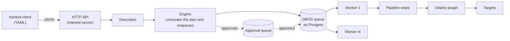

# Manent — The Deployment Engine

**Define once. Deploy reliably. Resume anywhere.**

Manent is an open-source, deploy-as-code engine for orchestrating reliable application releases across heterogeneous environments.

Describe a deployment in YAML, submit it through a CLI or API, and let Manent coordinate the execution through durable workflows.

> The name **manent** comes from the Latin *manere*, "to remain, to stand firm": it expresses the immutability of the artifact, which stays exactly as it was tested, validated and put into service.

## Why Manent?

- **Durable execution:** every step is a durable [DBOS](https://github.com/dbos-inc/dbos-transact-golang) workflow step, saved in Postgres (or SQLite) before the next one starts. If a worker crashes, the deploy resumes from the last completed step instead of starting over, and an `id` makes resubmissions idempotent.
- **Controlled rollouts:** release in waves (canary, then one region or availability zone at a time) or shift traffic by percentage to a new version running side by side. Health gates on Prometheus, Datadog, CloudWatch and others, plus approvals between waves, decide whether to continue, stop or roll back automatically.
- **Built-in governance:** promotion paths, approvals (also from Slack), change tickets in ServiceNow or Jira, freeze windows and policies in YAML or Rego. Role-based access per application and environment applies the same way to CLI, API, web UI and CI, and every change or denied request is written to a hash-chained audit log.
- **Secrets and configuration:** descriptors carry only references (`vault:…`, `file:…`, `env:…`), resolved by the worker at the moment of use and never stored in history or logs. Targets and parameters of each environment come from Consul, Git or files, and the environment's configuration always wins over the descriptor.
- **Extensible targets:** built-in plugins for VMs over SSH, containers, Kubernetes and Helm, AWS ECS and Lambda, Cloud Run, Azure, JBoss/WildFly, IIS and Windows services. Your own plugins run as separate processes over gRPC, with the same rollback and dry-run contract.
- **Automation-friendly:** the `manent` CLI, a REST API with an OpenAPI spec, a GitHub Action, a GitLab CI template and a Terraform provider. Each one submits the same descriptor and reports the outcome back to the pipeline.

Manent focuses on the deployment process itself: coordinating execution, preserving state, enforcing release policies and making outcomes observable.

Explore the documentation: https://manent-deployer.github.io/manent/

## How it works



1. The API authenticates the request, applies permissions and validates the descriptor.
2. The **engine** computes the plan, checks policies and governance rules, and enqueues the deploy, or an approval workflow that enqueues it once approved.
3. A **worker** picks it up, reads the environment configuration and runs the steps in order, saving each result before the next one.
4. The `deploy` step hands the release to a **plugin**. If a step fails and the policy allows it, the worker rolls back the steps already started.

More in the [architecture](https://manent-deployer.github.io/manent/concetti/architettura/) page.

## Screenshots

The same server also serves a [web interface](#web-interface) for following deploys, approving them and seeing what runs where. These screenshots come from a demo environment with five applications, three environments and four weeks of history.

| | |
|---|---|
| <br/>**Deployments**: every deploy, promotion and rollback, with state, requester and duration. | <br/>**Wave rollout**: approval and canary, then one availability zone at a time across two regions. |
| <br/>**Automatic rollback**: a failed health check in eu-central-1 rolls every wave back. | <br/>**Inventory**: the release running in each application and environment, with promote and roll back. |
| <br/>**Activity**: running, waiting, queued and scheduled deploys and the workers running them. | <br/>**Metrics**: DORA metrics computed from the deployment history. |

The full documentation is at [manent-deployer.github.io/manent](https://manent-deployer.github.io/manent/); its sources are in [`docs/`](docs) (`make docs` builds the site locally).

## Quick start

```sh
make build
bin/manent-server -c configs/manent.yml validate -f examples/descriptor.yml   # shows the plan
bin/manent-server -c configs/manent.yml serve                                 # API on :8080 + worker
bin/manent deploy -f examples/descriptor.yml     # in another terminal
```

manent has two binaries:

- **`manent`**, the client for developers and CI: it reads YAML descriptors and talks only to the API (`--server`, `MANENT_SERVER` or `~/.config/manent/client.yml`; default `http://127.0.0.1:8080`; token in `MANENT_TOKEN` or in a file). It contains neither the engine, the plugins nor the database drivers, so the server's permissions and audit always apply.
- **`manent-server`**: `serve` (API and worker), `api`, `worker`, the platform operations `admin` and `audit verify`, and `validate` of a configuration locally.

Deploys are run by a **worker** (`serve` or `worker`).
By default DBOS uses SQLite (`sqlite:manent.db`); in production set `DBOS_SYSTEM_DATABASE_URL=postgres://...`.

## Horizontal scaling

Several instances share the same Postgres and take deploys from the same queue:

```sh
manent-server api              # N API instances behind a load balancer
manent-server worker           # M workers, each with a different executor_id
```

- `dbos.executor_id` (default: hostname) must be **unique and stable**: a restarted worker resumes its interrupted deploys with its own ID, from the step where they stopped. On Kubernetes use a StatefulSet.
- `dbos.environment_concurrency` (default 1) prevents concurrent deploys of the same application/environment across all workers. `concurrency` limits deploys per worker, `global_concurrency` the total.
- The `workdir` stays local: if a deploy resumes on a worker that does not have the artifact, it is downloaded again and its sha256 is verified.

## Wave rollouts

With targets in several regions and AZs, the environment configuration can define a `rollout` strategy: targets carry the `region` and `az` labels, waves select them (`select: "region=eu-1, canary!=true"`) and split them into passes by AZ or region, with `maxUnavailable` within the pass, an observation time (`bake`) and a health gate (HTTP probes, Prometheus queries, Alertmanager alerts) between one stage and the next. A failed pass stops the rollout; `onFailure` decides whether to roll back the stage (`rollback-wave`) or everything (`rollback-all`). `approvalsBetween` pauses for approval, and freezes with `regions` block only those regions. With `dbos.region_routing` each pass runs as a child workflow on the workers of its region (`dbos.region`). `manent status` shows stages, passes and gates; the inventory reports environments out of alignment (`drift`). Details in [Wave rollouts](https://manent-deployer.github.io/manent/guida/ondate/).

## Load balancers and traffic

- **Draining:** with `traffic.pool` in the environment configuration (`haproxy` with the Data Plane API, `aws-elb` with target groups or Auto Scaling group standby, `f5` BIG-IP, `nginx-plus`, open source `nginx` over SSH, `iis-arr` and `nlb` for IIS ARR and Windows NLB, `health-flag` for any load balancer) each batch of a wave rollout leaves the load balancer before the deploy and comes back only when healthy. A capacity check (`min_healthy`) postpones draining if the pool would fall below the minimum; waits are durable. Details in [Load balancer draining](https://manent-deployer.github.io/manent/guida/svuotamento/).
- **Percentage canary and blue/green:** with `rollout.strategy: traffic` the new version goes next to the stable one, without traffic, and the steps (`steps: [1, 5, 25, 50, 100]`, `[100]` for blue/green) shift traffic with bake, comparative gates (`compare: stable`, `{track}`), approvals and a check for weights changed by others. Going back is a weight change. Routers: Gateway API or Istio in the `kubernetes` plugin (slots `-a`/`-b`, Helm charts too), weighted `lambda` aliases, `cloudrun` and `containerapps` revisions, `appservice` slots with `rampUpRules` and swap, external plugins; for in-place targets an environment router (`aws-alb`) with targets labelled by slot. For in-place targets HAProxy, F5 and NGINX Plus also act as routers through server weights. With `rollout.waves` the rollout proceeds one cluster or region at a time; with `replicas: proportional` the candidate grows with its share. ECS services with a native strategy (blue/green, linear, canary) use it in delegated mode. Details in [Percentage rollouts](https://manent-deployer.github.io/manent/guida/traffico/).

## Operations

- **Lost workers:** every worker registers with a heartbeat (`manent-server admin executors`). The pending deploys of a worker that does not come back are resumed on another worker with `manent-server admin recover --executor <id>`, or automatically with `recovery.auto_recover_after`. Claiming and restarting the node exclude each other, so no deploy is resumed twice.
- **Upgrades:** on shutdown the worker stops taking deploys and waits for the running ones (`dbos.drain_timeout`). `app.version` is the workflow version, not the binary's; after an incompatible change the remaining workflows are migrated with `manent-server admin recover --from-version <v>`.
- **Retention:** `retention.max_age` deletes the finished history while keeping the last `keep_releases` releases of each environment (`manent-server admin prune`).
- **Observability:** Prometheus metrics on `/metrics` (worker: `observability.listen`), `/healthz` and `/readyz` probes, OpenTelemetry tracing from the API to the steps, the log of every deploy (`manent logs -f <id>`), the timeline (`manent steps <id>`) and DORA metrics (`manent dora`).
- **Packaging:** `Dockerfile` (distroless, non-root), Helm chart in `deploy/helm/manent` (workers in a StatefulSet), systemd units in `deploy/systemd`, releases with GoReleaser (checksums signed with cosign, SBOM), CI in `.github/workflows`, [CHANGELOG](CHANGELOG.md).
- **Tests:** `make test-postgres` (the same tests on Postgres), `make test-e2e` (real SSH in Docker), `make test-load` (load and chaos).

Details in [installation](https://manent-deployer.github.io/manent/operazioni/installazione/), [recovery and retention](https://manent-deployer.github.io/manent/operazioni/affidabilita/), [upgrades](https://manent-deployer.github.io/manent/operazioni/aggiornamenti/) and [observability](https://manent-deployer.github.io/manent/operazioni/osservabilita/).

## API

| Method | Path | Description |
|---|---|---|
| `POST` | `/api/v1/deployments` | enqueues a deploy (body: JSON descriptor) and answers `202` with the `id`; with `schedule.cron` it answers `201`; with `?dry_run=true` it enqueues a dry-run |
| `GET` | `/api/v1/deployments?schedule=&application=&environment=&state=&limit=` | lists the most recent deploys, with filters |
| `POST` | `/api/v1/deployments/plan` | returns the steps that would run |
| `GET` | `/api/v1/deployments/{id}` | state and result of the deploy |
| `GET` | `/api/v1/deployments/{id}/steps` · `/logs?offset=` | step timeline and deploy log |
| `POST` | `/api/v1/deployments/{id}/cancel` | cancels a waiting or running deploy |
| `POST` | `/api/v1/deployments/{id}/approve` · `/reject` | approves or rejects a deploy awaiting approval |
| `POST` | `/api/v1/promotions` | promotes an artifact from one environment to another |
| `POST` | `/api/v1/rollbacks` | goes back to a previous version |
| `GET` | `/api/v1/inventory` | live releases by application and environment |
| `GET` | `/api/v1/freezes` | active and future freeze windows |
| `GET` | `/api/v1/metrics/dora?application=&environment=&since=` | DORA metrics |
| `GET` | `/api/v1/schedules` · `/api/v1/schedules/{name}` | recurring schedules |
| `POST` | `/api/v1/schedules/{name}/pause` · `/resume` | pauses or resumes a schedule |
| `DELETE` | `/api/v1/schedules/{name}` | deletes a schedule |
| `GET` | `/healthz` · `/readyz` · `/metrics` | probes and Prometheus metrics, without authentication |

With `auth.mode: enabled` the `/api/v1` routes require `Authorization: Bearer <token>` (OIDC or static token): `401` without a valid token, `403` if the permissions do not allow the action.

The full API contract is [`api/openapi.yaml`](api/openapi.yaml).

## Security

The default configuration is meant for development: at startup `serve` and `worker` report every setting not fit for production. The full checklist is in [Security](https://manent-deployer.github.io/manent/operazioni/sicurezza/).

**Authentication** (`auth`):

- **users:** JWTs from an OIDC identity provider (Keycloak, Entra ID, Okta), verified with issuer, audience and JWKS keys;
- **CI pipelines:** static tokens, of which the configuration holds only the sha256, with an optional expiry; in `auth.tokens_file` they are added and revoked without a restart;
- **CLI:** the `manent` client uses a token like any API call; only `manent-server admin`, reserved to platform operators, works on the database and records the operating system user in the audit log (`cli:<user>`).

**Permissions** (`rbac`). Roles are assigned to users or groups per application and environment, with `*` patterns:

- built-in roles: `viewer`, `tester` (+ dry-run), `approver` (+ approvals), `deployer` (+ deploy, cancel and manual rollback), `operator` (+ schedules), `admin` (freeze overrides too);
- they apply to API and CLI alike, because the shared service enforces them;
- listings show only what can be read, up to the requested limit.

```yaml
auth:
  mode: enabled
  oidc: {issuer: https://sso.example.com/realms/corp, audience: manent}
  tokens: [{name: ci-pipeline, sha256: "<sha256 of the token>", groups: [ci]}]
rbac:
  bindings:
    - {groups: [team-a], role: deployer, applications: ["team-a-*"], environments: [dev, test]}
    - {groups: [release-managers], role: operator, applications: ["*"], environments: [prod]}
```

**Audit.** The following are recorded:

- requests, promotions, manual rollbacks, cancellations and schedule operations;
- approvals, rejections and freeze overrides, with the comment;
- denied access;
- the final outcome of every deploy and every approval.

Entries go to the log and to the SIEM and, with `audit.file`, to a JSON Lines file with a hash chain (HMAC with `hmac_key_ref`) and rotation (`max_size_mb`), verifiable with `manent-server audit verify`. Whoever requested the deploy is stored in the DBOS workflow and shows up in status, listings and callbacks (`requested_by`).

**Descriptor policy** (`descriptor_policy`). It limits what a descriptor can add to the environment configuration:

- parameters per plugin (for example never `post_command`);
- patterns of secret references (e.g. `vault:secret/data/{application}/*`);
- targets.

A violation is rejected at enqueueing (`422`) and, if it slips through (e.g. Consul unreachable at that moment), it fails the deploy in the `config` step, without retries.

**Secrets from Vault** (`secrets.vault`):

- references `vault:<path>#<field>`, KV v1 and v2;
- login with token, AppRole or Kubernetes.

**Artifact sources** (`artifacts`):

- credentials by URL prefix (basic, bearer, header, read from the secret provider) and dedicated CAs;
- with `allow_unlisted: false` only the listed sources, checked at enqueueing and at download.

## Scheduled deploys

Every deploy, scheduled ones included, goes through the DBOS `deployments` queue and respects its concurrency.

```yaml
# One deploy at a given time: it stays DELAYED until then, cancellable with `manent cancel <id>`
schedule:
  at: 2026-10-10T02:00:00+02:00
```

```yaml
# Recurring deploy: applying the descriptor again updates the schedule with the same name
schedule:
  cron: "0 2 * * *"        # 5 or 6 fields (with seconds), or @daily, @hourly, ...
  timezone: Europe/Rome
  name: myapp-nightly      # default: <application>-<environment>
```

Every recurring run gets the ID `<name>@<UTC time>`. To list them: `manent list --schedule myapp-nightly`. To manage schedules: `manent schedule list|show|pause|resume|delete`.

## Environment configuration (Consul)

Plugin, targets, plugin parameters and secret references of each environment can be managed in a configuration system instead of the descriptor. The descriptor then states only application, environment and artifact ([example](examples/descriptor-envconfig.yml)).

```yaml
# configs/manent.yml
envconfig:
  provider: consul                          # none | consul | git | file
  required: true
  consul:
    address: http://consul:8500             # default: CONSUL_HTTP_ADDR
    key: "manent/{application}/{artifact}/{environment}"
    # ACL token: CONSUL_HTTP_TOKEN or token_file
```

The value of the Consul key is YAML or JSON ([example](examples/envconfig/myapp/myapp/test.yml)):

```sh
consul kv put manent/myapp/myapp/test @examples/envconfig/myapp/myapp/test.yml
manent-server -c configs/manent.yml validate -f examples/descriptor-envconfig.yml   # shows the effective deploy
```

- **When it is read:** at the start of every deploy, so a scheduled deploy uses the configuration valid at run time. Once read it stays the same even if the deploy is resumed after a crash. The result reports the key and the `ModifyIndex` used.
- **What wins:** the environment configuration. The descriptor can add parameters and secrets that are not defined, but a conflicting value fails the deploy.
- **Secrets:** the configuration must hold only **references** to secrets (e.g. `env:DEPLOY_SSH_KEY`, `vault:secret/data/myapp/prod#ssh_key`), because it is stored in the deploy history.

## Dry-run

A dry-run runs the pipeline on a worker, like a real deploy, but without changing the environments:

```sh
manent deploy -f examples/descriptor.yml --dry-run
curl -X POST 'localhost:8080/api/v1/deployments?dry_run=true' -d @examples/descriptor.json
```

Alternatively, use `dryRun: true` in the descriptor. Unlike `validate`, which computes the plan locally, a dry-run reads the environment configuration, checks the secrets, downloads the artifact and runs QA. Then it asks the plugin to check the targets:

- in a dry-run a step runs only if it implements `pipeline.DryRunner`, otherwise it is skipped and reported as `"dry_run": "skipped"`. `secrets`, `artifacts` and `qa` run normally, `post-test` and `activation` are skipped;
- the `deploy` step selects and validates the plugin as in a real deploy, then calls `DryRun` if the plugin implements `plugin.DryRunner`. Otherwise it stops at validation (`"dry_run": "validated"`);
- `remote-copy` connects to every target and checks that `dest_dir` is writable (or can be created) and that `sha256sum` is available. It copies nothing and does not run `post_command`;
- with an `id` in the descriptor, the dry-run workflow uses the ID `<id>.dry-run`, so the real deploy with the same `id` can still run;
- the dry-run uses the same queue as deploys and therefore respects `environment_concurrency`. It is not allowed together with `schedule`.

## Callbacks

The descriptor can name up to 5 endpoints that receive, as a JSON `POST`, the outcome of the intermediate steps and the final one:

```yaml
secrets:
  - name: callback-key
    ref: env:MANENT_CALLBACK_KEY
callbacks:
  - url: https://ci.example.com/hooks/manent
    events: [step, deployment]      # optional, default: all
    auth:
      type: hmac                    # bearer | basic (+ username) | header (+ header) | hmac
      secret: callback-key          # name of a secret in secrets, never the value
```

Events, in order:

- `deployment` with state `started`;
- `step` for `config` and for every step of the plan, with state `succeeded`, `failed` or, in a dry-run, `skipped`. The event carries the step's `output` or `error`;
- `step` for the rollback checkpoints and compensations (`checkpoint:deploy`, `rollback:deploy`, ...), if enabled;
- the final `deployment` with state `succeeded` or `failed`, sent after cleanup. If a rollback ran, the `rollback` field reports its outcome (`completed`, `skipped`, `failed`).

```json
{"id": "myapp-1.2.3-test:4", "event": "step", "sequence": 4, "deployment_id": "myapp-1.2.3-test",
 "application": "myapp", "environment": "test", "step": "artifacts", "status": "succeeded",
 "output": {"sha256": "...", "size": "1024", "local_path": "..."}, "timestamp": "2026-10-09T10:00:00Z"}
```

Behaviour:

- **delivery:** every send is a DBOS step, retried up to `callbacks.max_retries`. An undelivered callback is logged but never fails the deploy. After a recovery an event can arrive twice: the receiver deduplicates it on `id` (also in the `X-Manent-Delivery` header);
- **response:** only `2xx` codes count as delivered. Redirects are not followed;
- **`hmac` signature:** the request carries `X-Manent-Timestamp` and `X-Manent-Signature: sha256=<hex>`, the HMAC-SHA256 of `<timestamp>.<body>` computed with the secret;
- **URL limits:** by default only `https` URLs are allowed, with `callbacks.allow_http` and `callbacks.allowed_hosts` in the configuration. URLs outside the policy are rejected at enqueueing (`422`);
- **cancelled deploys:** no final event is sent for a deploy cancelled with `cancel`.

## Rollback

If a deploy fails after changing the targets, manent can bring the environment back to the release that was live before the deploy, in the same DBOS workflow.

**Policy.** The configuration states for which artifact types rollback is possible. Unlisted types do not allow it, and database migrations are excluded by default:

```yaml
# configs/manent.yml
rollback:
  locator: plugin                 # how to find the release to go back to
  artifact_types:
    application:
      allowed: true
      enabled: true               # default for deploys of the type
      on: [deploy, post-test, activation]   # steps whose failure starts the rollback
    migration:
      allowed: false
```

Descriptor and environment configuration can enable it, disable it or narrow `on` within `allowed`, with the usual merge rules: the environment is authoritative, so production can enforce it. A rollback that is not allowed is rejected at enqueueing (`422`) and by `validate`.

```yaml
rollback:
  enabled: true
  on: [deploy, post-test]
```

**How it works:**

1. **Decision.** The policy is applied in the `config` step, after the merge with the environment configuration, and stays recorded with the deploy.
2. **Checkpoint.** Before `deploy`, the `checkpoint:deploy` step checks that the plugin supports rollback and asks the **locator** for the live release. Being a separate DBOS step, the deploy's retries do not repeat it.
3. **Compensation.** If a step listed in `on` fails, the worker runs `rollback:<step>` for the steps already started that can undo themselves (`deploy`, `activation`), in reverse order, the failed one included.
4. **Outcome.** The deploy stays `ERROR` and the error ends with `rollback completed`, `rollback: no release to restore` (first deploy) or `rollback failed: ...`. A failed compensation stops the rollback and is logged at `ERROR`, to the SIEM too.

**Locator.** The locator finds the previous release (`plugin.ReleaseLocator`):

- `plugin` (default) reads it from the targets through `plugin.ReleaseInspector`;
- other strategies, for example a company system that records live releases, are added in `app.NewLocators`.

**Plugin.** The plugin implements `plugin.Rollbacker`. `remote-copy` supports it with `layout: releases`:

- every version goes to `<dest_dir>/releases/<version>`, with the `current` symlink on the active release and an atomic swap of the link;
- the rollback points `current` back to the previous release and runs `rollback_command` (default `post_command`);
- `keep_releases` (default 5) limits the releases kept;
- `prepare_command` runs before the switch.

**Other cases.**

- **Dry-run:** runs the checkpoints but never the compensations.
- **Cancelled deploy:** a deploy cancelled with `cancel` is not compensated.
- **Manual rollback:** `manent rollback -a <app> -e <environment> [--to <version>]` releases a previous version again (see [Governance](#release-governance)).

Details in the [documentation](https://manent-deployer.github.io/manent/guida/rollback/).

## Release governance

```yaml
# configs/manent.yml
governance:
  rules:                                  # the first matching rule applies
    - name: production
      applications: ["*"]
      environments: [prod]
      requires: [preprod]                 # same artifact already released to preprod
      approvals: {required: 1, timeout: 72h}
  freezes:
    - {name: weekend, applications: ["*"], environments: [prod], cron: "0 18 * * FRI", duration: 62h, timezone: Europe/Rome}
```

```sh
manent inventory -e prod                                     # live releases, with sha256 and requester
manent promote -a myapp --from preprod --to prod             # same artifact, targets of the destination environment
manent approve <id> -m "CHG-1234"                            # approver role; the requester cannot approve their own deploy
manent rollback -a myapp -e prod [--to 1.3.2]                # back to a previous version (not for migrations)
manent freezes -e prod                                       # active and future freeze windows
```

- **Inventory:** rebuilt from the history of successful deploys; it reports later failed deploys.
- **Promotion:** with `requires`, a deploy of an artifact never released to the listed environments is rejected (`422`). `promote` reuses the source descriptor and pins its `sha256`, but not its targets.
- **Approvals:** the deploy stays `AWAITING_APPROVAL` on a separate queue that does not occupy the workers, and starts with the same ID after the approvals. It can be rejected, expire or be cancelled.
- **Freezes:** block deploys at enqueueing, at start on the worker and before every rollout stage; `freezeOverride: "<reason>"` in the descriptor overrides them, with the `deployment.freeze-override` permission, except for `hard` windows. `manent freeze add --name incident -e prod --for 4h` creates an emergency freeze at runtime, without restarts.
- **Dry-runs:** not subject to the rules.

Details in the [documentation](https://manent-deployer.github.io/manent/guida/governance/).

### Tenants

A tenant is an internal team that owns applications: the registry (`tenants.yml`) lists for every tenant its applications with their tags, members and administrators (implicit roles), deploy queue and restrictions on secrets, artifact sources and callbacks. The identity of a release is tenant/application/artifact/environment: two teams can have an application with the same name, and those that no tenant lists belong to the `untenanted` tenant. IDs, dependencies and releases do not cross tenants.

```sh
manent deploy -f deploy.yml --tenant retail                         # only if several tenants have the application
manent tenants list [--selector division=commerce]
manent inventory --selector "criticality=high"                     # tags of the applications and of the tenant (tenant.<tag>)
manent freeze add --name incident -a 'payments/*' -e prod --for 2h
```

Application patterns are qualified (`shop` only untenanted, `payments/*`, `*/*`); rules, freezes, Rego policies and RBAC bindings also accept the `tenants` (owner) and `selector` (applications) selectors. Details in [Tenants](https://manent-deployer.github.io/manent/guida/tenant/).

### Policies in Rego

With `governance.engine: opa` rules are written in Rego and evaluated by OPA embedded in the process. Revisions change at runtime: they are uploaded as drafts, tested, measured on real deploys and approved by another person. Without revisions, the default policy applies the rules of `manent.yml`.

```sh
manent policy push -d policies/ -m "DBA approval for migrations"   # compiled and tested by the server
manent policy impact 13 --since 30d                                # decisions of real deploys recomputed
manent policy approve 13                                           # by an identity other than the author
manent-server policy test -d policies/                             # locally, without a server
```

The policy returns denials and obligations (`requires`, `approvals` with the `approvers`, `change`, freeze exemptions); manent enforces them. Decisions are recorded in DBOS steps with the revision, so a recovery never re-evaluates. Possible sources are manent's store, a directory, a signed OPA bundle or Consul. Details in [Policies in Rego](https://manent-deployer.github.io/manent/guida/policy/).

## Chat and change management

```yaml
integrations:
  public_url: https://manent.example.com
  slack: {bot_token_ref: "vault:…#bot_token", signing_secret_ref: "vault:…#signing_secret", identities: {U024BE7LH: {subject: "oidc:alice"}}}
  notifications:
    - {name: prod, applications: ["*"], environments: [prod], slack: {channel: C0123456789}}
    - {name: cab, applications: ["*"], environments: ["prod*"], events: [approval], teams: {webhook_ref: "vault:…#teams"}}
  change:
    provider: servicenow                  # or jira
    servicenow: {url: https://acme.service-now.com, username: manent, password_ref: "vault:…#password"}
governance:
  rules:
    - {name: production, applications: ["*"], environments: [prod], change: {approval: true}}
```

- **Notifications:** start and outcome of deploys, approval requests and outcomes, in Slack (bot with updated messages, or incoming webhook) and Teams (Adaptive Cards via Workflows). Destinations are chosen at enqueueing; every send is a DBOS step and never fails the deploy.
- **Approvals from Slack:** Approve and Reject buttons pointing to `/integrations/slack/interactions`, verified with Slack's signature; the decision counts as that of the manent identity linked to the user, with the same permissions and the ban on self-approval. In Teams, a link to the deploy in the web interface.
- **Change management:** with `change` in the governance rule, a ticket in ServiceNow or Jira for every deploy, opened at start and closed with the outcome; with `approval: true` the deploy also waits for the change approval in the ITSM.

Details in the [documentation](https://manent-deployer.github.io/manent/guida/integrazioni/).

## Pipeline

Steps and their order are defined in `configs/manent.yml` (`pipeline.steps`).
`mandatory` steps always run. `optional` ones have a default in the configuration that the descriptor can override:

```yaml
steps:
  qa: false
  post-test: true
```

### Custom steps

A step with `type` in `pipeline.steps` adds a phase without writing code: a command on the targets over SSH (`command`) or an HTTP request that waits for the outcome (`http`). Commands and URLs are written only in `manent.yml`; the environment configuration provides the parameters (`step_params`), declared with a pattern, and the descriptor can set only those allowed by `descriptor_policy.step_params`.

- Values substituted into placeholders are not trusted: they never become command options, they are encoded in URLs and they do not alter the JSON body.
- Secrets reach the target as files in a directory on tmpfs, removed at the end and at every new attempt; in the log they are replaced by `***`.
- The specification is recorded in the plan and signed (`pipeline.custom.spec_key_refs`); a faulty specification is blocked with `pipeline.custom.revoked_specs`, in already created schedules too; `manent-server admin specs` lists the waiting deploys and the schedules that contain it.
- Every run is recorded in the audit log; declared outputs stay in the deploy state and do not go to callbacks.

```yaml
- name: db-migrate
  mode: optional
  type: command
  ssh: {user: migrator, key_secret: ssh-migrate}
  params: {database: {pattern: "[a-z]+", required: true}}
  run:
    run_once: true
    command: ["/opt/tools/migrate", "up", "--to", "{{ .Version }}", "--db", "{{ .Params.database }}"]
```

See [Custom steps](https://manent-deployer.github.io/manent/guida/step-personalizzati/).

## Web interface

`manent-server` serves a web interface on `/`, at the same address as the API: deploys with live waves and logs, approvals, inventory with promotions and rollbacks (always after a dry-run), freezes, schedules and DORA metrics. It uses OIDC sign-in (Authorization Code + PKCE, `auth.oidc.ui`) and the same permissions as the API, is accessible (WCAG 2.1 AA, checked with axe) and available in English and Italian. The code is in `web/` (React, TypeScript, Vite), embedded in the binary by `internal/webui`; the API contract is `api/openapi.yaml`.

```sh
make web        # builds the UI (Node >= 20 or a node:22 container)
make web-dev    # development server on http://127.0.0.1:5173
```

## Available plugins

| Plugin | Artifact | Targets |
|---|---|---|
| `remote-copy` | file (`application`), copied over SSH/SFTP with the `releases` layout and the `current` symlink | servers and VMs |
| `container` | registry image (`oci://registry/repo:tag`), started by digest with Docker or Podman over SSH | servers and VMs |
| `kubernetes` | YAML/JSON manifests, `.tar.gz` archive or Helm chart (`helm package`, rendered with `helm template`), applied with server-side apply and waiting for the rollout | Kubernetes clusters |
| `ecs` | registry image: new task definition revision, service update and wait for the deployment | Amazon ECS services (Fargate or EC2), one region per target |
| `lambda` | ECR image or `.zip` package: code update, published version and alias moved | AWS Lambda functions, one region per target |
| `cloudrun` | registry image: new revision and traffic on the latest ready revision | Google Cloud Run services, one region per target |
| `jboss` | `war`/`ear` archive uploaded with the HTTP management API, one deployment per version with an atomic switch; boolean `suspend`, `reload` and `restart` | JBoss EAP and WildFly, standalone or domain |
| `appservice` | `.zip`/`.war`/`.jar`/`.ear` package via Kudu (OneDeploy) or registry image, into the staging slot and then swapped, or straight into production | Azure App Service web apps |
| `containerapps` | registry image: new revision with a suffix derived from the deploy, traffic on the latest healthy revision | Azure Container Apps apps |
| `windows` | `.zip` archive extracted into a directory per version or `.msi` package, over WinRM or OpenSSH, with PowerShell: IIS `physicalPath`, service `binPath`, scheduled task action, MSI installation | IIS, Windows services, scheduled tasks and MSI packages (Windows Server 2016+) |
| `terraform` (external, [manent-plugin-terraform](https://github.com/manent-deployer/manent-plugin-terraform)) | Terraform root module (`.tgz` with its lock file): `init`, `plan` and `apply` of that plan with OpenTofu, `max_destroy` guard, non-sensitive outputs exported to other deploys | one Terraform state per target, in a remote backend |
| `ansible` (external, [manent-plugin-ansible](https://github.com/manent-deployer/manent-plugin-ansible)) | Ansible project (`.tgz` with playbooks, roles and collections): `ansible-playbook` with an inventory built from the targets (one group per label), check mode as dry-run, `set_stats` data exported to other deploys, optional release marker on the targets | servers and VMs over SSH, from workers with Python on the plugin's own queue |

All of them support dry-run. All but `terraform` and `ansible` support reading the live release and automatic rollback: `terraform` and `ansible` roll back manually, releasing the previous version again (`ansible` reads the live release with `release_marker`). For images, the manifest digest becomes the artifact's sha256: promotions and rollbacks release exactly the verified image.

## Writing a deploy plugin

A plugin implements `plugin.Deployer` from the `github.com/manent-deployer/manent/pkg/plugin` package:

```go
type Deployer interface {
	Name() string
	Supports(artifactType string) bool
	Validate(req *plugin.Request) error
	Deploy(ctx context.Context, req *plugin.Request) (*plugin.Result, error)
}
```

For dry-runs the plugin can also implement `plugin.DryRunner` (`DryRun(ctx, req) (*plugin.Result, error)`): it must only check the targets, without changing them, and report `plugin.StatusReady` for those that are ready.

For rollback it implements `plugin.Rollbacker` (`Rollback(ctx, req, previous plugin.Release)`, idempotent and applied to all targets) and, for the `plugin` locator, `plugin.ReleaseInspector` (`CurrentRelease(ctx, req)`, without changing the targets).

It is then registered with a `plugin.Factory` in `internal/app` (`NewPlugins`) and enabled in the `plugins:` section of the configuration.
`Deploy` must be idempotent: DBOS can run it again on a retry or a recovery.
Secrets are read with `req.Secrets.Secret(ctx, name)` only when needed and must never be put in the `Result`.

The reference plugin is [`plugins/remotecopy`](plugins/remotecopy): it copies the artifact over SSH/SFTP, verifies the remote sha256 and runs an optional `post_command`; with `layout: releases` it supports rollback.

### External plugins

A plugin can also be shipped as a separate binary, without recompiling manent. It uses the same `plugin.Factory`:

```go
func main() { external.Serve(myplugin.Factory) }   // github.com/manent-deployer/manent/pkg/plugin/external
```

```yaml
plugins:
  my-plugin:
    external:
      command: /opt/manent/plugins/my-plugin
      sha256: "<sha256 of the binary>"
    artifact_types: [application]
```

manent starts the process at the first deploy and talks to it over gRPC ([hashicorp/go-plugin](https://github.com/hashicorp/go-plugin)). The plugin does not inherit the worker's environment variables and receives secrets only through `req.Secrets`. Details in the [documentation](https://manent-deployer.github.io/manent/plugins/esterni/).

## License

Apache-2.0, see [LICENSE](LICENSE).
