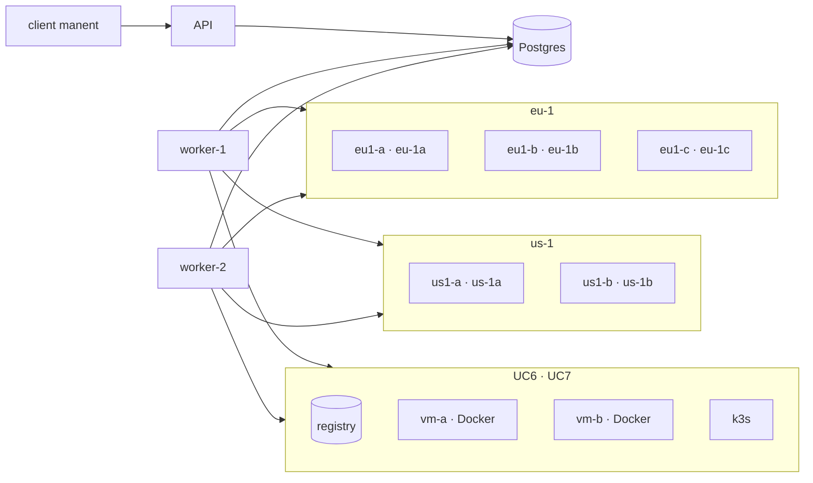

# Casi d'uso

I casi d'uso provano manent da capo a fondo, come gira in esercizio: server API, worker, client e target SSH in container separati, su Postgres. Si parte da un singolo deploy pianificato e si arriva ai rilasci a ondate su più region, poi ai container su VM e a Kubernetes, ai load balancer, ai rilasci per percentuale, agli step personalizzati, alle integrazioni e agli application server; per ogni caso si verificano anche fallimenti e rollback.

```sh
make test-usecases                    # tutti i casi (circa 30 minuti)
make test-usecases CASES="uc1 uc4"    # solo alcuni
make test-usecases KEEP=1             # lascia il laboratorio attivo alla fine
```

Servono Docker con Compose v2, Go, `jq` e `ssh-keygen`. Lo script compila i binari linux sull'host, quindi non serve l'immagine `golang`. UC6 e UC7 usano container privilegiati (Docker in Docker e k3s) e circa 2 GB di memoria in più per Docker. UC8 usa l'immagine di Playwright (circa 2 GB su disco), UC10 HAProxy (circa 200 MB), UC14 WildFly (circa 800 MB) e UC15 Prometheus (circa 270 MB). UC11 scarica le CRD della Gateway API da GitHub.

## Il laboratorio



- **Target:** container Debian con SSH (per il plugin `remote-copy`, layout `releases`) e un server HTTP che espone la release attiva: `http://<target>:8080/<app>/current/healthz`. Una release senza `healthz` simula una versione difettosa.
- **Configurazione di ambiente:** target, parametri e segreti arrivano dal provider `file` (`test/usecases/config/envconfig`); i descrittori contengono solo l'artefatto.
- **Accesso:** token statici con ruoli diversi (`ci` rilascia, `cab` approva, `admin` può derogare ai freeze, `viewer` legge soltanto), e un identity provider OIDC di prova (`test/usecases/oidc`) con gli stessi utenti per l'interfaccia web.
- **Guasti simulati:** il `post_command` fallisce o attende se il caso crea un file sul target. Worker e target vengono fermati o terminati con `docker compose`.
- **Profilo region:** per UC5 i worker generici sono sostituiti da un worker per region (`dbos.region`, `region_routing`), ciascuno solo sulla rete della sua region. L'orchestratore non raggiunge nessun target.
- **Container e Kubernetes:** per UC6 e UC7 il laboratorio avvia un registry delle immagini, due VM con Docker (`vm-a`, `vm-b`) e un cluster k3s a un nodo. L'applicazione di prova è una piccola immagine con `/healthz`; la versione difettosa non ce l'ha, quindi `HEALTHCHECK` e `readinessProbe` restano rossi. Questi servizi partono solo per il loro caso e vengono rimossi alla fine.
- **Load balancer:** per UC10 un HAProxy vero con la Data Plane API v3 (`test/usecases/haproxy`) davanti ai target di `eu-1`: il backend `uc10-shop` con gli health check HTTP viene svuotato a lotti, il backend `uc10-blue` contiene i due slot del rilascio per percentuale. Per UC15 e UC16 i backend `uc15-web` e `uc16-web` hanno i server chiamati come gli slot, e HAProxy esporta le sue metriche per server a un Prometheus vero (profilo `metrics`, lettura ogni secondo). UC11 usa lo stesso cluster k3s con le CRD della Gateway API e una `HTTPRoute` creata in anticipo, come farebbe l'infrastruttura.
- **Servizi esterni:** Slack, Teams, ServiceNow, Datadog, New Relic, Elastic e CloudWatch non hanno una versione locale (o non abbastanza leggera), quindi `test/usecases/fakes` ne emula le API (più un endpoint HTTP per gli step personalizzati; per i sistemi di metriche le serie da restituire si impostano con `POST /control/metrics`, e CloudWatch parla il protocollo CBOR dell'SDK AWS con firma SigV4) e registra ogni richiesta, che i casi rileggono. UC14 usa un WildFly vero con l'API HTTP di management.

## I casi

| Caso | Scenario | Cosa verifica |
|---|---|---|
| **UC1** | Deploy pianificato (`schedule.at`) su un target in una AZ, poi su tre AZ di una region | Attesa fino all'orario, annullamento, idempotenza, release difettosa con rollback automatico, fallimento senza rollback e ripristino, rollback manuale, checksum errato, dry-run, target spento |
| **UC2** | Configurazione di ambiente e promozione | Autenticazione e permessi, conflitti con la configurazione di ambiente, promozione `test → prod` con approvazione, divieto di auto-approvazione, rifiuto, freeze e deroga |
| **UC3** | Più worker sullo stesso database | Un deploy alla volta per ambiente e ambienti in parallelo, worker terminato durante un deploy (recovery automatica dall'altro), arresto ordinato che attende il deploy in corso |
| **UC4** | Rollout a ondate in una region | Canary e approvazione, un'AZ alla volta con bake e health gate, gate rosso sul canary, guasto nell'ultima AZ con `rollback-all`, rifiuto, `onFailure: stop` con drift nell'inventario |
| **UC5** | Rollout a ondate multi-region | Passi e sonde dell'health gate eseguiti dai worker di region, region in parallelo, `rollback-wave`, worker di region spento (il passo lo attende), freeze di una sola region |
| **UC6** | Container su VM con Docker (plugin [container](plugins/container.md)) | Immagine fissata al digest, promozione `test → prod` a ondate, dry-run, immagine unhealthy con `rollback-all`, rollback manuale, VM spenta, tag spostato nel registry (la promozione rifiuta l'immagine diversa) |
| **UC7** | Manifest su Kubernetes (plugin [kubernetes](plugins/kubernetes.md)) | Dry-run lato server, stessi manifest in `test` e `prod` con configurazione di ambiente diversa, rollout bloccato e rollback, prune degli oggetti rimossi, storico delle release, immagine non fissata al digest, rollback manuale |
| **UC8** | [Interfaccia web](guida/interfaccia-web.md) | Intestazioni e configurazione, `whoami`, approvazioni, cursore e stream SSE dell'API; con Playwright: login OIDC, ogni vista verificata con axe in entrambi i temi, dettaglio con log in tempo reale, promozione dopo un dry-run, divieto di auto-approvazione, approvazione da un altro utente seguita in tempo reale, tastiera e italiano |
| **UC9** | [Catene di deploy](guida/catene.md) | Deploy che attende un altro (`after`) senza toccare il proprio target, avvio dopo la fine della dipendenza, dipendenza fallita (`DEPENDENCY_FAILED`) e rifiuto all'invio, release composta in ordine topologico con reinvio idempotente, release fallita con `onFailure: rollback` (deploy riusciti riportati alla versione precedente) |
| **UC10** | [Load balancer e router](guida/svuotamento.md) su HAProxy | Ogni lotto svuotato dal backend durante il suo deploy e rientrato solo una volta sano, attese durevoli, controllo di capacità (`min_healthy`) che rimanda lo svuotamento mentre un altro server è guasto, nessuna richiesta fallita attraverso HAProxy durante il rilascio; router con due slot di target: primo rilascio con l'approvazione della governance spostata nel rollout (`approvals.when: rollout`), gradino del 50% con pesi uguali ed entrambe le versioni servite, release difettosa con i pesi tornati allo slot stabile |
| **UC11** | [Rilascio per percentuale](guida/traffico.md) su Kubernetes con un chart Helm | Candidata nello slot libero (`uc11-web-a`/`-b`) con l'etichetta dello slot, approvazione dopo i test a peso 0, regola dei tester dell'`HTTPRoute`, gradini sui pesi della regola principale, storico che indica lo slot, slot sostituito a zero repliche dopo `scaleDownDelay`, release difettosa che non diventa mai pronta con il traffico rimasto sullo slot stabile |
| **UC12** | [Step personalizzati](guida/step-personalizzati.md) | Piano con tipo e `spec_hash` ma senza comando né URL, dry-run con il solo comando e i soli segreti di `dry_run`, comando via SSH su un target con parametro, file del segreto e output dichiarato, segreto redatto nel log del deploy, richiesta HTTP con bearer, `Idempotency-Key` e corpo JSON costruito da manent, polling del job, exit 75 ritentato, errore permanente senza tentativi e target non toccati |
| **UC13** | [Chat e change management](guida/integrazioni.md) | Messaggio Slack all'avvio aggiornato con l'esito, richiesta di approvazione con i pulsanti su Slack, change aperto in ServiceNow con il deploy come `correlation_id`, clic di chi ha chiesto il deploy rifiutato (auto-approvazione), clic del CAB accettato (richiesta firmata come Slack), firma non valida rifiutata, deploy avviato solo dopo l'approvazione del change e change chiuso con l'esito, change respinto in ServiceNow, webhook di Teams rifiutato perché non https |
| **UC14** | WildFly (plugin [jboss](plugins/jboss.md)) | Dry-run, un deployment per versione con lo stesso runtime-name, cambio con il server sospeso, war rifiutato da WildFly con la versione in esercizio intatta, post-test rosso con rollback automatico, rollback manuale senza ricaricare, parametro in conflitto con la configurazione di ambiente rifiutato, restart della JVM, `keep_releases` |
| **UC15** | [Analisi canary](guida/traffico.md#analisi-canary) su Prometheus | Carico dall'host attraverso HAProxy, metriche di HAProxy per server (= slot) in un Prometheus vero, confronto di Mann-Whitney tra le serie di candidata e stabile a ogni lettura del gradino del 50%, primo rilascio senza confronti, release sana promossa con punteggio 100, release difettosa (una pagina mancante) respinta dalla metrica critica sulla quota di 4xx con il p-value nel gate e il traffico tornato allo slot stabile |
| **UC16** | [Analisi canary](guida/traffico.md#analisi-canary) su Datadog, New Relic, Elastic e CloudWatch | Una metrica per sistema, ciascuna letta con la sua API e le sue credenziali (chiavi Datadog, chiave NerdGraph e NRQL `TIMESERIES`, ES\|QL con API key, `GetMetricData` firmata con SigV4), serie equivalenti promosse con punteggio 100, due metriche non critiche peggiori: punteggio 50, sufficiente durante il bake (marginale) ma rosso alla fine, metrica critica di CloudWatch peggiore: rollout fermato prima della fine del bake, traffico tornato allo slot stabile |

Ogni verifica stampa ✔ o ✘. Alla fine lo script riassume i fallimenti e salva i log dei container in `test/usecases/.work/compose.log`.

## Aggiungere un caso

Un caso è uno script in `test/usecases/cases/` (`ucN.sh`), eseguito in ordine numerico sullo stesso laboratorio. Le funzioni di `lib.sh` creano artefatti e descrittori, eseguono il client con un ruolo (`as cab manent approve <id>`), attendono gli stati (`wait_state`, `wait_rollout`), leggono i target (`current`, `healthy`) e iniettano guasti (`fault`). Ogni caso usa una propria applicazione, così non dipende dagli altri.
