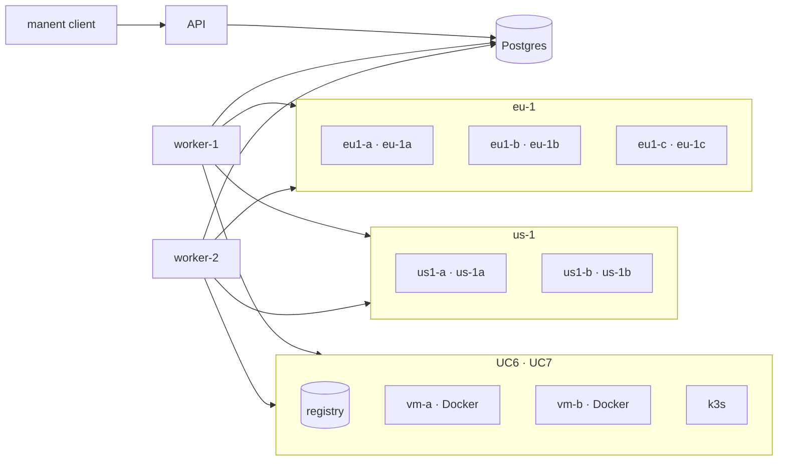

# Use cases

The use cases test manent end to end, as it runs in production: API server, workers, client and SSH targets in separate containers, on Postgres. They go from a single scheduled deploy to multi-region wave rollouts, then containers on VMs and Kubernetes, load balancers, percentage rollouts, custom steps, integrations and application servers, and for each one they also check failures and rollbacks.

```sh
make test-usecases                    # all cases (about 30 minutes)
make test-usecases CASES="uc1 uc4"    # a subset
make test-usecases KEEP=1             # leaves the lab running at the end
```

They require Docker with Compose v2, Go, `jq` and `ssh-keygen`. The script compiles the Linux binaries on the host, so the `golang` image is not needed. UC6 and UC7 use privileged containers (Docker in Docker and k3s) and about 2 GB of extra memory for Docker. UC8 uses the Playwright image (about 2 GB on disk), UC10 HAProxy (about 200 MB), UC14 WildFly (about 800 MB) and UC15 Prometheus (about 270 MB). UC11 downloads the Gateway API CRDs from GitHub.

## The lab



- **Targets:** Debian containers with SSH (for the `remote-copy` plugin, `releases` layout) and an HTTP server that exposes the live release: `http://<target>:8080/<app>/current/healthz`. A release without `healthz` simulates a faulty version.
- **Environment configuration:** targets, parameters and secrets come from the `file` provider (`test/usecases/config/envconfig`); descriptors contain only the artifact.
- **Access:** static tokens with different roles (`ci` deploys, `cab` approves, `admin` can bypass freezes, `viewer` only reads), and an OIDC identity provider for tests (`test/usecases/oidc`) with the same users for the web interface.
- **Simulated faults:** the `post_command` fails or waits if the case creates a file on the target. Workers and targets are stopped or killed with `docker compose`.
- **Region profile:** for UC5 the generic workers are replaced by one worker per region (`dbos.region`, `region_routing`), each on its region's network only. The orchestrator reaches no target.
- **Containers and Kubernetes:** for UC6 and UC7 the lab starts an image registry, two VMs with Docker (`vm-a`, `vm-b`) and a single-node k3s cluster. The test application is a small image with `/healthz`; the faulty version has none, so its `HEALTHCHECK` and `readinessProbe` stay red. These services start only for their case and are removed at the end.
- **Load balancer:** for UC10 a real HAProxy with the Data Plane API v3 (`test/usecases/haproxy`) in front of the `eu-1` targets: the `uc10-shop` backend with HTTP health checks is drained per batch, the `uc10-blue` backend holds the two slots of the percentage rollout. For UC15 and UC16 the `uc15-web` and `uc16-web` backends have servers named after the slots, and HAProxy exports its metrics per server to a real Prometheus (`metrics` profile, scraped every second). UC11 uses the same k3s cluster with the Gateway API CRDs and an `HTTPRoute` created upfront, as infrastructure would.
- **CI and Terraform:** for UC18 an `alpine` runner with the client (`tools` profile) runs the GitHub Action script and the GitLab template lines as the two CIs would; for UC19 the `hashicorp/terraform` image (`terraform` profile) uses the provider built from `integrations/terraform` with `dev_overrides`, without a registry.
- **Windows:** for UC20 an emulated Windows host (`test/usecases/windows`, `windows` profile) with a real PowerShell 7, OpenSSH, a WinRM endpoint over HTTPS that runs the commands with PowerShell, and modules with the IIS and service cmdlets the plugin uses, on a JSON configuration from which a web server serves the IIS applications. The plugin scripts run as on Windows Server; IIS and the service manager are imitated.
- **Windows, second host:** for UC21 a second emulated host (`win2`) and, on `win1`, the cmdlets of scheduled tasks and NLB, an `msiexec.exe` and the ARR part of `Microsoft.Web.Administration` (compiled from C# into the image, under `$env:windir` as on Windows), all on JSON state. The pools' PowerShell runs unchanged.
- **Azure:** for UC22 the `fakes` service also serves, on port 9400, Azure emulated at protocol level (`internal/azurefake`, also used by the plugin tests): Entra ID token with the lab service principal, Resource Manager for App Service and Container Apps with long-running operations, Kudu, the web apps and container apps themselves (they serve the released version) and the Log Analytics query API. The Container Apps images come from the lab registry.
- **External services:** Slack, Teams, ServiceNow, Datadog, New Relic, Elastic and CloudWatch have no local version (or none light enough), so `test/usecases/fakes` emulates their APIs (and an HTTP endpoint for custom steps; for the metrics systems the series to return are set with `POST /control/metrics`, and CloudWatch speaks the CBOR protocol of the AWS SDK with a SigV4 signature) and records every request, which the cases read back. UC14 uses a real WildFly with the HTTP management API.

## The cases

| Case | Scenario | What it checks |
|---|---|---|
| **UC1** | Scheduled deploy (`schedule.at`) on one target in an AZ, then on three AZs of a region | Wait until the scheduled time, cancellation, idempotency, faulty release with automatic rollback, failure without rollback and recovery, manual rollback, wrong checksum, dry-run, a target that is down |
| **UC2** | Environment configuration and promotion | Authentication and permissions, conflicts with the environment configuration, promotion `test → prod` with approval, ban on self-approval, rejection, freeze and override |
| **UC3** | Several workers on the same database | One deploy at a time per environment and environments in parallel, a worker killed during a deploy (automatic recovery by the other), graceful shutdown that waits for the running deploy |
| **UC4** | Wave rollout in one region | Canary and approval, one AZ at a time with bake and health gate, red gate on the canary, failure in the last AZ with `rollback-all`, rejection, `onFailure: stop` with drift in the inventory |
| **UC5** | Multi-region wave rollout | Passes and health-gate probes run by the region workers, regions in parallel, `rollback-wave`, a region worker that is down (the pass waits for it), freeze of a single region |
| **UC6** | Containers on VMs with Docker ([container](plugins/container.md) plugin) | Image pinned by digest, promotion `test → prod` in waves, dry-run, unhealthy image with `rollback-all`, manual rollback, VM down, tag moved in the registry (the promotion refuses the different image) |
| **UC7** | Manifests on Kubernetes ([kubernetes](plugins/kubernetes.md) plugin) | Server-side dry-run, same manifests in `test` and `prod` with different environment configuration, blocked rollout and rollback, prune of removed objects, release history, image not pinned to a digest, manual rollback |
| **UC8** | [Web interface](guida/interfaccia-web.md) | Headers and configuration, `whoami`, approvals, cursor and SSE stream of the API; with Playwright: OIDC sign-in, every view checked with axe in both themes, deploy detail with live log, promotion after a dry-run, ban on self-approval, approval by another user followed live, keyboard and Italian |
| **UC9** | [Deploy chains](guida/catene.md) | A deploy waiting for another (`after`) without touching its target, start after the end of the dependency, failed dependency (`DEPENDENCY_FAILED`) and refusal at submit, composite release in topological order with idempotent resubmission, failed release with `onFailure: rollback` (successful deploys rolled back to the previous version) |
| **UC10** | [Load balancer and router](guida/svuotamento.md) on HAProxy | Every batch drained from the backend during its deploy and back once healthy, durable waits, capacity check (`min_healthy`) that postpones the drain while another server is down, no failed request through HAProxy during the rollout; router with two slots of targets: first release with the governance approval moved into the rollout (`approvals.when: rollout`), 50% step with equal weights and both versions served, faulty release with the weights back to the stable slot |
| **UC11** | [Percentage rollout](guida/traffico.md) on Kubernetes with a Helm chart | Candidate in the free slot (`uc11-web-a`/`-b`) with the slot label, approval after the tests at weight 0, testers' rule of the `HTTPRoute`, steps on the main rule's weights, history pointing to the slot, replaced slot scaled to zero after `scaleDownDelay`, faulty release that never becomes ready with the traffic left on the stable slot |
| **UC12** | [Custom steps](guida/step-personalizzati.md) | Plan with type and `spec_hash` but no command or URL, dry-run with only its own command and secrets, command over SSH on one target with parameter, secret file and declared output, secret redacted in the deploy log, HTTP request with bearer, `Idempotency-Key` and JSON body built by manent, polling of the job, exit 75 retried, permanent error with no retries and targets untouched |
| **UC13** | [Chat and change management](guida/integrazioni.md) | Slack message posted at start and updated with the outcome, approval request with buttons on Slack, change opened in ServiceNow with the deploy as `correlation_id`, requester's click refused (self-approval), CAB's click accepted (signed Slack request), invalid signature refused, deploy started only after the change approval and change closed with the outcome, change rejected in ServiceNow, Teams webhook refused because not https |
| **UC14** | WildFly ([jboss](plugins/jboss.md) plugin) | Dry-run, one deployment per version with the same runtime-name, switch with the server suspended, war refused by WildFly with the version in service untouched, red post-test with automatic rollback, manual rollback without uploading again, parameter conflicting with the environment configuration refused, JVM restart, `keep_releases` |
| **UC15** | [Canary analysis](guida/traffico.md#canary-analysis) on Prometheus | Load from the host through HAProxy, HAProxy metrics per server (= slot) in a real Prometheus, Mann-Whitney comparison of the candidate and stable series at every reading of the 50% step, first release without comparisons, healthy release promoted with score 100, faulty release (one page missing) rejected by the critical metric on the 4xx share with the p-value in the gate and the traffic back to the stable slot |
| **UC16** | [Canary analysis](guida/traffico.md#canary-analysis) on Datadog, New Relic, Elastic and CloudWatch | One metric per system, each read with its own API and credentials (Datadog keys, NerdGraph key and NRQL `TIMESERIES`, ES\|QL with API key, `GetMetricData` signed with SigV4), equivalent series promoted with score 100, two non-critical metrics worse: score 50, enough during the bake (marginal) but red at its end, critical CloudWatch metric worse: rollout stopped before the end of the bake, traffic back to the stable slot |
| **UC17** | [Real state of the targets](guida/governance.md#stato-reale) | Reconciliation every 10 seconds (`reconcile` in the lab configuration): targets read equal to the inventory with region and AZ, manual rollback of the `current` symlink on a target reported as `drifted` with the version found, `out_of_sync` and `manent inventory --out-of-sync`, worker log and `manent_targets` metric, release removed (`missing`), target stopped (`unknown` with the error), back in sync without a new deploy, reading of the previous deploy ignored after a new release |
| **UC18** | [CI](guida/ci-iac.md): GitHub Action and GitLab template | Action script with the variables of a runner (`INPUT_*`, `GITHUB_OUTPUT`, `GITHUB_STEP_SUMMARY`): deploy with version and source from the pipeline, outputs and job summary, job re-run with the same `id` without new runs, dry-run, faulty release with the step failed, `state=ERROR` and rollback in the summary, `validate`, `env-validate` of a valid configuration and of one with an unknown field; GitLab job lines with the inputs substituted and a pipeline variable in the `id`, dotenv report |
| **UC19** | [Terraform](guida/ci-iac.md#terraform-provider) (manent provider) | `terraform apply` of the first and the next release, empty plan with the same version, rollback done with the CLI that shows in the plan and is undone by the apply, target changed by hand released again with `redeploy_out_of_sync`, candidate environment configuration checked in the plan (valid with the targets, invalid with the plan failed), faulty release with the apply failed and automatic rollback, destroy that leaves the release in service |
| **UC20** | Windows ([windows](plugins/windows.md) plugin) | IIS application over WinRM (HTTPS, basic): dry-run, deploy with the application pool stopped and restarted, `physicalPath` on the release and application served, release without healthz with a red post-test and rollback, `physicalPath` changed by hand reported by the reconciliation, manual rollback without a new copy, `keep_releases`; Windows service over OpenSSH: `binPath` with the arguments on the release executable, executable that does not start with the deploy failed and the service back on the previous release |
| **UC21** | Windows: ARR, NLB, MSI, scheduled tasks ([windows](plugins/windows.md) plugin) | IIS application on two hosts behind an ARR web farm: one server at a time in *Drain* and back *Available*, drain, deploy and restore steps per batch; MSI package on the nodes of an NLB cluster: one node at a time drained and stopped, public properties to `msiexec`, MajorUpgrade, release read from the installed product, failed package (1603) with the host untouched, manual rollback with a downgrade after uninstalling; scheduled task: action on the release executable with arguments and working directory, stored password of the account, `run_now`, running instance that blocks the deploy and `stop_task` |
| **UC22** | Azure ([appservice](plugins/appservice.md), [containerapps](plugins/containerapps.md), `azure-monitor`) | App Service with a staging slot: package through Kudu, health of the slot, swap, version travelling with the swap, faulty release that never reaches production, swap done by hand reported by the reconciliation, manual rollback with a new swap; without slot: production and tags; percentage rollout: 30% of the traffic to the slot (`rampUpRules`) with the gate on Log Analytics (KQL), swap, error rate over the threshold with production untouched; Container Apps: revision per deploy with the image pinned to the digest, unhealthy revision with the traffic back on the previous one |
| **UC23** | Governance in Rego ([Policies in Rego](guida/policy.md)) | Lab on `governance.engine: opa` (every case runs on the default policy, which applies the rules of `manent.yml`); revision pushed by an author without `policy.approve`, tests run at push, impact on the real deploys, self-approval refused (four eyes), approval by an admin without restarts and revision in the metrics; approvers limited to the CAB with the admin refused, downgrade denied and shown by `validate`; freeze created at runtime between two waves with the rollout paused and resumed after its deletion; hard freeze that blocks the override, deletion refused without `freeze.write` and break-glass with `manent-server admin`; back to the default policy |
| **UC24** | [Tenants](guida/tenant.md) | Teams that own applications, with the registry in `tenants.yml`; payments and retail both have `uc24-shop`: without `tenant` the deploy is refused as ambiguous, with `--tenant` each release reads the configuration of its tenant (`{tenant}` in the template) and has its inventory entry; an application no tenant lists deployed as `untenanted`; the dedicated queue and the restrictions of a tenant; deploy IDs, `after` and releases across tenants refused; the implicit role of the members, refused on the homonym of retail named by mistake and on the untenanted applications; application tags in selectors and a runtime freeze on `*/uc24-*`; `admin move-application` (dry-run); a Rego policy that reads the tenant tags; back to the default policy |
| **UC25** | [Permissions as a policy](guida/permessi.md) | Lab on `rbac.engine: opa` (every case runs on the default policy, which applies the bindings of `manent.yml`); OIDC users with the `employee_type` claim; a revision that gives a team its application and the applications of the tenants tagged `owner=<team>`, on-call shifts with `until` and a denial of production to contractors, simulated with `policy access` (gains against the active revision, denial with its reason, owned and other tenants) before a second person approves it; real deploys allowed and denied with the reason and the revision, audit with the grant used; a scheduled deploy cancelled by the on-call identity and not by the expired shift; a revision that removes every permission fixed by whoever has the static `policy.*`; back to the default policy |
| **UC26** | [Exports and imports](guida/catene.md#export-import) | An infrastructure deploy whose custom step "creates" two VMs and exports their hosts (`format: targets`) and the release directory; the configuration deploy imports them as targets and `dest_dir` with `after`, with `--import` from the CLI and in a composite release that names the producer; an export outside its pattern that fails the producer and leaves its dependant in `DEPENDENCY_FAILED`; a missing export refused at submit; an environment that takes targets and parameters from the release in service (`targets_from`, `params_from`) and refuses targets from the descriptor; a promotion that drops the import of the source deploy |
| **UC27** | [Git repository](integrazioni/git.md) | A second manent server reads the environment configuration from the lab Git server (smart HTTP with a token, commits signed with SSH): every deploy records the commit SHA; a new commit on main reaches the next deploy; an unsigned commit is refused at submission; `--config-ref` releases with the configuration of a tag, a branch outside `allowed_refs` and an unreachable SHA are refused; the manual rollback goes back to the SHA recorded by the deploy it restores, not to the head of main |

Each check prints ✔ or ✘. At the end the script summarizes the failures and saves the container logs in `test/usecases/.work/compose.log`.

## Adding a case

A case is a script in `test/usecases/cases/` (`ucN.sh`), run in numeric order on the same lab. The functions in `lib.sh` create artifacts and descriptors, run the client with a role (`as cab manent approve <id>`), wait for states (`wait_state`, `wait_rollout`), read the targets (`current`, `healthy`) and inject faults (`fault`). Every case uses its own application, so it does not depend on the others.
