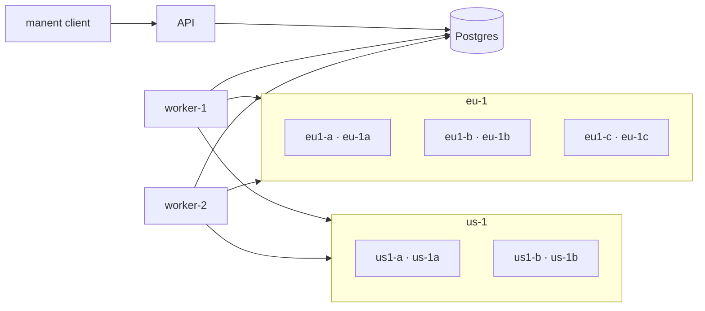

# Use cases

The use cases test manent end to end, as it runs in production: API server, workers, client and SSH targets in separate containers, on Postgres. They go from a single scheduled deploy to multi-region wave rollouts, and for each one they also check failures and rollbacks.

```sh
make test-usecases                    # all cases (about 10 minutes)
make test-usecases CASES="uc1 uc4"    # a subset
make test-usecases KEEP=1             # leaves the lab running at the end
```

They require Docker with Compose v2, Go, `jq` and `ssh-keygen`. The script compiles the Linux binaries on the host, so the `golang` image is not needed.

## The lab



- **Targets:** Debian containers with SSH (for the `remote-copy` plugin, `releases` layout) and an HTTP server that exposes the live release: `http://<target>:8080/<app>/current/healthz`. A release without `healthz` simulates a faulty version.
- **Environment configuration:** targets, parameters and secrets come from the `file` provider (`test/usecases/config/envconfig`); descriptors contain only the artifact.
- **Access:** static tokens with different roles (`ci` deploys, `cab` approves, `admin` can bypass freezes, `viewer` only reads).
- **Simulated faults:** the `post_command` fails or waits if the case creates a file on the target. Workers and targets are stopped or killed with `docker compose`.
- **Region profile:** for the last case the generic workers are replaced by one worker per region (`dbos.region`, `region_routing`), each on its region's network only.

## The cases

| Case | Scenario | What it checks |
|---|---|---|
| **UC1** | Scheduled deploy (`schedule.at`) on one target in an AZ, then on three AZs of a region | Wait until the scheduled time, cancellation, idempotency, faulty release with automatic rollback, failure without rollback and recovery, manual rollback, wrong checksum, dry-run, a target that is down |
| **UC2** | Environment configuration and promotion | Authentication and permissions, conflicts with the environment configuration, promotion `test → prod` with approval, ban on self-approval, rejection, freeze and override |
| **UC3** | Several workers on the same database | One deploy at a time per environment and environments in parallel, a worker killed during a deploy (automatic recovery by the other), graceful shutdown that waits for the running deploy |
| **UC4** | Wave rollout in one region | Canary and approval, one AZ at a time with bake and health gate, red gate on the canary, failure in the last AZ with `rollback-all`, rejection, `onFailure: stop` with drift in the inventory |
| **UC5** | Multi-region wave rollout | Passes run by the region workers, regions in parallel, `rollback-wave`, a region worker that is down (the pass waits for it), freeze of a single region |

Each check prints ✔ or ✘. At the end the script summarizes the failures and saves the container logs in `test/usecases/.work/compose.log`.

## Adding a case

A case is a script in `test/usecases/cases/` (`ucN.sh`), run in alphabetical order on the same lab. The functions in `lib.sh` create artifacts and descriptors, run the client with a role (`as cab manent approve <id>`), wait for states (`wait_state`, `wait_rollout`), read the targets (`current`, `healthy`) and inject faults (`fault`). Every case uses its own application, so it does not depend on the others.
