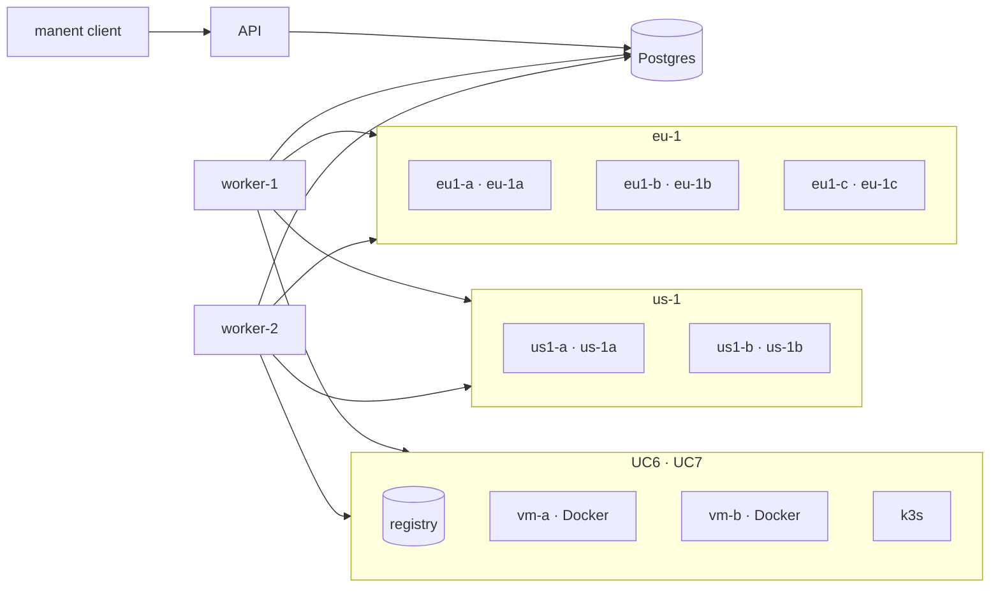

# Use cases

The use cases test manent end to end, as it runs in production: API server, workers, client and SSH targets in separate containers, on Postgres. They go from a single scheduled deploy to multi-region wave rollouts, then containers on VMs and Kubernetes, load balancers, percentage rollouts, custom steps, integrations and application servers, and for each one they also check failures and rollbacks.

```sh
make test-usecases                    # all cases (about 30 minutes)
make test-usecases CASES="uc1 uc4"    # a subset
make test-usecases KEEP=1             # leaves the lab running at the end
```

They require Docker with Compose v2, Go, `jq` and `ssh-keygen`. The script compiles the Linux binaries on the host, so the `golang` image is not needed. UC6 and UC7 use privileged containers (Docker in Docker and k3s) and about 2 GB of extra memory for Docker. UC8 uses the Playwright image (about 2 GB on disk), UC10 HAProxy (about 200 MB) and UC14 WildFly (about 800 MB). UC11 downloads the Gateway API CRDs from GitHub.

## The lab



- **Targets:** Debian containers with SSH (for the `remote-copy` plugin, `releases` layout) and an HTTP server that exposes the live release: `http://<target>:8080/<app>/current/healthz`. A release without `healthz` simulates a faulty version.
- **Environment configuration:** targets, parameters and secrets come from the `file` provider (`test/usecases/config/envconfig`); descriptors contain only the artifact.
- **Access:** static tokens with different roles (`ci` deploys, `cab` approves, `admin` can bypass freezes, `viewer` only reads), and an OIDC identity provider for tests (`test/usecases/oidc`) with the same users for the web interface.
- **Simulated faults:** the `post_command` fails or waits if the case creates a file on the target. Workers and targets are stopped or killed with `docker compose`.
- **Region profile:** for UC5 the generic workers are replaced by one worker per region (`dbos.region`, `region_routing`), each on its region's network only. The orchestrator reaches no target.
- **Containers and Kubernetes:** for UC6 and UC7 the lab starts an image registry, two VMs with Docker (`vm-a`, `vm-b`) and a single-node k3s cluster. The test application is a small image with `/healthz`; the faulty version has none, so its `HEALTHCHECK` and `readinessProbe` stay red. These services start only for their case and are removed at the end.
- **Load balancer:** for UC10 a real HAProxy with the Data Plane API v3 (`test/usecases/haproxy`) in front of the `eu-1` targets: the `uc10-shop` backend with HTTP health checks is drained per batch, the `uc10-blue` backend holds the two slots of the percentage rollout. UC11 uses the same k3s cluster with the Gateway API CRDs and an `HTTPRoute` created upfront, as infrastructure would.
- **External services:** Slack, Teams and ServiceNow have no local version, so `test/usecases/fakes` emulates their APIs (and an HTTP endpoint for custom steps) and records every request, which the cases read back. UC14 uses a real WildFly with the HTTP management API.

## The cases

| Case | Scenario | What it checks |
|---|---|---|
| **UC1** | Scheduled deploy (`schedule.at`) on one target in an AZ, then on three AZs of a region | Wait until the scheduled time, cancellation, idempotency, faulty release with automatic rollback, failure without rollback and recovery, manual rollback, wrong checksum, dry-run, a target that is down |
| **UC2** | Environment configuration and promotion | Authentication and permissions, conflicts with the environment configuration, promotion `test → prod` with approval, ban on self-approval, rejection, freeze and override |
| **UC3** | Several workers on the same database | One deploy at a time per environment and environments in parallel, a worker killed during a deploy (automatic recovery by the other), graceful shutdown that waits for the running deploy |
| **UC4** | Wave rollout in one region | Canary and approval, one AZ at a time with bake and health gate, red gate on the canary, failure in the last AZ with `rollback-all`, rejection, `onFailure: stop` with drift in the inventory |
| **UC5** | Multi-region wave rollout | Passes and health-gate probes run by the region workers, regions in parallel, `rollback-wave`, a region worker that is down (the pass waits for it), freeze of a single region |
| **UC6** | Containers on VMs with Docker ([container](plugins/container.md) plugin) | Image pinned by digest, promotion `test → prod` in waves, dry-run, unhealthy image with `rollback-all`, manual rollback, VM down, tag moved in the registry (the promotion refuses the different image) |
| **UC7** | Manifests on Kubernetes ([kubernetes](plugins/kubernetes.md) plugin) | Server-side dry-run, same manifests in `test` and `prod` with different environment configuration, blocked rollout and rollback, prune of removed objects, release history, image not pinned to a digest, manual rollback |
| **UC8** | [Web interface](guida/interfaccia-web.md) | Headers and configuration, `whoami`, approvals, cursor and SSE stream of the API; with Playwright: OIDC sign-in, every view checked with axe in both themes, deploy detail with live log, promotion after a dry-run, ban on self-approval, approval by another user followed live, keyboard and Italian |
| **UC9** | [Deploy chains](guida/catene.md) | A deploy waiting for another (`after`) without touching its target, start after the end of the dependency, failed dependency (`DEPENDENCY_FAILED`) and refusal at submit, composite release in topological order with idempotent resubmission, failed release with `onFailure: rollback` (successful deploys rolled back to the previous version) |
| **UC10** | [Load balancer and router](guida/svuotamento.md) on HAProxy | Every batch drained from the backend during its deploy and back once healthy, durable waits, capacity check (`min_healthy`) that postpones the drain while another server is down, no failed request through HAProxy during the rollout; router with two slots of targets: first release with the governance approval moved into the rollout (`approvals.when: rollout`), 50% step with equal weights and both versions served, faulty release with the weights back to the stable slot |
| **UC11** | [Percentage rollout](guida/traffico.md) on Kubernetes with a Helm chart | Candidate in the free slot (`uc11-web-a`/`-b`) with the slot label, approval after the tests at weight 0, testers' rule of the `HTTPRoute`, steps on the main rule's weights, history pointing to the slot, replaced slot scaled to zero after `scaleDownDelay`, faulty release that never becomes ready with the traffic left on the stable slot |
| **UC12** | [Custom steps](guida/step-personalizzati.md) | Plan with type and `spec_hash` but no command or URL, dry-run with only its own command and secrets, command over SSH on one target with parameter, secret file and declared output, secret redacted in the deploy log, HTTP request with bearer, `Idempotency-Key` and JSON body built by manent, polling of the job, exit 75 retried, permanent error with no retries and targets untouched |
| **UC13** | [Chat and change management](guida/integrazioni.md) | Slack message posted at start and updated with the outcome, approval request with buttons on Slack, change opened in ServiceNow with the deploy as `correlation_id`, requester's click refused (self-approval), CAB's click accepted (signed Slack request), invalid signature refused, deploy started only after the change approval and change closed with the outcome, change rejected in ServiceNow, Teams webhook refused because not https |
| **UC14** | WildFly ([jboss](plugins/jboss.md) plugin) | Dry-run, one deployment per version with the same runtime-name, switch with the server suspended, war refused by WildFly with the version in service untouched, red post-test with automatic rollback, manual rollback without uploading again, parameter conflicting with the environment configuration refused, JVM restart, `keep_releases` |

Each check prints ✔ or ✘. At the end the script summarizes the failures and saves the container logs in `test/usecases/.work/compose.log`.

## Adding a case

A case is a script in `test/usecases/cases/` (`ucN.sh`), run in numeric order on the same lab. The functions in `lib.sh` create artifacts and descriptors, run the client with a role (`as cab manent approve <id>`), wait for states (`wait_state`, `wait_rollout`), read the targets (`current`, `healthy`) and inject faults (`fault`). Every case uses its own application, so it does not depend on the others.
