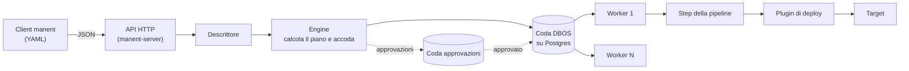

# Architettura

## Flusso di un deploy

Il client `manent` legge descrittori YAML e li invia all'API in JSON: c'è un solo punto di ingresso, quindi un solo modello di descrittore, un solo motore e le stesse regole di accesso.

1. Il descrittore viene letto e validato. L'API autentica la richiesta e applica i [permessi](../operazioni/accesso.md) dell'identità.
2. L'**Engine** calcola il [piano](pipeline.md), cioè l'elenco degli step da eseguire, verifica policy e [regole di governance](../guida/governance.md) e accoda il workflow `manent.deploy` nella coda DBOS. Se servono approvazioni accoda invece `manent.approval` su una coda separata, che accoda il deploy solo dopo le approvazioni.
3. Un **worker** preleva il workflow, legge la [configurazione di ambiente](../guida/configurazione-ambiente.md) ed esegue gli step in ordine. Ogni step è uno step DBOS: il suo risultato viene salvato nel database prima di passare al successivo.
4. Lo step `deploy` sceglie un **plugin** e gli delega il rilascio sui target.
5. Se uno step fallisce e la policy lo prevede, il worker esegue il [rollback](../guida/rollback.md): annulla in ordine inverso gli step già avviati, riportando i target alla release precedente.
6. Alla fine, con successo o errore, il worker libera la directory di lavoro del deploy e invia l'esito agli eventuali [callback](../guida/callback.md).

## Binari e modalità

| Binario | Comandi | Cosa fa |
|---|---|---|
| `manent` | tutti | Client: parla solo con l'API. Non contiene DBOS, plugin, SSH né driver di database (lo verifica un test sulle dipendenze). |
| `manent-server` | `serve`, `worker` | **Worker**: possiede un contesto DBOS, esegue i deploy dalla coda e, all'avvio, riprende quelli interrotti con il proprio `executor_id`. |
| `manent-server` | `api` (o `serve --no-worker`), `admin` | **Client DBOS**: accoda e interroga i deploy, ma non li esegue e non li riprende. |

Solo `serve` e `worker` avviano un contesto DBOS completo. Gli altri comandi usano un client DBOS: se avviassero un contesto, riprenderebbero i workflow in corso associati al loro ID e li rieseguirebbero in un processo destinato a terminare dopo pochi secondi.

Il contratto tra client e server (interfacce del servizio, richieste, risposte, errori) sta in `internal/service`, senza dipendenze dal motore: lo implementano l'`Engine` sul server e `internal/apiclient` nel client.

!!! note "Serve almeno un worker"
    Un deploy accodato resta in stato `ENQUEUED` finché un worker non lo preleva. `manent deploy` attende la conclusione: senza worker attivi resta in attesa fino a `--timeout`.

## Componenti

| Package | Ruolo |
|---|---|
| `internal/clientcli`, `internal/api` | Ingresso: client (go-flags, YAML) e API HTTP (Gin, JSON). |
| `internal/servercli` | Comandi di `manent-server`: `serve`, `api`, `worker`, `admin`, `audit verify`, `validate`. |
| `internal/service` | Contratto tra client e server, senza dipendenze dal motore. |
| `internal/descriptor` | Modello del descrittore, parsing e validazione. |
| `internal/engine` | `Engine` (accoda e interroga, funziona anche come client) e `Worker` (esegue i workflow). |
| `internal/pipeline` | Contratto degli step e calcolo del piano. |
| `internal/steps` | Step standard: `secrets`, `artifacts`, `qa`, `deploy`, `post-test`, `activation`. |
| `internal/envconfig` | Configurazione di ambiente da Consul o da file e sua fusione con il descrittore. |
| `internal/callback` | Invio degli eventi ai callback HTTP. |
| `internal/rollback` | Policy di rollback per tipo di artefatto. |
| `internal/rollout`, `internal/labels` | Piano dei [rilasci a ondate](../guida/ondate.md) (selettori sulle etichette, stadi, passi, lotti) e health gate (sonde, Prometheus, Alertmanager). |
| `internal/governance` | Regole di rilascio: promozione obbligatoria, approvazioni, finestre di freeze. |
| `internal/apiclient` | Implementazione del servizio sopra l'API HTTP, usata dal client. |
| `internal/auth`, `internal/authz`, `internal/audit` | Identità (OIDC, token, utente CLI), permessi per applicazione e ambiente, registro di audit. |
| `internal/secrets` | Provider di segreti: `env:`, `file:`, `vault:`. |
| `internal/extplugin` | Avvio e gestione dei plugin esterni. |
| `internal/logging` | Logger `slog` con inoltro al SIEM in RFC 5424. |
| `internal/deploylog` | Log di ogni deploy in uno stream DBOS del workflow, consultabile da API e CLI. |
| `internal/telemetry` | Metriche Prometheus e tracing OpenTelemetry. |
| `internal/cluster` | Registro dei worker: heartbeat, rivendicazione dei workflow di un worker perso, lease. |
| `internal/app` | Unico punto di composizione: collega le implementazioni concrete alle interfacce. |
| `pkg/plugin` | Unico package pubblico: contratto dei plugin (anche rollback e locator) e SDK per i plugin esterni. |
| `plugins/remotecopy` | Plugin di riferimento: copia via SSH/SFTP. |

Ogni servizio è definito tramite interfacce, così ogni componente si può sostituire con un mock nei test.

## Durabilità

DBOS registra nel database l'input del workflow e il risultato di ogni step. Quando un worker riparte:

- i workflow rimasti in sospeso con il suo `executor_id` vengono ripresi;
- gli step già completati non vengono rieseguiti: DBOS restituisce il risultato salvato;
- lo step in corso al momento dell'interruzione viene rieseguito.

Se un worker non torna, i suoi workflow si riprendono su un altro worker con la [recovery](../operazioni/affidabilita.md#worker-perso), manuale o automatica.

Per questo ogni step e ogni plugin devono essere **idempotenti**. Il workflow stesso deve restare deterministico: tutto ciò che ha effetti esterni (rete, file, orologio) sta dentro gli step.

I nomi dei workflow (`manent.deploy`, `manent.scheduled-deploy`, `manent.approval`, `manent.deploy-pass`) sono stabili: DBOS li usa per la recovery e per le schedule, quindi non vanno cambiati.

## Storico e inventario

Ogni workflow porta con sé degli **attributi** DBOS: applicazione, ambiente, artefatto, versione, tipo (`deploy`, `promotion`, `rollback`) e, al termine, esito, `sha256` dell'artefatto rilasciato ed esito del rollback. Elenchi, permessi, inventario e controllo della promozione li leggono senza caricare l'input dei workflow. Lo storico dei deploy nel database DBOS è quindi anche l'inventario delle release: la [retention](../operazioni/affidabilita.md#retention-dello-storico) conserva comunque le ultime release di ogni ambiente.

## Idempotenza della richiesta

Se il descrittore ha un `id`, questo diventa l'ID del workflow DBOS. Inviare due volte lo stesso descrittore con lo stesso `id` non produce due deploy: la seconda richiesta restituisce il deploy esistente. Senza `id`, DBOS genera un UUID.
