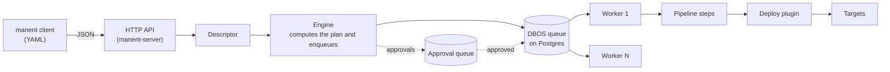

# Architecture

## Flow of a deploy

The `manent` client reads YAML descriptors and sends them to the API as JSON: there is a single entry point, hence a single descriptor model, a single engine and the same access rules.

1. The descriptor is read and validated. The API authenticates the request and applies the identity's [permissions](../operazioni/accesso.md).
2. The **Engine** computes the [plan](pipeline.md), i.e. the list of steps to run, checks policies and [governance rules](../guida/governance.md) and enqueues the `manent.deploy` workflow on the DBOS queue. If approvals are needed it enqueues `manent.approval` on a separate queue instead, which enqueues the deploy only once approved.
3. A **worker** picks up the workflow, reads the [environment configuration](../guida/configurazione-ambiente.md) and runs the steps in order. Each step is a DBOS step: its result is saved to the database before moving to the next one.
4. The `deploy` step picks a **plugin** and delegates the release on the targets to it.
5. If a step fails and the policy says so, the worker performs a [rollback](../guida/rollback.md): it undoes the steps already started in reverse order, bringing the targets back to the previous release.
6. At the end, on success or error, the worker frees the deploy's working directory and sends the outcome to any [callbacks](../guida/callback.md).

## Binaries and modes

| Binary | Commands | What it does |
|---|---|---|
| `manent` | all | Client: talks only to the API. It contains no DBOS, plugins, SSH or database drivers (a dependency test checks this). |
| `manent-server` | `serve`, `worker` | **Worker**: owns a DBOS context, runs deploys from the queue and, at startup, resumes those interrupted with its own `executor_id`. |
| `manent-server` | `api` (or `serve --no-worker`), `admin` | **DBOS client**: enqueues and queries deploys, but neither runs nor resumes them. |

Only `serve` and `worker` start a full DBOS context. The other commands use a DBOS client: if they started a context, they would resume the in-flight workflows associated with their ID and rerun them in a process meant to exit after a few seconds.

The client/server contract (service interfaces, requests, responses, errors) lives in `internal/service`, with no dependency on the engine: it is implemented by the `Engine` on the server and by `internal/apiclient` in the client.

!!! note "At least one worker is needed"
    A queued deploy stays `ENQUEUED` until a worker picks it up. `manent deploy` waits for completion: with no active workers it waits until `--timeout`.

## Components

| Package | Role |
|---|---|
| `internal/clientcli`, `internal/api` | Entry points: client (go-flags, YAML) and HTTP API (Gin, JSON). |
| `internal/servercli` | `manent-server` commands: `serve`, `api`, `worker`, `admin`, `audit verify`, `validate`. |
| `internal/service` | Client/server contract, with no dependency on the engine. |
| `internal/descriptor` | Descriptor model, parsing and validation. |
| `internal/engine` | `Engine` (enqueues and queries, also works as a client) and `Worker` (runs the workflows). |
| `internal/pipeline` | Step contract and plan computation. |
| `internal/steps` | Standard steps: `secrets`, `artifacts`, `qa`, `deploy`, `post-test`, `activation`. |
| `internal/envconfig` | Environment configuration from Consul or files and its merge with the descriptor. |
| `internal/callback` | Delivery of events to HTTP callbacks. |
| `internal/rollback` | Rollback policies per artifact type. |
| `internal/rollout`, `internal/labels` | [Wave rollout](../guida/ondate.md) plan (label selectors, stages, passes, batches) and health gate (probes, Prometheus, Alertmanager). |
| `internal/governance` | Release rules: mandatory promotion, approvals, freeze windows. |
| `internal/apiclient` | Implementation of the service on top of the HTTP API, used by the client. |
| `internal/auth`, `internal/authz`, `internal/audit` | Identity (OIDC, tokens, CLI user), per-application and per-environment permissions, audit log. |
| `internal/secrets` | Secret providers: `env:`, `file:`, `vault:`. |
| `internal/extplugin` | Startup and management of external plugins. |
| `internal/logging` | `slog` logger with forwarding to the SIEM in RFC 5424. |
| `internal/deploylog` | Per-deploy log in a DBOS stream of the workflow, readable from API and CLI. |
| `internal/telemetry` | Prometheus metrics and OpenTelemetry tracing. |
| `internal/cluster` | Worker registry: heartbeats, claiming the workflows of a lost worker, leases. |
| `internal/app` | The only composition point: wires concrete implementations to interfaces. |
| `pkg/plugin` | The only public package: plugin contract (including rollback and locators) and SDK for external plugins. |
| `plugins/remotecopy` | Reference plugin: copy over SSH/SFTP. |

Every service is defined through interfaces, so every component can be replaced with a mock in tests.

## Durability

DBOS records the workflow input and the result of every step in the database. When a worker restarts:

- the workflows left pending with its `executor_id` are resumed;
- steps already completed are not rerun: DBOS returns the saved result;
- the step in progress at the time of the interruption is rerun.

If a worker does not come back, its workflows are resumed on another worker through [recovery](../operazioni/affidabilita.md#worker-perso), manual or automatic.

This is why every step and every plugin must be **idempotent**. The workflow itself must remain deterministic: anything with external effects (network, files, clock) lives inside the steps.

The workflow names (`manent.deploy`, `manent.scheduled-deploy`, `manent.approval`, `manent.deploy-pass`) are stable: DBOS uses them for recovery and schedules, so they must not change.

## History and inventory

Every workflow carries DBOS **attributes**: application, environment, artifact, version, kind (`deploy`, `promotion`, `rollback`) and, at the end, outcome, `sha256` of the released artifact and rollback outcome. Lists, permissions, inventory and the promotion check read them without loading the workflow input. The deploy history in the DBOS database is therefore also the release inventory: [retention](../operazioni/affidabilita.md#retention-dello-storico) always keeps the latest releases of each environment.

## Request idempotency

If the descriptor has an `id`, it becomes the DBOS workflow ID. Sending the same descriptor twice with the same `id` does not produce two deploys: the second request returns the existing deploy. Without an `id`, DBOS generates a UUID.
