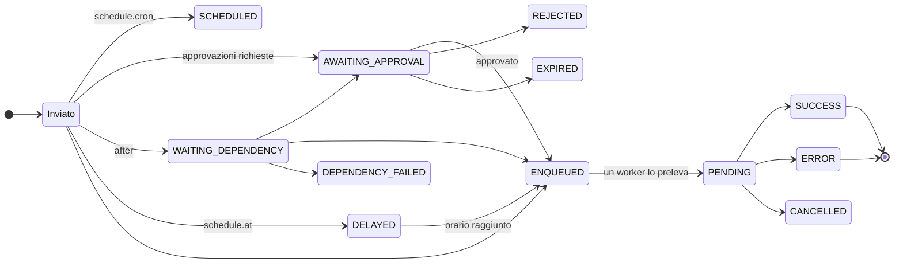

# Ciclo di vita di un deploy

Questa pagina segue un deploy dalla richiesta all'esito: cosa viene verificato, dove attende, cosa gira sul worker e come termina. Per ogni fase sono indicati gli stati che si vedono in `manent status`, `manent list` e nell'interfaccia web.

## 1. Invio

La richiesta arriva all'API: dal client `manent`, dall'interfaccia web, da un'azione di CI, da Terraform o da una chiamata diretta. Prima di accodare qualunque cosa il server verifica, in ordine:

1. **Descrittore.** Campi obbligatori, formati, campi sconosciuti. Gli errori vengono restituiti tutti insieme.
2. **Identità e permessi.** Il token bearer (OIDC o statico) diventa un'identità come `oidc:alice` o `token:ci`; l'[RBAC](../operazioni/accesso.md#permessi-rbac) deve concedere `deployment.submit` (o `deployment.dry-run`) sull'applicazione e sull'ambiente.
3. **Sorgenti e URL.** La sorgente dell'artefatto deve essere ammessa da `artifacts.sources`, gli URL dei callback dalla policy dei callback.
4. **Configurazione di ambiente.** Il server la legge e la fonde con il descrittore, applicando la [policy sui descrittori](../operazioni/sicurezza.md#cosa-puo-chiedere-un-descrittore). Un conflitto, un parametro non ammesso o l'assenza di target danno `422`. Se il provider non risponde, la verifica è lasciata al worker.
5. **Governance.** Finestre di freeze, promozione obbligatoria (`requires`), approvazioni e change management, dalle regole YAML o dalla [policy Rego](../guida/policy.md). La decisione viene salvata con la richiesta.
6. **Piano.** L'elenco ordinato degli step viene calcolato da `pipeline.steps` e dalla sezione `steps` del descrittore, e salvato come input del workflow.

La risposta è `202` con l'ID del deploy (`201` per una schedule ricorrente). Da qui in avanti il deploy è durevole: sopravvive ai riavvii dell'API e dei worker.

!!! tip "Verificare senza accodare"
    `manent validate -f deploy.yml` esegue le stesse verifiche e stampa il piano e il deploy effettivo, senza accodare nulla.

## 2. Attesa

Un deploy può attendere per motivi diversi, ciascuno con il suo stato. Nessuna di queste attese occupa uno slot di un worker.

| Stato | Attende | Finisce con |
|---|---|---|
| `SCHEDULED` | Il prossimo scatto di una schedule ricorrente (è la schedule, non un deploy). | Un deploy `<schedule>@<ora UTC>` a ogni scatto. |
| `DELAYED` | L'orario di `schedule.at`. | `ENQUEUED` a quell'orario. |
| `WAITING_DEPENDENCY` | I deploy elencati in `after`. | `ENQUEUED` (o `AWAITING_APPROVAL`) se riescono tutti, altrimenti `DEPENDENCY_FAILED`. |
| `AWAITING_APPROVAL` | Le approvazioni di altre identità e, se richiesta, l'approvazione del change nell'ITSM. | `ENQUEUED` con lo stesso ID, `REJECTED` o `EXPIRED`. |
| `ENQUEUED` | Uno slot libero di un worker e nessun altro deploy in corso sulla stessa applicazione e sullo stesso ambiente. | `PENDING`. |

La coda è partizionata per `<application>/<environment>`: di default un solo deploy per ambiente è in corso alla volta, su tutti i worker, mentre ambienti diversi procedono in parallelo. Vedi [Scalabilità](../operazioni/scalabilita.md).

## 3. Esecuzione

Un worker preleva il deploy (`PENDING`) ed esegue un workflow durevole. Ogni voce qui sotto è uno step DBOS: il suo risultato viene salvato prima che parta il successivo.

1. **`config`.** Legge la configurazione di ambiente valida *adesso*, la fonde con il descrittore, decide la policy di rollback e ricontrolla freeze e policy. Il suo output registra sorgente e revisione della configurazione usata.
2. **Ticket di change** (`change:open`), se la regola di governance lo richiede. Senza ticket il deploy non parte.
3. **Notifica di avvio**: callback (`started`) e messaggi in chat.
4. **Gli step del piano**, in ordine: `secrets` verifica che ogni segreto sia risolvibile; `artifacts` scarica l'artefatto e ne calcola lo sha256; `qa` lo verifica; `deploy` lo affida al plugin; `post-test` chiama gli endpoint di salute; `activation` rende operativa la release. Gli step personalizzati girano nella loro posizione.
5. **Checkpoint.** Prima di uno step annullabile, uno step separato `checkpoint:<step>` registra lo stato a cui tornare, per esempio la release in esercizio.
6. **Rollout.** Con ondate o percentuali, gli step da `deploy` ad `activation` si ripetono per ogni passo e lotto, con tempi di osservazione, health gate, approvazioni tra le ondate e freeze per region.

Ogni step ha `max_retries` tentativi con intervallo crescente. Gli errori che non possono migliorare ritentando (un parametro non ammesso, un rifiuto della policy, un 4xx di un sistema) sono **permanenti** e falliscono subito.

!!! note "Annullare un deploy in corso"
    `manent cancel <id>` ferma un deploy in corso all'inizio dello step successivo: lo step in esecuzione viene completato, così manent non lascia mai un target scritto a metà.

## 4. Errore e rollback

Quando uno step fallisce dopo i tentativi, il deploy va verso `ERROR`. Se il [rollback](../guida/rollback.md) è attivo e lo step fallito è in `rollback.on`, il worker prima **compensa** gli step già avviati, in ordine inverso (`rollback:activation`, `rollback:deploy`…), riportando i target alla release precedente. Si ferma alla prima compensazione che fallisce.

Il deploy resta comunque `ERROR`: l'esito del rollback (`completed`, `failed`) compare nel suo stato, nell'evento finale di callback e chat e nell'[inventario](../guida/governance.md#inventario) (`last_failure.rollback`).

## 5. Conclusione

Sia in caso di successo sia di errore, il worker:

1. esegue `cleanup`, che rimuove la directory di lavoro del deploy;
2. registra esito, sha256 dell'artefatto rilasciato ed esito del rollback come attributi del workflow, che alimentano inventario, elenchi e metriche DORA;
3. invia l'evento finale a callback e chat e chiude il ticket di change (`change:close`);
4. scrive la voce di audit `deployment.finish`;
5. sveglia i deploy e le release che attendono questo (`after`).

| Stato finale | Significato |
|---|---|
| `SUCCESS` | Tutti gli step sono riusciti. Il deploy diventa la release `current` dell'ambiente. |
| `ERROR` | Uno step è fallito. Errore ed esito del rollback sono nello stato. |
| `CANCELLED` | Annullato con `manent cancel`, prima o durante l'esecuzione. |
| `REJECTED`, `EXPIRED` | L'approvazione è stata rifiutata o non è arrivata in tempo: non è stato eseguito nulla. |
| `DEPENDENCY_FAILED` | Una dipendenza in `after` non è riuscita: non è stato eseguito nulla. |
| `MAX_RECOVERY_ATTEMPTS_EXCEEDED` | Il workflow è stato ripreso troppe volte dopo dei crash e DBOS ha smesso di riprenderlo. Vanno esaminati i log del worker. |

## Dopo un crash

Se il worker che esegue un deploy si ferma, non si perde nulla:

- quando riparte con lo stesso `executor_id` riprende i suoi workflow: gli step completati non vengono rieseguiti (DBOS restituisce il risultato salvato), quello in corso viene rieseguito;
- se non torna, un altro worker li riprende con la [recovery](../operazioni/affidabilita.md#worker-perso), automatica o con `manent-server admin recover`.

Per questo ogni step e ogni plugin sono idempotenti: eseguire due volte lo stesso step lascia i target come eseguirlo una volta.

## Seguire un deploy

| Strumento | Cosa mostra |
|---|---|
| `manent status <id>` | Stato, date, richiedente, approvazione, rollout, risultato di ogni step o l'errore. |
| `manent logs -f <id>` | Il log del deploy, in tempo reale fino alla fine. |
| `manent steps <id>` | Ogni step registrato con orari, durata, output ed errore. |
| `manent activity` | Tutto ciò che è in corso o in attesa in questo momento. |
| [Interfaccia web](../guida/interfaccia-web.md) | Stato, ondate e log aggiornati in tempo reale, approvazioni. |
| [Callback](../guida/callback.md) | Un evento HTTP per ogni step e per l'esito. |
| `GET /api/v1/deployments/{id}/events` | Le stesse informazioni come stream Server-Sent Events. |
