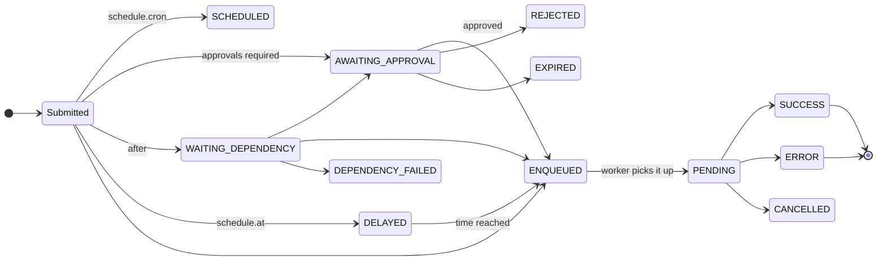

# Deploy lifecycle

This page follows a deploy from the request to the outcome: what is checked, where it waits, what runs on the worker and how it ends. Each phase also lists the states you see in `manent status`, `manent list` and the web interface.

## 1. Submission

A request reaches the API: from the `manent` client, the web interface, a CI action, Terraform or a direct call. Before anything is enqueued the server checks, in order:

1. **Descriptor.** Required fields, formats, unknown fields. All errors are returned together.
2. **Identity and permissions.** The bearer token (OIDC or static) becomes an identity such as `oidc:alice` or `token:ci`; [RBAC](../operazioni/accesso.md#permessi-rbac) must grant `deployment.submit` (or `deployment.dry-run`) on the application and environment.
3. **Sources and URLs.** The artifact source must be allowed by `artifacts.sources`; callback URLs by the callback policy.
4. **Environment configuration.** The server reads it and merges it with the descriptor, applying the [descriptor policy](../operazioni/sicurezza.md#cosa-puo-chiedere-un-descrittore). A conflict, a forbidden parameter or no target is a `422`. If the provider is unreachable, the check is left to the worker.
5. **Governance.** Freeze windows, mandatory promotion (`requires`), approvals and change management, from the YAML rules or the [Rego policy](../guida/policy.md). The decision is saved with the request.
6. **Plan.** The ordered list of steps is computed from `pipeline.steps` and the descriptor's `steps` section, and saved as the workflow input.

The response is `202` with the deploy ID (`201` for a recurring schedule). From here on the deploy is durable: it survives restarts of the API and of the workers.

!!! tip "Check without enqueuing"
    `manent validate -f deploy.yml` runs the same checks and prints the plan and the effective deploy, without enqueuing anything.

## 2. Waiting

A deploy can wait for different reasons, each with its own state. None of these waits takes a worker slot.

| State | Waiting for | Ends with |
|---|---|---|
| `SCHEDULED` | The next tick of a recurring schedule (this is the schedule, not a deploy). | A deploy `<schedule>@<UTC time>` at every tick. |
| `DELAYED` | The time of `schedule.at`. | `ENQUEUED` at that time. |
| `WAITING_DEPENDENCY` | The deploys listed in `after`. | `ENQUEUED` (or `AWAITING_APPROVAL`) if they all succeed, `DEPENDENCY_FAILED` otherwise. |
| `AWAITING_APPROVAL` | Approvals from other identities, and the change approval in the ITSM if required. | `ENQUEUED` with the same ID, `REJECTED` or `EXPIRED`. |
| `ENQUEUED` | A free worker slot and no other deploy running on the same application and environment. | `PENDING`. |

The queue is partitioned by `<application>/<environment>`: by default only one deploy per environment runs at a time, across all workers, while different environments proceed in parallel. See [Scalability](../operazioni/scalabilita.md).

## 3. Execution

A worker picks the deploy up (`PENDING`) and runs a durable workflow. Each item below is a DBOS step: its result is saved before the next one starts.

1. **`config`.** Reads the environment configuration valid *now*, merges it with the descriptor, decides the rollback policy and checks freezes and policy again. Its output records the source and revision of the configuration used.
2. **Change ticket** (`change:open`), if the governance rule requires one. Without a ticket the deploy does not start.
3. **Start notification**: callbacks (`started`) and chat messages.
4. **The plan's steps**, in order: `secrets` checks that every secret can be resolved; `artifacts` downloads the artifact and computes its sha256; `qa` verifies it; `deploy` hands it to the plugin; `post-test` calls the health endpoints; `activation` makes the release operational. Custom steps run in their position.
5. **Checkpoints.** Before a step that can be undone, a separate `checkpoint:<step>` records the state to go back to, for example the release currently in service.
6. **Rollout.** With waves or percentages, the steps from `deploy` to `activation` repeat for every pass and batch, with bake times, health gates, approvals between waves and freezes per region.

Every step has `max_retries` retries with an increasing interval. Errors that cannot improve by retrying (a forbidden parameter, a policy refusal, a 4xx from a system) are **permanent** and fail at once.

!!! note "Cancelling a running deploy"
    `manent cancel <id>` stops a running deploy at the start of the next step: the step in progress still completes, so a target is never left half-written by manent.

## 4. Failure and rollback

When a step fails after its retries, the deploy moves towards `ERROR`. If [rollback](../guida/rollback.md) is enabled and the failed step is in `rollback.on`, the worker first **compensates** the steps already started, in reverse order (`rollback:activation`, `rollback:deploy`…), bringing the targets back to the previous release. It stops at the first compensation that fails.

The deploy stays `ERROR` either way: the outcome of the rollback (`completed`, `failed`) is in its status, in the final event of callbacks and chat, and in the [inventory](../guida/governance.md#inventario) (`last_failure.rollback`).

## 5. Completion

On success and on error alike, the worker:

1. runs `cleanup`, which removes the deploy's working directory;
2. records the outcome, the sha256 of the released artifact and the rollback outcome as workflow attributes, which feed the inventory, the lists and the DORA metrics;
3. sends the final event to callbacks and chat, and closes the change ticket (`change:close`);
4. writes the `deployment.finish` audit entry;
5. wakes the deploys and releases waiting on this one (`after`).

| Final state | Meaning |
|---|---|
| `SUCCESS` | Every step succeeded. The deploy becomes the `current` release of the environment. |
| `ERROR` | A step failed. See the error and the rollback outcome in the status. |
| `CANCELLED` | Cancelled with `manent cancel`, before or during the run. |
| `REJECTED`, `EXPIRED` | The approval was refused or not given in time: nothing ran. |
| `DEPENDENCY_FAILED` | A dependency in `after` did not succeed: nothing ran. |
| `MAX_RECOVERY_ATTEMPTS_EXCEEDED` | The workflow was resumed too many times after crashes and DBOS stopped resuming it. Investigate the worker logs. |

## After a crash

If the worker running a deploy stops, nothing is lost:

- when it restarts with the same `executor_id`, it resumes its workflows: completed steps are not rerun (DBOS returns their saved result), the step that was running is run again;
- if it does not come back, another worker resumes them through [recovery](../operazioni/affidabilita.md#worker-perso), automatic or with `manent-server admin recover`.

This is why every step and every plugin is idempotent: running the same step twice leaves the targets as running it once.

## Following a deploy

| Tool | What you see |
|---|---|
| `manent status <id>` | State, dates, requester, approval, rollout, result of every step or the error. |
| `manent logs -f <id>` | The deploy log, live, up to the end. |
| `manent steps <id>` | Every recorded step with times, duration, output and error. |
| `manent activity` | Everything running or waiting right now. |
| [Web interface](../guida/interfaccia-web.md) | Status, waves and log updated live, approvals. |
| [Callbacks](../guida/callback.md) | An HTTP event for every step and for the outcome. |
| `GET /api/v1/deployments/{id}/events` | The same as a Server-Sent Events stream. |
