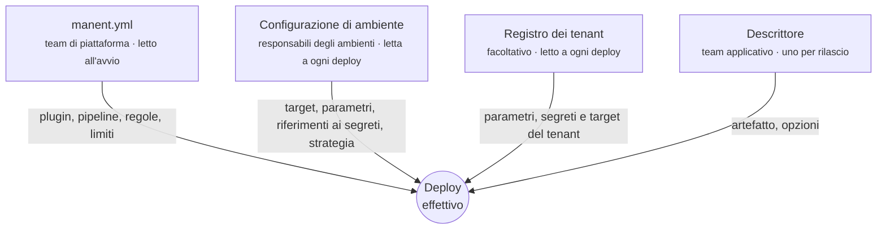

# Modello di configurazione

Un deploy è il risultato di fino a quattro livelli di configurazione, ciascuno di un team diverso e modificato con ritmi diversi. Tenerli separati permette a un team applicativo di rilasciare con un descrittore di dieci righe, mentre il team di piattaforma mantiene il controllo su comandi, credenziali e regole.



## I livelli

| Livello | Dove | Responsabile | Contiene | Letto |
|---|---|---|---|---|
| **`manent.yml`** | Un file su ogni processo server (una ConfigMap con Helm). | Team di piattaforma | Plugin e i loro limiti, step della pipeline, regole di governance, autenticazione e RBAC, integrazioni, sorgenti degli artefatti ammesse, `descriptor_policy`. | All'avvio. |
| **Configurazione di ambiente** | KV di Consul (`manent/<application>/<environment>`) o file. | Responsabili degli ambienti | Plugin, target con etichette, parametri del plugin, riferimenti ai segreti, strategia di rollout e di traffico, rollback, parametri degli step personalizzati, tenancy. | All'avvio di ogni deploy, nello step `config`. |
| **Registro dei tenant** | Consul o file (`tenants/<tenant>.yml`). | Gestione clienti | Tag, parametri, segreti e parametri degli step di ogni tenant, per applicazione. | All'avvio di ogni deploy per un tenant. |
| **Descrittore** | Il repository dell'applicazione, inviato con ogni richiesta. | Team applicativo | Applicazione, ambiente, artefatto, `id` di idempotenza, step facoltativi, pianificazione, callback, dipendenze. | All'invio, poi salvato con il deploy. |

## Regole di fusione

Nello step `config` i livelli vengono fusi nel **deploy effettivo**, che è ciò che ricevono i plugin.

- **L'ambiente è autorevole.** Ciò che definisce non può essere cambiato dal descrittore. Il descrittore può solo *aggiungere* ciò che manca, o ripetere un valore identico.
- **I conflitti sono errori.** Un parametro con due valori diversi fa fallire il deploy; nulla viene sovrascritto in silenzio.
- **Alcune sezioni appartengono solo all'ambiente.** `traffic` (load balancer e router) viene rifiutato in un descrittore; `rollout` si può solo ripetere identico.
- **`descriptor_policy` limita le aggiunte.** In `manent.yml` la piattaforma decide quali parametri dei plugin, riferimenti ai segreti, parametri degli step personalizzati e target può aggiungere un descrittore. Una policy tipica di produzione non ammette comandi né target.
- **I tenant aggiungono un livello intermedio.** Il tenant fornisce solo i parametri che l'ambiente dichiara in `tenant_params`, più i propri segreti e i propri target (etichetta `tenant`).

| Campo | Ambiente | Descrittore |
|---|---|---|
| `plugin`, `policy` | Li definisce. | Può ripeterli. |
| `targets` | Li definisce. | Può ometterli o ripeterli; può aggiungerne solo se `descriptor_policy.targets` lo consente. |
| `params` | Li definisce. | Può aggiungere le chiavi ammesse da `descriptor_policy.params`. |
| `secrets` | Dichiara nome → riferimento. | Può aggiungere segreti il cui riferimento corrisponde a `descriptor_policy.secret_refs`. |
| `rollback` | Può imporlo. | Può attivarlo entro la policy del tipo di artefatto; non può disattivare ciò che l'ambiente impone. |
| `rollout` | Definisce la strategia. | Può solo ripeterla identica. |
| `traffic` | Definisce pool e router. | Non ammesso. |

La tabella completa è in [Configurazione di ambiente](../guida/configurazione-ambiente.md).

## Un esempio sui tre livelli

=== "manent.yml (piattaforma)"

    ```yaml
    plugins:
      remote-copy:
        artifact_types: [application]
    descriptor_policy:
      params:
        remote-copy: [verify_checksum]     # niente comandi, niente directory
      secret_refs: ["vault:secret/data/{application}/*"]
      targets: false
    artifacts:
      allow_unlisted: false
      sources:
        - prefix: https://nexus.example.com/repository/releases/
    ```

=== "Ambiente (shop/prod)"

    ```yaml
    plugin: remote-copy
    targets:
      - {host: web-1.prod.internal, user: deploy, labels: {az: eu-1a}}
      - {host: web-2.prod.internal, user: deploy, labels: {az: eu-1b}}
    params:
      dest_dir: /opt/shop
      layout: releases
      ssh_key_secret: deploy-key
      prepare_command: 'tar -xzf "$MANENT_ARTIFACT" -C "$MANENT_RELEASE_DIR"'
      post_command: "sudo systemctl restart shop"
    secrets:
      - {name: deploy-key, ref: "vault:secret/data/shop/prod#ssh_key"}
    rollback:
      enabled: true
    ```

=== "Descrittore (repository di shop)"

    ```yaml
    apiVersion: manent/v1
    application: shop
    environment: prod
    artifact:
      type: application
      name: shop
      version: 2.4.0
      source: https://nexus.example.com/repository/releases/shop-2.4.0.tar.gz
    ```

Il team applicativo non vede mai host, chiavi o comandi; i responsabili degli ambienti non toccano la cadenza dei rilasci; la piattaforma decide cosa può cambiare ciascuno.

## Quando viene letto ogni livello

Ciò che un deploy usa viene fissato in momenti precisi, così un deploy ripreso dopo un crash si comporta esattamente come quello partito.

| Cosa | Fissato quando | Conseguenza |
|---|---|---|
| Piano (step e loro ordine) | All'invio. | Cambiare `pipeline.steps` non altera i deploy già accodati. |
| Decisione di governance, destinazioni delle notifiche, regola di change | All'invio. | Una regola più severa arrivata dopo non invalida un'approvazione già data (salvo `governance.start: strict`). |
| Configurazione di ambiente, tenant | Nello step `config`, all'avvio dell'esecuzione. | Un deploy pianificato usa la configurazione valida quando gira; un deploy ripreso riusa quella già letta. |
| Valori dei segreti | Al momento dell'uso, mai salvati. | Ruotare un segreto in Vault ha effetto al successivo utilizzo, anche dentro un deploy in corso. |
| `manent.yml` | All'avvio del processo. | La maggior parte delle modifiche richiede un riavvio. Eccezioni: `auth.tokens_file`, le policy Rego e i freeze a runtime, ricaricati a caldo. |

## Dove mettere cosa

| Vuoi | Modifica |
|---|---|
| Aggiungere un server alla produzione | La configurazione di ambiente (`targets`). |
| Rilasciare una nuova versione | Il descrittore (`artifact.version`, `artifact.source`), di solito dalla CI con `--version` e `--source`. |
| Attivare i test post-deploy per un solo rilascio | Il descrittore (`steps: {post-test: true}`). |
| Rendere obbligatorio il rollback in produzione | La configurazione di ambiente (`rollback.enabled: true`). |
| Vietare i comandi shell provenienti dai descrittori | `manent.yml` (`descriptor_policy.params`). |
| Richiedere due approvazioni in produzione | `manent.yml` (`governance.rules`) o una policy Rego. |
| Ruotare la chiave SSH | Solo il gestore dei segreti: i riferimenti non cambiano. |
