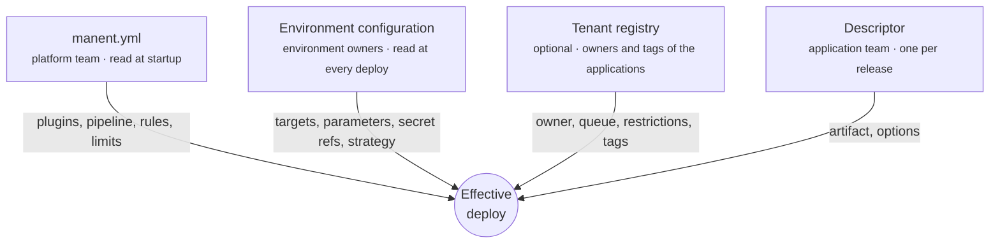

# Configuration model

A deploy is the result of up to four layers of configuration, each owned by a different team and changed at a different pace. Keeping them separate is what lets an application team release with a ten-line descriptor while the platform team keeps control of commands, credentials and rules.



## The layers

| Layer | Where | Owner | Contains | Read |
|---|---|---|---|---|
| **`manent.yml`** | A file on every server process (a ConfigMap with Helm). | Platform team | Plugins and their limits, pipeline steps, governance rules, authentication and RBAC, integrations, allowed artifact sources, `descriptor_policy`. | At startup. |
| **Environment configuration** | Consul KV (`manent/<application>/<environment>`) or files. | Environment owners | Plugin, targets with labels, plugin parameters, secret references, rollout and traffic strategy, rollback, custom step parameters. | At the start of every deploy, in the `config` step. |
| **Tenant registry** | A file (`tenants.yml`). | Platform team | The teams, the applications each one owns with their tags, members, queue and restrictions. | At submission (owner, restrictions recorded in the request), cached. |
| **Descriptor** | The application repository, sent with each request. | Application team | Application, environment, artifact, idempotency `id`, optional steps, schedule, callbacks, dependencies. | At submission, then saved with the deploy. |

## Merge rules

The layers are merged in the `config` step into the **effective deploy**, which is what plugins receive.

- **The environment is authoritative.** What it defines cannot be changed by the descriptor. The descriptor can only *add* what is missing, or repeat a value identically.
- **Conflicts are errors.** A parameter set to two different values fails the deploy; nothing is silently overwritten.
- **Some sections belong only to the environment.** `traffic` (load balancers and routers) is refused in a descriptor; `rollout` can only be repeated identically.
- **`descriptor_policy` limits additions.** In `manent.yml` the platform decides which plugin parameters, secret references, custom step parameters and targets a descriptor may add. A typical production policy allows no commands and no targets.
- **The tenant restricts, it does not add.** The owner of the application can limit secret references, artifact sources and callback hosts of its deploys; it never adds parameters or targets.

| Field | Environment | Descriptor |
|---|---|---|
| `plugin`, `policy` | Defines them. | Can repeat them. |
| `targets` | Defines them. | Can omit or repeat them; can add them only if `descriptor_policy.targets` allows it. |
| `params` | Defines them. | Can add the keys allowed by `descriptor_policy.params`. |
| `secrets` | Declares name → reference. | Can add secrets whose reference matches `descriptor_policy.secret_refs`. |
| `rollback` | Can enforce it. | Can enable it within the artifact type's policy; cannot disable what the environment enforces. |
| `rollout` | Defines the strategy. | Can only repeat it identically. |
| `traffic` | Defines pool and router. | Not allowed. |

The full table is in [Environment configuration](../guida/configurazione-ambiente.md).

## An example across the layers

=== "manent.yml (platform)"

    ```yaml
    plugins:
      remote-copy:
        artifact_types: [application]
    descriptor_policy:
      params:
        remote-copy: [verify_checksum]     # no commands, no directories
      secret_refs: ["vault:secret/data/{application}/*"]
      targets: false
    artifacts:
      allow_unlisted: false
      sources:
        - prefix: https://nexus.example.com/repository/releases/
    ```

=== "Environment (shop/prod)"

    ```yaml
    plugin: remote-copy
    targets:
      - {host: web-1.prod.internal, user: deploy, labels: {az: eu-1a}}
      - {host: web-2.prod.internal, user: deploy, labels: {az: eu-1b}}
    params:
      dest_dir: /opt/shop
      layout: releases
      ssh_key_secret: deploy-key
      prepare_command: 'tar -xzf "$MANENT_ARTIFACT" -C "$MANENT_RELEASE_DIR"'
      post_command: "sudo systemctl restart shop"
    secrets:
      - {name: deploy-key, ref: "vault:secret/data/shop/prod#ssh_key"}
    rollback:
      enabled: true
    ```

=== "Descriptor (shop repository)"

    ```yaml
    apiVersion: manent/v1
    application: shop
    environment: prod
    artifact:
      type: application
      name: shop
      version: 2.4.0
      source: https://nexus.example.com/repository/releases/shop-2.4.0.tar.gz
    ```

The application team never sees hosts, keys or commands; the environment owners never touch the release cadence; the platform decides what each of them is allowed to change.

## When each layer is read

What a deploy uses is fixed at precise moments, so that a deploy resumed after a crash behaves exactly like the one that started.

| What | Fixed when | Consequence |
|---|---|---|
| Plan (steps and their order) | At submission. | Changing `pipeline.steps` does not alter deploys already enqueued. |
| Governance decision, notification destinations, change rule | At submission. | A stricter rule arrived later does not invalidate an approval already given (unless `governance.start: strict`). |
| Environment configuration | In the `config` step, at the start of the run. | A scheduled deploy uses the configuration valid when it runs; a resumed deploy reuses the one it read. |
| Secret values | At the moment of use, never stored. | Rotating a secret in Vault takes effect at the next use, even within a running deploy. |
| `manent.yml` | At process startup. | Most changes need a restart. Exceptions: `auth.tokens_file`, Rego policies and runtime freezes, reloaded live. |

## Where to put what

| You want to | Change |
|---|---|
| Add a server to production | The environment configuration (`targets`). |
| Release a new version | The descriptor (`artifact.version`, `artifact.source`), usually from CI with `--version` and `--source`. |
| Turn on post-deploy tests for one release | The descriptor (`steps: {post-test: true}`). |
| Make rollback mandatory in production | The environment configuration (`rollback.enabled: true`). |
| Forbid shell commands coming from descriptors | `manent.yml` (`descriptor_policy.params`). |
| Require two approvals in production | `manent.yml` (`governance.rules`) or a Rego policy. |
| Rotate the SSH key | The secret store only: references do not change. |
