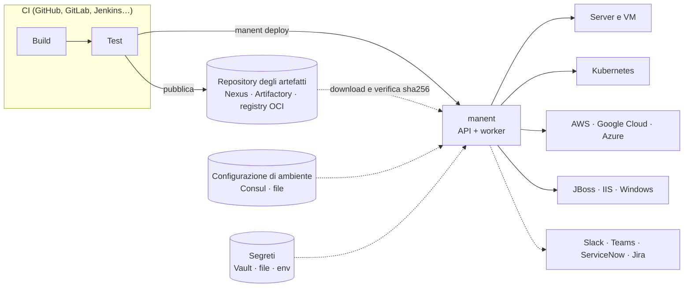

# Panoramica

manent è un motore di **deploy as code**. Prende un artefatto che la CI ha già costruito e testato e lo porta negli ambienti attraverso una pipeline di step dichiarata. Ogni step viene registrato in un database, è soggetto a regole e resta verificabile anche dopo.

Il nome viene dal latino *manere*, "rimanere, restare saldo". L'artefatto non cambia lungo la strada verso la produzione: il file che ha superato i test in `test` è, byte per byte, quello rilasciato in `prod`.

## Dove si colloca manent

| È | Non è |
|---|---|
| Il sistema di rilascio tra il repository degli artefatti e i target. | Un sistema di CI: manent non compila né testa nulla. Comincia dove finisce la pipeline. |
| Un motore di workflow durevoli: un deploy interrotto riprende dall'ultimo step completato. | Uno strumento di provisioning dell'infrastruttura: servizi, cluster e VM esistono già (Terraform, CloudFormation…). manent cambia solo ciò che vi gira sopra. |
| Il punto in cui si applicano le regole di rilascio: promozioni, approvazioni, freeze, ticket di change. | Un controller GitOps che riscrive continuamente i target: manent rilascia quando glielo si chiede e, con la [riconciliazione](../guida/governance.md#stato-reale), *segnala* i target cambiati fuori da manent senza sovrascriverli. |
| Un solo motore con un solo modello, raggiungibile da CLI, API, interfaccia web, azioni di CI e Terraform. | Una raccolta di script per team: tutti i team usano la stessa pipeline, le stesse regole e lo stesso audit. |

## Principi

- **L'artefatto è immutabile.** Una promozione fissa lo `sha256` dell'artefatto effettivamente rilasciato nell'ambiente di origine, e lo step `qa` lo verifica prima del deploy. Un file ricostruito, anche dallo stesso commit, è un altro artefatto.
- **Dichiarativo.** Il [descrittore](../guida/descrittore.md) dice *cosa* rilasciare; la [configurazione di ambiente](../guida/configurazione-ambiente.md) dice *dove* e *come*. Nessuno dei due contiene script che cambiano a ogni rilascio.
- **Durevole e idempotente.** Ogni step è uno step [DBOS](https://github.com/dbos-inc/dbos-transact-golang) il cui risultato viene salvato prima che parta il successivo. Dopo un crash il deploy continua sullo stesso worker o su un altro, e lo stesso `id` non viene mai eseguito due volte.
- **Configurazione autorevole.** Ciò che l'ambiente definisce non può essere cambiato dal descrittore: un conflitto è un errore, mai una sovrascrittura silenziosa. [`descriptor_policy`](../operazioni/sicurezza.md#cosa-puo-chiedere-un-descrittore) limita ciò che un descrittore può aggiungere.
- **Segreti per riferimento.** Descrittori, configurazione e storico contengono solo riferimenti (`vault:…`, `file:…`, `env:…`). I valori vengono letti dal worker al momento dell'uso e non compaiono mai negli output né nei log.
- **Fail closed.** Una policy di governance che non si può valutare rifiuta il deploy; un health gate senza dati è rosso; un campo sconosciuto nel descrittore è un errore.
- **Un solo core.** CLI, API, interfaccia web, GitHub Action, template GitLab e provider Terraform passano tutti dalla stessa API, quindi valgono ovunque gli stessi permessi e lo stesso audit.

## Il modello

| Concetto | Che cos'è | Dove si definisce |
|---|---|---|
| **Applicazione** | Ciò che si rilascia, per esempio `shop-api`. | Descrittore (`application`). |
| **Ambiente** | Dove gira l'applicazione: `dev`, `test`, `preprod`, `prod`. Region e AZ sono *etichette* dei target, non ambienti separati. | Descrittore (`environment`). |
| **Artefatto** | Il file o l'immagine immutabile da rilasciare, con un `type` (`application`, `container`, `kubernetes`, `war`, `lambda`…) che sceglie i plugin in grado di gestirlo. | Descrittore (`artifact`). |
| **Target** | Una destinazione: un host, l'API di un cluster, una region cloud, un endpoint di management. Ha delle `labels` (`region`, `az`, `canary`, `tenant`…). | Configurazione di ambiente o descrittore. |
| **Plugin** | Il componente che sa rilasciare un tipo di artefatto su un tipo di target. | `manent.yml` (`plugins`). |
| **Pipeline** | Gli step ordinati che ogni deploy attraversa: `secrets`, `artifacts`, `qa`, `deploy`, `post-test`, `activation`, più gli step personalizzati. | `manent.yml` (`pipeline`). |
| **Deploy** | Un'esecuzione della pipeline per un'applicazione, un ambiente e un artefatto: un workflow durevole con un ID, uno stato e un esito. | Creato da una richiesta. |
| **Strategia di rilascio** | Come il deploy raggiunge i target: tutti insieme, a [ondate](../guida/ondate.md) o per [percentuale di traffico](../guida/traffico.md). | Configurazione di ambiente. |
| **Governance** | Le regole su chi può rilasciare cosa, dove e quando. | `manent.yml` (`governance`) o policy Rego. |
| **Tenant** | Terza dimensione facoltativa: un cliente o un'istanza con parametri, segreti e target propri. | [Registro dei tenant](../guida/tenant.md). |

Il [Glossario](glossario.md) raccoglie tutti i termini usati in questa documentazione.

## Chi fa cosa

manent separa le responsabilità, così ogni team cambia solo ciò che gli appartiene.

| Ruolo | Possiede | Azioni tipiche | Da dove partire |
|---|---|---|---|
| **Team applicativo** | Il descrittore, nel repository dell'applicazione. | Rilasciare dalla CI, seguire il deploy, dry-run, rollback. | [Primo deploy](../tutorial/primo-deploy.md), [Deploy dalla CI](../tutorial/ci.md) |
| **Responsabili degli ambienti** | La configurazione di ambiente (Consul o file): target, parametri, riferimenti ai segreti, strategia di rilascio. | Aggiungere un nodo, cambiare un'ondata, imporre il rollback. | [Ambienti e segreti](../tutorial/ambienti.md) |
| **Team di piattaforma** | `manent.yml`, worker, plugin, database, integrazioni. | Installare, scalare, aggiornare, recuperare i worker persi. | [manent in produzione](../tutorial/produzione.md) |
| **Release manager, CAB** | Regole e policy di governance. | Approvare, congelare, imporre promozione e ticket di change. | [Promozione e approvazioni](../tutorial/promozione.md) |
| **Sicurezza e audit** | Identity provider, RBAC, audit, SIEM. | Assegnare ruoli, verificare la catena dell'audit, ricostruire chi ha rilasciato cosa. | [Autenticazione, permessi e audit](../operazioni/accesso.md) |

## Prossimi passi

- [Tipologie di deploy](tipologie-deploy.md): tutti i modi in cui un deploy può partire e raggiungere i target.
- [Ciclo di vita di un deploy](ciclo-di-vita.md): cosa succede dalla richiesta all'esito, e tutti gli stati.
- [Modello di configurazione](configurazione.md): i livelli e le regole di fusione.
- [Architettura](architettura.md): binari, componenti e durabilità.
