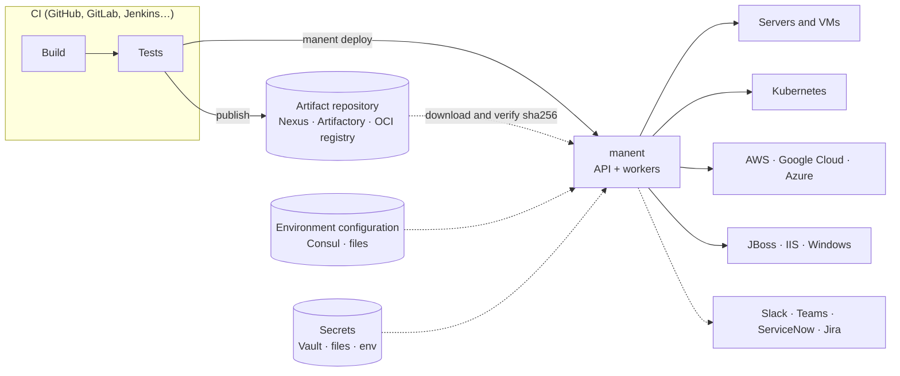

# Overview

manent is a **deploy as code** engine. It takes an artifact that CI has already built and tested, and takes it to your environments through a declared pipeline of steps. Every step is recorded in a database, governed by rules, and can be audited afterwards.

The name comes from the Latin *manere*, "to remain, to stand firm". The artifact does not change on its way to production: the file that passed the tests in `test` is, byte for byte, the one released in `prod`.

## Where manent fits

| Is | Is not |
|---|---|
| The release system between the artifact repository and the targets. | A CI system: manent builds and tests nothing. It starts where the pipeline ends. |
| A durable workflow engine: an interrupted deploy resumes from the last step it completed. | An infrastructure provisioning tool: services, clusters and VMs already exist (Terraform, CloudFormation…). manent only changes what runs on them. |
| The place where release rules are enforced: promotions, approvals, freezes, change tickets. | A GitOps controller that keeps rewriting the targets: manent releases when asked and, with [reconciliation](../guida/governance.md#stato-reale), *reports* targets changed outside it, without overwriting them. |
| One engine with one model, reached through the CLI, the API, the web interface, CI actions and Terraform. | A per-team script collection: every team uses the same pipeline, the same rules and the same audit trail. |

## Design principles

- **The artifact is immutable.** A promotion pins the `sha256` of the artifact actually released in the source environment, and the `qa` step checks it before the deploy. A rebuilt file, even from the same commit, is a different artifact.
- **Declarative.** The [descriptor](../guida/descrittore.md) says *what* to release; the [environment configuration](../guida/configurazione-ambiente.md) says *where* and *how*. Neither contains scripts that change at every release.
- **Durable and idempotent.** Each step is a [DBOS](https://github.com/dbos-inc/dbos-transact-golang) step whose result is saved before the next one starts. After a crash a deploy continues on the same or another worker, and the same `id` never runs twice.
- **Authoritative configuration.** What the environment defines cannot be overridden by the descriptor: a conflict is an error, never a silent overwrite. [`descriptor_policy`](../operazioni/sicurezza.md#cosa-puo-chiedere-un-descrittore) limits what a descriptor may add.
- **Secrets by reference.** Descriptors, configuration and history contain only references (`vault:…`, `file:…`, `env:…`). Values are read by the worker at the moment they are used and never appear in outputs or logs.
- **Fail closed.** A governance policy that cannot be evaluated refuses the deploy; a health gate that sees no data is red; an unknown descriptor field is an error.
- **One core.** CLI, API, web interface, GitHub Action, GitLab template and Terraform provider all go through the same API, so the same permissions and audit apply everywhere.

## The model

| Concept | What it is | Defined in |
|---|---|---|
| **Application** | Something you release, for example `shop-api`. | Descriptor (`application`). |
| **Environment** | Where the application runs: `dev`, `test`, `preprod`, `prod`. Regions and AZs are *labels* of the targets, not separate environments. | Descriptor (`environment`). |
| **Artifact** | The immutable file or image to release, with a `type` (`application`, `container`, `kubernetes`, `war`, `lambda`…) that picks the plugins able to handle it. | Descriptor (`artifact`). |
| **Target** | A destination: a host, a cluster API, a cloud region, a management endpoint. It carries `labels` (`region`, `az`, `canary`…). | Environment configuration or descriptor. |
| **Plugin** | The component that knows how to release an artifact type on a kind of target. | `manent.yml` (`plugins`). |
| **Pipeline** | The ordered steps every deploy goes through: `secrets`, `artifacts`, `qa`, `deploy`, `post-test`, `activation`, plus custom steps. | `manent.yml` (`pipeline`). |
| **Deploy** | One run of the pipeline for an application, environment and artifact: a durable workflow with an ID, a state and an outcome. | Created by a request. |
| **Rollout strategy** | How the deploy reaches the targets: all at once, in [waves](../guida/ondate.md), or by [traffic percentage](../guida/traffico.md). | Environment configuration. |
| **Governance** | Rules on who can release what, where and when. | `manent.yml` (`governance`) or Rego policies. |
| **Tenant** | The team that owns an application; application tags group applications across teams. | [Tenant registry](../guida/tenant.md). |

See the [Glossary](glossario.md) for every term used in this documentation.

## Who does what

manent separates responsibilities, so that each team changes only what belongs to it.

| Role | Owns | Typical actions | Start from |
|---|---|---|---|
| **Application team** | The descriptor, in the application repository. | Release from CI, follow the deploy, dry-run, roll back. | [First deploy](../tutorial/primo-deploy.md), [Deploy from CI](../tutorial/ci.md) |
| **Environment owners** | The environment configuration (Consul or files): targets, parameters, secret references, rollout strategy. | Add a node, change a wave, enforce rollback. | [Environments and secrets](../tutorial/ambienti.md) |
| **Platform team** | `manent.yml`, workers, plugins, database, integrations. | Install, scale, upgrade, recover lost workers. | [manent in production](../tutorial/produzione.md) |
| **Release managers, CAB** | Governance rules and policies. | Approve, freeze, require promotion and change tickets. | [Promotion and approvals](../tutorial/promozione.md) |
| **Security and audit** | Identity provider, RBAC, audit, SIEM. | Grant roles, verify the audit chain, review who released what. | [Authentication, permissions and audit](../operazioni/accesso.md) |

## Next steps

- [Deploy types](tipologie-deploy.md): every way a deploy can be triggered and rolled out.
- [Deploy lifecycle](ciclo-di-vita.md): what happens from the request to the outcome, and every state.
- [Configuration model](configurazione.md): the three layers and their merge rules.
- [Architecture](architettura.md): binaries, components and durability.
