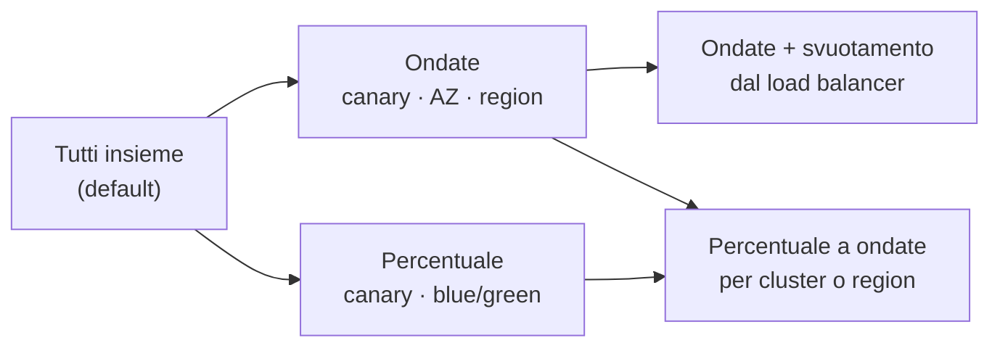

# Tipologie di deploy

Ogni deploy di manent esegue la stessa pipeline. Ciò che cambia si descrive lungo quattro assi indipendenti:

| Asse | Domanda | Possibilità |
|---|---|---|
| [**Avvio**](#trigger) | Quando parte? | subito, a un orario, in modo ricorrente, dopo altri deploy, dentro una release composta |
| [**Tipo**](#kind) | Da dove viene l'artefatto? | nuovo deploy, promozione, rollback manuale, adozione, più il dry-run come modalità |
| [**Strategia**](#strategy) | Come raggiunge i target? | tutti insieme, a ondate, con svuotamento dal load balancer, per percentuale di traffico, delegata al servizio cloud |
| [**Piattaforma**](#platform) | Cosa cambia sul target? | file sui server, container, oggetti Kubernetes, servizi cloud gestiti, application server, Windows |

Gli assi si combinano liberamente: una promozione ricorrente rilasciata a ondate su cluster Kubernetes è un deploy valido, come lo è il dry-run di un rilascio per percentuale su Cloud Run.

## Avvio { #trigger }

### Immediato

Il caso predefinito. Il deploy entra subito nella coda DBOS (`ENQUEUED`) e parte appena un worker ha uno slot libero e non è in corso un altro deploy della stessa applicazione e dello stesso ambiente (`dbos.environment_concurrency`, default 1).

```sh
manent deploy -f deploy.yml
```

### A un orario

`schedule.at` accoda subito il deploy nello stato `DELAYED`; entra in coda all'orario indicato, per esempio in una finestra di manutenzione. Si annulla come qualunque deploy.

```yaml
schedule:
  at: 2026-11-07T02:00:00+01:00
```

### Ricorrente

`schedule.cron` crea (o aggiorna per nome) una **schedule**: a ogni scatto manent accoda un deploy con l'ID deterministico `<schedule>@<ora UTC>`, quindi uno scatto non produce mai due deploy, anche con molti worker. Tipico per i rilasci notturni negli ambienti di sviluppo.

```yaml
schedule:
  cron: "0 2 * * 1-5"
  timezone: Europe/Rome
  name: shop-nightly
```

Vedi [Deploy pianificati](../guida/pianificazione.md).

### Dopo altri deploy

Con `after` (o `--after <id>`) il deploy attende, nello stato `WAITING_DEPENDENCY`, che i deploy da cui dipende siano riusciti. Mentre attende non occupa slot; se una dipendenza fallisce termina in `DEPENDENCY_FAILED`.

```yaml
after: [shop-db-2.4.0-prod]
afterTimeout: 2h
```

Un deploy può anche leggere ciò che ha prodotto il precedente: il deploy dell'infrastruttura esporta le VM create, quello della configurazione le importa come propri target (`imports`, `deploy.targetsFrom`). Vedi [Export e import](../guida/catene.md#export-import).

### Release composta

Un documento `kind: Release` raggruppa più deploy con le dipendenze tra loro: quelli indipendenti girano in parallelo, gli altri in ordine. `onFailure` decide se fermarsi, continuare o annullare con un rollback i deploy già fatti.

```yaml
apiVersion: manent/v1
kind: Release
id: shop-2026-10
onFailure: rollback
deploys:
  - {name: db, file: release/db.yml}
  - {name: api, file: release/api.yml, after: [db]}
  - {name: web, file: release/web.yml, after: [api]}
```

Vedi [Catene di deploy](../guida/catene.md).


## Tipo { #kind }

Il tipo viene registrato con ogni deploy (`kind` nello stato e nell'[inventario](../guida/governance.md#inventario)).

| Tipo | Avviato da | Artefatto | Note |
|---|---|---|---|
| `deploy` | `manent deploy`, API, CI, schedule | Quello del descrittore. | Il caso abituale. |
| `promotion` | `manent promote --from test --to prod` | Quello rilasciato con successo nell'ambiente di origine, con lo `sha256` fissato. | I target vengono dall'ambiente di destinazione, mai dall'origine. Valgono le regole della destinazione. |
| `rollback` | `manent rollback -e prod [--to 1.3.2]` | Una release precedente dello stesso ambiente, con il suo `sha256`. | Un rollback manuale è un nuovo deploy. Ammesso solo per i tipi di artefatto la cui policy lo consente. |

Il **rollback automatico** non è un tipo: avviene *dentro* un deploy fallito, che resta `ERROR` e riporta l'esito del rollback. Vedi [Rollback](../guida/rollback.md).

Il **dry-run** è una modalità di qualunque tipo (`--dry-run`, `dryRun: true`): lo stesso workflow gira su un worker, verifica segreti, artefatto e target e non cambia nulla. Un dry-run con `id` riceve l'ID `<id>.dry-run`, così non consuma la chiave di idempotenza del deploy reale. Vedi [Dry-run](../guida/dry-run.md).

## Strategia { #strategy }



### Tutti insieme

Senza `rollout` il deploy esegue gli step una volta, su tutti i target dell'ambiente. È il plugin a decidere come percorrerli: `remote-copy`, per esempio, rilascia un target dopo l'altro e si ferma al primo errore. È la scelta giusta per un singolo nodo, per gli ambienti di sviluppo e per i servizi in cui è la piattaforma a sostituire le istanze gradualmente (un `Deployment` Kubernetes, un servizio ECS).

### Ondate

La strategia [`rollout.waves`](../guida/ondate.md) rilascia prima un canary, poi una region e una AZ alla volta, a lotti di `maxUnavailable` target. Dopo ogni stadio ci sono un tempo di osservazione e un **health gate** (sonde HTTP, metriche, allarmi). Il deploy resta uno, con un ID e un esito; in caso di errore `onFailure` si ferma, riporta indietro l'ondata fallita o riporta indietro tutto.

```yaml
rollout:
  waves:
    - {name: canary, select: "canary=true", bake: 15m}
    - {name: eu, select: "region=eu-1", by: az, bake: 10m}
  maxUnavailable: 25%
  onFailure: rollback-wave
```

Con `dbos.region_routing` i passi di ogni region girano sui worker di quella region, per le reti separate per region.

### Ondate con svuotamento dal load balancer

Quando i target sono dietro un load balancer, `traffic.pool` nella configurazione di ambiente [svuota](../guida/svuotamento.md) ogni lotto prima del deploy e lo rimette in servizio dopo, con un controllo di capacità. Provider: HAProxy, F5 BIG-IP, NGINX Plus, NGINX open source, AWS ELB, IIS ARR, Windows NLB e un file di health-flag.

### Percentuale (canary e blue/green)

La strategia [`traffic`](../guida/traffico.md) rilascia la **candidata** accanto alla versione **stabile** senza traffico, poi sposta il traffico per gradini (per esempio 1, 5, 25, 50, 100%) con un gate dopo ogni gradino. Un errore riporta il traffico alla stabile con un cambio di peso, senza rifare il deploy. Il blue/green è lo stesso meccanismo con `steps: [100]`. L'analisi canary può confrontare candidata e stabile con un test statistico (Mann-Whitney).

```yaml
rollout:
  strategy: traffic
  traffic: {steps: [5, 25, 50, 100], bake: 10m}
```

Il traffico lo sposta il plugin (Kubernetes con Gateway API o Istio, Lambda, Cloud Run, App Service, Container Apps) oppure un router dell'ambiente (HAProxy, F5, NGINX Plus, AWS ALB) con target etichettati per `slot`. Con `rollout.waves` l'intera sequenza si ripete per cluster o per region.

### Delegata al servizio cloud

Alcuni servizi hanno strategie progressive proprie. Con il plugin [ecs](../plugins/ecs.md#strategie-native), un servizio configurato con `BLUE_GREEN`, `LINEAR` o `CANARY` le mantiene: manent aggiorna il servizio e attende la durata prevista, mentre ECS sposta il traffico e torna indietro sui propri allarmi.

### Quale strategia

| Vuoi | Usa |
|---|---|
| Il rilascio più semplice, un nodo o un ambiente di sviluppo | Tutti insieme |
| Limitare l'impatto di un errore tra region e AZ | Ondate con un canary |
| Nessuna connessione persa dietro un load balancer | Ondate con svuotamento |
| Esporre prima una piccola quota di utenti, con ritorno immediato | Percentuale |
| Spostare tutto il traffico in un colpo dopo i test sulla nuova versione | Blue/green (`steps: [100]`, tester, approvazione a `"0"`) |
| Mantenere la strategia nativa del servizio cloud | Delegata (ECS) |

## Piattaforma { #platform }

| Piattaforma | Plugin | Tipo di artefatto | Cosa cambia | Rollback |
|---|---|---|---|---|
| Server Linux e Unix | [remote-copy](../plugins/remote-copy.md) | `application` | File copiati via SSH/SFTP, una directory per release e il symlink `current`. | con `layout: releases` |
| Docker e Podman su VM | [container](../plugins/container.md) | `container` | Il container, ricreato da un'immagine fissata per digest. | sì |
| Kubernetes | [kubernetes](../plugins/kubernetes.md) | `kubernetes` | Manifest o un chart Helm, con server-side apply. | sì |
| Amazon ECS | [ecs](../plugins/ecs.md) | `ecs` | Una nuova revisione della task definition di un servizio esistente. | sì |
| AWS Lambda | [lambda](../plugins/lambda.md) | `lambda` | Il codice della funzione e una versione pubblicata dietro un alias. | sì |
| Google Cloud Run | [cloudrun](../plugins/cloudrun.md) | `cloudrun` | Una nuova revisione di un servizio esistente. | sì |
| Azure App Service | [appservice](../plugins/appservice.md) | `appservice` | Pacchetto o immagine, eventualmente in uno slot con swap. | sì |
| Azure Container Apps | [containerapps](../plugins/containerapps.md) | `containerapps` | Una nuova revisione di un'app esistente. | sì |
| JBoss EAP, WildFly | [jboss](../plugins/jboss.md) | `war`, `ear` | Un deployment per versione, sostituito in modo atomico. | sì |
| Windows | [windows](../plugins/windows.md) | `windows` | Applicazioni IIS, servizi, attività pianificate, pacchetti MSI. | sì |
| Tutto il resto | [plugin esterno](../plugins/esterni.md) | il tuo | Quello che fa il tuo plugin, via gRPC. | se dichiarato |

Il tipo di artefatto sceglie anche la [policy di rollback](../guida/rollback.md): `migration`, per esempio, non lo ammette mai.
