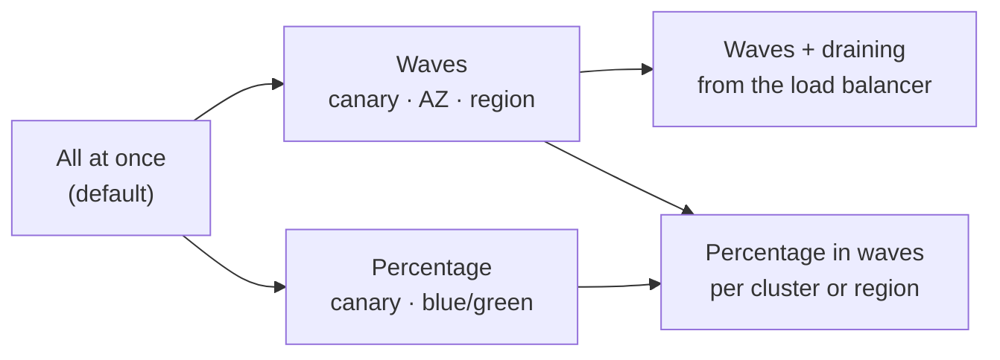

# Deploy types

Every deploy in manent runs the same pipeline. What changes is described along four independent axes:

| Axis | Question | Options |
|---|---|---|
| [**Trigger**](#trigger) | When does it start? | immediately, at a given time, recurring, after other deploys, as part of a composite release |
| [**Kind**](#kind) | Where does the artifact come from? | new deploy, promotion, manual rollback, adoption, plus dry-run as a mode |
| [**Strategy**](#strategy) | How does it reach the targets? | all at once, in waves, with load balancer draining, by traffic percentage, delegated to the cloud service |
| [**Platform**](#platform) | What is changed on the target? | files on servers, containers, Kubernetes objects, managed cloud services, application servers, Windows |

The axes combine freely: a recurring promotion released in waves to Kubernetes clusters is a valid deploy, and so is a dry-run of a percentage rollout on Cloud Run.

## Trigger { #trigger }

### Immediate

The default. The deploy enters the DBOS queue at once (`ENQUEUED`) and starts as soon as a worker has a free slot and no other deploy of the same application and environment is running (`dbos.environment_concurrency`, default 1).

```sh
manent deploy -f deploy.yml
```

### At a given time

`schedule.at` enqueues the deploy immediately in state `DELAYED`; it enters the queue at the given time, for example in a maintenance window. It is cancelled like any deploy.

```yaml
schedule:
  at: 2026-11-07T02:00:00+01:00
```

### Recurring

`schedule.cron` creates (or updates by name) a **schedule**: at every tick manent enqueues a deploy with the deterministic ID `<schedule>@<UTC time>`, so a tick never produces two deploys, even with many workers. Typical for nightly releases to development environments.

```yaml
schedule:
  cron: "0 2 * * 1-5"
  timezone: Europe/Rome
  name: shop-nightly
```

See [Scheduled deploys](../guida/pianificazione.md).

### After other deploys

With `after` (or `--after <id>`) the deploy waits, in state `WAITING_DEPENDENCY`, until the deploys it depends on have succeeded. It takes no slot while it waits; if a dependency fails it ends as `DEPENDENCY_FAILED`.

```yaml
after: [shop-db-2.4.0-prod]
afterTimeout: 2h
```

A deploy can also read what the previous one produced: the infrastructure deploy exports the VMs it created, the configuration deploy imports them as its targets (`imports`, `deploy.targetsFrom`). See [Exports and imports](../guida/catene.md#export-import).

### Composite release

A `kind: Release` document groups several deploys with the dependencies between them: independent ones run in parallel, the others in order. `onFailure` decides whether to stop, continue or roll back the deploys already done.

```yaml
apiVersion: manent/v1
kind: Release
id: shop-2026-10
onFailure: rollback
deploys:
  - {name: db, file: release/db.yml}
  - {name: api, file: release/api.yml, after: [db]}
  - {name: web, file: release/web.yml, after: [api]}
```

See [Deploy chains](../guida/catene.md).


## Kind { #kind }

The kind is recorded with every deploy (`kind` in the status and in the [inventory](../guida/governance.md#inventario)).

| Kind | Started by | Artifact | Notes |
|---|---|---|---|
| `deploy` | `manent deploy`, API, CI, schedules | The one in the descriptor. | The usual case. |
| `promotion` | `manent promote --from test --to prod` | The one released successfully in the source environment, with its `sha256` pinned. | Targets come from the destination environment, never from the source. Subject to the destination's rules. |
| `rollback` | `manent rollback -e prod [--to 1.3.2]` | A previous release of the same environment, with its `sha256`. | A manual rollback is a new deploy. Allowed only for artifact types whose policy allows rollback. |

**Automatic rollback** is not a kind: it happens *inside* a failed deploy, which stays `ERROR` and reports the rollback outcome. See [Rollback](../guida/rollback.md).

**Dry-run** is a mode of any kind (`--dry-run`, `dryRun: true`): the same workflow runs on a worker, checks secrets, artifact and targets, and changes nothing. A dry-run with an `id` gets the ID `<id>.dry-run`, so it does not consume the idempotency key of the real deploy. See [Dry-run](../guida/dry-run.md).

## Strategy { #strategy }



### All at once

Without `rollout` the deploy runs the steps once, on all the targets of the environment. The plugin decides how to go through them: `remote-copy`, for example, releases one target after the other and stops at the first failure. It is the right choice for a single node, for development environments, and for services where the platform itself replaces instances gradually (a Kubernetes `Deployment`, an ECS service).

### Waves

The [`rollout.waves`](../guida/ondate.md) strategy releases a canary first, then one region and one AZ at a time, in batches of `maxUnavailable` targets. After every stage there is a bake time and a **health gate** (HTTP probes, metrics, alerts). The deploy keeps one ID and one outcome; on failure `onFailure` stops, rolls back the failed wave or rolls back everything.

```yaml
rollout:
  waves:
    - {name: canary, select: "canary=true", bake: 15m}
    - {name: eu, select: "region=eu-1", by: az, bake: 10m}
  maxUnavailable: 25%
  onFailure: rollback-wave
```

With `dbos.region_routing` each region's passes run on workers of that region, for networks that are separate per region.

### Waves with load balancer draining

When the targets sit behind a load balancer, `traffic.pool` in the environment configuration [drains](../guida/svuotamento.md) every batch before the deploy and puts it back in service afterwards, with a capacity check. Providers: HAProxy, F5 BIG-IP, NGINX Plus, NGINX open source, AWS ELB, IIS ARR, Windows NLB and a health-flag file.

### Percentage (canary and blue/green)

The [`traffic`](../guida/traffico.md) strategy releases the **candidate** next to the **stable** version without traffic, then moves traffic in steps (for example 1, 5, 25, 50, 100%) with a gate after each step. A failure sends the traffic back to the stable version with a weight change, without redeploying. Blue/green is the same mechanism with `steps: [100]`. Canary analysis can compare candidate and stable statistically (Mann-Whitney).

```yaml
rollout:
  strategy: traffic
  traffic: {steps: [5, 25, 50, 100], bake: 10m}
```

Traffic is moved by the plugin (Kubernetes with Gateway API or Istio, Lambda, Cloud Run, App Service, Container Apps) or by an environment router (HAProxy, F5, NGINX Plus, AWS ALB) with targets labelled by `slot`. With `rollout.waves` the whole sequence runs per cluster or region.

### Delegated to the cloud service

Some services have their own progressive strategies. With the [ecs](../plugins/ecs.md#strategie-native) plugin, a service configured with `BLUE_GREEN`, `LINEAR` or `CANARY` keeps them: manent updates the service and waits for the expected duration, while ECS moves traffic and rolls back on its alarms.

### Which strategy

| You want | Use |
|---|---|
| The simplest release, one node or a dev environment | All at once |
| To limit the blast radius across regions and AZs | Waves with a canary |
| No dropped connections behind a load balancer | Waves with draining |
| To expose a small share of users first, with instant return | Percentage |
| To switch all traffic at once after tests on the new version | Blue/green (`steps: [100]`, testers, approval at `"0"`) |
| To keep the cloud service's native strategy | Delegated (ECS) |

## Platform { #platform }

| Platform | Plugin | Artifact type | What changes | Rollback |
|---|---|---|---|---|
| Linux and Unix servers | [remote-copy](../plugins/remote-copy.md) | `application` | Files copied over SSH/SFTP, a release directory and the `current` symlink. | with `layout: releases` |
| Docker and Podman on VMs | [container](../plugins/container.md) | `container` | The container, recreated from an image pinned by digest. | yes |
| Kubernetes | [kubernetes](../plugins/kubernetes.md) | `kubernetes` | Manifests or a Helm chart, with server-side apply. | yes |
| Amazon ECS | [ecs](../plugins/ecs.md) | `ecs` | A new task definition revision of an existing service. | yes |
| AWS Lambda | [lambda](../plugins/lambda.md) | `lambda` | Function code and a published version behind an alias. | yes |
| Google Cloud Run | [cloudrun](../plugins/cloudrun.md) | `cloudrun` | A new revision of an existing service. | yes |
| Azure App Service | [appservice](../plugins/appservice.md) | `appservice` | Package or image, optionally in a slot with swap. | yes |
| Azure Container Apps | [containerapps](../plugins/containerapps.md) | `containerapps` | A new revision of an existing app. | yes |
| JBoss EAP, WildFly | [jboss](../plugins/jboss.md) | `war`, `ear` | A deployment per version, replaced atomically. | yes |
| Windows | [windows](../plugins/windows.md) | `windows` | IIS applications, services, scheduled tasks, MSI packages. | yes |
| Anything else | [external plugin](../plugins/esterni.md) | your own | Whatever your plugin does, over gRPC. | if declared |

The artifact type also selects the [rollback policy](../guida/rollback.md): `migration`, for example, never allows it.
