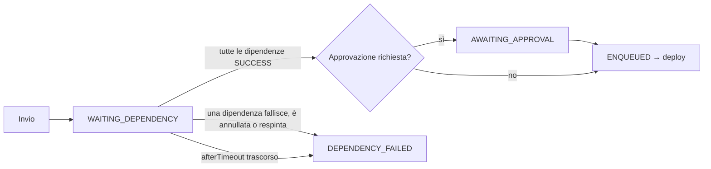
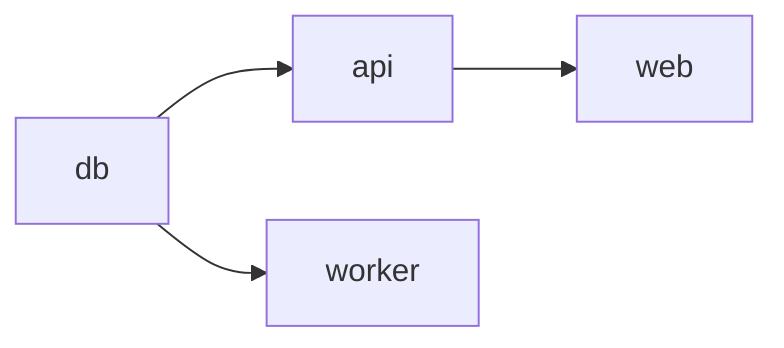

# Catene di deploy

A volte un deploy deve partire solo dopo il successo di un altro: la migrazione del database prima del backend, il backend prima del frontend, un servizio condiviso prima delle applicazioni che lo usano. manent offre due livelli:

- **dipendenze (`after`)**: un singolo deploy attende che altri deploy, indicati per ID, riescano;
- **release composte (`kind: Release`)**: un'unica richiesta con più deploy e le dipendenze tra loro, seguita nel suo insieme, con una politica per i fallimenti.

Il secondo livello è costruito sul primo: ogni deploy di una release è un deploy normale che attende i propri predecessori.

## Dipendenze: `after`

```yaml title="api.yml"
apiVersion: manent/v1
id: shop-api-2.4.0-prod
application: shop-api
environment: prod
after:
  - shop-db-42-prod          # ID dei deploy che devono riuscire prima
afterTimeout: 2h             # attesa massima, default 24h (da 1m a 30 giorni)
artifact: {type: application, name: shop-api, version: 2.4.0, source: https://…}
```

Dalla CLI le dipendenze si aggiungono anche con `--after`, ripetibile:

```sh
manent deploy -f api.yml --after shop-db-42-prod
```

### Come funziona



- **All'invio** ogni dipendenza deve esistere, non essere un dry-run e non essere già conclusa senza successo: altrimenti la richiesta è rifiutata (`422`). Se sono già tutte riuscite il deploy viene accodato subito.
- **Durante l'attesa** il deploy è `WAITING_DEPENDENCY` e **non occupa uno slot della coda dell'ambiente**: come un'approvazione, l'attesa gira sulla coda delle approvazioni. Un deploy in attesa non blocca quindi gli altri deploy dell'ambiente, e due deploy che si attendono a vicenda non possono bloccare la coda.
- L'attesa è un workflow DBOS durevole: sopravvive al riavvio dei worker. Quando una dipendenza si conclude (riuscita, fallita, annullata, respinta) **avvisa subito** le attese che la seguono, che rileggono lo stato in una sola query. In più l'attesa rilegge lo stato ogni `chains.poll_interval` (default 5s), raddoppiando l'intervallo fino a 5 minuti: copre i casi senza avviso, come un deploy eliminato dalla retention.
- **Quando tutte le dipendenze sono riuscite** viene chiesta l'approvazione, se la regola di [governance](governance.md#approvazioni) la richiede (così gli approvatori vengono interpellati solo per un deploy che può davvero partire), poi il deploy viene accodato con l'ID già restituito. Con `schedule.at` il deploy parte al più tardi tra l'orario e il successo delle dipendenze.
- **Se una dipendenza non riesce** (errore, annullata, respinta, scaduta, a sua volta con dipendenze fallite) o l'attesa scade, il deploy non viene eseguito e si conclude in `DEPENDENCY_FAILED`, con il motivo in `error` e in `after.reason`. L'esito è registrato nell'audit (`after.finish`).
- Un deploy in attesa si annulla come gli altri (`manent cancel <id>`).

Lo stato del deploy riporta le dipendenze:

```json
{
  "id": "shop-api-2.4.0-prod",
  "state": "WAITING_DEPENDENCY",
  "after": {
    "status": "waiting",
    "expires_at": "2026-10-12T14:00:00Z",
    "dependencies": [{"id": "shop-db-42-prod", "state": "PENDING"}]
  }
}
```

### Regole

- `after` non è ammesso con `dryRun` (il dry-run viene eseguito subito) né con `schedule.cron` (ogni esecuzione dipenderebbe sempre dagli stessi deploy). Al massimo 20 dipendenze; un deploy non può dipendere da se stesso.
- Le dipendenze possono essere di altre applicazioni e altri ambienti, ma chi richiede il deploy deve avere `deployment.read` su di esse: altrimenti dall'esito dell'attesa si dedurrebbe lo stato dei deploy di altri team.
- Una [promozione](governance.md#promozione) o un [rollback manuale](governance.md#rollback-manuale) non eredita le dipendenze del deploy di origine.

## Release composte

Una release raggruppa più deploy con le dipendenze tra loro. I deploy indipendenti partono in parallelo, gli altri dopo i loro predecessori.

```yaml title="release.yml"
apiVersion: manent/v1
kind: Release
id: shop-2026-10            # obbligatorio: è la chiave di idempotenza
onFailure: rollback         # stop (default) | continue | rollback
deploys:
  - name: db
    file: release/db.yml    # descrittore del deploy, relativo a questo file
  - name: api
    file: release/api.yml
    after: [db]             # nomi di altri deploy della release
  - name: worker
    file: release/worker.yml
    after: [db]
  - name: web
    file: release/web.yml
    after: [api]
```



```sh
manent release submit -f release.yml      # invia e segue l'avanzamento (--no-wait, --timeout)
manent release status shop-2026-10
manent release list
manent release cancel shop-2026-10
```

Tramite API i descrittori sono inclusi nella richiesta (`descriptor` invece di `file`): vedi [API HTTP](api.md#release-composte).

### Come funziona

- **Prima le verifiche, poi l'invio.** La release è validata nel suo insieme (nomi distinti, dipendenze esistenti, **nessun ciclo**, niente `schedule` né `dryRun` nei deploy), poi per **ogni** deploy vengono verificati piano, policy, configurazione di ambiente, regole di governance (es. un freeze) e dipendenze esterne alla release: un errore rifiuta subito l'intera richiesta. Solo dopo la release viene accettata.
- **Accodamento dei deploy.** È il workflow della release ad accodare i deploy, in ordine topologico, come primo passo: una caduta del server subito dopo l'invio non lascia deploy senza la release che li segue. I deploy appena accettati risultano `ENQUEUED` finché il workflow non li ha accodati. Se in quel momento un deploy viene rifiutato (es. un freeze iniziato nel frattempo), quelli già accodati vengono annullati: il rifiutato risulta `ERROR`, i successivi `CANCELLED`, la release `ERROR`.
- **ID.** Ogni deploy riceve l'ID del suo descrittore, se ne ha uno, altrimenti `<release>.<nome>` (es. `shop-2026-10.api`). Le dipendenze interne alla release diventano `after` tra questi ID; un `after` già presente in un descrittore (dipendenze esterne alla release) resta.
- **Ogni deploy è un deploy normale**: piano, permessi, governance (approvazioni, freeze, promozione obbligatoria), rollback automatico e ondate propri. Negli elenchi e nello stato riporta `release`.
- **Monitoraggio.** Il workflow `manent.release`, sulla coda delle approvazioni, legge lo stato di tutti i deploy con una sola query, viene avvisato quando uno di essi (o un suo rollback) si conclude e applica `onFailure`. Inviare di nuovo la stessa release restituisce quella esistente. Annullando la release (`manent release cancel`) si ferma prima il workflow, poi vengono annullati i deploy non conclusi.

### `onFailure`

| Valore | Quando un deploy non riesce |
|---|---|
| `stop` (default) | I deploy non ancora partiti (in attesa, da approvare, in coda) vengono annullati. Quelli già in esecuzione terminano. |
| `continue` | I deploy che non dipendono da quello fallito proseguono; quelli che ne dipendono si concludono in `DEPENDENCY_FAILED`. |
| `rollback` | Come `stop`; poi i deploy **riusciti** tornano alla versione precedente, dal più dipendente al meno dipendente (es. `web`, poi `api`, poi `db`). |

I rollback di `onFailure: rollback` sono [rollback manuali](governance.md#rollback-manuale) con ID `<release>.rollback.<nome>`, eseguiti con l'identità di chi ha inviato la release: seguono le stesse regole, compresa la [policy per tipo di artefatto](rollback.md) (una `migration` non si riporta indietro, e la sequenza si ferma lì). Procedono uno alla volta e si fermano al primo che non riesce.

### Stato della release

| `state` | Significato |
|---|---|
| `PENDING` | Almeno un deploy non è concluso. |
| `SUCCESS` | Tutti i deploy sono riusciti. |
| `ERROR` | Almeno un deploy non è riuscito: `error` li elenca, `deploys[].rollback_state` riporta i rollback. |
| `CANCELLED` | La release è stata annullata. |

L'esito è registrato nell'audit (`release.finish`). L'interfaccia web mostra le release nella vista **Release**, con lo stato di ogni deploy e del suo rollback.

### Permessi

- Inviare una release richiede, per ogni deploy, gli stessi permessi di un deploy singolo (`deployment.submit`, `deployment.freeze-override` se il descrittore la usa, `deployment.read` sulle dipendenze esterne) e, con `onFailure: rollback`, `deployment.rollback`.
- Leggere una release richiede `deployment.read` su tutti i suoi deploy; gli elenchi mostrano solo le release interamente leggibili. Annullarla richiede `deployment.cancel` su tutti i suoi deploy.
