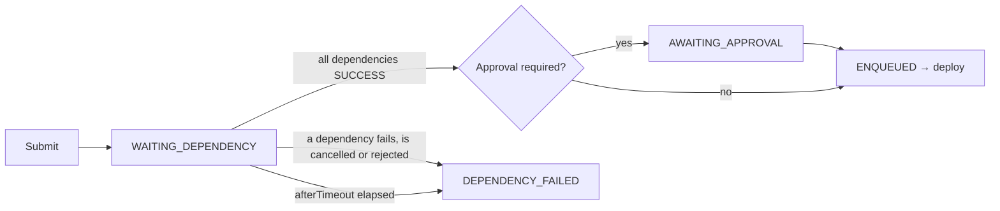
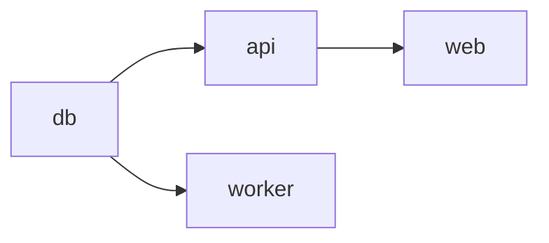

# Deploy chains

Sometimes a deploy must start only after another one has succeeded: the database migration before the backend, the backend before the frontend, a shared service before the applications that use it. manent offers two levels:

- **dependencies (`after`)**: a single deploy waits for other deploys, identified by their ID, to succeed;
- **composite releases (`kind: Release`)**: a single request with several deploys and the dependencies between them, followed as a whole, with a policy for failures.

The second level is built on the first: every deploy of a release is a normal deploy that waits for its predecessors.

## Dependencies: `after`

```yaml title="api.yml"
apiVersion: manent/v1
id: shop-api-2.4.0-prod
application: shop-api
environment: prod
after:
  - shop-db-42-prod          # IDs of deploys that must succeed first
afterTimeout: 2h             # maximum wait, default 24h (from 1m to 30 days)
artifact: {type: application, name: shop-api, version: 2.4.0, source: https://…}
```

From the CLI the dependencies can also be added with `--after`, repeatable:

```sh
manent deploy -f api.yml --after shop-db-42-prod
```

### How it works



- **At submit time** every dependency must exist, must not be a dry-run and must not have already ended without success: otherwise the request is refused (`422`). If they have all already succeeded, the deploy is queued straight away.
- **While waiting** the deploy is `WAITING_DEPENDENCY` and **does not take a slot of the environment queue**: like an approval, the wait runs on the approval queue. A waiting deploy therefore never blocks the other deploys of the environment, and two deploys waiting for each other cannot deadlock the queue.
- The wait is a durable DBOS workflow: it survives worker restarts. When a dependency ends (succeeded, failed, cancelled, rejected) it **immediately notifies** the waits that follow it, which read the state again with a single query. The wait also reads the state every `chains.poll_interval` (default 5s), doubling the interval up to 5 minutes: this covers the cases without a notification, such as a deploy deleted by retention.
- **When all dependencies have succeeded** the approval is requested, if the [governance](governance.md#approvazioni) rule requires one (so approvers are asked only for a deploy that can really start), then the deploy is queued with the ID already returned. With `schedule.at`, the deploy starts at the later of the time and the success of the dependencies.
- **If a dependency does not succeed** (error, cancelled, rejected, expired, dependency failed in turn) or the wait expires, the deploy is not run and ends as `DEPENDENCY_FAILED`, with the reason in `error` and in `after.reason`. The outcome is recorded in the audit log (`after.finish`).
- A waiting deploy can be cancelled like any other (`manent cancel <id>`).

The deploy status reports the dependencies:

```json
{
  "id": "shop-api-2.4.0-prod",
  "state": "WAITING_DEPENDENCY",
  "after": {
    "status": "waiting",
    "expires_at": "2026-10-12T14:00:00Z",
    "dependencies": [{"id": "shop-db-42-prod", "state": "PENDING"}]
  }
}
```

### Rules

- `after` is not allowed with `dryRun` (a dry-run runs immediately) nor with `schedule.cron` (every run would depend on the same deploys). At most 20 dependencies, a deploy cannot depend on itself.
- The dependencies may belong to other applications and environments, but the requester needs `deployment.read` on them: otherwise the outcome of the wait would reveal the state of other teams' deploys.
- A [promotion](governance.md#promozione) or a [manual rollback](governance.md#rollback-manuale) does not inherit the dependencies of the source deploy.

## Composite releases { #release-composte }

A release groups several deploys with the dependencies between them. Independent deploys run in parallel, the others after their predecessors.

```yaml title="release.yml"
apiVersion: manent/v1
kind: Release
id: shop-2026-10            # required: it is the idempotency key
onFailure: rollback         # stop (default) | continue | rollback
deploys:
  - name: db
    file: release/db.yml    # deploy descriptor, relative to this file
  - name: api
    file: release/api.yml
    after: [db]             # names of other deploys of the release
  - name: worker
    file: release/worker.yml
    after: [db]
  - name: web
    file: release/web.yml
    after: [api]
```



```sh
manent release submit -f release.yml      # submits and follows the progress (--no-wait, --timeout)
manent release status shop-2026-10
manent release list
manent release cancel shop-2026-10
```

Through the API the descriptors are included in the request (`descriptor` instead of `file`): see [HTTP API](api.md#release-composte).

### How it works

- **Checks first, then submission.** The release is validated as a whole (unique names, existing dependencies, **no cycles**, no `schedule` or `dryRun` in the deploys), then plan, policies, environment configuration, governance rules (e.g. a freeze) and dependencies outside the release are checked for **every** deploy: an error refuses the whole request immediately. Only then is the release accepted.
- **Queuing the deploys.** The release workflow queues the deploys, in topological order, as its first step: a server crash right after the submission does not leave deploys without the release that follows them. Newly accepted deploys are `ENQUEUED` until the workflow has queued them. If a deploy is refused at that moment (e.g. a freeze that started in the meantime), those already queued are cancelled: the refused one is `ERROR`, the following ones `CANCELLED`, the release `ERROR`.
- **IDs.** Each deploy gets the ID of its descriptor, if it has one, otherwise `<release>.<name>` (e.g. `shop-2026-10.api`). The dependencies inside the release become `after` between these IDs; `after` already in a descriptor (dependencies outside the release) is kept.
- **Each deploy is a normal deploy**: its own plan, permissions, governance (approvals, freeze, mandatory promotion), automatic rollback and waves. In lists and in the status it carries `release`.
- **Following.** The `manent.release` workflow, on the approval queue, reads the state of all the deploys with a single query, is notified when one of them (or its rollback) ends, and applies `onFailure`. Submitting the same release again returns the existing one. Cancelling the release (`manent release cancel`) stops the workflow first, then cancels the deploys that have not finished.

### `onFailure`

| Value | When a deploy does not succeed |
|---|---|
| `stop` (default) | Deploys not yet started (waiting, awaiting approval, queued) are cancelled. Those already running finish. |
| `continue` | Deploys that do not depend on the failed one continue; those that depend on it end as `DEPENDENCY_FAILED`. |
| `rollback` | Like `stop`; then the deploys that **succeeded** are rolled back to their previous version, from the most dependent to the least dependent (e.g. `web`, then `api`, then `db`). |

The rollbacks of `onFailure: rollback` are [manual rollbacks](governance.md#rollback-manuale) with ID `<release>.rollback.<name>`, run with the identity of whoever submitted the release: they follow the same rules, including the [artifact type policy](rollback.md) (a `migration` cannot be rolled back, and the sequence stops there). They proceed one at a time and stop at the first that does not succeed.

### Release state

| `state` | Meaning |
|---|---|
| `PENDING` | At least one deploy has not finished. |
| `SUCCESS` | All deploys succeeded. |
| `ERROR` | At least one deploy did not succeed: `error` lists them, `deploys[].rollback_state` reports the rollbacks. |
| `CANCELLED` | The release was cancelled. |

The outcome is recorded in the audit log (`release.finish`). The web interface shows releases in the **Releases** view, with the state of each deploy and of its rollback.

### Permissions

- Submitting a release requires, for every deploy, the same permissions as a single deploy (`deployment.submit`, `deployment.freeze-override` if the descriptor uses it, `deployment.read` on external dependencies) and, with `onFailure: rollback`, `deployment.rollback`.
- Reading a release requires `deployment.read` on all its deploys; lists show only fully readable releases. Cancelling requires `deployment.cancel` on all its deploys.

## Exports and imports { #export-import }

A chain often needs to pass data along, not just order: the infrastructure deploy creates the VMs, the configuration deploy must know which ones they are. A deploy can **export** some of its outputs, and the deploys that follow it can **import** them as targets (`deploy.targetsFrom`) and plugin parameters (`deploy.paramsFrom`). The [tutorial](../tutorial/catene.md) walks through it step by step.

```yaml title="infra.yml (producer)"
apiVersion: manent/v1
id: infra-42
application: infra-web
environment: prod
artifact: {type: terraform, name: infra-web, version: 3.1.0, source: https://…}
exports:
  vms:     {from: deploy.vms, format: targets, pattern: '10\.20\.\d+\.\d+'}
  db_host: {from: deploy.db_host, pattern: '[a-z0-9.-]{1,253}'}
```

```yaml title="os-config.yml (consumer)"
apiVersion: manent/v1
application: os-config
environment: prod
after: [infra-42]
imports:
  infra: {deployment: infra-42}       # must be among the dependencies
artifact: {type: ansible, name: os-config, version: 1.8.0, source: https://…}
deploy:
  targetsFrom: [{import: infra, export: vms}]
  paramsFrom:
    db_host: {import: infra, export: db_host}
```

### Exports

- `from` is `<step>.<key>`: an output of the plugin (`deploy` step, `Result.Outputs` of the [plugin contract](../plugins/index.md)) or a declared output of a [custom step](step-personalizzati.md). In a wave rollout the step runs once per pass and batch: `targets` exports join the lists, `string` exports must have the same value everywhere.
- `format: string` (default) requires `pattern`, a regular expression matched against the **whole** value; `format: targets` is a JSON list of targets, objects `{host, port, user, labels}` or plain host strings, and the optional `pattern` applies to each host.
- Only declared outputs become exports, checked when the deploy **succeeds**: a value that does not match its format or pattern fails the deploy (`exports of the deploy not valid`), so the deploys that depend on it end as `DEPENDENCY_FAILED` instead of starting with wrong values. The pattern is also the barrier against secrets: plugins must never put secrets in their outputs.
- Exports are recorded with the outcome and shown in `manent status` (`exports`), in the API (`Status.exports`, `Result.exports`), in the web interface and in the CI outcome (`export_<name>=…`, see [CI and infrastructure as code](ci-iac.md)).
- Dry-runs have no exports.

### Imports

An import is one of:

| | Reads the exports of | Typical use |
|---|---|---|
| `deployment: <id>` | a given deploy, which **must be in `after`** (in a release: the name of another deploy of the release, which must be in its `after`) | the first deploy of a chain, pinned to the exact producer |
| `current: {application, environment}` | the **release in service** of an application (inventory; `artifact` if it has more than one); across tenants only the `public` exports are readable; `environment` defaults to the deploy's | everything that comes later: promotions, rollbacks, reconciliation, recurring schedules |

- Imports are resolved **when the deploy starts**, in the `config` step, before the merge with the environment configuration: imported targets and parameters are descriptor additions, so the [descriptor policy](../operazioni/sicurezza.md#cosa-puo-chiedere-un-descrittore) and the [merge rules](configurazione-ambiente.md#regole-di-fusione) apply to them (e.g. `deploy.targets` defined by the environment and `targetsFrom` in the descriptor is a conflict). The result is persisted with the step: a deploy resumed after a crash uses the same values. The step output records the source of each import (`import.infra: infra-42@3.1.0`).
- At submit time the imports are already checked if possible: a missing export or an environment without a release in service refuses the request (`422`). If the producer has not succeeded yet, the check is left to the worker.
- From the CLI, `--import <name>=<id>` binds an import to a deploy known only at run time and adds it to `after`; the descriptor can then use `targetsFrom`/`paramsFrom` without declaring the import:

    ```sh
    manent deploy -f os-config.yml --import infra=$INFRA_DEPLOYMENT_ID
    ```

- A [promotion](governance.md#promozione) or a [manual rollback](governance.md#rollback-manuale) drops the `deployment` imports together with `after`: the targets of another environment must not be reused. Its targets come from the environment configuration, typically with an import from `current`:

    ```yaml title="environment configuration of os-config/prod"
    plugin: ansible
    imports:
      infra: {current: {application: infra-web}}
    targets_from: [{import: infra, export: vms}]
    params_from:
      db_host: {import: infra, export: db_host}
    ```

    The environment configuration can only import releases in service (`current`); with `targets_from` the descriptor cannot add its own targets.
- In a composite release, `deployment` names another deploy of the release:

    ```yaml
    deploys:
      - name: infra
        file: release/infra.yml
      - name: os
        file: release/os-config.yml    # imports: {infra: {deployment: infra}}
        after: [infra]
    ```

- Permissions: importing requires `deployment.read` on the producer (as for `after`) and, with `current`, on its application and environment.
- Limits: at most 10 imports and 32 exports per deploy, export values up to 64 KiB (256 KiB in all), at most 500 targets per `targets` export, plugin outputs up to 64 keys. An import must be used by `targetsFrom` or `paramsFrom`, a parameter in `paramsFrom` cannot also be in `params`, and a deploy cannot import its own release in service.
