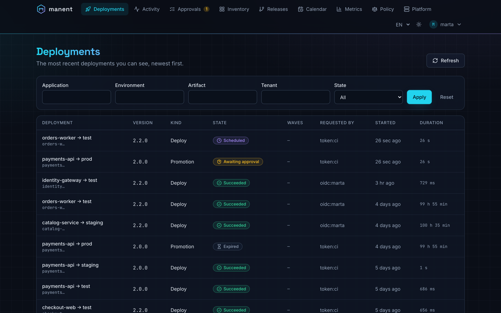
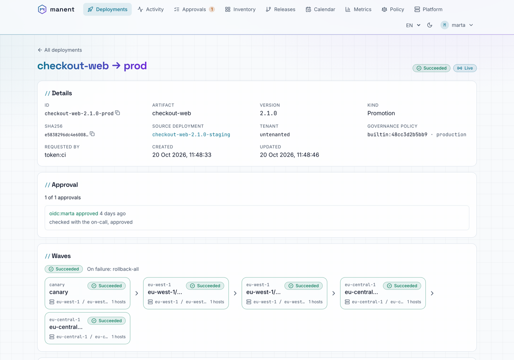
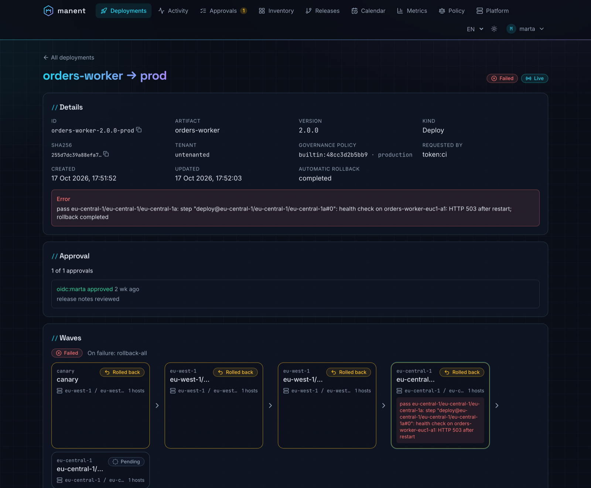
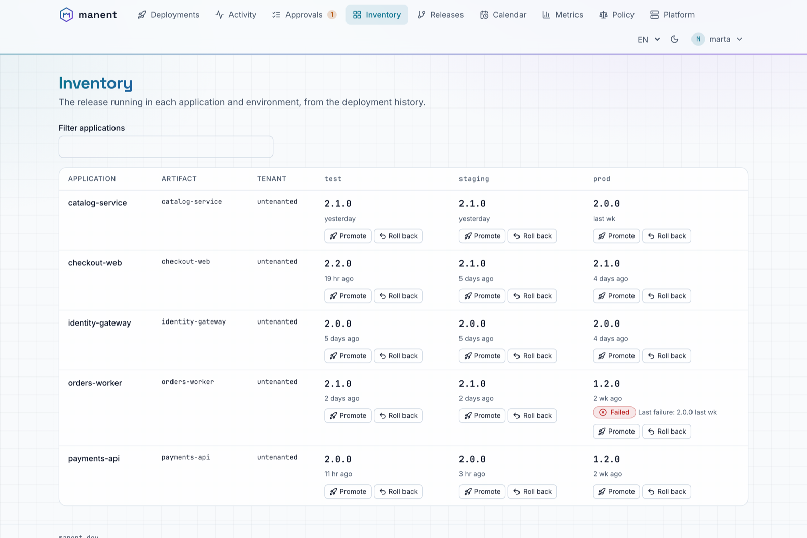
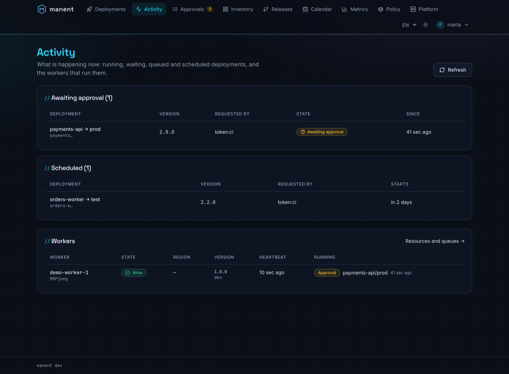
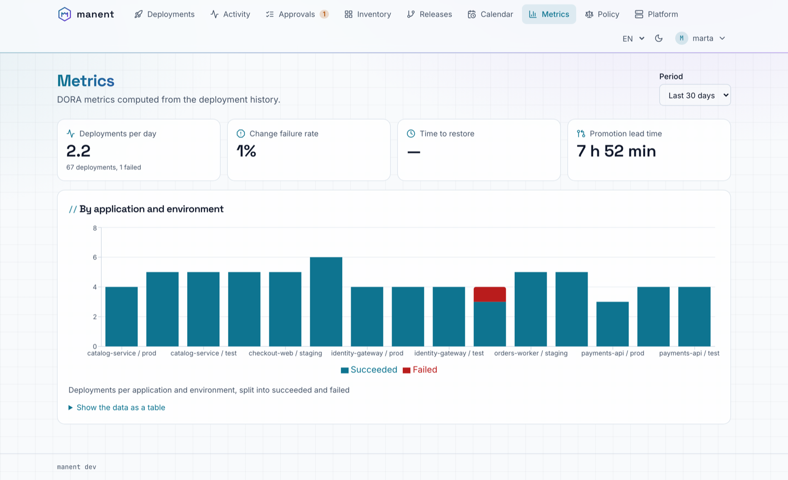

# Interfaccia web

`manent-server` serve un'interfaccia web su `/`, allo stesso indirizzo dell'API: chi rilascia, chi approva e chi è di turno segue deploy, ondate e log e prende decisioni senza la CLI. L'interfaccia è incorporata nel binario e nelle immagini ufficiali, quindi non c'è altro da installare.

Mostra solo ciò che l'utente può vedere e offre solo le azioni che può eseguire: i permessi sono le regole [RBAC](../operazioni/accesso.md#permessi-rbac) dell'API, che verifica comunque ogni richiesta.

## Viste

| Vista | Cosa mostra | Cosa si può fare |
|---|---|---|
| **Deploy** | I deploy più recenti, filtrabili per applicazione, ambiente e stato, con tipo, avanzamento delle ondate, richiedente e durata. | Aprire un deploy. |
| **Dettaglio di un deploy** | Stato, sha256, origine di una promozione o di un rollback, release, dipendenze con il loro stato, approvazioni con i commenti, ondate (stadi, region, AZ, health gate), step registrati, log. Stato e log si aggiornano in tempo reale. | Approvare o respingere, annullare. |
| **Attività** | Cosa sta succedendo ora: deploy in esecuzione con worker, ultimo step e avanzamento delle ondate; deploy in attesa di approvazione, in attesa delle dipendenze, in coda e pianificati. Con `platform.read`, i worker con stato, region, heartbeat e workflow in esecuzione. Aggiornata ogni 5 secondi. | Aprire un deploy. |
| **Approvazioni** | I deploy in attesa di una decisione che puoi prendere, prima dell'avvio o tra due ondate. | Approvare con un commento, respingere (commento obbligatorio). |
| **Release** | [Release composte](catene.md#release-composte) con l'avanzamento di ogni deploy, le dipendenze e i rollback di `onFailure: rollback`. | Aprire una release o un deploy, annullare una release. |
| **Tenant** | Visibile quando il [registro dei tenant](tenant.md) ha tenant che puoi leggere: tag, applicazioni possedute, coda, filtri per applicazione e selettore. La pagina di un tenant mostra le sue applicazioni con i tag e la release in esercizio per applicazione, artefatto e ambiente. | Aprire il deploy in esercizio o lo storico dei deploy di un'applicazione. |
| **Inventario** | Release in esercizio per applicazione e ambiente e artefatto (con il [tenant](tenant.md) proprietario), ultimo fallimento e drift. | Promuovere in un altro ambiente, fare rollback, sempre dopo un dry-run. |
| **Calendario** | Finestre di freeze attive e future (anche per region, hard, create a runtime con il loro autore), schedule ricorrenti. | Con `freeze.write`, creare un freeze d'emergenza e chiudere quelli creati a runtime. Sospendere, riprendere ed eliminare le schedule. |
| **Metriche** | Metriche DORA su 7, 30 o 90 giorni, per applicazione e ambiente, con i dati anche in tabella. | |
| **Piattaforma** | Con `platform.read`: le code (deploy, approvazioni e attese, passi delle region) con i limiti, i workflow in attesa, in esecuzione e pianificati, l'attesa più lunga e i worker in ascolto; i worker con le loro risorse (CPU usata e disponibile, memoria del processo rispetto al limite del container o alla memoria dell'host, slot di deploy occupati, spazio libero della workdir, carico dell'host) e le code che ascoltano. Aggiornata ogni 5 secondi. | Aprire i deploy in esecuzione su un worker. |
| **Policy** | Con `policy.read`: motore, sorgente e revisione della [policy di governance](policy.md) in vigore, le revisioni con stato, autore, approvatore e test, i file di ogni revisione. | Con `policy.write` calcolare l'impatto sugli ultimi 7 giorni e, con `rbac.engine: opa`, simulare in **Accessi** i [permessi](permessi.md#simulazione-e-impatto) di un'identità; con `policy.approve` approvare una bozza o tornare a una revisione precedente. |

Ogni vista ha un URL proprio con i filtri nella query string, così un link incollato in chat apre esattamente la stessa pagina.

**Promozioni e rollback** passano sempre da un [dry-run](dry-run.md): il dialogo lo esegue su un worker e abilita la conferma solo se riesce. Il motivo di una deroga al freeze è proposto solo a chi ha `deployment.freeze-override`. Le **approvazioni** seguono le regole della [governance](governance.md#approvazioni): chi ha richiesto un deploy non può approvarlo, e il pulsante spiega perché. Il dettaglio di un deploy mostra la revisione della policy di governance che lo ha deciso e, se la policy li limita, gli approvatori ammessi.

## Screenshot

Da un ambiente demo con cinque applicazioni, tre ambienti e quattro settimane di storico.

<div class="mn-shots" markdown>

<figure markdown="span">
  [{ loading=lazy }](../assets/screenshots/deployments.png)
  <figcaption><strong>Deploy</strong>: ogni deploy, promozione e rollback, con stato, richiedente e durata.</figcaption>
</figure>

<figure markdown="span">
  [{ loading=lazy }](../assets/screenshots/deployment-waves.png)
  <figcaption><strong>Rilascio a ondate</strong>: approvazione, canary, poi una zona di disponibilità alla volta su due region.</figcaption>
</figure>

<figure markdown="span">
  [{ loading=lazy }](../assets/screenshots/deployment-rollback.png)
  <figcaption><strong>Rollback automatico</strong>: un health check fallito in eu-central-1 riporta indietro tutte le ondate.</figcaption>
</figure>

<figure markdown="span">
  [{ loading=lazy }](../assets/screenshots/inventory.png)
  <figcaption><strong>Inventario</strong>: la release in esercizio per ogni applicazione e ambiente, con promozione e rollback.</figcaption>
</figure>

<figure markdown="span">
  [{ loading=lazy }](../assets/screenshots/activity.png)
  <figcaption><strong>Attività</strong>: deploy in corso, in attesa, in coda e pianificati, e i worker che li eseguono.</figcaption>
</figure>

<figure markdown="span">
  [{ loading=lazy }](../assets/screenshots/metrics.png)
  <figcaption><strong>Metriche</strong>: metriche DORA calcolate dallo storico dei deploy.</figcaption>
</figure>

</div>

## Accesso

Con l'autenticazione attiva l'interfaccia usa OIDC con Authorization Code e PKCE: il browser ottiene un token dall'identity provider e lo manda all'API come fa la CLI. I token restano solo in memoria (niente cookie né localStorage), quindi niente CSRF; dopo un ricaricamento della pagina l'identity provider fa rientrare l'utente senza chiedere le credenziali finché la sua sessione è attiva.

```yaml title="manent.yml"
auth:
  mode: enabled
  oidc:
    issuer: https://login.example.com/realms/corp
    audience: manent
    username_claim: preferred_username
    groups_claim: groups
    ui:
      client_id: manent-ui          # client pubblico, senza segreto
      scopes: [openid, profile]     # default
      redirect_path: /auth/callback # default
```

Sull'identity provider:

1. registrare un client **pubblico** `manent-ui` con PKCE (S256), redirect URI `https://<manent>/auth/callback` e post-logout URI `https://<manent>/`;
2. fare in modo che gli access token di questo client abbiano l'audience di `auth.oidc.audience` e il claim dei gruppi (`groups_claim`): in Keycloak un mapper *audience* e uno *group membership*, in Entra ID uno scope dell'API esposta e i group claim;
3. ammettere l'origine di manent nel CORS dell'endpoint dei token (Keycloak: *Web origins*).

Il browser permette questo login solo su HTTPS (o su `localhost`), perché PKCE usa la Web Crypto API: servita in HTTP semplice, l'interfaccia spiega che serve HTTPS.

I token statici restano per i sistemi automatici e non sono un modo per entrare nell'interfaccia. Con `auth.mode: none` (solo sviluppo) l'interfaccia si apre senza login e mostra un avviso fisso; con l'autenticazione attiva ma senza `auth.oidc.ui` spiega che l'accesso non è configurato.

## Configurazione

| Chiave | Default | Descrizione |
|---|---|---|
| `http.ui.enabled` | `true` | Serve l'interfaccia su `/`. Con `false` restano solo l'API, `/healthz` e `/readyz`. |
| `auth.oidc.ui.client_id` | | Client OIDC pubblico dell'interfaccia. |
| `auth.oidc.ui.scopes` | `[openid, profile]` | Scope richiesti; aggiungere `offline_access` se l'identity provider emette refresh token solo con quello. |
| `auth.oidc.ui.redirect_path` | `/auth/callback` | Percorso di ritorno dopo il login. |

L'interfaccia legge questa configurazione da `GET /ui/config.json` (senza autenticazione, senza segreti) prima del login.

## Aggiornamenti in tempo reale

Il dettaglio di un deploy riceve stato e log come [Server-Sent Events](api.md#eventi-in-tempo-reale) (`/api/v1/deployments/{id}/events`). Se un proxy blocca lo stream l'interfaccia passa a interrogare l'API ogni 3 secondi e lo indica in testata ("Aggiornamento periodico"). Le altre viste si aggiornano ogni 15–60 secondi e quando la scheda del browser torna in primo piano.

I proxy davanti a manent non devono bufferizzare le risposte `text/event-stream` (con NGINX: `proxy_buffering off` per quel percorso, oppure l'intestazione `X-Accel-Buffering: no` che manent invia).

## Sicurezza

- **Content Security Policy:** script solo da manent (nessuno script inline), connessioni solo verso manent e l'issuer OIDC, `frame-ancestors 'none'`, `object-src 'none'`. Gli stili inline sono ammessi per i componenti dei dialoghi.
- **Altre intestazioni:** `X-Content-Type-Options: nosniff`, `X-Frame-Options: DENY`, `Referrer-Policy: no-referrer`, `Cross-Origin-Opener-Policy: same-origin`.
- **Contenuto non fidato:** log, errori e commenti delle approvazioni sono resi come testo, mai come HTML.
- **Cache:** i file in `/assets/` hanno l'hash nel nome e restano in cache per un anno; `index.html` non è mai in cache, così un aggiornamento di manent arriva subito al browser.

## Accessibilità e lingue

L'interfaccia punta a WCAG 2.1 AA: landmark e titoli semantici, link "Vai al contenuto", focus sul titolo a ogni cambio di pagina, stati con icona e testo (mai solo il colore), tabelle con didascalia e intestazioni, dialoghi con il focus intrappolato, cambi di stato di un deploy annunciati agli screen reader, grafici con l'alternativa in tabella, rispetto delle preferenze di movimento ridotto e contrasto elevato. I [casi d'uso](../casi-uso.md) la verificano con axe su ogni vista, in entrambi i temi.

È disponibile in inglese e in italiano (dal browser, con un selettore in testata) e ha un tema scuro come questo sito e uno chiaro.

## Build

Binari e immagini di rilascio includono l'interfaccia. Per costruirla dai sorgenti serve Node 20 o successivo, oppure Docker:

```sh
make web        # web/ → internal/webui/dist (Node locale o un container node:22)
make build      # esegue anche make web; NOUI=1 la salta
make web-dev    # server di sviluppo su http://127.0.0.1:5173 con l'API di un manent locale
make web-test   # tipi, test dei componenti e allineamento con api/openapi.yaml
```

Un binario compilato senza l'interfaccia (`NOUI=1`, oppure `go build` su un checkout pulito) serve su `/` una pagina che spiega come costruirla; l'API non cambia.
