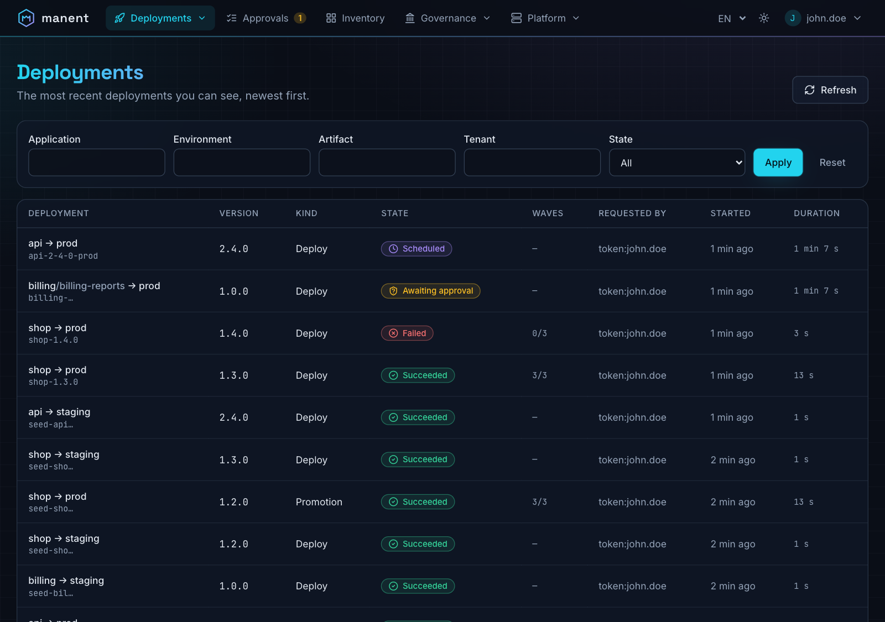
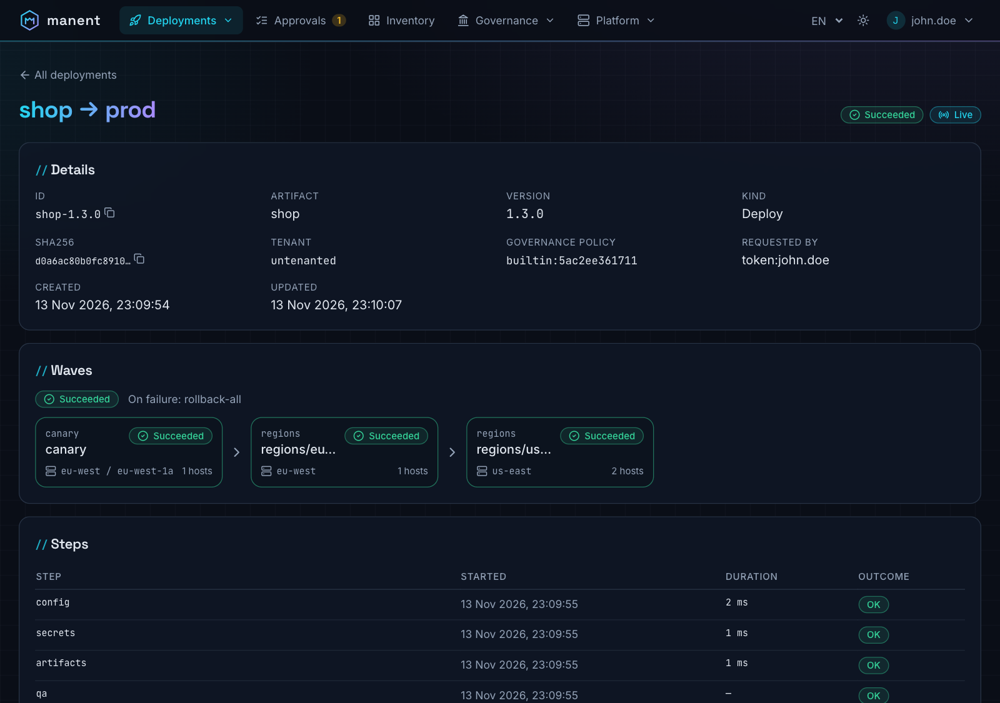
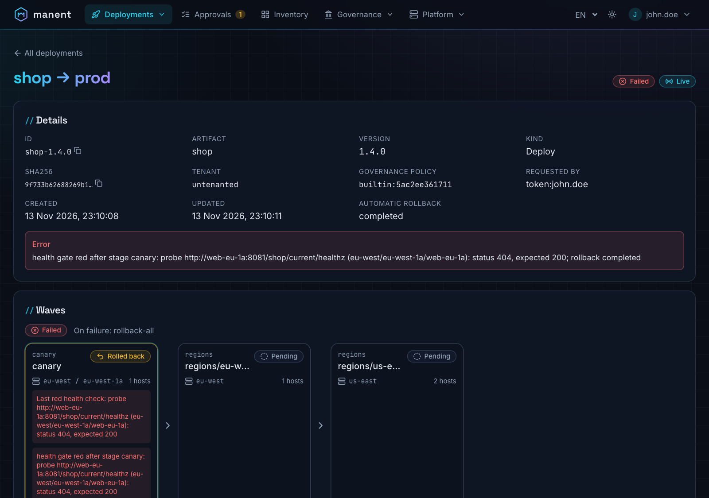
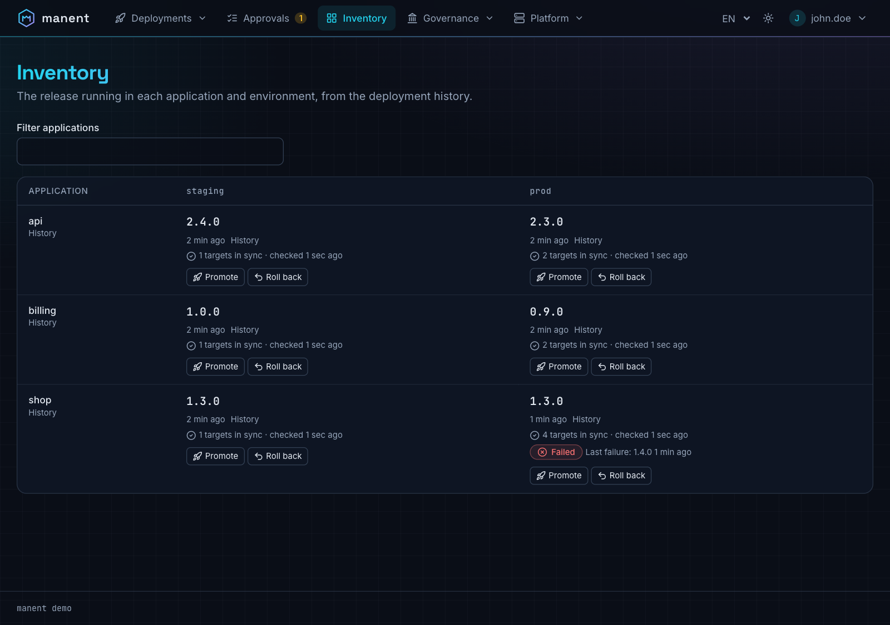
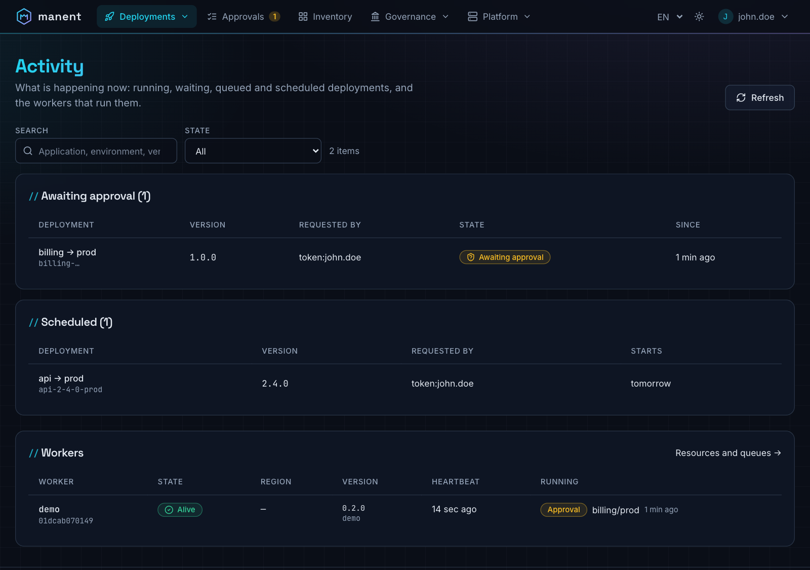
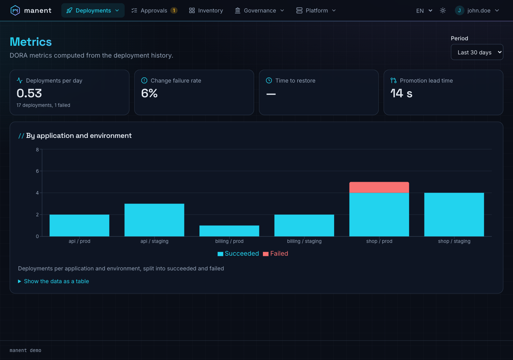

# Web interface

`manent-server` serves a web interface at `/`, on the same address as the API: whoever releases, approves or is on call can follow deploys, waves and logs and take decisions without the CLI. The interface is built into the binary and the official images, so there is nothing else to install.

It shows only what the user is allowed to see and offers only the actions they are allowed to take: permissions are the [RBAC](../operazioni/accesso.md#permessi-rbac) rules of the API, which checks every request anyway.

## Views

The top bar groups the views by purpose, so it stays short:

| Menu | Views |
|---|---|
| **Deployments** | Deployments, Activity, Releases, Metrics |
| **Approvals** | Approvals, with the number of decisions waiting for you |
| **Inventory** | Inventory, Tenants (when there are tenants you can read) |
| **Governance** | Calendar, Policy (with `policy.read`) |
| **Platform** | Workers and queues, Configuration (with `platform.read`) |

A menu with only one view you can open is a plain link; one with none is not shown.

| View | What it shows | What you can do |
|---|---|---|
| **Deployments** | The most recent deploys, filterable by application, environment and state, with kind, wave progress, requester and duration. | Open a deploy. |
| **Deployment detail** | Status, sha256, origin of a promotion or rollback, release, dependencies with their state, approvals with comments, waves (stages, regions, AZs, health gate), recorded steps, log. Status and log update live. | Approve or reject, cancel. |
| **Activity** | What is happening now: running deploys with worker, last step and wave progress; deploys awaiting approval, waiting for dependencies, queued and scheduled, filterable by text (application, environment, tenant, version, requester, worker) and by state. With `platform.read`, the workers with state, region, heartbeat and running workflows. Refreshed every 5 seconds. | Open a deploy. |
| **Approvals** | Deploys waiting for a decision that you can take, before the start or between two waves, filterable by text. | Approve with a comment, reject (comment required). |
| **Releases** | [Composite releases](catene.md#release-composte) with the progress of each deploy, its dependencies and the rollbacks of `onFailure: rollback`, filterable by state and by text (release, applications, environments and versions of its deploys). | Open a release or a deploy, cancel a release. |
| **Tenants** | Shown when the [tenant registry](tenant.md) has tenants you can read: tags, owned applications, queue, filters by application and selector. The page of a tenant shows its applications with their tags and the release in service per application, artifact and environment. | Open the deploy in service or the deploy history of an application. |
| **Inventory** | Live release per application and environment and artifact (with the owner [tenant](tenant.md)), last failure and drift. | Promote to another environment, roll back, always after a dry-run. |
| **Calendar** | Active and upcoming freeze windows (also per region, hard, created at runtime with their author), recurring schedules. | With `freeze.write`, create an emergency freeze and close those created at runtime. Pause, resume and delete schedules. |
| **Metrics** | DORA metrics over 7, 30 or 90 days, per application and environment, with the data also as a table. | |
| **Platform** | With `platform.read`: the queues (deploys, approvals and waits, region passes) with their limits, the workflows waiting, running and scheduled, the oldest wait and the workers listening; the workers with their resources (CPU used and available, process memory against the container limit or the host memory, deploy slots busy, free space of the workdir, host load) and the queues they listen to. Queues are filterable by text, type and "only with work"; workers by text (ID, host, queue, build, running application), state, region and "only busy". Refreshed every 5 seconds. | Open the deploys running on a worker. |
| **Configuration** | With `platform.read`: the effective configuration of the server process that answers the page (`GET /api/v1/configuration`): version, executor, the [files](../operazioni/configurazione.md#layers) read in order, then every section after defaults and environment variables. Values that may be secrets are hidden and marked (passwords in URLs, keys such as `password`, `secret`, `token` that are not a `_ref` or `_file`, the hashes of static tokens, the `env` of external plugins). Workers may run with other files: their configuration is not shown. | Search by key or value, show the empty values, switch to JSON and copy it. |
| **Policy** | With `policy.read`: engine, source and revision of the [governance policy](policy.md) in force, the revisions with state, author, approver and tests, the files of each revision. | With `policy.write` compute the impact on the last 7 days and, with `rbac.engine: opa`, simulate in **Access** the [permissions](permessi.md#simulation-and-impact) of an identity; with `policy.approve` approve a draft or go back to a previous revision. |

Every view has its own URL with filters in the query string, so a link pasted in a chat opens exactly the same page.

**Promotions and rollbacks** always go through a [dry-run](dry-run.md): the dialog runs it on a worker and enables confirmation only if it succeeds. A freeze override reason is offered only to those with `deployment.freeze-override`. **Approvals** follow the rules of [governance](governance.md#approvazioni): whoever requested a deploy cannot approve it, and the button explains why. The detail of a deploy shows the revision of the governance policy that decided it and, if the policy limits them, the allowed approvers.

## Screenshots

From a demo environment with five applications, three environments and four weeks of history.

<div class="mn-shots" markdown>

<figure markdown="span">
  [{ loading=lazy }](../assets/screenshots/deployments.png)
  <figcaption><strong>Deployments</strong>: every deploy, promotion and rollback, with state, requester and duration.</figcaption>
</figure>

<figure markdown="span">
  [{ loading=lazy }](../assets/screenshots/deployment-waves.png)
  <figcaption><strong>Wave rollout</strong>: a canary in eu-west, then one region at a time, eu-west and us-east.</figcaption>
</figure>

<figure markdown="span">
  [{ loading=lazy }](../assets/screenshots/deployment-rollback.png)
  <figcaption><strong>Automatic rollback</strong>: the health check of the canary fails and manent rolls the release back.</figcaption>
</figure>

<figure markdown="span">
  [{ loading=lazy }](../assets/screenshots/inventory.png)
  <figcaption><strong>Inventory</strong>: the release running in each application and environment, with promote and roll back.</figcaption>
</figure>

<figure markdown="span">
  [{ loading=lazy }](../assets/screenshots/activity.png)
  <figcaption><strong>Activity</strong>: running, waiting, queued and scheduled deploys and the workers running them.</figcaption>
</figure>

<figure markdown="span">
  [{ loading=lazy }](../assets/screenshots/metrics.png)
  <figcaption><strong>Metrics</strong>: DORA metrics computed from the deployment history.</figcaption>
</figure>

</div>

## Sign-in

With authentication enabled the interface uses OIDC with Authorization Code and PKCE: the browser obtains a token from the identity provider and sends it to the API exactly like the CLI does. Tokens stay in memory only (no cookies or localStorage), so there is no CSRF; after a page reload the identity provider signs the user in again without asking for credentials while its session is active.

```yaml title="manent.yml"
auth:
  mode: enabled
  oidc:
    issuer: https://login.example.com/realms/corp
    audience: manent
    username_claim: preferred_username
    groups_claim: groups
    ui:
      client_id: manent-ui          # public client, no secret
      scopes: [openid, profile]     # default
      redirect_path: /auth/callback # default
      # audience: manent            # only for providers that need it (Ory Hydra, Auth0)
      # resource: https://manent.example.com  # RFC 8707, for Pocket ID
```

On the identity provider:

1. register a **public** client `manent-ui` with PKCE (S256), redirect URI `https://<manent>/auth/callback` and post-logout URI `https://<manent>/`;
2. make the access tokens of this client carry the audience of `auth.oidc.audience` and the groups claim (`groups_claim`): in Keycloak an *audience* mapper and a *group membership* mapper, in Entra ID a scope of the exposed API and group claims. Ory Hydra and Auth0 put in the access token only the audience the client asks for: set `auth.oidc.ui.audience` to the value of `auth.oidc.audience`, and the interface sends it as the `audience` parameter of the authorization request. Pocket ID sets the audience from the `resource` parameter of RFC 8707 instead: see [Pocket ID](#pocket-id);
3. allow the manent origin in CORS for the token endpoint (Keycloak: *Web origins*).

The browser allows this sign-in only on HTTPS (or `localhost`), because PKCE needs the Web Crypto API: served over plain HTTP, the interface explains that it needs HTTPS.

### Pocket ID { #pocket-id }

[Pocket ID](https://pocket-id.org) is a small identity provider with users and groups built in and sign-in with passkeys (HTTPS, or `http://localhost`). Its access tokens are JWTs whose audience is the client that asked for them, unless the request names a `resource` (RFC 8707). The interface and the pipelines are different clients, so both ask for the same resource:

1. in **APIs** create an API with an identifier URI (e.g. `https://manent.example.com`) and give both clients access to it;
2. in **OIDC clients** create `manent-ui` as a public client (PKCE) with callback `https://<manent>/auth/callback`, and one confidential client per pipeline;
3. in **Claim mappings** create a policy that releases `groups` (scope `groups`) also in the access token, and assign it to `manent-ui`: the built-in policy releases groups only in the ID token and userinfo;
4. in manent:

```yaml title="manent.yml"
auth:
  mode: enabled
  oidc:
    issuer: https://id.example.com         # APP_URL of Pocket ID
    audience: https://manent.example.com   # identifier of the API
    username_claim: sub                    # user UUID; client-<id> for client_credentials
    groups_claim: groups
    ui:
      client_id: <manent-ui>
      scopes: [openid, profile, groups]
      resource: https://manent.example.com
```

A pipeline gets its token with `grant_type=client_credentials`, its secret (or a [federated client credential](https://pocket-id.org/docs/guides/oidc-client-authentication)) and `resource=https://manent.example.com` from `POST <APP_URL>/api/oidc/token`. Its token has no groups: bind it with `subjects: ["oidc:client-<client id>"]`.

Static tokens remain for automated systems and are not a way to sign in to the interface. With `auth.mode: none` (development only) the interface opens without sign-in and shows a permanent warning; with authentication enabled but no `auth.oidc.ui`, it explains that sign-in is not configured.

## Configuration

| Key | Default | Description |
|---|---|---|
| `http.ui.enabled` | `true` | Serves the interface at `/`. With `false` only the API, `/healthz` and `/readyz` remain. |
| `auth.oidc.ui.client_id` | | Public OIDC client of the interface. |
| `auth.oidc.ui.scopes` | `[openid, profile]` | Requested scopes; add `offline_access` if the identity provider issues refresh tokens only with it. |
| `auth.oidc.ui.redirect_path` | `/auth/callback` | Return path after sign-in. |
| `auth.oidc.ui.resource` | | Sent as the `resource` parameter (RFC 8707) of the authorization request, for the identity providers that set the audience of the access token from it (Pocket ID). An absolute URI equal to `auth.oidc.audience`. |
| `auth.oidc.ui.audience` | | Sent as the `audience` parameter of the authorization request, for the identity providers that put in the access token only the audience asked for (Ory Hydra, Auth0). It must be `auth.oidc.audience`. |

The interface reads this configuration from `GET /ui/config.json` (no authentication, no secrets) before signing in.

## Live updates

The deploy detail receives status and log as [Server-Sent Events](api.md#eventi-in-tempo-reale) (`/api/v1/deployments/{id}/events`). If a proxy blocks the stream the interface switches to polling every 3 seconds and says so in the header ("Polling"). The other views refresh every 15–60 seconds and when the browser tab comes back into focus.

Proxies in front of manent must not buffer `text/event-stream` responses (with NGINX: `proxy_buffering off` for that path, or rely on the `X-Accel-Buffering: no` header that manent sends).

## Security

- **Content Security Policy:** scripts only from manent itself (no inline scripts), connections only to manent and the OIDC issuer, `frame-ancestors 'none'`, `object-src 'none'`. Inline styles are allowed for dialog components.
- **Other headers:** `X-Content-Type-Options: nosniff`, `X-Frame-Options: DENY`, `Referrer-Policy: no-referrer`, `Cross-Origin-Opener-Policy: same-origin`.
- **Untrusted content:** logs, errors and approval comments are rendered as text, never as HTML.
- **Caching:** files under `/assets/` have a hash in the name and are cached for a year; `index.html` is never cached, so an upgrade of manent reaches the browser at once.

## Accessibility and languages

The interface aims at WCAG 2.1 AA: semantic landmarks and headings, a "Skip to content" link, focus moved to the title on every page change, status shown with icon and text (never colour alone), tables with captions and header cells, dialogs with focus trapping, state changes of a deploy announced to screen readers, charts with a table alternative, reduced motion and higher contrast honoured. The [use cases](../casi-uso.md) check it with axe on every view, in both themes.

It is available in English and Italian (from the browser, with a selector in the header) and has a dark theme like this site and a light one.

## Building

Release binaries and images include the interface. To build it from source, Node 20 or later is needed, or Docker:

```sh
make web        # web/ → internal/webui/dist (Node locally or a node:22 container)
make build      # also runs make web; NOUI=1 skips it
make web-dev    # development server on http://127.0.0.1:5173 with the API of a local manent
make web-test   # types, component tests and alignment with api/openapi.yaml
```

A binary built without the interface (`NOUI=1`, or `go build` on a clean checkout) serves a page at `/` explaining how to build it; the API is not affected.
