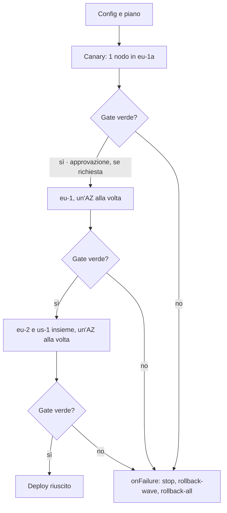

# Rilasci a ondate

Con più region e AZ un deploy si rilascia a **ondate**: una canary, poi una region alla volta, un'AZ alla volta, con un tempo di osservazione e un **health gate** tra un passo e il successivo. Il deploy resta uno solo (un ID, un esito) e si ferma, o torna indietro, al primo passo che non supera il controllo.

Dietro un load balancer ogni lotto può essere [svuotato](svuotamento.md) prima del deploy e rimesso in servizio dopo. Per spostare il traffico per percentuali verso una versione affiancata, invece che per nodi, si usa la strategia [`traffic`](traffico.md).



## Topologia: le etichette dei target

Ogni target porta delle etichette (`labels`); `region` e `az` sono riservate. L'ambiente resta uno (`prod`): le region non diventano ambienti separati, così governance, inventario e promozione ragionano su `prod`.

```yaml title="Configurazione di ambiente myapp/prod"
plugin: remote-copy
targets:
  - {host: eu1-a-01, labels: {region: eu-1, az: eu-1a, canary: "true"}}
  - {host: eu1-a-02, labels: {region: eu-1, az: eu-1a}}
  - {host: eu1-b-01, labels: {region: eu-1, az: eu-1b}}
  # ... 3 region × 3 AZ
```

## La strategia

La strategia (`rollout`) sta di norma nella [configurazione di ambiente](configurazione-ambiente.md), autorevole: il descrittore può ripeterla identica, non cambiarla. Senza `rollout` il deploy resta quello di sempre, su tutti i target in un unico passo.

```yaml
rollout:
  regions: [eu-1, eu-2, us-1]          # ordine delle region (le altre seguono in ordine alfabetico)
  waves:
    - {name: canary, select: "canary=true", bake: 15m}
    - {name: eu-1, select: "region=eu-1, canary!=true", by: az, bake: 10m}
    - {name: resto, select: "region in (eu-2, us-1)", by: az, parallelRegions: 2, bake: 10m}
  maxUnavailable: 25%                  # target aggiornati insieme in un passo
  onFailure: stop                      # stop | rollback-wave | rollback-all
  approvalsBetween: [canary]           # pausa per approvazione dopo queste ondate
  health:
    interval: 30s
    failuresToStop: 2
    probes:
      - {url: "https://{host}/healthz", expectStatus: 200}
    metrics:
      - name: error-rate
        query: 'sum(rate(http_requests_total{app="{application}",code=~"5..",az="{az}"}[5m])) / sum(rate(http_requests_total{app="{application}",az="{az}"}[5m]))'
        max: 0.01
    alerts:
      blockOn: ["severity=critical"]
```

| Campo | Default | Significato |
|---|---|---|
| `waves[].select` | | Target dell'ondata: condizioni separate da virgole, tutte necessarie (`chiave=valore`, `chiave!=valore`, `chiave in (a, b)`, `chiave notin (a, b)`). |
| `waves[].by` | nessuna divisione | `az`: un passo per AZ; `region`: un passo per region. |
| `waves[].parallelRegions` | `1` | Region aggiornate insieme nello stesso stadio. Con `by: az`, lo stadio k contiene l'AZ k di ciascuna region (in ordine alfabetico). |
| `waves[].bake` | `0s` | Tempo di osservazione dopo ogni stadio dell'ondata (al massimo 24h). |
| `maxUnavailable` | `1` | Target aggiornati insieme dentro un passo: un numero o una percentuale dei target del passo. |
| `onFailure` | `stop` | Cosa fare se un passo o un gate fallisce (vedi sotto). |
| `approvalsBetween` | | Ondate dopo le quali il rollout attende un'approvazione. |
| `health` | | Controlli del gate. Senza, il gate è solo il tempo di osservazione. |

Il piano viene verificato all'accodamento (`422` se non valido): ogni ondata deve selezionare almeno un target, ogni target deve appartenere a una sola ondata, con `by` i target devono avere le etichette `region` e `az`. `manent validate` mostra gli stadi e i passi:

```sh
manent validate -f release.yml     # rollout.stages: canary, eu-1/eu-1b, resto/eu-2a+us-1a, ...
```

### Stadi, passi e lotti

- Uno **stadio** è un gruppo di passi eseguiti insieme e seguiti dallo stesso bake e health gate. Il suo nome è `<ondata>/<AZ o region>` (`resto/eu-2a+us-1a`).
- Un **passo** è il lavoro su una region (o un'AZ) dentro lo stadio: `<ondata>/<region>/<az>`.
- Dentro un passo i target sono aggiornati a **lotti** di `maxUnavailable`, un lotto dopo l'altro.

Gli step che lavorano sui target, da `deploy` ad `activation` (con `post-test` in mezzo), sono eseguiti per ogni lotto; quelli prima (`secrets`, `artifacts`, `qa`) una volta sola all'inizio. Nel log e nella timeline ogni esecuzione porta il nome del passo e del lotto: `deploy@eu-1/eu-1/eu-1b#0`.

## Health gate

Dopo ogni stadio il worker attende il tempo di osservazione leggendo i controlli a ogni `interval`. Lo stadio fallisce appena i controlli rossi consecutivi arrivano a `failuresToStop` (default 1), e alla fine del bake l'ultima lettura deve essere verde. Attese e letture sono step durevoli: dopo una recovery il bake già trascorso non viene ripetuto.

| Controllo | Fonte | Rosso quando |
|---|---|---|
| `probes` | HTTP verso ogni target dello stadio (`{host}` sostituito) | Stato diverso da `expectStatus` (default 200), o errore. L'URL deve iniziare con `http(s)://{host}`: le sonde raggiungono solo i target. |
| `metrics` | Query PromQL su `rollout.prometheus_url`, per ogni passo; `{application}`, `{environment}`, `{region}` e `{az}` sostituiti | Valore oltre `max` o sotto `min`, oppure **nessun dato** (un gate che non vede traffico non può dire che il rilascio è sano: per accettarlo, `or vector(0)`). |
| `alerts` | Alertmanager (`rollout.alertmanager_url`), allarmi attivi | Un allarme soddisfa tutte le condizioni di `blockOn` e riguarda l'applicazione (`application` o `app`), la region (`region`) e l'AZ (`az`) dello stadio; un'etichetta assente nell'allarme vale per tutti. |

Lo stato del rollout riporta l'ultimo gate rosso: `stages[].gate`, ad esempio `metric error-rate (us-1/us-1a): valore 0.2 fuori soglia`.

## Fallimenti e rollback

Un passo fallito (uno step in errore o un gate rosso) ferma sempre gli stadi successivi. `onFailure` decide cosa succede a quelli già eseguiti:

| `onFailure` | Stadio fallito | Stadi già superati |
|---|---|---|
| `stop` (default) | Lasciato com'è | Restano sulla nuova versione: l'[inventario](governance.md#inventario) segnala `drift` |
| `rollback-wave` | Riportato alla release precedente | Restano sulla nuova versione |
| `rollback-all` | Riportato alla release precedente | Riportati indietro anche loro, in ordine inverso |

I rollback usano le stesse compensazioni del [rollback automatico](rollback.md), con i checkpoint presi all'inizio di ogni passo; per questo `rollback-wave` e `rollback-all` richiedono il rollback attivo (`rollback.enabled`) per il tipo di artefatto, e sono rifiutati all'accodamento altrimenti. Le migration restano escluse.

Dopo uno stop il deploy è `ERROR`: si corregge e si rilascia di nuovo la stessa versione (gli stadi già aggiornati vengono rieseguiti, quindi i plugin devono essere idempotenti) oppure si torna indietro con `manent rollback`.

## Approvazioni e freeze

- **Approvazione tra le ondate:** dopo l'ultimo stadio di un'ondata in `approvalsBetween` il rollout si mette in pausa e il deploy risulta `AWAITING_APPROVAL`. Si sblocca con `manent approve <id>`, con le stesse regole delle [approvazioni](governance.md#approvazioni): permesso `deployment.approve`, niente auto-approvazione, numero di approvazioni e scadenza dalla regola di governance (una approvazione e 72 ore se la regola non ne prevede). Un rifiuto o una scadenza fermano il rollout e applicano `onFailure`.
- **Freeze per region:** una finestra con `regions: [us-1]` blocca solo i passi su quella region. Prima di ogni stadio il worker verifica i freeze delle sue region e, se ce n'è uno attivo, mette il rollout in pausa (`paused-freeze`) fino alla fine della finestra. `freezeOverride` deroga anche a questi.

## Esecuzione nelle region

Di default l'orchestratore esegue tutti i passi. Con reti separate per region, i target di una region sono raggiungibili solo da worker di quella region: con `dbos.region_routing: true` ogni passo diventa un workflow figlio (`manent.deploy-pass`) sulla coda della sua region, eseguito da un worker con `dbos.region` uguale.

```yaml title="manent.yml del worker di eu-1"
dbos:
  region: eu-1
  region_routing: true
```

| Worker | Ascolta |
|---|---|
| con `region` | coda dei deploy, approvazioni e coda dei passi della sua region (`<queue>.<region>`) |
| senza `region`, con `region_routing` | coda dei deploy e approvazioni: orchestra, ma non esegue passi |
| senza `region_routing` | tutte le code (installazioni in una sola region) |

- Le region dello stesso stadio sono aggiornate in parallelo; ogni passo scarica e verifica l'artefatto sul worker della sua region.
- L'orchestratore attende i figli in modo durevole: se cade, chi lo riprende ritrova i passi già avviati e non li ripete. Un worker di region perso viene ripreso dalla [recovery](../operazioni/affidabilita.md) sulla stessa coda, quindi da un altro worker della stessa region.
- Una region senza worker registrati fa fallire il passo con `nessun worker registrato per la region <region>`.
- Anche le sonde HTTP dell'health gate (`probes`) sui target di una region sono eseguite da un worker di quella region, con un workflow figlio (`manent.gate-probe`) per ogni lettura; metriche e allarmi li legge l'orchestratore, che quindi deve raggiungere solo Prometheus e Alertmanager. Come per i passi, se la region non ha worker attivi la lettura attende il loro ritorno.
- I log scritti nei passi arrivano al log del deploy alla fine di ciascun passo.
- In multi-region tutti i worker devono avere `region_routing: true` (e di norma una `region`): un worker senza instradamento ascolterebbe anche le code delle region.

## Stato del rollout

`manent status <id>` (e `GET /api/v1/deployments/{id}`) riporta lo stato completo; gli elenchi e l'inventario il riassunto `rollout_progress` (stadi superati/stadi totali).

```json
{
  "state": "ERROR",
  "rollout_progress": "2/4",
  "rollout": {
    "status": "failed",
    "stage": "resto/eu-2a+us-1a",
    "on_failure": "stop",
    "stages": [
      {"name": "canary", "wave": "canary", "state": "succeeded", "passes": [{"name": "canary", "region": "eu-1", "az": "eu-1a", "hosts": ["eu1-a-01"]}]},
      {"name": "eu-1/eu-1b", "wave": "eu-1", "state": "succeeded", "passes": ["…"]},
      {"name": "resto/eu-2a+us-1a", "wave": "resto", "state": "failed",
       "gate": "metric error-rate (us-1/us-1a): valore 0.2 fuori soglia", "passes": ["…"]},
      {"name": "resto/eu-2b+us-1b", "wave": "resto", "state": "pending", "passes": ["…"]}
    ]
  }
}
```

| `rollout.status` | Significato |
|---|---|
| `running` | In esecuzione (uno stadio, il suo bake o il gate). |
| `paused-approval` | In attesa di approvazione dopo un'ondata. |
| `paused-freeze` | In attesa della fine di un freeze (`paused` dice quale). |
| `succeeded` / `failed` | Concluso; con un rollback, `rollback` ne riporta l'esito. |

La metrica `manent_rollout_passes_total{application,environment,region,az,outcome}` conta i passi conclusi (vedi [Osservabilità](../operazioni/osservabilita.md)).
