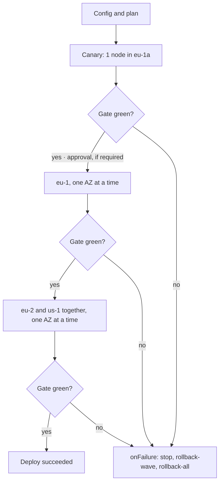

# Wave rollouts

With several regions and AZs a deploy is released in **waves**: a canary, then one region at a time, one AZ at a time, with a bake time and a **health gate** between one step and the next. The deploy stays a single one (one ID, one outcome) and stops, or rolls back, at the first step that fails the check.

Behind a load balancer every batch can be [drained](svuotamento.md) before the deploy and put back in service afterwards. To shift traffic by percentages to a version running side by side, rather than by nodes, use the [`traffic`](traffico.md) strategy.



## Topology: target labels

Each target carries labels (`labels`); `region` and `az` are reserved. The environment stays one (`prod`): regions do not become separate environments, so governance, inventory and promotion reason about `prod`.

```yaml title="Environment configuration myapp/prod"
plugin: remote-copy
targets:
  - {host: eu1-a-01, labels: {region: eu-1, az: eu-1a, canary: "true"}}
  - {host: eu1-a-02, labels: {region: eu-1, az: eu-1a}}
  - {host: eu1-b-01, labels: {region: eu-1, az: eu-1b}}
  # ... 3 regions × 3 AZs
```

## The strategy

The strategy (`rollout`) normally lives in the [environment configuration](configurazione-ambiente.md), which is authoritative: the descriptor can repeat it identically, not change it. Without `rollout` the deploy is the usual one, on all targets in a single step.

```yaml
rollout:
  regions: [eu-1, eu-2, us-1]          # region order (the others follow alphabetically)
  waves:
    - {name: canary, select: "canary=true", bake: 15m}
    - {name: eu-1, select: "region=eu-1, canary!=true", by: az, bake: 10m}
    - {name: rest, select: "region in (eu-2, us-1)", by: az, parallelRegions: 2, bake: 10m}
  maxUnavailable: 25%                  # targets updated together in a pass
  onFailure: stop                      # stop | rollback-wave | rollback-all
  approvalsBetween: [canary]           # pause for approval after these waves
  health:
    interval: 30s
    failuresToStop: 2
    probes:
      - {url: "https://{host}/healthz", expectStatus: 200}
    metrics:
      - name: error-rate
        query: 'sum(rate(http_requests_total{app="{application}",code=~"5..",az="{az}"}[5m])) / sum(rate(http_requests_total{app="{application}",az="{az}"}[5m]))'
        max: 0.01
    alerts:
      blockOn: ["severity=critical"]
```

| Field | Default | Meaning |
|---|---|---|
| `waves[].select` | | Targets of the wave: comma-separated conditions, all required (`key=value`, `key!=value`, `key in (a, b)`, `key notin (a, b)`). |
| `waves[].by` | no split | `az`: one pass per AZ; `region`: one pass per region. |
| `waves[].parallelRegions` | `1` | Regions updated together in the same stage. With `by: az`, stage k contains AZ k of each region (in alphabetical order). |
| `waves[].bake` | `0s` | Bake time after each stage of the wave (at most 24h). |
| `waves[].batchBake` | no gate | If set, a gate after every batch of a pass but the last: the probes read the batch's targets for this time (`0s`: a single reading). See [batch gate](#batch-gate). |
| `waves[].maxUnavailable` | the rollout's | Replaces `maxUnavailable` for the passes of the wave: for example one node at a time in the canary and 25% in the wide waves. |
| `maxUnavailable` | `1` | Targets updated together within a pass: a number or a percentage of the pass's targets. |
| `onFailure` | `stop` | What to do if a pass or a gate fails (see below). |
| `approvalsBetween` | | Waves after which the rollout waits for an approval. |
| `health` | | Gate checks. Without them, the gate is only the bake time. |

The plan is checked at enqueue time (`422` if invalid): every wave must select at least one target, every target must belong to exactly one wave, and with `by` the targets must have the `region` and `az` labels. `manent validate` shows the stages and passes:

```sh
manent validate -f release.yml     # rollout.stages: canary, eu-1/eu-1b, rest/eu-2a+us-1a, ...
```

### Stages, passes and batches

- A **stage** is a group of passes run together and followed by the same bake and health gate. Its name is `<wave>/<AZ or region>` (`rest/eu-2a+us-1a`).
- A **pass** is the work on a region (or an AZ) within the stage: `<wave>/<region>/<az>`.
- Within a pass the targets are updated in **batches** of `maxUnavailable` (the wave's, if set, otherwise the rollout's), one batch after the other. A percentage is computed on the pass's targets, rounded down and with at least one target.

The steps that work on the targets, from `deploy` to `activation` (with `post-test` in between), run for each batch; the ones before (`secrets`, `artifacts`, `qa`) run only once at the start. In the log and the timeline each run carries the name of the pass and the batch: `deploy@eu-1/eu-1/eu-1b#0`.

## Health gate { #health-gate }

After each stage the worker waits for the bake time, reading the checks every `interval`. The stage fails as soon as the consecutive red checks reach `failuresToStop` (default 1), and at the end of the bake the last reading must be green. Waits and readings are durable steps: after a recovery the bake time already elapsed is not repeated.

| Check | Source | Red when |
|---|---|---|
| `probes` | HTTP to every target of the stage (`{host}` substituted) | Status other than `expectStatus` (default 200), or an error. The URL must start with `http(s)://{host}`: probes only reach the targets. |
| `metrics` | Query on the metrics system of `provider` (default Prometheus, `rollout.prometheus_url`; also Datadog, New Relic, Elastic, CloudWatch: see [canary analysis](traffico.md#canary-analysis)), for each pass; `{application}`, `{environment}`, `{region}` and `{az}` substituted | Value above `max` or below `min`, or **no data** (a gate that sees no traffic cannot say the release is healthy: to accept that, use `or vector(0)`). |
| `alerts` | Alertmanager (`rollout.alertmanager_url`), active alerts | An alert matches all the `blockOn` conditions and concerns the application (`application` or `app`), the region (`region`) and the AZ (`az`) of the stage; a label missing from the alert matches everything. |

The rollout status reports the last red gate: `stages[].gate`, for example `metric error-rate (us-1/us-1a): valore 0.2 fuori soglia`.

### Batch gate { #batch-gate }

The stage gate comes after the last batch: with many targets in an AZ, a defect that shows up immediately is only detected once the whole AZ is updated. With `batchBake` the worker checks every batch before moving to the next one:

```yaml
rollout:
  waves:
    - {name: eu-1, select: "region=eu-1", by: az, bake: 10m, batchBake: 1m}
  maxUnavailable: 25%
  health:
    interval: 15s
    failuresToStop: 2
    probes:
      - url: "http://{host}:8080/healthz"
```

- After every batch but the last (followed by the stage gate), the `probes` read **only the batch's targets** every `interval` for `batchBake`, with the same rules as the stage gate: `failuresToStop` consecutive red readings stop the pass, and the last reading must be green. With a pool the gate starts once the batch is back in service.
- `metrics` and `alerts` stay with the stage gate: they describe the whole pass and are read by the orchestrator. Without `probes`, `batchBake` is only a durable wait between batches.
- A red batch gate is a failed pass: `onFailure` applies, and the following batches are not touched.
- With `dbos.region_routing` the gate runs in the pass's child workflow, on the region's worker.
- The readings are `gate@<pass>#<batch>.<n>` steps. It is not allowed with `strategy: traffic` and does not run in dry-run.

## Failures and rollback

A failed pass (a step in error or a red gate) always stops the following stages. `onFailure` decides what happens to those already run:

| `onFailure` | Failed stage | Stages already passed |
|---|---|---|
| `stop` (default) | Left as is | Stay on the new version: the [inventory](governance.md#inventario) reports `drift` |
| `rollback-wave` | Brought back to the previous release | Stay on the new version |
| `rollback-all` | Brought back to the previous release | Brought back as well, in reverse order |

Rollbacks use the same compensations as [automatic rollback](rollback.md), with checkpoints taken at the start of each pass; this is why `rollback-wave` and `rollback-all` require rollback to be enabled (`rollback.enabled`) for the artifact type, and are rejected at enqueue time otherwise. Migrations remain excluded.

After a stop the deploy is `ERROR`: fix the problem and release the same version again (stages already updated are run again, so plugins must be idempotent), or go back with `manent rollback`.

## Approvals and freezes { #approvazioni-e-freeze }

- **Approval between waves:** after the last stage of a wave listed in `approvalsBetween` the rollout pauses and the deploy shows as `AWAITING_APPROVAL`. It is unblocked with `manent approve <id>`, with the same rules as [approvals](governance.md#approvazioni): `deployment.approve` permission, no self-approval, number of approvals and expiry from the governance rule (one approval and 72 hours if the rule does not set them). A rejection or an expiry stops the rollout and applies `onFailure`.
- **Per-region freeze:** a window with `regions: [us-1]` blocks only the passes in that region. Before each stage the worker checks the freezes of its regions and, if one is active, pauses the rollout (`paused-freeze`) until the window ends. `freezeOverride` bypasses these too.

## Running in the regions { #esecuzione-nelle-region }

By default the orchestrator runs all the passes. With separate networks per region, a region's targets can be reached only by workers in that region: with `dbos.region_routing: true` each pass becomes a child workflow (`manent.deploy-pass`) on its region's queue, run by a worker with the same `dbos.region`.

```yaml title="manent.yml of the eu-1 worker"
dbos:
  region: eu-1
  region_routing: true
```

| Worker | Listens to |
|---|---|
| with `region` | deploy queue, approvals and its region's pass queue (`<queue>.<region>`) |
| without `region`, with `region_routing` | deploy queue and approvals: it orchestrates, but does not run passes |
| without `region_routing` | all queues (single-region installations) |

- Regions of the same stage are updated in parallel; each pass downloads and verifies the artifact on its region's worker.
- The orchestrator waits for the children durably: if it goes down, whoever resumes it finds the passes already started and does not repeat them. A lost region worker is resumed by [recovery](../operazioni/affidabilita.md) on the same queue, hence by another worker of the same region.
- A region with no registered workers makes the pass fail with `no worker registered for region <region>`.
- The health gate's HTTP probes (`probes`) on a region's targets are also run by a worker in that region, with a child workflow (`manent.gate-probe`) for each reading; metrics and alerts are read by the orchestrator, which therefore only needs to reach Prometheus and Alertmanager. As with passes, if the region has no active workers the reading waits for them to come back.
- Logs written in the passes reach the deploy log at the end of each pass.
- In multi-region setups all workers must have `region_routing: true` (and normally a `region`): a worker without routing would also listen to the region queues.

## Rollout status

`manent status <id>` (and `GET /api/v1/deployments/{id}`) reports the full status; lists and the inventory the summary `rollout_progress` (stages passed/total stages).

```json
{
  "state": "ERROR",
  "rollout_progress": "2/4",
  "rollout": {
    "status": "failed",
    "stage": "rest/eu-2a+us-1a",
    "on_failure": "stop",
    "stages": [
      {"name": "canary", "wave": "canary", "state": "succeeded", "passes": [{"name": "canary", "region": "eu-1", "az": "eu-1a", "hosts": ["eu1-a-01"]}]},
      {"name": "eu-1/eu-1b", "wave": "eu-1", "state": "succeeded", "passes": ["…"]},
      {"name": "rest/eu-2a+us-1a", "wave": "rest", "state": "failed",
       "gate": "metric error-rate (us-1/us-1a): valore 0.2 fuori soglia", "passes": ["…"]},
      {"name": "rest/eu-2b+us-1b", "wave": "rest", "state": "pending", "passes": ["…"]}
    ]
  }
}
```

| `rollout.status` | Meaning |
|---|---|
| `running` | Running (a stage, its bake or the gate). |
| `paused-approval` | Waiting for approval after a wave. |
| `paused-freeze` | Waiting for a freeze to end (`paused` says which). |
| `succeeded` / `failed` | Finished; with a rollback, `rollback` reports its outcome. |

The `manent_rollout_passes_total{application,environment,region,az,outcome}` metric counts finished passes (see [Observability](../operazioni/osservabilita.md)).
