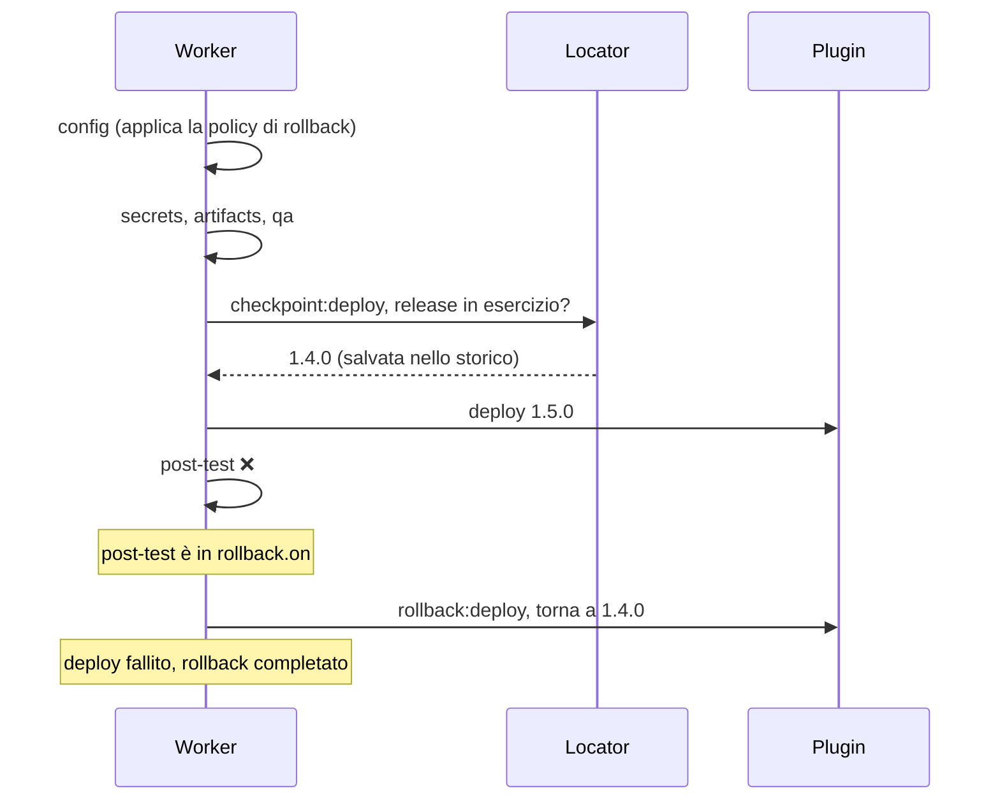

# Rollback

Quando un deploy fallisce dopo aver modificato i target, manent può riportare l'ambiente alla release che era in esercizio prima del deploy. Il rollback è **automatico** e fa parte dello stesso workflow DBOS del deploy: è durevole, sopravvive a un crash del worker e i suoi passi compaiono nello stato del deploy e nei callback.

Il rollback è il risultato di tre elementi:

| Elemento | Dove | Cosa decide |
|---|---|---|
| **Policy** | `rollback` in `manent.yml`, configurazione di ambiente, descrittore | se il rollback è ammesso per il tipo di artefatto, se è attivo e quali fallimenti lo avviano |
| **Locator** | `rollback.locator` | come individuare la release a cui tornare |
| **Plugin** | interfaccia `plugin.Rollbacker` | come tornare indietro su quella tecnologia |

## Come funziona



1. **Policy.** Nello step `config` la policy viene applicata al descrittore effettivo, già fuso con la configurazione di ambiente. La decisione viene salvata con il deploy, quindi un deploy ripreso dopo un crash usa la stessa decisione anche se nel frattempo la configurazione è cambiata.
2. **Checkpoint.** Prima di ogni step che sa annullare i propri effetti (oggi `deploy` e `activation`), il worker esegue lo step `checkpoint:<step>`. Per `deploy` il checkpoint:
   - verifica che il plugin supporti il rollback. Se non lo supporta il deploy si ferma qui, prima di toccare i target;
   - chiede al locator la release in esercizio e la registra.

   Il checkpoint è uno step DBOS distinto, quindi i retry di `deploy` non lo ripetono: la release registrata è sempre quella precedente al deploy, anche se un tentativo fallito ha già aggiornato alcuni target.
3. **Compensazione.** Se fallisce uno step indicato in `rollback.on`, il worker esegue `rollback:<step>` per ogni step già avviato che sa annullare i propri effetti. Lo fa in ordine inverso e compensa **anche lo step fallito**, perché può aver aggiornato solo una parte dei target.
4. **Esito.** Il deploy resta fallito (`ERROR`): il rollback ripristina l'ambiente, non rende riuscito il deploy. L'errore riporta l'esito del rollback:

| Esito | Messaggio | Significato |
|---|---|---|
| `completed` | `...; rollback completato` | Almeno una compensazione ha ripristinato lo stato precedente. |
| `skipped` | `...; rollback: nessuna release da ripristinare` | Non c'era nulla a cui tornare, ad esempio al primo deploy dell'applicazione. |
| `failed` | `...; rollback fallito: ...` | Una compensazione è fallita dopo i suoi retry. Le compensazioni successive non vengono tentate, così lo stato resta noto per l'intervento manuale. Il log, anche verso il SIEM, è a livello `ERROR`. |

Ogni compensazione usa i `max_retries` dello step che annulla.

## Policy

### Per tipo di artefatto

In `manent.yml` si stabilisce per quali tipi di artefatto il rollback è possibile. I tipi non elencati **non** lo ammettono.

```yaml title="manent.yml"
rollback:
  locator: plugin
  artifact_types:
    application:
      allowed: true
      enabled: true                          # default per i deploy di questo tipo
      on: [deploy, post-test, activation]    # default se omesso
    migration:
      allowed: false                         # una migration di database non è reversibile
```

| Chiave | Descrizione |
|---|---|
| `allowed` | Il rollback è possibile per questo tipo. Se è `false`, chiedere il rollback è un errore. |
| `enabled` | Il valore di default. Richiede `allowed: true`. |
| `on` | Gli step il cui fallimento avvia il rollback. Default `[deploy, post-test, activation]`. |
| `locator` | Il locator per questo tipo, se diverso da `rollback.locator`. |

!!! note "Migration e altri artefatti non reversibili"
    Di default `migration` è esclusa: tornare alla versione precedente dell'applicazione non annulla una modifica dello schema del database. Un artefatto non reversibile va gestito con una nuova migration (roll-forward), non con il rollback.

### Nell'ambiente e nel descrittore

Configurazione di ambiente e descrittore possono attivare o disattivare il rollback, restringere `on` o scegliere il locator, sempre entro `allowed`. Valgono le regole di fusione della [configurazione di ambiente](configurazione-ambiente.md): l'ambiente è autorevole e un valore in conflitto è un errore. Ad esempio, un ambiente di produzione può imporre il rollback senza che un descrittore possa disattivarlo:

```yaml title="Configurazione di ambiente (manent/myapp/prod)"
rollback:
  enabled: true
```

```yaml title="Descrittore"
rollback:
  enabled: true
  on: [deploy, post-test]
  locator: plugin
```

Un rollback non ammesso viene rifiutato già all'accodamento (`422` dall'API) e da `manent validate`, che mostra anche la decisione effettiva nel campo `rollback`.

### Quali fallimenti lo avviano

`on` elenca gli step il cui fallimento avvia il rollback. Il fallimento di uno step non elencato, ad esempio `artifacts` o `qa`, ferma il deploy senza rollback: in quel momento i target non sono ancora stati toccati.

Anche il fallimento di un checkpoint conta come fallimento del suo step. Se ad esempio non si riesce a leggere la release in esercizio prima di `deploy`, il deploy si ferma e vengono compensati solo gli step precedenti.

## Locator

Il locator individua, prima del deploy, la release in esercizio a cui tornare. È un'interfaccia (`plugin.ReleaseLocator`), quindi le strategie possono essere diverse:

| Locator | Come |
|---|---|
| `plugin` (default) | Chiede al plugin di leggere la release dai target (`plugin.ReleaseInspector`). Con `remote-copy`, è la release puntata dal symlink `current`. |
| sistema aziendale | Un'implementazione che interroga il sistema che registra le release in esercizio (CMDB, inventario dei rilasci). Va registrata in `app.NewLocators`. |

```go
// ReleaseLocator individua la release in esercizio prima del deploy.
// Restituisce nil se non ce n'è nessuna (primo deploy).
type ReleaseLocator interface {
	Current(ctx context.Context, dep plugin.Deployer, req *plugin.Request) (*plugin.Release, error)
}

type Release struct {
	Version string            `json:"version"`
	Details map[string]string `json:"details,omitempty"` // mai segreti: viene persistito
}
```

Esempio di locator verso un sistema aziendale dei rilasci:

```go
// CMDBLocator chiede la release in esercizio al registro aziendale dei rilasci.
type CMDBLocator struct {
	BaseURL string
	Client  *http.Client
}

func (l CMDBLocator) Current(ctx context.Context, _ plugin.Deployer, req *plugin.Request) (*plugin.Release, error) {
	u := fmt.Sprintf("%s/releases/%s/%s/current", l.BaseURL, url.PathEscape(req.Application), url.PathEscape(req.Environment))
	r, _ := http.NewRequestWithContext(ctx, http.MethodGet, u, nil)
	resp, err := l.Client.Do(r)
	if err != nil {
		return nil, err
	}
	defer resp.Body.Close()
	switch resp.StatusCode {
	case http.StatusNotFound:
		return nil, nil // primo rilascio
	case http.StatusOK:
	default:
		return nil, fmt.Errorf("registro dei rilasci: status %d", resp.StatusCode)
	}
	var body struct{ Version string `json:"version"` }
	if err := json.NewDecoder(resp.Body).Decode(&body); err != nil {
		return nil, err
	}
	return &plugin.Release{Version: body.Version, Details: map[string]string{"source": "cmdb"}}, nil
}
```

```go title="internal/app/app.go"
func NewLocators(cfg *config.Config, log *slog.Logger) map[string]plugin.ReleaseLocator {
	return map[string]plugin.ReleaseLocator{
		plugin.PluginLocatorName: plugin.PluginLocator{},
		"cmdb":                   CMDBLocator{BaseURL: "https://cmdb.example.com", Client: &http.Client{Timeout: 10 * time.Second}},
	}
}
```

Il locator restituisce solo la versione: il plugin deve sapere come tornarci. Con `remote-copy`, ad esempio, la release deve essere ancora presente sui target (vedi `keep_releases`).

## Supporto dei plugin

Un plugin supporta il rollback se implementa `plugin.Rollbacker`; per il locator `plugin` deve implementare anche `plugin.ReleaseInspector`. Vedi [Scrivere un plugin](../plugins/index.md#rollback).

| Plugin | Rollback |
|---|---|
| [`remote-copy`](../plugins/remote-copy.md#rollback) | Sì, con `layout: releases`: riporta il symlink `current` alla release precedente ed esegue `rollback_command`. |
| [Plugin esterni](../plugins/esterni.md) | Se il plugin implementa le interfacce. manent lo sa dalle capacità dichiarate all'avvio del processo. |

## Attivazione

Lo step `activation` è opzionale: per molti artefatti basta il deploy. Quando è attivo e il rollback lo coinvolge, la sua compensazione chiama `Deactivate` sull'`Activator`, se lo implementa (interfaccia `steps.Deactivator`), ad esempio per riportare il traffico sulla release precedente. Un `Activator` che non lo implementa viene saltato (`rollback: skipped`).

## Dry-run, callback e stato

- **[Dry-run](dry-run.md):** il checkpoint viene eseguito, perché non modifica nulla. Il dry-run verifica quindi anche che il plugin supporti il rollback e che la release in esercizio sia leggibile. Non viene mai eseguita una compensazione.
- **[Callback](callback.md):** checkpoint e compensazioni producono eventi `step` (`checkpoint:deploy`, `rollback:deploy`, ...). L'evento finale `deployment` di un deploy fallito ha il campo `rollback` con l'esito (`completed`, `skipped`, `failed`).
- **Stato:** l'errore del deploy riporta l'esito del rollback. Gli output di checkpoint e compensazioni (release precedente, risultato del plugin) sono nello storico DBOS.

## Rollback manuale

Per tornare indietro dopo un deploy **riuscito** si usa `manent rollback` (`POST /api/v1/rollbacks`): rilascia di nuovo una versione precedente come nuovo deploy, con la stessa policy per tipo di artefatto. Vedi [Governance dei rilasci](governance.md#rollback-manuale).

## Limiti

- **Deploy annullato:** `manent cancel` interrompe il workflow, quindi le compensazioni non possono essere eseguite. Lo stesso vale per un worker che si arresta durante il rollback: al riavvio, la recovery riprende il workflow dal punto in cui si era fermato.
- **Release diverse sui target:** con il locator `plugin`, `remote-copy` rifiuta il deploy se i target hanno release diverse, perché non sarebbe chiaro a quale tornare.
- **Aggiornamento di manent:** un deploy già in corso durante l'aggiornamento, con lo step `config` già registrato, prosegue senza rollback: la decisione registrata non lo contiene. I deploy ancora in coda applicano invece la policy.
