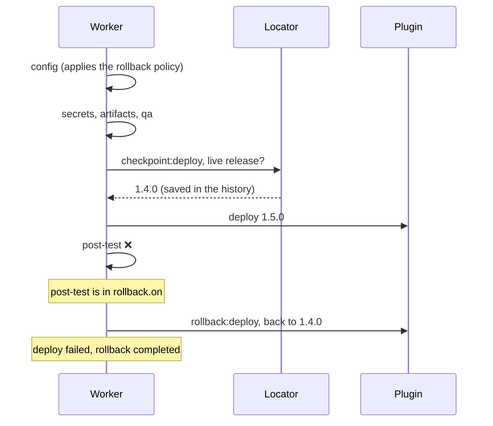

# Rollback

When a deploy fails after changing the targets, manent can bring the environment back to the release that was live before the deploy. Rollback is **automatic** and is part of the same DBOS workflow as the deploy: it is durable, survives a worker crash and its steps appear in the deploy status and in callbacks.

Rollback is the result of three elements:

| Element | Where | What it decides |
|---|---|---|
| **Policy** | `rollback` in `manent.yml`, environment configuration, descriptor | whether rollback is allowed for the artifact type, whether it is enabled and which failures trigger it |
| **Locator** | `rollback.locator` | how to find the release to go back to |
| **Plugin** | `plugin.Rollbacker` interface | how to go back on that technology |

## How it works



1. **Policy.** In the `config` step the policy is applied to the effective descriptor, already merged with the environment configuration. The decision is saved with the deploy, so a deploy resumed after a crash uses the same decision even if the configuration has changed in the meantime.
2. **Checkpoint.** Before every step that can undo its effects (currently `deploy` and `activation`), the worker runs the `checkpoint:<step>` step. For `deploy` the checkpoint:
   - checks that the plugin supports rollback. If it does not, the deploy stops here, before touching the targets;
   - asks the locator for the live release and records it.

   The checkpoint is a separate DBOS step, so `deploy` retries do not repeat it: the recorded release is always the one before the deploy, even if a failed attempt has already updated some targets.
3. **Compensation.** If a step listed in `rollback.on` fails, the worker runs `rollback:<step>` for every already-started step that can undo its effects. It does so in reverse order and compensates **the failed step too**, because it may have updated only part of the targets.
4. **Outcome.** The deploy stays failed (`ERROR`): rollback restores the environment, it does not make the deploy succeed. The error reports the rollback outcome:

| Outcome | Message | Meaning |
|---|---|---|
| `completed` | `...; rollback completed` | At least one compensation restored the previous state. |
| `skipped` | `...; rollback: no release to restore` | There was nothing to go back to, for example on the application's first deploy. |
| `failed` | `...; rollback failed: ...` | A compensation failed after its retries. Further compensations are not attempted, so the state stays known for manual intervention. The log, including to the SIEM, is at `ERROR` level. |

Each compensation uses the `max_retries` of the step it undoes.

## Policy

### Per artifact type

`manent.yml` sets for which artifact types rollback is possible. Types not listed do **not** allow it.

```yaml title="manent.yml"
rollback:
  locator: plugin
  artifact_types:
    application:
      allowed: true
      enabled: true                          # default for deploys of this type
      on: [deploy, post-test, activation]    # default if omitted
    migration:
      allowed: false                         # a database migration is not reversible
```

| Key | Description |
|---|---|
| `allowed` | Rollback is possible for this type. If `false`, asking for rollback is an error. |
| `enabled` | The default value. Requires `allowed: true`. |
| `on` | Steps whose failure triggers rollback. Default `[deploy, post-test, activation]`. |
| `locator` | The locator for this type, if different from `rollback.locator`. |

!!! note "Migrations and other non-reversible artifacts"
    By default `migration` is excluded: going back to the previous version of the application does not undo a database schema change. A non-reversible artifact is handled with a new migration (roll-forward), not with rollback.

### In the environment and in the descriptor

The environment configuration and the descriptor can enable or disable rollback, narrow `on` or pick the locator, always within `allowed`. The merge rules of the [environment configuration](configurazione-ambiente.md) apply: the environment is authoritative and a conflicting value is an error. For example, a production environment can enforce rollback without a descriptor being able to disable it:

```yaml title="Environment configuration (manent/myapp/myapp/prod)"
rollback:
  enabled: true
```

```yaml title="Descriptor"
rollback:
  enabled: true
  on: [deploy, post-test]
  locator: plugin
```

A rollback that is not allowed is rejected already at enqueue time (`422` from the API) and by `manent validate`, which also shows the effective decision in the `rollback` field.

### Which failures trigger it

`on` lists the steps whose failure triggers rollback. The failure of a step not listed, for example `artifacts` or `qa`, stops the deploy without rollback: at that point the targets have not been touched yet.

The failure of a checkpoint also counts as a failure of its step. If, for example, the live release cannot be read before `deploy`, the deploy stops and only the previous steps are compensated.

## Locator

The locator finds, before the deploy, the live release to go back to. It is an interface (`plugin.ReleaseLocator`), so strategies can differ:

| Locator | How |
|---|---|
| `plugin` (default) | Asks the plugin to read the release from the targets (`plugin.ReleaseInspector`). With `remote-copy`, it is the release the `current` symlink points to. |
| corporate system | An implementation that queries the system recording live releases (CMDB, release inventory). It must be registered in `app.NewLocators`. |

```go
// ReleaseLocator finds the live release before the deploy.
// It returns nil if there is none (first deploy).
type ReleaseLocator interface {
	Current(ctx context.Context, dep plugin.Deployer, req *plugin.Request) (*plugin.Release, error)
}

type Release struct {
	Version string            `json:"version"`
	Details map[string]string `json:"details,omitempty"` // never secrets: it is persisted
}
```

Example of a locator backed by a corporate release system:

```go
// CMDBLocator asks the corporate release registry for the live release.
type CMDBLocator struct {
	BaseURL string
	Client  *http.Client
}

func (l CMDBLocator) Current(ctx context.Context, _ plugin.Deployer, req *plugin.Request) (*plugin.Release, error) {
	u := fmt.Sprintf("%s/releases/%s/%s/current", l.BaseURL, url.PathEscape(req.Application), url.PathEscape(req.Environment))
	r, _ := http.NewRequestWithContext(ctx, http.MethodGet, u, nil)
	resp, err := l.Client.Do(r)
	if err != nil {
		return nil, err
	}
	defer resp.Body.Close()
	switch resp.StatusCode {
	case http.StatusNotFound:
		return nil, nil // first release
	case http.StatusOK:
	default:
		return nil, fmt.Errorf("release registry: status %d", resp.StatusCode)
	}
	var body struct{ Version string `json:"version"` }
	if err := json.NewDecoder(resp.Body).Decode(&body); err != nil {
		return nil, err
	}
	return &plugin.Release{Version: body.Version, Details: map[string]string{"source": "cmdb"}}, nil
}
```

```go title="internal/app/app.go"
func NewLocators(cfg *config.Config, log *slog.Logger) map[string]plugin.ReleaseLocator {
	return map[string]plugin.ReleaseLocator{
		plugin.PluginLocatorName: plugin.PluginLocator{},
		"cmdb":                   CMDBLocator{BaseURL: "https://cmdb.example.com", Client: &http.Client{Timeout: 10 * time.Second}},
	}
}
```

The locator returns only the version: the plugin must know how to get back to it. With `remote-copy`, for example, the release must still be present on the targets (see `keep_releases`).

## Plugin support

A plugin supports rollback if it implements `plugin.Rollbacker`; for the `plugin` locator it must also implement `plugin.ReleaseInspector`. See [Writing a plugin](../plugins/index.md#rollback).

| Plugin | Rollback |
|---|---|
| [`remote-copy`](../plugins/remote-copy.md#rollback) | Yes, with `layout: releases`: points the `current` symlink back to the previous release and runs `rollback_command`. |
| [External plugins](../plugins/esterni.md) | If the plugin implements the interfaces. manent knows from the capabilities declared when the process starts. |

## Activation

The `activation` step is optional: for many artifacts the deploy is enough. When it is enabled and rollback involves it, its compensation calls `Deactivate` on the `Activator`, if it implements it (`steps.Deactivator` interface), for example to move traffic back to the previous release. An `Activator` that does not implement it is skipped (`rollback: skipped`).

## Dry-run, callbacks and status

- **[Dry-run](dry-run.md):** the checkpoint runs, because it changes nothing. The dry-run therefore also checks that the plugin supports rollback and that the live release can be read. A compensation is never run.
- **[Callbacks](callback.md):** checkpoints and compensations produce `step` events (`checkpoint:deploy`, `rollback:deploy`, ...). The final `deployment` event of a failed deploy has the `rollback` field with the outcome (`completed`, `skipped`, `failed`).
- **Status:** the deploy error reports the rollback outcome. The outputs of checkpoints and compensations (previous release, plugin result) are in the DBOS history.

## Manual rollback

To go back after a **successful** deploy, use `manent rollback` (`POST /api/v1/rollbacks`): it releases a previous version again as a new deploy, with the same per-artifact-type policy. See [Release governance](governance.md#rollback-manuale).

## Percentage rollouts and draining

In [percentage rollouts](traffico.md) going back to the stable version is a traffic shift made by the engine (`traffic:revert`): it does not use the plugin, the locator nor `rollback.enabled`, and `onFailure` is `rollback-all` by default. With a pool ([draining](svuotamento.md)) the `drain` and `restore` steps take part in the compensations: a batch is drained before the deploy rollback and put back in service afterwards.

## Limits

- **Cancelled deploy:** `manent cancel` interrupts the workflow, so compensations cannot run. The same holds for a worker that stops during rollback: on restart, recovery resumes the workflow from where it stopped.
- **Different releases on the targets:** with the `plugin` locator, `remote-copy` rejects the deploy if the targets have different releases, because it would not be clear which one to go back to.
- **manent upgrade:** a deploy already running during the upgrade, with the `config` step already recorded, continues without rollback: the recorded decision does not contain it. Deploys still in the queue apply the policy instead.
