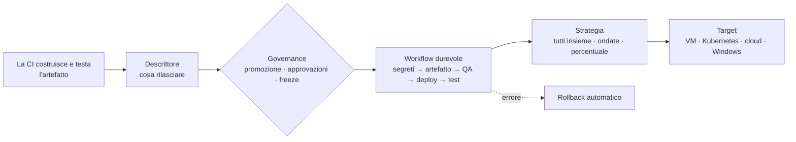

<div class="mn-hero" markdown>

<div markdown>

<span class="mn-hero__eyebrow">deploy as code · workflow durevoli DBOS</span>

# Il tuo processo di deploy, sotto controllo.

<p class="mn-hero__subtitle">Definisci cosa rilasciare. Controlla come arriva in produzione.</p>

<p class="mn-hero__lead">Manent è un motore di deploy open source che coordina workflow durevoli, verifica degli artefatti, rollout progressivi e governance dei rilasci su VM, Kubernetes e piattaforme cloud.</p>

<div class="mn-hero__actions">
<a class="md-button md-button--primary" href="tutorial/">Inizia dai tutorial →</a>
<a class="md-button" href="concetti/panoramica/">Come funziona</a>
<a class="md-button" href="integrazioni/">Integrazioni</a>
</div>

</div>

<div class="mn-terminal">
<div class="mn-terminal__bar"><i></i><i></i><i></i><span>~/myapp — manent</span></div>
<pre><code><span class="p">$</span> manent deploy -f release.yml
<span class="dim">deploy enqueued: 7c0e… (manent logs -f 7c0e…)</span>
<span class="p">$</span> manent logs -f 7c0e…
<span class="dim">14:03:10</span> INFO  <span class="v">[secrets]</span>    secrets verified
<span class="dim">14:03:12</span> INFO  <span class="v">[artifacts]</span>  sha256=2d27fbdf… verified
<span class="dim">14:03:12</span> INFO  <span class="v">[qa]</span>         QA passed
<span class="dim">14:03:15</span> INFO  <span class="v">[deploy]</span>     release 1.4.0 activated on 3 targets
<span class="dim">14:03:15</span> INFO  <span class="v">[activation]</span> live
<span class="ok">✔ SUCCESS</span>  myapp/prod  1.4.0  <span class="dim">kind=promotion</span></code></pre>
</div>

</div>

<div class="mn-stats">
<div class="mn-stat"><b>Durevole</b><span>riprende dall'ultimo step</span></div>
<div class="mn-stat"><b>Idempotente</b><span>mai due volte lo stesso deploy</span></div>
<div class="mn-stat"><b>Governato</b><span>promozioni · approvazioni · freeze</span></div>
<div class="mn-stat"><b>Osservabile</b><span>metriche · tracce · log · DORA</span></div>
</div>

Il deploy si descrive in un file dichiarativo, il **descrittore**. Il client `manent` lo legge in YAML e lo invia all'API di `manent-server`, che lo accoda; un worker lo esegue come workflow durevole [DBOS](https://github.com/dbos-inc/dbos-transact-golang).

```yaml title="release.yml"
apiVersion: manent/v1
application: myapp
environment: test
artifact:
  type: application
  name: myapp
  version: 1.2.3
  source: https://artifacts.example.com/myapp/myapp-1.2.3.tar.gz
```

## Cosa offre

<div class="grid cards" markdown>

-   :material-database-sync-outline:{ .lg .middle } **Workflow durevoli**

    ---

    Ogni step è registrato da DBOS: se un worker si interrompe, il deploy riprende dall'ultimo step completato e non esegue due volte ciò che è già stato fatto.

    [:octicons-arrow-right-24: Architettura](concetti/architettura.md)

-   :material-pipe:{ .lg .middle } **Pipeline configurabile**

    ---

    Segreti, artefatti, QA, deploy, test post deploy e attivazione. Gli step obbligatori non si possono saltare; quelli opzionali si attivano dal descrittore.

    [:octicons-arrow-right-24: Pipeline e step](concetti/pipeline.md)

-   :material-puzzle-outline:{ .lg .middle } **Plugin di deploy**

    ---

    Il deploy vero e proprio è delegato a plugin: [remote-copy](plugins/remote-copy.md) per file via SSH, [container](plugins/container.md) per Docker e Podman su VM, [kubernetes](plugins/kubernetes.md) per i cluster, [ecs](plugins/ecs.md), [lambda](plugins/lambda.md), [cloudrun](plugins/cloudrun.md), [appservice](plugins/appservice.md) e [containerapps](plugins/containerapps.md) per i servizi cloud gestiti di AWS, Google Cloud e Azure, [jboss](plugins/jboss.md) per JBoss EAP e WildFly, [windows](plugins/windows.md) per IIS, servizi Windows, attività pianificate e pacchetti MSI. Se ne scrivono di nuovi, anche come binari separati via gRPC.

    [:octicons-arrow-right-24: Scrivere un plugin](plugins/index.md)

-   :material-monitor-dashboard:{ .lg .middle } **Interfaccia web**

    ---

    Deploy, ondate e log in tempo reale, approvazioni, inventario con promozioni e rollback, freeze e metriche DORA, con i permessi dell'API. Incorporata nel server, accessibile, in inglese e italiano.

    [:octicons-arrow-right-24: Interfaccia web](guida/interfaccia-web.md)

-   :material-tune-variant:{ .lg .middle } **Configurazione per ambiente**

    ---

    Target, plugin e parametri di ogni ambiente possono stare in Consul. Il descrittore indica solo cosa rilasciare.

    [:octicons-arrow-right-24: Configurazione di ambiente](guida/configurazione-ambiente.md)

-   :material-calendar-clock-outline:{ .lg .middle } **Pianificazione**

    ---

    Deploy a un orario preciso o ricorrenti (cron), sulla stessa coda e con gli stessi limiti di concorrenza dei deploy immediati.

    [:octicons-arrow-right-24: Deploy pianificati](guida/pianificazione.md)

-   :material-flask-outline:{ .lg .middle } **Dry-run e callback**

    ---

    Simula un deploy verificando segreti, artefatto e target senza modificarli. Notifica l'esito di ogni step a endpoint HTTP esterni.

    [:octicons-arrow-right-24: Dry-run](guida/dry-run.md)

-   :material-shield-lock-outline:{ .lg .middle } **Sicurezza e audit**

    ---

    Utenti OIDC e token per la CI, permessi per applicazione e ambiente, audit con catena di hash, segreti da Vault e limiti su ciò che un descrittore può chiedere.

    [:octicons-arrow-right-24: Accesso e audit](operazioni/accesso.md)

-   :material-backup-restore:{ .lg .middle } **Rollback automatico**

    ---

    Se un deploy fallisce, riporta l'ambiente alla release precedente. Le policy stabiliscono per quali tipi di artefatto è possibile.

    [:octicons-arrow-right-24: Rollback](guida/rollback.md)

-   :material-source-branch-check:{ .lg .middle } **Governance dei rilasci**

    ---

    Inventario di cosa è in esercizio, promozione obbligatoria tra ambienti, approvazioni, finestre di freeze e rollback manuale.

    [:octicons-arrow-right-24: Governance](guida/governance.md)

-   :material-forum-outline:{ .lg .middle } **Chat e change management**

    ---

    Notifiche di deploy e approvazioni in Slack e Teams, approvazioni con i pulsanti di Slack, ticket di change in ServiceNow o Jira aperti e chiusi con ogni deploy.

    [:octicons-arrow-right-24: Integrazioni](guida/integrazioni.md)

-   :material-earth:{ .lg .middle } **Rilasci a ondate**

    ---

    Canary, poi una region e un'AZ alla volta, con tempo di osservazione e health gate su sonde, Prometheus e Alertmanager. Ogni region eseguita dai suoi worker.

    [:octicons-arrow-right-24: Rilasci a ondate](guida/ondate.md)

-   :material-chart-timeline-variant:{ .lg .middle } **Pronto per l'esercizio**

    ---

    Metriche Prometheus, tracing OpenTelemetry, log di ogni deploy e metriche DORA. Recovery dei worker persi, drain, retention, immagini container, chart Helm e rilasci firmati.

    [:octicons-arrow-right-24: Osservabilità](operazioni/osservabilita.md)

</div>

## Il percorso di un rilascio



Ogni fase viene registrata: il [ciclo di vita di un deploy](concetti/ciclo-di-vita.md) spiega ogni stato, e le [tipologie di deploy](concetti/tipologie-deploy.md) tutti i modi in cui un rilascio può partire e raggiungere i target.

## L'interfaccia web

Il server serve anche un'interfaccia web, con gli stessi permessi dell'API: segui deploy e ondate in tempo reale, approva, promuovi e torna indietro, guarda cosa gira dove. Gli screenshot vengono da un ambiente demo con cinque applicazioni, tre ambienti e quattro settimane di storico; la [guida all'interfaccia web](guida/interfaccia-web.md) descrive ogni vista.

<div class="mn-shots" markdown>

<figure markdown="span">
  [{ loading=lazy }](assets/screenshots/deployments.png)
  <figcaption><strong>Deploy</strong>: ogni deploy, promozione e rollback, con stato, richiedente e durata.</figcaption>
</figure>

<figure markdown="span">
  [{ loading=lazy }](assets/screenshots/deployment-waves.png)
  <figcaption><strong>Rilascio a ondate</strong>: approvazione, canary, poi una zona di disponibilità alla volta su due region.</figcaption>
</figure>

<figure markdown="span">
  [{ loading=lazy }](assets/screenshots/deployment-rollback.png)
  <figcaption><strong>Rollback automatico</strong>: un health check fallito in eu-central-1 riporta indietro tutte le ondate.</figcaption>
</figure>

<figure markdown="span">
  [{ loading=lazy }](assets/screenshots/inventory.png)
  <figcaption><strong>Inventario</strong>: la release in esercizio per ogni applicazione e ambiente, con promozione e rollback.</figcaption>
</figure>

<figure markdown="span">
  [{ loading=lazy }](assets/screenshots/activity.png)
  <figcaption><strong>Attività</strong>: deploy in corso, in attesa, in coda e pianificati, e i worker che li eseguono.</figcaption>
</figure>

<figure markdown="span">
  [{ loading=lazy }](assets/screenshots/metrics.png)
  <figcaption><strong>Metriche</strong>: metriche DORA calcolate dallo storico dei deploy.</figcaption>
</figure>

</div>

## Da dove iniziare

<div class="grid cards" markdown>

-   :material-school-outline:{ .lg .middle } **[Tutorial](tutorial/index.md)**

    ---

    Sette passi pratici, dal primo deploy via SSH a Kubernetes, rilasci canary, pipeline di CI e produzione.

-   :material-lightbulb-on-outline:{ .lg .middle } **[Concetti](concetti/panoramica.md)**

    ---

    Cosa è e cosa non è manent, il modello, le tipologie di deploy, il ciclo di vita e i livelli di configurazione.

-   :material-connection:{ .lg .middle } **[Integrazioni](integrazioni/index.md)**

    ---

    Configurazioni passo passo per Slack, Teams, ServiceNow, Jira, GitHub, GitLab, Terraform, Vault, Consul, OIDC, Prometheus e altro.

-   :material-book-open-variant:{ .lg .middle } **[Riferimento](guida/descrittore.md)**

    ---

    Descrittore, [CLI](guida/cli.md), [API HTTP](guida/api.md), [`manent-server`](operazioni/server.md) e [`manent.yml`](operazioni/configurazione.md).

-   :material-server-network:{ .lg .middle } **[Operazioni](operazioni/installazione.md)**

    ---

    Installazione, scalabilità, recovery, aggiornamenti, osservabilità e sicurezza per il team di piattaforma.

-   :material-puzzle-outline:{ .lg .middle } **[Plugin](plugins/index.md)**

    ---

    I plugin incorporati per ogni piattaforma, e come scriverne di propri, anche come binari separati.

</div>
