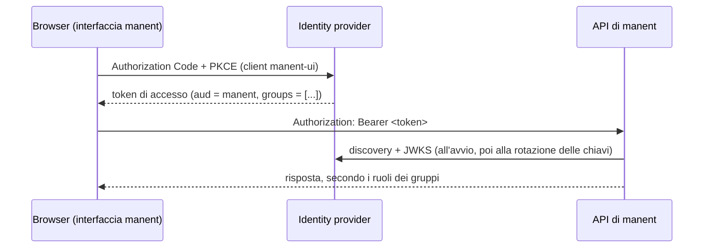

# Identity provider OIDC

Le persone accedono a manent tramite il tuo identity provider. L'API verifica i token di accesso JWT che emette (firma, issuer, audience, scadenza), prende nome utente e gruppi dai loro claim, e i binding dell'[RBAC](../operazioni/accesso.md#permessi-rbac) trasformano i gruppi in ruoli. L'interfaccia web fa accedere gli utenti con Authorization Code e PKCE; la CLI invia un token ottenuto dal provider.

!!! abstract "Cosa serve"
    Un provider OIDC (Keycloak, Microsoft Entra ID, Okta, Google, Auth0, Dex…) · i permessi per registrare applicazioni · manent servito in HTTPS (l'accesso dal browser lo richiede)



## Cosa si aspetta manent nel token

| Claim | Impostazione | Default |
|---|---|---|
| `iss` | `auth.oidc.issuer` | |
| `aud` | `auth.oidc.audience` | |
| nome utente | `auth.oidc.username_claim` | `preferred_username` (in mancanza `sub`) |
| gruppi | `auth.oidc.groups_claim` | `groups` |

L'identità diventa `oidc:<nome utente>`, come mostra `manent whoami` e come viene registrata nell'audit.

## Configura il provider

=== "Keycloak"

    1. Nel realm (per esempio `corp`, issuer `https://sso.example.com/realms/corp`) crea un client **`manent`** che rappresenta solo l'API: *Client authentication* disattivata, nessun flusso attivo. Il suo ID è l'audience.
    2. Crea un client **`manent-ui`** per l'interfaccia web:
        - *Client authentication* **disattivata** (client pubblico), *Standard flow* attivo, *Direct access grants* disattivato;
        - *Valid redirect URIs* `https://manent.example.com/auth/callback`, *Valid post logout redirect URIs* `https://manent.example.com/`, *Web origins* `https://manent.example.com`;
        - *Advanced → Proof Key for Code Exchange Code Challenge Method*: `S256`.
    3. In *Client scopes → manent-ui-dedicated* aggiungi due mapper:
        - **Audience**: *Included Client Audience* `manent`, *Add to access token* attivo;
        - **Group Membership**: *Token Claim Name* `groups`, *Full group path* disattivato, *Add to access token* attivo.

    ```yaml title="manent.yml"
    auth:
      mode: enabled
      oidc:
        issuer: https://sso.example.com/realms/corp
        audience: manent
        username_claim: preferred_username
        groups_claim: groups
        ui:
          client_id: manent-ui
    ```

=== "Microsoft Entra ID"

    1. **App registration `manent-api`** (l'API):
        - *Expose an API*: Application ID URI `api://manent`, aggiungi uno scope `access`;
        - nel *Manifest* imposta `requestedAccessTokenVersion` (o `accessTokenAcceptedVersion` nel manifest precedente) a `2`: i token v2 hanno come `aud` il **client ID** dell'applicazione;
        - *App roles*: crea ruoli come `manent.deployer` e `manent.approver` e assegnali ai gruppi in *Enterprise applications → manent-api → Users and groups*. I ruoli arrivano nel claim `roles` con nomi leggibili, mentre il claim `groups` conterrebbe gli object ID.
    2. **App registration `manent-ui`** (l'interfaccia web):
        - *Authentication*: piattaforma **Single-page application**, redirect URI `https://manent.example.com/auth/callback`, front-channel logout `https://manent.example.com/`;
        - *API permissions*: *My APIs → manent-api → access*, poi concedi il consenso amministrativo.

    ```yaml title="manent.yml"
    auth:
      mode: enabled
      oidc:
        issuer: https://login.microsoftonline.com/<tenant-id>/v2.0
        audience: <client ID di manent-api>
        username_claim: preferred_username
        groups_claim: roles
        ui:
          client_id: <client ID di manent-ui>
          scopes: [openid, profile, "api://manent/access"]
    rbac:
      bindings:
        - {groups: [manent.deployer], role: deployer, applications: ["*"], environments: [dev, test]}
        - {groups: [manent.approver], role: approver, applications: ["*"], environments: [prod]}
    ```

    Lo scope `api://manent/access` fa emettere a Entra il token di accesso per l'API, con l'audience giusta.

=== "Okta"

    1. *Security → API → Authorization Servers*: usa un authorization server personalizzato (o creane uno chiamato `manent`) con audience `api://manent`. Il suo issuer è `https://<org>.okta.com/oauth2/<id del server>`.
    2. In quel server, *Claims → Add Claim*: nome `groups`, incluso nell'**Access Token**, tipo di valore **Groups**, filtro per esempio *Starts with* `manent-`.
    3. *Applications → Create App Integration → OIDC → Single-Page Application*: grant type Authorization Code, sign-in redirect URI `https://manent.example.com/auth/callback`, sign-out redirect URI `https://manent.example.com/`; assegna i gruppi che possono usare manent.
    4. *Security → API → Trusted Origins*: aggiungi `https://manent.example.com` per il CORS.

    ```yaml title="manent.yml"
    auth:
      mode: enabled
      oidc:
        issuer: https://acme.okta.com/oauth2/aus1234567890
        audience: api://manent
        username_claim: sub            # nei token di accesso di Okta il login è in sub
        groups_claim: groups
        ui:
          client_id: <client ID della SPA>
    ```

Per un provider con una CA privata aggiungi `auth.oidc.ca_file`. manent legge il documento di discovery e le chiavi del provider all'avvio di `serve` (o `api`), e ricarica le chiavi quando ruotano.

## Associa i gruppi ai ruoli

```yaml title="manent.yml"
rbac:
  bindings:
    - {groups: [team-shop], role: deployer, applications: ["shop*"], environments: [dev, test, staging]}
    - {groups: [team-shop], role: tester, applications: ["shop*"], environments: [prod]}
    - {groups: [release-managers], role: operator, applications: ["*"], environments: ["*"]}
    - {groups: [cab], role: approver, applications: ["*"], environments: [prod]}
    - {groups: [platform], role: admin, applications: ["*"], environments: ["*"]}
```

Un binding si applica quando l'identità appartiene a uno dei suoi `groups` (o corrisponde a uno dei suoi `subjects`); un'azione è consentita se almeno un binding la concede. Vedi [Ruoli e azioni](../operazioni/accesso.md#permessi-rbac).

## Accedi

- **Interfaccia web:** apri `https://manent.example.com` e accedi. I token restano solo in memoria, senza cookie; un ricaricamento della pagina ti fa riaccedere in silenzio finché dura la sessione del provider.
- **CLI:** manent non esegue il login da sé. Ottieni un token di accesso per l'audience `manent` con gli strumenti del provider (un device authorization grant, un `oidc-agent`, un portale aziendale) e salvalo nel `token_file` del client:

    ```yaml title="~/.config/manent/client.yml"
    server: https://manent.example.com
    token_file: ~/.config/manent/token
    ```

- **CI:** usa i [token statici](../operazioni/accesso.md) con ruoli propri.

## Verifica

```sh
manent whoami
```

```json
{"subject": "oidc:alice", "method": "oidc", "groups": ["team-shop"], "auth_enabled": true,
 "grants": [{"role": "deployer", "applications": ["shop*"], "environments": ["dev", "test", "staging"]}]}
```

| Sintomo | Causa probabile |
|---|---|
| `401` su ogni richiesta | `issuer` errato (deve coincidere esattamente con `iss`, slash finale compreso) o `audience` errata. Decodifica il token e confronta. |
| Accesso riuscito, ma `403` ovunque | Il claim dei gruppi manca nel token di **accesso** o ha un altro nome: controlla `groups_claim` e i mapper. |
| L'interfaccia web dice che l'accesso non è configurato | Manca `auth.oidc.ui.client_id`. |
| L'interfaccia web dice che serve HTTPS | PKCE richiede la Web Crypto API del browser, disponibile solo in HTTPS o su `localhost`. |

Riferimento: [Autenticazione, permessi e audit](../operazioni/accesso.md), [Interfaccia web](../guida/interfaccia-web.md).
