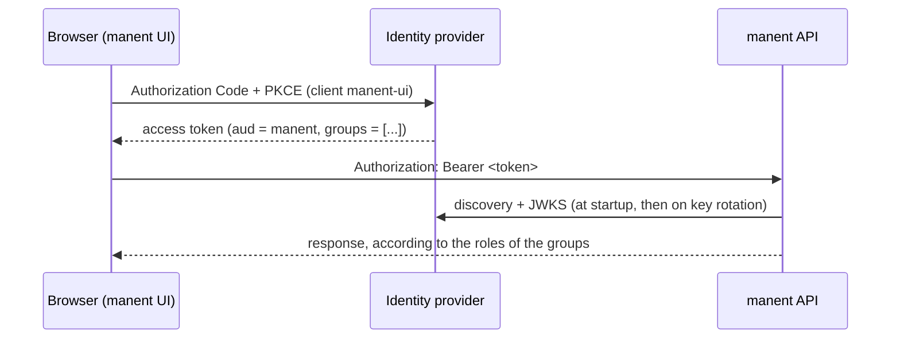

# OIDC identity providers

People sign in to manent through your identity provider. The API verifies the JWT access tokens it issues (signature, issuer, audience, expiry), takes the user name and the groups from their claims, and the [RBAC](../operazioni/accesso.md#permessi-rbac) bindings turn groups into roles. The web interface signs users in with Authorization Code and PKCE; the CLI sends a token you obtain from the provider.

!!! abstract "What you need"
    An OIDC provider (Keycloak, Microsoft Entra ID, Okta, Google, Auth0, Dex…) · permission to register applications · manent served over HTTPS (the browser sign-in needs it)



## What manent expects in the token

| Claim | Setting | Default |
|---|---|---|
| `iss` | `auth.oidc.issuer` | |
| `aud` | `auth.oidc.audience` | |
| user name | `auth.oidc.username_claim` | required: see [below](#nome-utente) |
| groups | `auth.oidc.groups_claim` | `groups` |

The identity becomes `oidc:<user name>`, as shown by `manent whoami` and recorded in the audit log.

### Choosing the user name claim { #nome-utente }

`username_claim` is required: the user name is what subject bindings, the four-eyes rule on approvals and the audit log rely on. Choose a claim that is unique for each user and that users cannot change themselves. A token without that claim is refused; manent never falls back to another claim.

| Provider | Claim | Notes |
|---|---|---|
| Keycloak | `preferred_username` | Readable. Keep *Realm settings → Edit username* off, the default, so users cannot rename themselves. |
| Microsoft Entra ID | `oid` | The immutable object ID. Microsoft advises against `preferred_username` for authorization: administrators can change it and assign it again to another user. |
| Okta | `sub` | In access tokens of a custom authorization server, `sub` is the user's login. |
| Any | `sub` | Unique and stable by the OIDC specification, but often an opaque ID. |

Changing `username_claim` on an existing installation changes every identity: pending approvals compare the requester's old name with the approver's new one, so drain them first and update bindings and Slack identities.

## Configure your provider

=== "Keycloak"

    1. In the realm (for example `corp`, issuer `https://sso.example.com/realms/corp`) create a client **`manent`** that only stands for the API: *Client authentication* off, every flow off. Its ID is the audience.
    2. Create a client **`manent-ui`** for the web interface:
        - *Client authentication* **off** (public client), *Standard flow* on, *Direct access grants* off;
        - *Valid redirect URIs* `https://manent.example.com/auth/callback`, *Valid post logout redirect URIs* `https://manent.example.com/`, *Web origins* `https://manent.example.com`;
        - *Advanced → Proof Key for Code Exchange Code Challenge Method*: `S256`.
    3. In *Client scopes → manent-ui-dedicated* add two mappers:
        - **Audience**: *Included Client Audience* `manent`, *Add to access token* on;
        - **Group Membership**: *Token Claim Name* `groups`, *Full group path* off, *Add to access token* on.

    ```yaml title="manent.yml"
    auth:
      mode: enabled
      oidc:
        issuer: https://sso.example.com/realms/corp
        audience: manent
        username_claim: preferred_username
        groups_claim: groups
        ui:
          client_id: manent-ui
    ```

=== "Microsoft Entra ID"

    1. **App registration `manent-api`** (the API):
        - *Expose an API*: Application ID URI `api://manent`, add a scope `access`;
        - in the *Manifest* set `requestedAccessTokenVersion` (or `accessTokenAcceptedVersion` in the legacy manifest) to `2`: v2 tokens carry the application's **client ID** as `aud`;
        - *App roles*: create roles such as `manent.deployer` and `manent.approver`, and assign groups to them in *Enterprise applications → manent-api → Users and groups*. Roles arrive in the `roles` claim with readable names, while the `groups` claim would contain object IDs.
    2. **App registration `manent-ui`** (the web interface):
        - *Authentication*: platform **Single-page application**, redirect URI `https://manent.example.com/auth/callback`, front-channel logout `https://manent.example.com/`;
        - *API permissions*: *My APIs → manent-api → access*, then grant admin consent.

    ```yaml title="manent.yml"
    auth:
      mode: enabled
      oidc:
        issuer: https://login.microsoftonline.com/<tenant-id>/v2.0
        audience: <client ID of manent-api>
        username_claim: oid            # immutable; subjects become object IDs
        groups_claim: roles
        ui:
          client_id: <client ID of manent-ui>
          scopes: [openid, profile, "api://manent/access"]
    rbac:
      bindings:
        - {groups: [manent.deployer], role: deployer, applications: ["*"], environments: [dev, test]}
        - {groups: [manent.approver], role: approver, applications: ["*"], environments: [prod]}
    ```

    The scope `api://manent/access` makes Entra issue the access token for the API, with the right audience.

=== "Okta"

    1. *Security → API → Authorization Servers*: use a custom authorization server (or create one named `manent`) with audience `api://manent`. Its issuer is `https://<org>.okta.com/oauth2/<server id>`.
    2. In that server, *Claims → Add Claim*: name `groups`, include in **Access Token**, value type **Groups**, filter for example *Starts with* `manent-`.
    3. *Applications → Create App Integration → OIDC → Single-Page Application*: grant type Authorization Code, sign-in redirect URI `https://manent.example.com/auth/callback`, sign-out redirect URI `https://manent.example.com/`; assign the groups that may use manent.
    4. *Security → API → Trusted Origins*: add `https://manent.example.com` for CORS.

    ```yaml title="manent.yml"
    auth:
      mode: enabled
      oidc:
        issuer: https://acme.okta.com/oauth2/aus1234567890
        audience: api://manent
        username_claim: sub            # Okta access tokens carry the login in sub
        groups_claim: groups
        ui:
          client_id: <client ID of the SPA>
    ```

For a provider with a private CA, add `auth.oidc.ca_file`. manent reads the provider's discovery document and keys when `serve` (or `api`) starts, and reloads the keys when they rotate.

## Map groups to roles

```yaml title="manent.yml"
rbac:
  bindings:
    - {groups: [team-shop], role: deployer, applications: ["shop*"], environments: [dev, test, staging]}
    - {groups: [team-shop], role: tester, applications: ["shop*"], environments: [prod]}
    - {groups: [release-managers], role: operator, applications: ["*"], environments: ["*"]}
    - {groups: [cab], role: approver, applications: ["*"], environments: [prod]}
    - {groups: [platform], role: admin, applications: ["*"], environments: ["*"]}
```

A binding applies when the identity belongs to one of its `groups` (or matches one of its `subjects`); an action is allowed if any binding grants it. See [Roles and actions](../operazioni/accesso.md#permessi-rbac).

## Sign in

- **Web interface:** open `https://manent.example.com` and sign in. Tokens stay in memory only, without cookies; a reload signs you in again silently while the provider's session lasts.
- **CLI:** manent does not run the login itself. Obtain an access token for the `manent` audience with your provider's tooling (a device authorization grant, an `oidc-agent`, a corporate portal) and save it in the client's `token_file`:

    ```yaml title="~/.config/manent/client.yml"
    server: https://manent.example.com
    token_file: ~/.config/manent/token
    ```

- **CI:** use [static tokens](../operazioni/accesso.md) with their own roles.

## Check it

```sh
manent whoami
```

```json
{"subject": "oidc:alice", "method": "oidc", "groups": ["team-shop"], "auth_enabled": true,
 "grants": [{"role": "deployer", "applications": ["shop*"], "environments": ["dev", "test", "staging"]}]}
```

| Symptom | Likely cause |
|---|---|
| `401` on every request | Wrong `issuer` (it must match `iss` exactly, trailing slash included) or wrong `audience`. Decode the token and compare. |
| Signed in, but `403` everywhere | The groups claim is missing from the **access** token or has another name: check `groups_claim` and the mappers. |
| The web interface says sign-in is not configured | `auth.oidc.ui.client_id` is missing. |
| The web interface says it needs HTTPS | PKCE needs the browser's Web Crypto API, available only on HTTPS or `localhost`. |

Reference: [Authentication, permissions and audit](../operazioni/accesso.md), [Web interface](../guida/interfaccia-web.md).
