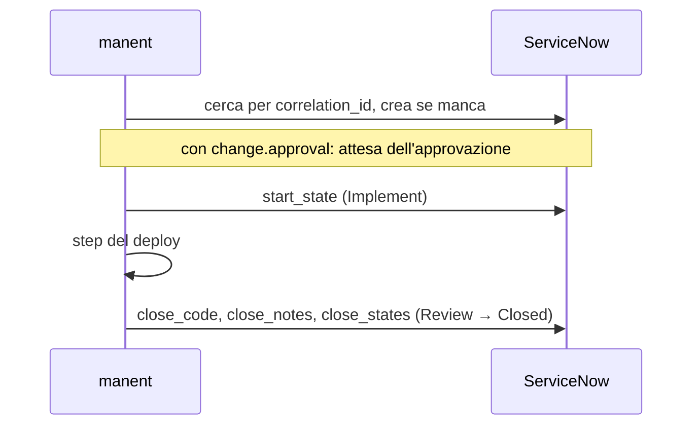

# ServiceNow

Una change request per ogni deploy reale delle applicazioni e degli ambienti che scegli: aperta all'avvio del deploy, portata in implementazione e chiusa con l'esito. Facoltativamente il deploy **attende l'approvazione del change** in ServiceNow, insieme o al posto delle approvazioni di manent.

!!! abstract "Cosa serve"
    Un'istanza ServiceNow · un utente tecnico con accesso in lettura, creazione e aggiornamento su `change_request` · un gestore dei segreti raggiungibile da manent



## 1. Prepara ServiceNow

1. Crea un utente per manent, per esempio `manent`, con il ruolo `itil` o un ruolo dedicato con ACL per leggere, creare e aggiornare i record di `change_request`.
2. Annota l'URL dell'istanza (`https://acme.service-now.com`) e decidi i campi che ogni change deve avere: assignment group, configuration item, categoria, tipo.
3. Controlla il tuo modello di change: manent imposta lo stato **Implement** (`-1`) all'avvio del deploy e **Review** (`0`) poi **Closed** (`3`) alla fine. Se il tuo modello richiede altri stati o transizioni, li imposterai al passo 2.

```sh
vault kv put secret/manent/servicenow password='…'
```

Funziona anche un token OAuth bearer, con `token_ref` al posto di `username` e `password_ref`.

## 2. Configura il provider

```yaml title="manent.yml"
integrations:
  public_url: https://manent.example.com      # il change rimanda al deploy
  change:
    provider: servicenow
    poll_interval: 1m                         # lettura dell'approvazione, a intervalli crescenti fino a 5 minuti
    servicenow:
      url: https://acme.service-now.com
      username: manent
      password_ref: "vault:secret/data/manent/servicenow#password"
      fields:
        type: normal
        assignment_group: "Release Management"
        cmdb_ci: "{application}"
      # start_state: "-1"                     # "" lascia lo stato invariato
      # close_states: ["0", "3"]
      # close_codes: {success: successful, failure: unsuccessful}
```

I valori dei campi accettano `{application}`, `{environment}`, `{version}`, `{artifact}`, `{deployment}` e `{requested_by}`. manent compila già `short_description`, `description`, `correlation_id` e `correlation_display`; gli ultimi due vengono rifiutati in `fields` all'avvio, perché `correlation_id` è il modo in cui manent ritrova il change.

## 3. Attivalo per ambiente

Il change management fa parte di una [regola di governance](../guida/governance.md):

```yaml title="manent.yml"
governance:
  rules:
    - name: production
      applications: ["*"]
      environments: [prod]
      requires: [preprod]
      change: {approval: true, timeout: 72h}   # attende l'approvazione del change
```

| `change` | Effetto |
|---|---|
| `{}` | Un ticket per deploy, aperto all'avvio e chiuso alla fine. Il deploy non attende. |
| `{approval: true}` | Il ticket viene aperto quando il deploy viene **richiesto**, e il deploy parte solo quando ServiceNow lo approva (e quando sono arrivate le eventuali `approvals` di manent). |

Con `approval: true` l'attesa avviene nel workflow di approvazione di manent, che non occupa slot dei worker. manent legge il campo `approval` a intervalli crescenti: `approved` fa partire il deploy, `rejected` (o un change annullato, stato `4`) lo respinge con una decisione che porta il nome del ticket, per esempio `servicenow:CHG0031337`. Uno standard change già approvato alla creazione non attende affatto.

## 4. Verifica

```sh
manent deploy -f deploy/prod.yml --no-wait
manent status <id> | jq '{state, change}'
```

```json
{"state": "AWAITING_APPROVAL", "change": {"number": "CHG0031337", "url": "https://acme.service-now.com/…", "approval": "pending"}}
```

Il numero del ticket compare anche nella CLI, nell'interfaccia web e nei messaggi in chat. In ServiceNow il record ha `correlation_id` uguale all'ID del deploy: è così che manent lo ritrova dopo i tentativi o una recovery, e un deploy non apre mai due ticket.

## Comportamento e limiti { #comportamento-e-limiti }

- **Senza ticket il deploy non parte**: se `change:open` non riesce a crearlo, il deploy fallisce prima di toccare qualunque target.
- **Gli errori di chiusura vengono registrati nel log**, non sono fatali: il deploy è già terminato.
- Le risposte 4xx di ServiceNow (tranne 408 e 429) sono permanenti e non vengono ritentate; gli altri errori vengono ritentati 3 volte.
- Le credenziali vengono lette a ogni chiamata e non compaiono mai in log, output o messaggi; i redirect non vengono seguiti.
- I dry-run non aprono mai ticket.

Riferimento: [Chat e change management](../guida/integrazioni.md#change-management).
