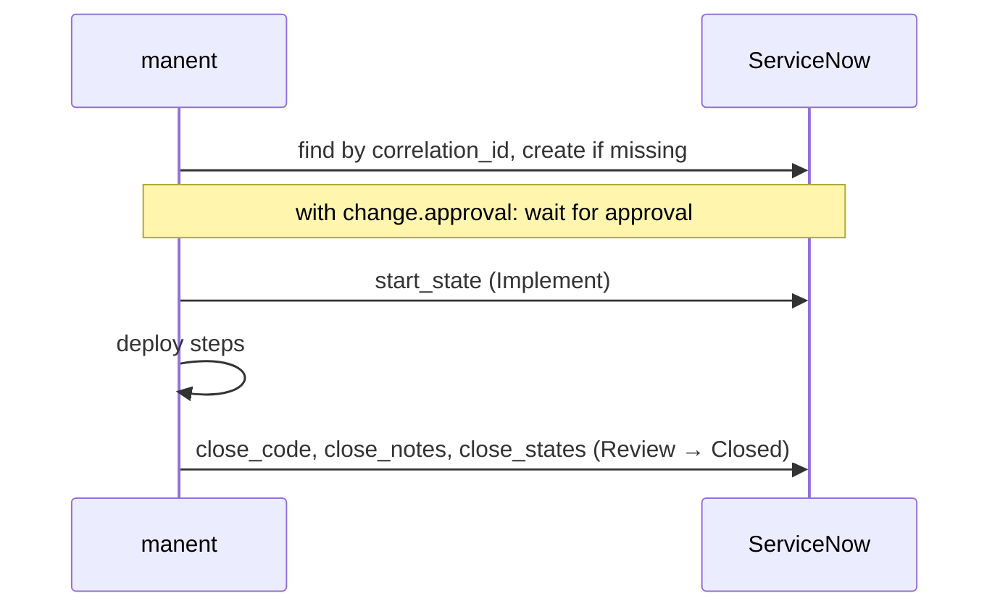

# ServiceNow

A change request for every real deploy of the applications and environments you choose: opened when the deploy starts, moved to implementation, and closed with the outcome. Optionally the deploy **waits for the change to be approved** in ServiceNow, alongside or instead of manent's own approvals.

!!! abstract "What you need"
    A ServiceNow instance · a technical user with read, create and update access to `change_request` · a secret store reachable by manent



## 1. Prepare ServiceNow

1. Create a user for manent, for example `manent`, with the `itil` role or a dedicated role with ACLs to read, create and update records of `change_request`.
2. Note the instance URL (`https://acme.service-now.com`) and decide the fields every change must carry: assignment group, configuration item, category, type.
3. Check your change model: manent sets the state to **Implement** (`-1`) when the deploy starts and to **Review** (`0`) then **Closed** (`3`) at the end. If your model needs other states or transitions, you will set them in step 2.

```sh
vault kv put secret/manent/servicenow password='…'
```

An OAuth bearer token works too, with `token_ref` instead of `username` and `password_ref`.

## 2. Configure the provider

```yaml title="manent.yml"
integrations:
  public_url: https://manent.example.com      # the change links to the deploy
  change:
    provider: servicenow
    poll_interval: 1m                         # approval polling, growing up to 5 minutes
    servicenow:
      url: https://acme.service-now.com
      username: manent
      password_ref: "vault:secret/data/manent/servicenow#password"
      fields:
        type: normal
        assignment_group: "Release Management"
        cmdb_ci: "{application}"
      # start_state: "-1"                     # "" leaves the state unchanged
      # close_states: ["0", "3"]
      # close_codes: {success: successful, failure: unsuccessful}
```

Field values accept `{application}`, `{environment}`, `{version}`, `{artifact}`, `{deployment}` and `{requested_by}`. manent already fills `short_description`, `description`, `correlation_id` and `correlation_display`; the last two are refused in `fields` at startup, because `correlation_id` is how manent finds the change again.

## 3. Turn it on per environment

Change management is part of a [governance rule](../guida/governance.md):

```yaml title="manent.yml"
governance:
  rules:
    - name: production
      applications: ["*"]
      environments: [prod]
      requires: [preprod]
      change: {approval: true, timeout: 72h}   # wait for the change to be approved
```

| `change` | Effect |
|---|---|
| `{}` | A ticket per deploy, opened at start and closed at the end. The deploy does not wait. |
| `{approval: true}` | The ticket is opened when the deploy is **requested**, and the deploy starts only once ServiceNow approves it (and once any manent `approvals` are given). |

With `approval: true` the wait happens in manent's approval workflow, which takes no worker slot. manent reads the `approval` field at growing intervals: `approved` lets the deploy go, `rejected` (or a cancelled change, state `4`) rejects it with a decision named after the ticket, for example `servicenow:CHG0031337`. A standard change that is pre-approved when created does not wait at all.

## 4. Check it

```sh
manent deploy -f deploy/prod.yml --no-wait
manent status <id> | jq '{state, change}'
```

```json
{"state": "AWAITING_APPROVAL", "change": {"number": "CHG0031337", "url": "https://acme.service-now.com/…", "approval": "pending"}}
```

The ticket number also appears in the CLI, in the web interface and in chat messages. In ServiceNow the record has `correlation_id` equal to the deploy ID: that is how manent finds it again after retries or a recovery, so a deploy never opens two tickets.

## Behaviour and limits { #comportamento-e-limiti }

- **Without a ticket the deploy does not start**: if `change:open` cannot create it, the deploy fails before touching any target.
- **Closing errors are logged**, not fatal: the deploy has already finished.
- 4xx answers from ServiceNow (except 408 and 429) are permanent and not retried; other errors are retried 3 times.
- Credentials are read at every call and never appear in logs, outputs or messages; redirects are not followed.
- Dry-runs never open tickets.

Reference: [Chat and change management](../guida/integrazioni.md#change-management).
