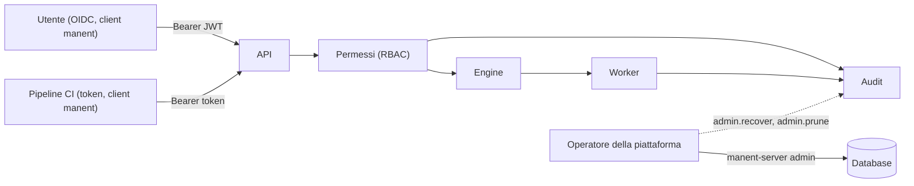

# Autenticazione, permessi e audit

manent identifica chi lo usa, decide cosa può fare per applicazione e ambiente e registra ogni azione rilevante. Il client `manent` passa sempre dall'API, quindi le stesse regole valgono per chi usa l'API direttamente e per chi usa la CLI.



## Autenticazione

```yaml title="manent.yml"
auth:
  mode: enabled          # none = nessuna autenticazione: solo sviluppo
  oidc:
    issuer: https://sso.example.com/realms/corp
    audience: manent
    username_claim: preferred_username
  tokens:
    - name: ci-pipeline
      sha256: "9f2c…"
      groups: [ci]
```

Con `mode: enabled` ogni richiesta a `/api/v1` deve avere l'header `Authorization: Bearer <token>`. Senza token, o con un token non valido, la risposta è `401` con `WWW-Authenticate: Bearer`. `/healthz` resta accessibile senza autenticazione.

### Utenti: OIDC

manent verifica i JWT emessi da un identity provider OIDC (Keycloak, Microsoft Entra ID, Okta, Google, ...): firma, issuer, audience e scadenza. Le chiavi di firma vengono lette dall'issuer (discovery e JWKS) all'avvio di `serve` e rilette automaticamente quando ruotano.

| Chiave | Default | Descrizione |
|---|---|---|
| `issuer` | | URL dell'issuer. |
| `audience` | | Valore atteso nel claim `aud`, tipicamente il client ID registrato per manent. |
| `username_claim` | | Obbligatorio. Claim con il nome dell'utente, unico e non modificabile dall'utente: vedi [Scegliere il claim del nome utente](../integrazioni/oidc.md#nome-utente). Un token senza questo claim viene rifiutato. |
| `groups_claim` | `groups` | Claim con i gruppi, usati dai permessi. |
| `policy_claims` | `[email, name]` | Claim esposti alla [policy dei permessi](../guida/permessi.md) (`input.identity.claims`); gli altri non le arrivano mai. |
| `ca_file` | | CA aggiuntive per raggiungere l'issuer. |
| `ui.client_id`, `ui.scopes`, `ui.redirect_path` | | Client pubblico (PKCE) dell'[interfaccia web](../guida/interfaccia-web.md#accesso). |

Il client (portale, script, CI con identità federata) ottiene il token dall'identity provider e lo passa a manent. manent non gestisce login né sessioni.

### Sistemi automatici: token statici

Per le pipeline CI si possono configurare token statici. In configurazione c'è solo lo **sha256** del token, mai il valore:

```sh
TOKEN=$(openssl rand -hex 32)          # da salvare nel secret store della CI
printf '%s' "$TOKEN" | sha256sum       # da scrivere in auth.tokens[].sha256
```

Il confronto avviene a tempo costante. Ogni token può avere una scadenza (`expires_at`, RFC 3339): dopo quella data non è più valido.

#### File dei token

I token in `auth.tokens` cambiano solo riavviando `serve`. Per aggiungerli e revocarli senza riavvio si usa un file separato, con lo stesso formato:

```yaml title="manent.yml"
auth:
  mode: enabled
  tokens_file: /etc/manent/tokens.yml
```

```yaml title="/etc/manent/tokens.yml"
tokens:
  - name: ci-pipeline
    sha256: "9f2c…"
    groups: [ci]
    expires_at: 2027-06-30T00:00:00Z
```

- **Rilettura.** manent controlla il file al più ogni 5 secondi e lo rilegge quando cambiano data di modifica o dimensione. Un token tolto dal file non è più valido entro 5 secondi.
- **File non valido.** All'avvio è un errore. Dopo, un file modificato ma non valido viene segnalato a log e restano in uso i token letti l'ultima volta: un errore di modifica non blocca la CI.
- **File rimosso.** Tutti i suoi token sono revocati.

Il file può essere un Secret Kubernetes montato o gestito da Vault Agent; contiene solo hash, ma va comunque protetto in scrittura.

### Identità

Ogni identità ha la forma `<metodo>:<nome>`, usata nei permessi, nell'audit e nello stato dei deploy:

| Metodo | Esempio | Origine |
|---|---|---|
| `oidc` | `oidc:alice` | Utente OIDC (claim `username_claim`). |
| `token` | `token:ci-pipeline` | Token statico. |
| `cli` | `cli:joeg` | Utente del sistema operativo che esegue `manent-server admin` (registrato nell'audit di recovery e retention). |
| `none` | `none:anonymous` | API con `auth.mode: none`. |

## Permessi (RBAC)

I permessi assegnano un **ruolo** a utenti o gruppi su un insieme di **applicazioni** e **ambienti**. Con `auth.mode: none` i permessi sono disattivati e tutto è concesso.

```yaml title="manent.yml"
rbac:
  bindings:
    - groups: [team-a]                 # gruppi OIDC o dei token
      role: deployer
      applications: ["team-a-*"]
      environments: [dev, test]
    - groups: [team-a]
      role: tester                     # in produzione solo dry-run
      applications: ["team-a-*"]
      environments: [prod]
    - groups: [release-managers]
      role: operator
      applications: ["*"]
      environments: [prod]
    - subjects: ["token:ci-pipeline"]
      role: deployer
      applications: ["*"]
      environments: [test]
```

Tutti i campi accettano pattern con `*`. Un binding si applica se l'identità corrisponde a uno dei `subjects` o appartiene a uno dei `groups`. Un'azione è consentita se almeno un binding la concede: non esistono regole di negazione. Per decidere permessi e divieti in Rego, con revisioni, approvazione e simulazione, vedi [Permessi come policy](../guida/permessi.md) (`rbac.engine: opa`).

### Ruoli e azioni

| Azione | Cosa consente |
|---|---|
| `deployment.read` | Stato, risultato ed elenco dei deploy. |
| `deployment.dry-run` | Accodare un [dry-run](../guida/dry-run.md). |
| `deployment.submit` | Accodare un deploy, anche pianificato con `schedule.at`. |
| `deployment.cancel` | Annullare un deploy. |
| `deployment.rollback` | [Rollback manuale](../guida/governance.md#rollback-manuale) a una versione precedente. |
| `deployment.approve` | Approvare o respingere un deploy in [attesa di approvazione](../guida/governance.md#approvazioni). |
| `deployment.freeze-override` | Derogare a una [finestra di freeze](../guida/governance.md#finestre-di-freeze). |
| `schedule.read` | Leggere le schedule ricorrenti. |
| `schedule.write` | Creare, aggiornare, sospendere, riattivare ed eliminare le schedule. Creare una schedule richiede anche `deployment.submit`. |
| `platform.read` | Vedere i [worker](../guida/cli.md#attivita-e-worker): host, versioni, region, heartbeat e workflow in esecuzione. Non dipende dall'applicazione: basta un binding qualsiasi che la conceda. |
| `freeze.write` | Creare ed eliminare [finestre di freeze a runtime](../guida/policy.md#freeze-a-runtime), su ogni applicazione e ambiente della finestra. |
| `policy.read`, `policy.write`, `policy.approve` | Leggere, caricare (e valutare, misurare) e attivare le revisioni della [policy di governance](../guida/policy.md). Come `platform.read` non dipendono dall'applicazione. |

| Ruolo predefinito | Azioni |
|---|---|
| `viewer` | `deployment.read`, `schedule.read` |
| `tester` | `viewer` + `deployment.dry-run` |
| `approver` | `viewer` + `deployment.approve` |
| `deployer` | `tester` + `deployment.submit`, `deployment.cancel`, `deployment.rollback` |
| `operator` | `deployer` + `schedule.write`, `platform.read` |
| `release-manager` | `viewer` + `freeze.write` |
| `admin` | tutte, comprese `deployment.freeze-override` e le azioni `policy.*` |

`deployer` e `operator` non possono approvare: chi rilascia non deve potersi approvare con un secondo ruolo. Le approvazioni si assegnano a un gruppo dedicato (es. il change advisory board) con il ruolo `approver`.

I pattern delle applicazioni sono qualificati: `shop` copre solo lo `shop` untenanted, `payments/shop` quello del [tenant](../guida/tenant.md#pattern-delle-applicazioni-qualificati) payments, `*/*` ogni applicazione. Un binding con `tenants` (un selettore sui tag del tenant proprietario e su `name`) vale solo per i deploy delle sue applicazioni; `selector` legge i tag dell'applicazione (solo le chiavi di `rbac.selector_keys`). Membri e amministratori di un tenant ricevono anche i ruoli impliciti di `rbac.tenant_roles`.

Altri ruoli si definiscono in `rbac.roles`:

```yaml
rbac:
  roles:
    canceller: [deployment.read, deployment.cancel]
```

### Regole

- **Elenchi.** `GET /deployments`, `GET /schedules` e `GET /inventory` (e i comandi CLI corrispondenti) restituiscono solo ciò che l'identità può leggere. L'elenco dei deploy prosegue sui più vecchi finché non raggiunge `limit`.
- **Azione negata.** La risposta è `403` con il motivo; nella CLI il comando termina con lo stesso errore.
- **Schedule con lo stesso nome.** Una schedule si aggiorna per nome: se ne esiste già una con lo stesso nome per un'altra applicazione o ambiente, serve `schedule.write` anche su quella.
- **Deploy delle schedule.** I deploy generati da una schedule risultano richiesti da chi ha creato o aggiornato per ultimo la schedule.
- **Piano.** `POST /deployments/plan` richiede `deployment.read`, perché rivela la pipeline dell'applicazione e dell'ambiente.
- **Promozione.** Richiede `deployment.read` sull'ambiente di origine e `deployment.submit` su quello di destinazione.
- **Approvazioni.** Chi ha richiesto un deploy non può approvarlo, salvo `allow_self` nella regola.
- **Freeze.** Le finestre di freeze sono visibili a ogni identità con `deployment.read` su almeno un'applicazione, anche quelle sulle altre applicazioni (una finestra su `*` blocca anche le sue). Un'identità autenticata senza permessi riceve `403`.
- **Dipendenze e release.** Un deploy con [`after`](../guida/catene.md) richiede `deployment.read` sulle sue dipendenze. Una release composta richiede i permessi di ogni deploy (più `deployment.rollback` con `onFailure: rollback`); leggerla o annullarla richiede `deployment.read` o `deployment.cancel` su tutti i suoi deploy.
- **Attività e worker.** `GET /activity` elenca solo i deploy che l'identità può leggere. `GET /workers` richiede `platform.read`; dei workflow in esecuzione mostra solo quelli di applicazioni e ambienti leggibili e conta gli altri in `hidden_tasks`.

### Client e server

- **Il client `manent`** chiama sempre l'API con il token di `MANENT_TOKEN` o del file del token (vedi [CLI](../guida/cli.md#configurazione-del-client)). Non contiene il motore né i driver del database e non ne ha le credenziali: autenticazione, permessi e audit sono quelli del server. È lo strumento da dare agli utenti e alle pipeline CI.
- **`manent-server admin`** e **`manent-server audit verify`** lavorano sul database di sistema e sul file di audit, con le credenziali del server. L'identità registrata nell'audit è l'utente del sistema operativo (`cli:<utente>`).

!!! warning "L'accesso al database è il vero confine"
    Chi ha le credenziali del database può agire su DBOS direttamente, senza passare da manent. Le credenziali vanno solo ai processi del server e agli operatori della piattaforma; gli utenti usano il client.

## Audit

Ogni azione rilevante produce una voce di audit:

| Azione | Quando |
|---|---|
| `deployment.submit`, `deployment.dry-run` | Richiesta di un deploy, anche negata o rifiutata. |
| `deployment.promote`, `deployment.rollback` | Promozione e rollback manuale. |
| `deployment.approve`, `deployment.reject` | Decisione di un approvatore. |
| `approval.finish` | Esito di un'approvazione (`approved`, `rejected`, `expired`), registrato dal worker. |
| `after.finish`, `release.finish` | Esito dell'attesa delle dipendenze e di una release composta, registrato dal worker. |
| `deployment.cancel` | Annullamento. |
| `schedule.pause`, `schedule.resume`, `schedule.delete` | Operazioni sulle schedule. |
| `freeze.create`, `freeze.delete` | Finestre di freeze create o eliminate a runtime (anche da `manent-server admin freeze-delete`). |
| `policy.push`, `policy.activate` | Revisioni della policy di governance caricate e attivate (anche da `manent-server admin policy-activate`). |
| `deployment.read`, `schedule.read`, `schedule.write`, `platform.read` | Solo se negate. |
| `deployment.finish` | Esito finale del deploy, registrato dal worker. |

| Esito (`outcome`) | Significato |
|---|---|
| `allowed` | Azione autorizzata ed eseguita. |
| `denied` | Negata dai permessi. |
| `error` | Autorizzata ma rifiutata (es. sorgente dell'artefatto non ammessa) o fallita. |
| `succeeded`, `failed` | Esito finale del deploy (`deployment.finish`). |

Il campo `comment` riporta il commento di un'approvazione o il motivo di una deroga al freeze.

```json title="Voce di audit"
{"time": "2026-10-09T21:42:46.02513Z", "actor": "token:ci-pipeline", "action": "deployment.submit",
 "outcome": "denied", "application": "myapp", "environment": "prod",
 "reason": "permission denied: token:ci-pipeline cannot perform deployment.submit on myapp/prod"}
```

Le voci vanno:

- al **log applicativo** e quindi al **SIEM** (attributo `audit=true`, componente `audit`), dove vanno conservate secondo le politiche aziendali;
- se `audit.file` è indicato, a un file **JSON Lines** aperto in sola aggiunta con permessi `0600`, sincronizzato su disco a ogni voce.

```yaml
audit:
  file: /var/log/manent/audit.jsonl
  max_size_mb: 100                                    # rotazione (0 = nessuna)
  hmac_key_ref: "vault:secret/data/manent/audit#key"  # facoltativa
```

### Integrità del file

Le voci del file formano una **catena di hash**: ognuna riporta l'hash della precedente (`prev_hash`) e il proprio (`hash`), calcolato sulla riga stessa. Modificare, inserire, scambiare o cancellare una voce rompe la catena:

```sh
manent-server audit verify                 # audit.file e i suoi file ruotati
```

```json
{"files": ["/var/log/manent/audit.jsonl.20261010T091200.000000000Z", "/var/log/manent/audit.jsonl"],
 "entries": 1520, "last": "5b1f…"}
```

| Protezione | Come |
|---|---|
| Modifiche e cancellazioni | Rilevate da `audit verify`, con il numero di riga. |
| Ricalcolo della catena | Con `hmac_key_ref` l'hash è un HMAC-SHA256: chi modifica il file senza la chiave non può ricalcolarlo. Senza chiave la catena rileva errori e modifiche maldestre, non un attaccante che la ricalcola. |
| Troncamento delle ultime voci | Non rilevabile dal solo file: `last` va confrontato con la copia nel SIEM o in un archivio. |

- **Rotazione.** Superato `max_size_mb`, il file viene rinominato con il suffisso `.<data UTC>` e se ne apre uno nuovo. La catena prosegue: la prima voce del nuovo file riporta l'hash dell'ultima del precedente. Archiviare o eliminare i file ruotati spetta ai processi aziendali: se il primo file verificato non parte dall'inizio, `audit verify` riporta il suo `prev_hash` come `anchor`.
- **Un file per processo.** Due processi non devono scrivere sullo stesso file: ognuno riprende la catena dall'ultima voce solo all'avvio. Con più worker sullo stesso host si usa un percorso diverso per ciascuno.
- **Copia autorevole.** Il SIEM resta la copia di riferimento; il file serve per la verifica locale e come seconda copia.

La voce `deployment.finish` è registrata in uno step DBOS: dopo una recovery non viene ripetuta. Riporta anche l'esito dell'eventuale [rollback](../guida/rollback.md).

### Chi ha richiesto un deploy

L'identità che ha richiesto il deploy viene salvata nel workflow DBOS (utente autenticato del workflow). Compare:

- nello stato del deploy e negli elenchi (`requested_by`);
- in ogni evento dei [callback](../guida/callback.md) (`requested_by`);
- nei log del worker e nella voce `deployment.finish`.

```json title="GET /api/v1/deployments/{id}"
{"id": "myapp-1.2.3-prod", "state": "SUCCESS", "application": "myapp", "environment": "prod",
 "requested_by": "oidc:alice", "created_at": "…", "result": {…}}
```
