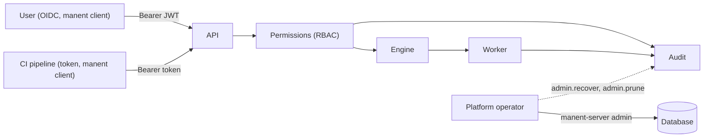

# Authentication, permissions and audit

manent identifies who uses it, decides what they can do per application and environment and records every relevant action. The `manent` client always goes through the API, so the same rules apply to whoever uses the API directly and to whoever uses the CLI.



## Authentication

```yaml title="manent.yml"
auth:
  mode: enabled          # none = no authentication: development only
  oidc:
    issuer: https://sso.example.com/realms/corp
    audience: manent
  tokens:
    - name: ci-pipeline
      sha256: "9f2c…"
      groups: [ci]
```

With `mode: enabled` every request to `/api/v1` must have the `Authorization: Bearer <token>` header. Without a token, or with an invalid one, the response is `401` with `WWW-Authenticate: Bearer`. `/healthz` stays accessible without authentication.

### Users: OIDC

manent verifies JWTs issued by an OIDC identity provider (Keycloak, Microsoft Entra ID, Okta, Google, ...): signature, issuer, audience and expiry. Signing keys are read from the issuer (discovery and JWKS) when `serve` starts and reloaded automatically when they rotate.

| Key | Default | Description |
|---|---|---|
| `issuer` | | Issuer URL. |
| `audience` | | Expected value of the `aud` claim, typically the client ID registered for manent. |
| `username_claim` | `preferred_username` | Claim with the user name. If missing, `sub` is used. |
| `groups_claim` | `groups` | Claim with the groups, used by permissions. |
| `policy_claims` | `[email, name]` | Claims exposed to the [permission policy](../guida/permessi.md) (`input.identity.claims`); the others never reach it. |
| `ca_file` | | Additional CAs to reach the issuer. |
| `ui.client_id`, `ui.scopes`, `ui.redirect_path` | | Public client (PKCE) of the [web interface](../guida/interfaccia-web.md#sign-in). |

The client (portal, script, CI with federated identity) obtains the token from the identity provider and passes it to manent. manent handles neither login nor sessions.

### Automated systems: static tokens

Static tokens can be configured for CI pipelines. The configuration holds only the token's **sha256**, never its value:

```sh
TOKEN=$(openssl rand -hex 32)          # store it in the CI secret store
printf '%s' "$TOKEN" | sha256sum       # write it to auth.tokens[].sha256
```

The comparison is constant-time. Each token can have an expiry (`expires_at`, RFC 3339): after that date it is no longer valid.

#### Token file

Tokens in `auth.tokens` change only by restarting `serve`. To add and revoke them without a restart use a separate file, with the same format:

```yaml title="manent.yml"
auth:
  mode: enabled
  tokens_file: /etc/manent/tokens.yml
```

```yaml title="/etc/manent/tokens.yml"
tokens:
  - name: ci-pipeline
    sha256: "9f2c…"
    groups: [ci]
    expires_at: 2027-06-30T00:00:00Z
```

- **Reload.** manent checks the file at most every 5 seconds and reloads it when its modification time or size changes. A token removed from the file stops being valid within 5 seconds.
- **Invalid file.** At startup it is an error. Afterwards, a modified but invalid file is reported in the log and the tokens read last time stay in use: an editing mistake does not block CI.
- **Removed file.** All its tokens are revoked.

The file can be a mounted Kubernetes Secret or managed by Vault Agent; it contains only hashes, but it must still be write-protected.

### Identities

Every identity has the form `<method>:<name>`, used in permissions, in the audit log and in the deploy status:

| Method | Example | Origin |
|---|---|---|
| `oidc` | `oidc:alice` | OIDC user (`username_claim` claim). |
| `token` | `token:ci-pipeline` | Static token. |
| `cli` | `cli:joeg` | Operating system user running `manent-server admin` (recorded in the recovery and retention audit). |
| `none` | `none:anonymous` | API with `auth.mode: none`. |

## Permissions (RBAC) { #permessi-rbac }

Permissions assign a **role** to users or groups on a set of **applications** and **environments**. With `auth.mode: none` permissions are disabled and everything is allowed.

```yaml title="manent.yml"
rbac:
  bindings:
    - groups: [team-a]                 # OIDC or token groups
      role: deployer
      applications: ["team-a-*"]
      environments: [dev, test]
    - groups: [team-a]
      role: tester                     # dry-run only in production
      applications: ["team-a-*"]
      environments: [prod]
    - groups: [release-managers]
      role: operator
      applications: ["*"]
      environments: [prod]
    - subjects: ["token:ci-pipeline"]
      role: deployer
      applications: ["*"]
      environments: [test]
```

All fields accept patterns with `*`. A binding applies if the identity matches one of the `subjects` or belongs to one of the `groups`. An action is allowed if at least one binding grants it: there are no deny rules. To decide permissions and denials in Rego, with revisions, approval and simulation, see [Permissions as a policy](../guida/permessi.md) (`rbac.engine: opa`).

### Roles and actions

| Action | What it allows |
|---|---|
| `deployment.read` | Status, result and list of deploys. |
| `deployment.dry-run` | Enqueue a [dry-run](../guida/dry-run.md). |
| `deployment.submit` | Enqueue a deploy, including one scheduled with `schedule.at`. |
| `deployment.cancel` | Cancel a deploy. |
| `deployment.rollback` | [Manual rollback](../guida/governance.md#rollback-manuale) to a previous version. |
| `deployment.approve` | Approve or reject a deploy [awaiting approval](../guida/governance.md#approvazioni). |
| `deployment.freeze-override` | Bypass a [freeze window](../guida/governance.md#finestre-di-freeze). |
| `schedule.read` | Read recurring schedules. |
| `schedule.write` | Create, update, pause, resume and delete schedules. Creating a schedule also requires `deployment.submit`. |
| `platform.read` | See the [workers](../guida/cli.md#attivita-e-worker): hosts, versions, regions, heartbeat and running workflows. It is not tied to an application: any binding that grants it is enough. |
| `freeze.write` | Create and delete [freeze windows at runtime](../guida/policy.md#freeze-a-runtime), on every application and environment of the window. |
| `policy.read`, `policy.write`, `policy.approve` | Read, push (and evaluate, measure) and activate the revisions of the [governance policy](../guida/policy.md). Like `platform.read` they are not tied to an application. |

| Predefined role | Actions |
|---|---|
| `viewer` | `deployment.read`, `schedule.read` |
| `tester` | `viewer` + `deployment.dry-run` |
| `approver` | `viewer` + `deployment.approve` |
| `deployer` | `tester` + `deployment.submit`, `deployment.cancel`, `deployment.rollback` |
| `operator` | `deployer` + `schedule.write`, `platform.read` |
| `release-manager` | `viewer` + `freeze.write` |
| `admin` | all, including `deployment.freeze-override` and the `policy.*` actions |

`deployer` and `operator` cannot approve: whoever releases must not be able to approve themselves through a second role. Approvals are assigned to a dedicated group (e.g. the change advisory board) with the `approver` role.

A binding with `tenants` (a selector on the tags of the owner [tenant](../guida/tenant.md) and on `name`) applies only to the deploys of its applications; `selector` reads the application tags (only the keys of `rbac.selector_keys`). Tenant members and admins also get the implicit roles of `rbac.tenant_roles`.

Further roles are defined in `rbac.roles`:

```yaml
rbac:
  roles:
    canceller: [deployment.read, deployment.cancel]
```

### Rules

- **Lists.** `GET /deployments`, `GET /schedules` and `GET /inventory` (and the corresponding CLI commands) return only what the identity can read. The deploy list keeps going through older ones until it reaches `limit`.
- **Denied action.** The response is `403` with the reason; in the CLI the command exits with the same error.
- **Schedules with the same name.** A schedule is updated by name: if one with the same name already exists for another application or environment, `schedule.write` is also needed on that one.
- **Schedule deploys.** Deploys generated by a schedule appear as requested by whoever last created or updated the schedule.
- **Plan.** `POST /deployments/plan` requires `deployment.read`, because it reveals the pipeline of the application and environment.
- **Promotion.** Requires `deployment.read` on the source environment and `deployment.submit` on the destination.
- **Approvals.** Whoever requested a deploy cannot approve it, unless the rule has `allow_self`.
- **Freezes.** Freeze windows are visible to every authenticated identity.
- **Dependencies and releases.** A deploy with [`after`](../guida/catene.md) requires `deployment.read` on its dependencies. A composite release requires the permissions of every deploy (plus `deployment.rollback` with `onFailure: rollback`); reading or cancelling it requires `deployment.read` or `deployment.cancel` on all its deploys.
- **Activity and workers.** `GET /activity` lists only the deploys the identity can read. `GET /workers` requires `platform.read`; of the running workflows it shows only those of readable applications and environments, and counts the others in `hidden_tasks`.

### Client and server

- **The `manent` client** always calls the API with the token from `MANENT_TOKEN` or the token file (see [CLI](../guida/cli.md#configurazione-del-client)). It contains neither the engine nor the database drivers and has no database credentials: authentication, permissions and audit are the server's. It is the tool to give users and CI pipelines.
- **`manent-server admin`** and **`manent-server audit verify`** work on the system database and the audit file, with the server's credentials. The identity recorded in the audit log is the operating system user (`cli:<user>`).

!!! warning "Database access is the real boundary"
    Whoever has the database credentials can act on DBOS directly, bypassing manent. Credentials go only to server processes and platform operators; users use the client.

## Audit { #audit }

Every relevant action produces an audit entry:

| Action | When |
|---|---|
| `deployment.submit`, `deployment.dry-run` | Request of a deploy, even if denied or refused. |
| `deployment.promote`, `deployment.rollback` | Promotion and manual rollback. |
| `deployment.approve`, `deployment.reject` | An approver's decision. |
| `approval.finish` | Outcome of an approval (`approved`, `rejected`, `expired`), recorded by the worker. |
| `after.finish`, `release.finish` | Outcome of a dependency wait and of a composite release, recorded by the worker. |
| `deployment.cancel` | Cancellation. |
| `schedule.pause`, `schedule.resume`, `schedule.delete` | Schedule operations. |
| `freeze.create`, `freeze.delete` | Freeze windows created or deleted at runtime (also from `manent-server admin freeze-delete`). |
| `policy.push`, `policy.activate` | Governance policy revisions pushed and activated (also from `manent-server admin policy-activate`). |
| `deployment.read`, `schedule.read`, `schedule.write`, `platform.read` | Only if denied. |
| `deployment.finish` | Final outcome of the deploy, recorded by the worker. |

| Outcome (`outcome`) | Meaning |
|---|---|
| `allowed` | Action authorized and performed. |
| `denied` | Denied by permissions. |
| `error` | Authorized but refused (e.g. artifact source not allowed) or failed. |
| `succeeded`, `failed` | Final outcome of the deploy (`deployment.finish`). |

The `comment` field holds the comment of an approval or the reason for a freeze override.

```json title="Audit entry"
{"time": "2026-10-09T21:42:46.02513Z", "actor": "token:ci-pipeline", "action": "deployment.submit",
 "outcome": "denied", "application": "myapp", "environment": "prod",
 "reason": "permission denied: token:ci-pipeline cannot perform deployment.submit on myapp/prod"}
```

Entries go:

- to the **application log** and hence to the **SIEM** (attribute `audit=true`, component `audit`), where they must be retained according to company policy;
- if `audit.file` is set, to a **JSON Lines** file opened append-only with `0600` permissions, synced to disk at every entry.

```yaml
audit:
  file: /var/log/manent/audit.jsonl
  max_size_mb: 100                                    # rotation (0 = none)
  hmac_key_ref: "vault:secret/data/manent/audit#key"  # optional
```

### File integrity { #integrita-del-file }

The file's entries form a **hash chain**: each one carries the hash of the previous one (`prev_hash`) and its own (`hash`), computed on the line itself. Modifying, inserting, swapping or deleting an entry breaks the chain:

```sh
manent-server audit verify                 # audit.file and its rotated files
```

```json
{"files": ["/var/log/manent/audit.jsonl.20261010T091200.000000000Z", "/var/log/manent/audit.jsonl"],
 "entries": 1520, "last": "5b1f…"}
```

| Protection | How |
|---|---|
| Modifications and deletions | Detected by `audit verify`, with the line number. |
| Recomputing the chain | With `hmac_key_ref` the hash is an HMAC-SHA256: whoever modifies the file without the key cannot recompute it. Without a key the chain detects errors and clumsy changes, not an attacker who recomputes it. |
| Truncation of the last entries | Not detectable from the file alone: compare `last` with the copy in the SIEM or an archive. |

- **Rotation.** Once `max_size_mb` is exceeded, the file is renamed with the suffix `.<UTC date>` and a new one is opened. The chain continues: the first entry of the new file carries the hash of the last one of the previous file. Archiving or deleting rotated files is up to company processes: if the first verified file does not start from the beginning, `audit verify` reports its `prev_hash` as `anchor`.
- **One file per process.** Two processes must not write to the same file: each resumes the chain from the last entry only at startup. With several workers on the same host, use a different path for each.
- **Authoritative copy.** The SIEM remains the reference copy; the file is for local verification and as a second copy.

The `deployment.finish` entry is recorded in a DBOS step: after a recovery it is not repeated. It also reports the outcome of any [rollback](../guida/rollback.md).

### Who requested a deploy

The identity that requested the deploy is saved in the DBOS workflow (the workflow's authenticated user). It appears:

- in the deploy status and in lists (`requested_by`);
- in every [callback](../guida/callback.md) event (`requested_by`);
- in the worker's logs and in the `deployment.finish` entry.

```json title="GET /api/v1/deployments/{id}"
{"id": "myapp-1.2.3-prod", "state": "SUCCESS", "application": "myapp", "environment": "prod",
 "requested_by": "oidc:alice", "created_at": "…", "result": {…}}
```
