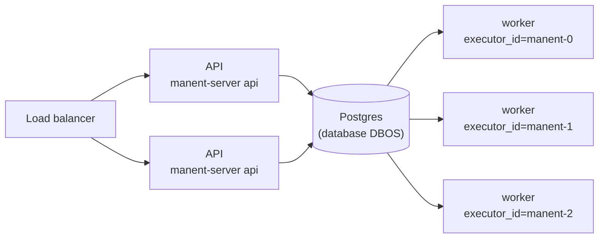

# Scalabilità e recovery

## Topologia

Più istanze di manent condividono lo stesso Postgres e prelevano i deploy dalla stessa coda. API e worker si possono scalare separatamente:

```sh
manent-server api    # N istanze API dietro un load balancer
manent-server worker               # M worker, ciascuno con un executor_id diverso
```



!!! warning "SQLite"
    SQLite va bene per sviluppo e per worker sulla stessa macchina. Con più nodi serve Postgres.

## `executor_id`

Ogni worker deve avere un `dbos.executor_id` **univoco e stabile** (default: l'hostname; `DBOS__VMID` ha la precedenza).

All'avvio un worker riprende solo i deploy rimasti in sospeso con il proprio ID, dallo step in cui si erano fermati. Se un nodo non torna con lo stesso ID, i suoi deploy restano in stato `PENDING` finché non vengono ripresi da un altro worker con la [recovery](affidabilita.md#worker-perso), manuale o automatica. In Kubernetes conviene uno StatefulSet, i cui pod hanno nomi stabili (`manent-0`, `manent-1`, …): il [chart Helm](installazione.md#kubernetes-helm) usa il nome del pod come `executor_id`.

Con il default, **più worker sulla stessa macchina** avrebbero tutti l'hostname come ID: va assegnato a ciascuno un ID proprio, stabile tra i riavvii.

```sh
DBOS__VMID=build01-w1 manent-server -c manent.yml worker
DBOS__VMID=build01-w2 manent-server -c manent.yml worker
```

Un worker che parte con l'ID di un altro ancora attivo (non arrestato e con un heartbeat più recente di `recovery.stale_after`) **non si avvia**. Altrimenti, al suo avvio, la recovery di DBOS riprenderebbe anche i deploy in esecuzione sull'altro, che verrebbero eseguiti due volte. Prima di rinunciare attende `recovery.stale_after`: è il caso di un riavvio dopo un crash, in cui il processo precedente non ha registrato l'arresto. L'errore indica l'host che usa l'ID.

## Più region

Con target in più region, i [rilasci a ondate](../guida/ondate.md) aggiornano una region (o un'AZ) alla volta. Con `dbos.region_routing` ogni worker dichiara la sua `dbos.region` ed esegue solo i passi sui target di quella region, dalla coda `<queue>.<region>`: SSH, download e controlli partono dalla rete della region. Il database resta uno, raggiunto da tutte le region.

## Concorrenza

La coda è partizionata per `<application>/<environment>`.

| Opzione | Ambito | Effetto |
|---|---|---|
| `environment_concurrency` (default 1) | tutti i worker | Deploy contemporanei dello stesso ambiente della stessa applicazione. Con 1 i deploy di `myapp/prod` sono serializzati. |
| `concurrency` | singolo worker | Deploy in esecuzione su quel worker. |
| `global_concurrency` | tutti i worker | Deploy in esecuzione in totale (`0` = nessun limite). |

Deploy immediati, pianificati, ricorrenti e dry-run passano tutti dalla stessa coda e rispettano gli stessi limiti.

## Recovery

Cosa succede se un worker si ferma durante un deploy:

1. il deploy resta in stato `PENDING`, associato all'`executor_id` del worker;
2. al riavvio, il worker lo riprende: gli step già completati non vengono rieseguiti, quello interrotto riparte;
3. se il deploy riprende su un worker diverso, perché la macchina è stata sostituita mantenendo l'ID, e la directory di lavoro non contiene l'artefatto, lo step `deploy` lo riscarica e ne verifica lo sha256.

[`manent workers`](../guida/cli.md#attivita-e-worker) mostra stato, ultimo heartbeat e workflow in esecuzione di ogni worker; [`manent activity`](../guida/cli.md#attivita-e-worker) quale worker sta eseguendo ogni deploy.

Per questo gli step e i plugin devono essere idempotenti. Il plugin `remote-copy`, ad esempio, scrive su un file `.part` e lo rinomina in modo atomico: riscrivere lo stesso artefatto produce lo stesso risultato.

## Arresto

`worker` e `serve` si arrestano con `SIGINT` o `SIGTERM`. Il worker smette di prelevare deploy e attende quelli in corso fino a `dbos.drain_timeout` (vedi [drain](affidabilita.md#arresto-ordinato-drain)). Quelli non conclusi entro questo tempo restano in sospeso e vengono ripresi al riavvio. I processi dei [plugin esterni](../plugins/esterni.md) vengono arrestati dopo DBOS.

## Avvio contemporaneo

Su un Postgres vuoto, più worker avviati insieme tentano di creare lo schema DBOS nello stesso momento. L'inizializzazione viene ritentata automaticamente con un'attesa crescente, quindi non serve avviare i worker uno alla volta. Anche l'API (`api`, `serve --no-worker`) e `admin` creano lo schema se lo trovano assente, quindi possono partire prima dei worker.
