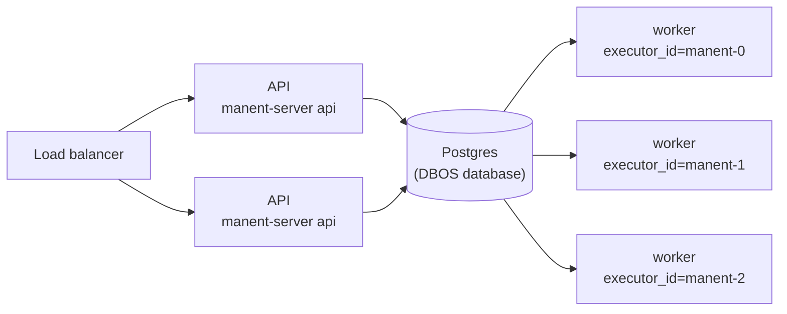

# Scalability and recovery

## Topology

Several manent instances share the same Postgres and pick deploys from the same queue. API and workers can be scaled separately:

```sh
manent-server api    # N API instances behind a load balancer
manent-server worker               # M workers, each with a different executor_id
```



!!! warning "SQLite"
    SQLite is fine for development and for workers on the same machine. Several nodes need Postgres.

## `executor_id`

Every worker must have a **unique and stable** `dbos.executor_id` (default: the hostname; `DBOS__VMID` takes precedence).

At startup a worker resumes only the deploys left pending with its own ID, from the step where they stopped. If a node does not come back with the same ID, its deploys stay `PENDING` until another worker resumes them through [recovery](affidabilita.md#worker-perso), manual or automatic. In Kubernetes a StatefulSet is recommended, whose pods have stable names (`manent-0`, `manent-1`, …): the [Helm chart](installazione.md#kubernetes-helm) uses the pod name as `executor_id`.

## Several regions

With targets in several regions, [wave rollouts](../guida/ondate.md) update one region (or one AZ) at a time. With `dbos.region_routing` each worker declares its `dbos.region` and runs only the passes on that region's targets, from the `<queue>.<region>` queue: SSH, downloads and checks start from the region's network. There is still a single database, reached by all regions.

## Concurrency

The queue is partitioned by `<application>/<environment>`.

| Option | Scope | Effect |
|---|---|---|
| `environment_concurrency` (default 1) | all workers | Concurrent deploys of the same environment of the same application. With 1, deploys of `myapp/prod` are serialized. |
| `concurrency` | single worker | Deploys running on that worker. |
| `global_concurrency` | all workers | Deploys running in total (`0` = no limit). |

Immediate, scheduled and recurring deploys and dry-runs all go through the same queue and respect the same limits.

## Recovery

What happens if a worker stops during a deploy:

1. the deploy stays `PENDING`, associated with the worker's `executor_id`;
2. on restart, the worker resumes it: steps already completed are not rerun, the interrupted one restarts;
3. if the deploy resumes on a different worker, because the machine was replaced keeping the ID, and the working directory does not contain the artifact, the `deploy` step downloads it again and verifies its sha256.

[`manent workers`](../guida/cli.md#attivita-e-worker) shows each worker's state, last heartbeat and running workflows; [`manent activity`](../guida/cli.md#attivita-e-worker) which worker is running each deploy.

This is why steps and plugins must be idempotent. The `remote-copy` plugin, for example, writes to a `.part` file and renames it atomically: rewriting the same artifact produces the same result.

## Shutdown

`worker` and `serve` stop on `SIGINT` or `SIGTERM`. The worker stops picking up deploys and waits for those in progress up to `dbos.drain_timeout` (see [drain](affidabilita.md#arresto-ordinato-drain)). Those not finished within this time stay pending and are resumed on restart. [External plugin](../plugins/esterni.md) processes are stopped after DBOS.

## Concurrent startup

On an empty Postgres, several workers started together try to create the DBOS schema at the same time. Initialization is retried automatically with an increasing wait, so there is no need to start workers one at a time.
