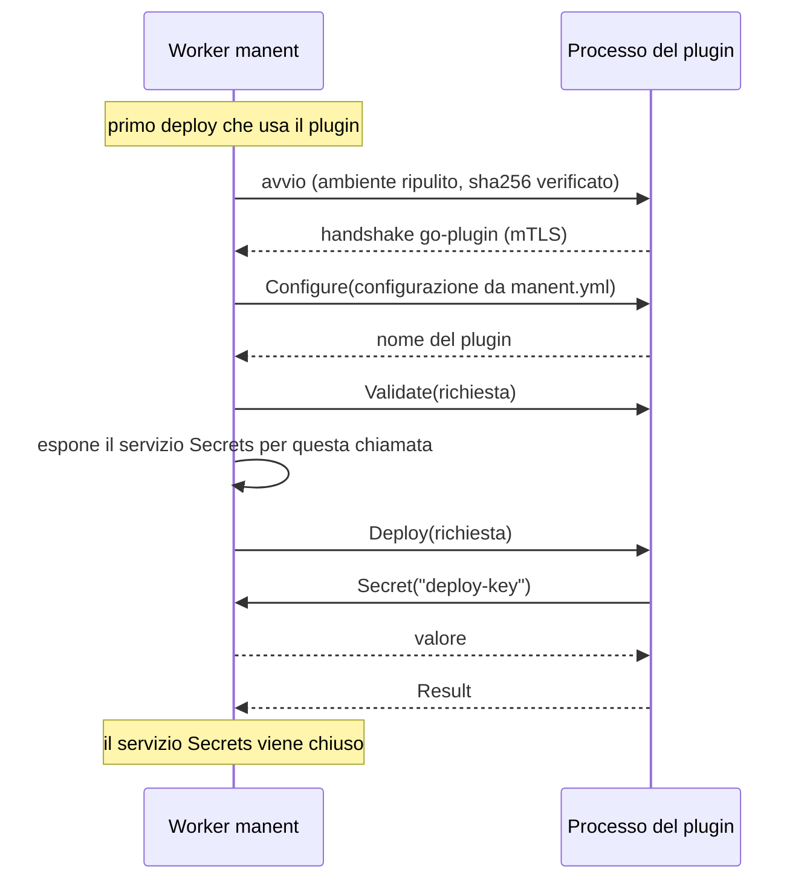

# Plugin esterni

Un plugin esterno è un binario separato da manent. I team possono quindi sviluppare, versionare e distribuire i propri plugin senza ricompilare manent. Il trasporto è gRPC, tramite [hashicorp/go-plugin](https://github.com/hashicorp/go-plugin), la stessa libreria usata da Terraform e Vault.

Per il resto del motore un plugin esterno è un normale `plugin.Deployer`: policy di selezione, step `deploy`, dry-run, rollback e callback funzionano allo stesso modo.

## Come funziona



- **Avvio:** il processo parte al primo utilizzo, non all'avvio di manent. I comandi CLI, che attivano i plugin solo per calcolare il piano, non eseguono mai il binario.
- **Processo condiviso:** un solo processo serve tutti i deploy di quel plugin sul worker, anche in parallelo.
- **Riavvio:** se il processo termina (crash, kill), viene riavviato alla chiamata successiva. Una chiamata interrotta dal crash fallisce e viene ritentata dai retry DBOS dello step.
- **Arresto:** alla chiusura di manent il processo viene arrestato, dopo che DBOS ha atteso i deploy in corso.

## Scrivere un plugin esterno in Go

Il plugin implementa lo stesso contratto di un [plugin interno](index.md) e ha un `main` di una riga:

```go
package main

import (
	"github.com/manent-deployer/manent/pkg/plugin/external"
	"example.com/team/mioplugin"
)

func main() {
	external.Serve(mioplugin.Factory)
}
```

`external.Serve` riceve la stessa `plugin.Factory` di un plugin interno: lo stesso codice può essere compilato dentro manent o distribuito come binario. Il plugin `remote-copy` ne è un esempio, in `cmd/manent-plugin-remote-copy`.

```sh
go build -o mio-plugin ./cmd/mio-plugin
sha256sum mio-plugin
```

!!! warning "Lo stdout è riservato"
    go-plugin usa lo stdout del processo per l'handshake con manent. Il plugin non deve scrivere su stdout. Per i log si usa il logger ricevuto dalla Factory.

### Log

La Factory riceve un logger che scrive su stderr in JSON compatibile con hclog. manent lo legge e lo inoltra al proprio log, con livello, messaggio e attributi originali, quindi i log del plugin arrivano anche al SIEM.

```go
func Factory(cfg map[string]any, log *slog.Logger) (plugin.Deployer, error) {
	return &Plugin{log: log}, nil
}

func (p *Plugin) Deploy(ctx context.Context, req *plugin.Request) (*plugin.Result, error) {
	p.log.Info("copia avviata", "deployment", req.DeploymentID, "targets", len(req.Targets))
	// ...
}
```

Lo stesso logger si ottiene anche con `external.Logger()`. Le scritture dirette su `os.Stderr` non arrivano a manent, perché go-plugin le devia su un canale separato.

### Segreti

`req.Secrets.Secret(ctx, nome)` funziona come in un plugin interno. Dietro le quinte manent espone il servizio `Secrets` sul canale di go-plugin per la sola durata della chiamata `Deploy`, `DryRun`, `CurrentRelease` o `Rollback`: il plugin non riceve i segreti in anticipo e non può leggerli fuori da una chiamata.

### Errori che un retry non risolve

Di default manent ritenta uno step fallito (`max_retries` dello step), perché un sistema esterno può fallire solo per un momento. Quando un nuovo tentativo darebbe lo stesso esito, per esempio una richiesta con un parametro non valido o una modifica rifiutata da un limite di sicurezza, restituite l'errore avvolto con `plugin.Permanent(err)`: lo step fallisce subito, senza retry. Il marcatore attraversa il protocollo come codice gRPC `ABORTED` e funziona allo stesso modo in un plugin interno.

```go
if destroyed > maxDestroy {
	return nil, plugin.Permanent(fmt.Errorf("the plan destroys %d resources, more than max_destroy (%d)", destroyed, maxDestroy))
}
```

### Dry-run

Se il deployer implementa `plugin.DryRunner`, il dry-run viene inoltrato al plugin. Altrimenti il plugin risponde `UNIMPLEMENTED` e manent si ferma alla validazione, come per un plugin interno senza dry-run.

### Rollback

Se il deployer implementa `plugin.Rollbacker` e `plugin.ReleaseInspector`, il [rollback](../guida/rollback.md) funziona come per un plugin interno. All'avvio il plugin dichiara a manent le interfacce opzionali che implementa (`capabilities` nella risposta a `Configure`). Così manent sa già nel checkpoint, prima di toccare i target, se il plugin supporta il rollback.

Un plugin compilato con un SDK precedente non dichiara nessuna capacità: funziona come prima, ma per manent non supporta il rollback.

### Rilasci per percentuale

Un deployer che implementa `plugin.SlotDeployer`, `plugin.TrafficRouter` ed eventualmente `plugin.TesterRouter` e `plugin.SlotScaler` partecipa ai [rilasci per percentuale](../guida/traffico.md) come un plugin interno: le capacità `slots`, `traffic_router`, `testers` e `scale` lo dichiarano a manent, e lo stato registrato da `PrepareSlots` arriva in ogni chiamata (`DeployRequest.traffic`). Le chiamate non implementate restituiscono `UNIMPLEMENTED` e il deploy fallisce senza retry.

## Configurare manent

Il plugin si attiva nella sezione `plugins` di `manent.yml`, sotto il nome con cui i descrittori lo riferiranno (`deploy.plugin`). La chiave `external` lo identifica come esterno; tutte le altre chiavi sono la configurazione passata alla Factory del plugin.

```yaml
plugins:
  mio-plugin:
    external:
      command: /opt/manent/plugins/mio-plugin
      args: []
      sha256: "3f1c9a…"              # consigliato: verificato all'attivazione e a ogni avvio
      env:                           # variabili passate al plugin
        KUBECONFIG: /etc/manent/kubeconfig
      start_timeout: 1m
    # configurazione del plugin, ricevuta dalla Factory
    artifact_types: [container]
    namespace_prefix: team-a-
```

| Chiave | Descrizione |
|---|---|
| `command` | Percorso del binario. I percorsi relativi sono risolti rispetto alla directory di lavoro di manent. |
| `args` | Argomenti del processo. |
| `sha256` | Hash del binario. Senza, manent registra un avviso. |
| `env` | Variabili d'ambiente del processo. |
| `start_timeout` | Tempo massimo per l'avvio e l'handshake (default 1 minuto). |

Il nome in `plugins` non può coincidere con quello di un plugin interno (es. `remote-copy`): per provare la versione esterna di `remote-copy` usare un nome diverso, come `remote-copy-ext`.

All'attivazione manent verifica che il binario esista, sia eseguibile e abbia lo sha256 indicato. Un errore di configurazione rilevato dal plugin stesso (la Factory restituisce un errore) emerge invece al primo avvio del processo, come errore dello step `deploy`.

### Ambiente del processo

Il processo **non eredita** le variabili d'ambiente del worker, perché potrebbero contenere segreti: i riferimenti `env:` leggono proprio da lì. Riceve solo:

- `PATH`, `HOME`, `TMPDIR`, `TZ`, `LANG` del worker;
- le variabili di `external.env`;
- le variabili interne di go-plugin per l'handshake.

## Compatibilità e versioni

Il protocollo è definito in `pkg/plugin/external/proto/deployer.proto` e ha una versione (`external.ProtocolVersion`, oggi `1`). Le aggiunte compatibili, come le chiamate per il rollback, non cambiano la versione: un plugin che non le implementa risponde `UNIMPLEMENTED`. go-plugin rifiuta un plugin compilato con una versione di protocollo diversa da quella di manent, con un errore esplicito all'avvio.

- Un plugin compilato con una versione dell'SDK che ha lo stesso `ProtocolVersion` funziona con manent anche se le altre dipendenze sono diverse: plugin e manent sono processi separati.
- Una modifica incompatibile del protocollo incrementa `ProtocolVersion`: i plugin vanno ricompilati con il nuovo SDK.

## Plugin in altri linguaggi

Il protocollo è gRPC, quindi in teoria un plugin si può scrivere in qualsiasi linguaggio, seguendo la guida di go-plugin per i plugin non Go. Oltre al servizio `Deployer` di `deployer.proto`, il plugin deve però implementare l'handshake su stdout, il servizio di health check, mTLS automatico e il broker di go-plugin per richiamare il servizio `Secrets`. L'unica strada supportata e testata è l'SDK Go (`external.Serve`).

## Riferimento del protocollo

```proto
service Deployer {
  rpc Configure(ConfigureRequest) returns (ConfigureResponse);
  rpc Supports(SupportsRequest) returns (SupportsResponse);
  rpc Validate(DeployRequest) returns (Empty);
  rpc Deploy(DeployRequest) returns (DeployResponse);
  rpc DryRun(DeployRequest) returns (DeployResponse);   // UNIMPLEMENTED se non supportato
  rpc CurrentRelease(DeployRequest) returns (CurrentReleaseResponse);   // idem
  rpc Rollback(RollbackRequest) returns (DeployResponse);               // idem
  // Rilasci per percentuale, UNIMPLEMENTED se non supportati
  rpc PrepareSlots(DeployRequest) returns (StateResponse);
  rpc DeployCandidate(DeployRequest) returns (DeployResponse);
  rpc PromoteCandidate(DeployRequest) returns (Empty);
  rpc RevertCandidate(DeployRequest) returns (Empty);
  rpc RetirePrevious(DeployRequest) returns (Empty);
  rpc SetCandidateWeight(WeightRequest) returns (Empty);
  rpc CandidateWeight(DeployRequest) returns (WeightResponse);
  rpc RouteTesters(DeployRequest) returns (DetailsResponse);
  rpc ScaleCandidate(WeightRequest) returns (Empty);
}

service Secrets {
  rpc Secret(SecretRequest) returns (SecretResponse);
}
```

| Chiamata | Note |
|---|---|
| `Configure` | Prima chiamata dopo ogni avvio. Riceve la configurazione in JSON e restituisce il nome del plugin e le capacità (`dry_run`, `current_release`, `rollback`, `slots`, `traffic_router`, `testers`, `scale`). |
| `Supports` | Interrogata dalla policy di selezione. Un errore di comunicazione vale "non supportato". |
| `Validate` | Senza accesso ai segreti. Timeout di 30 secondi. |
| `Deploy`, `DryRun`, `CurrentRelease`, `Rollback` | Con il contesto del deploy: un annullamento si propaga al plugin. `secrets_broker_id` indica dove è esposto il servizio `Secrets`. |

Per rigenerare il codice Go dopo una modifica del `.proto`: `make proto`.
