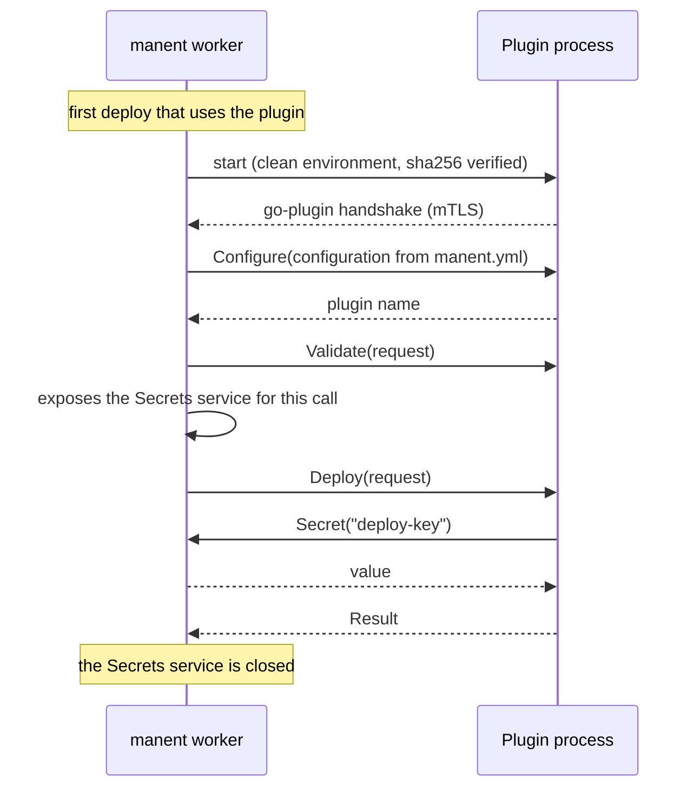

# External plugins

An external plugin is a binary separate from manent. Teams can therefore develop, version and distribute their own plugins without recompiling manent. The transport is gRPC, through [hashicorp/go-plugin](https://github.com/hashicorp/go-plugin), the same library used by Terraform and Vault.

For the rest of the engine an external plugin is a normal `plugin.Deployer`: selection policy, `deploy` step, dry-run, rollback and callbacks work the same way.

## How it works



- **Startup:** the process starts on first use, not when manent starts. CLI commands, which activate plugins only to compute the plan, never run the binary.
- **Shared process:** a single process serves all deploys of that plugin on the worker, including in parallel.
- **Restart:** if the process exits (crash, kill), it is restarted on the next call. A call interrupted by the crash fails and is retried by the step's DBOS retries.
- **Shutdown:** when manent closes the process is stopped, after DBOS has waited for running deploys.

## Writing an external plugin in Go

The plugin implements the same contract as an [internal plugin](index.md) and has a one-line `main`:

```go
package main

import (
	"github.com/manent-deployer/manent/pkg/plugin/external"
	"example.com/team/myplugin"
)

func main() {
	external.Serve(myplugin.Factory)
}
```

`external.Serve` receives the same `plugin.Factory` as an internal plugin: the same code can be compiled into manent or distributed as a binary. The `remote-copy` plugin is an example, in `cmd/manent-plugin-remote-copy`.

```sh
go build -o my-plugin ./cmd/my-plugin
sha256sum my-plugin
```

!!! warning "stdout is reserved"
    go-plugin uses the process's stdout for the handshake with manent. The plugin must not write to stdout. For logs use the logger received by the Factory.

### Logs { #log }

The Factory receives a logger that writes to stderr in hclog-compatible JSON. manent reads it and forwards it to its own log, with the original level, message and attributes, so the plugin's logs reach the SIEM too.

```go
func Factory(cfg map[string]any, log *slog.Logger) (plugin.Deployer, error) {
	return &Plugin{log: log}, nil
}

func (p *Plugin) Deploy(ctx context.Context, req *plugin.Request) (*plugin.Result, error) {
	p.log.Info("copy started", "deployment", req.DeploymentID, "targets", len(req.Targets))
	// ...
}
```

The same logger can also be obtained with `external.Logger()`. Direct writes to `os.Stderr` do not reach manent, because go-plugin diverts them to a separate channel.

### Secrets

`req.Secrets.Secret(ctx, name)` works as in an internal plugin. Behind the scenes manent exposes the `Secrets` service on the go-plugin channel only for the duration of the `Deploy`, `DryRun`, `CurrentRelease` or `Rollback` call: the plugin does not receive secrets in advance and cannot read them outside a call.

### Errors that a retry cannot fix

By default manent retries a failed step (`max_retries` of the step), because an external system can fail only for a moment. When a retry would give the same outcome, for example a request with an invalid parameter or a change refused by a safety limit, return the error wrapped with `plugin.Permanent(err)`: the step fails at once, without retries. The mark crosses the protocol as the gRPC code `ABORTED`, and works the same in an internal plugin.

```go
if destroyed > maxDestroy {
	return nil, plugin.Permanent(fmt.Errorf("the plan destroys %d resources, more than max_destroy (%d)", destroyed, maxDestroy))
}
```

### Dry-run

If the deployer implements `plugin.DryRunner`, the dry-run is forwarded to the plugin. Otherwise the plugin responds `UNIMPLEMENTED` and manent stops at validation, as for an internal plugin without dry-run.

### Rollback

If the deployer implements `plugin.Rollbacker` and `plugin.ReleaseInspector`, [rollback](../guida/rollback.md) works as for an internal plugin. At startup the plugin declares to manent the optional interfaces it implements (`capabilities` in the response to `Configure`). This way manent already knows in the checkpoint, before touching the targets, whether the plugin supports rollback.

A plugin compiled with an earlier SDK declares no capabilities: it works as before, but for manent it does not support rollback.

### Percentage rollouts

A deployer that implements `plugin.SlotDeployer`, `plugin.TrafficRouter` and possibly `plugin.TesterRouter` and `plugin.SlotScaler` takes part in [percentage rollouts](../guida/traffico.md) like an internal plugin: the `slots`, `traffic_router`, `testers` and `scale` capabilities declare it to manent, and the state recorded by `PrepareSlots` arrives in every call (`DeployRequest.traffic`). Calls that are not implemented return `UNIMPLEMENTED` and the deploy fails without retries.

### Parallel targets { #parallel-targets }

A deploy can ask to update several targets of a batch at the same time ([parallel targets](../guida/ondate.md#parallel-targets)). manent passes the number in `Request.Parallelism` (`DeployRequest.parallelism`) only to the plugins that declare it: implement `plugin.ParallelDeployer` (`ParallelTargets() bool`), and the SDK announces the `parallel_targets` capability. The other plugins always get 1, and work as before.

The SDK has the loop that honors it, with the same rules as the built-in plugins: `plugin.ForEachTarget` stops starting targets after the first error and lets the running ones finish; `plugin.ForAllTargets` runs them all (a rollback, a dry-run). Both keep the order of the targets, report the ones never started as `skipped` and measure the time spent on each target (`TargetResult.DurationMS`, the `manent_target_deploy_seconds` metric).

```go
func (d *deployer) ParallelTargets() bool { return true }

func (d *deployer) Deploy(ctx context.Context, req *plugin.Request) (*plugin.Result, error) {
	targets, err := plugin.ForEachTarget(ctx, req, func(ctx context.Context, t plugin.Target) (plugin.TargetResult, error) {
		if err := d.release(ctx, t, req); err != nil {
			return plugin.TargetResult{}, fmt.Errorf("target %s: %w", t.Host, err)
		}
		return plugin.TargetResult{Status: plugin.StatusDeployed}, nil
	})
	return &plugin.Result{Plugin: "my-plugin", Targets: targets}, err
}
```

The function runs on several goroutines at once: what it shares (clients, caches, counters) must be safe for concurrent use. Log with the target's host, because the lines of different targets interleave.

## Configuring manent

The plugin is enabled in the `plugins` section of `manent.yml`, under the name descriptors will use to refer to it (`deploy.plugin`). The `external` key marks it as external; all other keys are the configuration passed to the plugin's Factory.

```yaml
plugins:
  my-plugin:
    external:
      command: /opt/manent/plugins/my-plugin
      args: []
      sha256: "3f1c9a…"              # recommended: verified at activation and at every start
      env:                           # variables passed to the plugin
        KUBECONFIG: /etc/manent/kubeconfig
      start_timeout: 1m
    # plugin configuration, received by the Factory
    artifact_types: [container]
    namespace_prefix: team-a-
```

| Key | Description |
|---|---|
| `command` | Path of the binary. Relative paths are resolved against manent's working directory. |
| `args` | Process arguments. |
| `sha256` | Hash of the binary. Without it, manent logs a warning. |
| `env` | Process environment variables. |
| `start_timeout` | Maximum time for startup and handshake (default 1 minute). |

The name in `plugins` cannot match that of an internal plugin (e.g. `remote-copy`): to try the external version of `remote-copy` use a different name, such as `remote-copy-ext`.

At activation manent checks that the binary exists, is executable and has the given sha256. A configuration error detected by the plugin itself (the Factory returns an error) emerges instead at the first process start, as an error of the `deploy` step.

### Process environment

The process **does not inherit** the worker's environment variables, because they may contain secrets: `env:` references read precisely from there. It receives only:

- the worker's `PATH`, `HOME`, `TMPDIR`, `TZ`, `LANG`;
- the variables in `external.env`;
- go-plugin's internal handshake variables.

## Compatibility and versions

The protocol is defined in `pkg/plugin/external/proto/deployer.proto` and has a version (`external.ProtocolVersion`, currently `1`). Compatible additions, such as the rollback calls, do not change the version: a plugin that does not implement them responds `UNIMPLEMENTED`. go-plugin refuses a plugin compiled with a protocol version different from manent's, with an explicit error at startup.

- A plugin compiled with an SDK version that has the same `ProtocolVersion` works with manent even if the other dependencies differ: plugin and manent are separate processes.
- An incompatible protocol change increments `ProtocolVersion`: plugins must be recompiled with the new SDK.

## Plugins in other languages

The protocol is gRPC, so in theory a plugin can be written in any language, following go-plugin's guide for non-Go plugins. Besides the `Deployer` service of `deployer.proto`, however, the plugin must implement the handshake on stdout, the health check service, automatic mTLS and the go-plugin broker to call back the `Secrets` service. The only supported and tested path is the Go SDK (`external.Serve`).

## Protocol reference

```proto
service Deployer {
  rpc Configure(ConfigureRequest) returns (ConfigureResponse);
  rpc Supports(SupportsRequest) returns (SupportsResponse);
  rpc Validate(DeployRequest) returns (Empty);
  rpc Deploy(DeployRequest) returns (DeployResponse);
  rpc DryRun(DeployRequest) returns (DeployResponse);   // UNIMPLEMENTED if not supported
  rpc CurrentRelease(DeployRequest) returns (CurrentReleaseResponse);   // same
  rpc Rollback(RollbackRequest) returns (DeployResponse);               // same
  // Percentage rollouts, UNIMPLEMENTED if not supported
  rpc PrepareSlots(DeployRequest) returns (StateResponse);
  rpc DeployCandidate(DeployRequest) returns (DeployResponse);
  rpc PromoteCandidate(DeployRequest) returns (Empty);
  rpc RevertCandidate(DeployRequest) returns (Empty);
  rpc RetirePrevious(DeployRequest) returns (Empty);
  rpc SetCandidateWeight(WeightRequest) returns (Empty);
  rpc CandidateWeight(DeployRequest) returns (WeightResponse);
  rpc RouteTesters(DeployRequest) returns (DetailsResponse);
  rpc ScaleCandidate(WeightRequest) returns (Empty);
}

service Secrets {
  rpc Secret(SecretRequest) returns (SecretResponse);
}
```

| Call | Notes |
|---|---|
| `Configure` | First call after every start. Receives the configuration as JSON and returns the plugin name and capabilities (`dry_run`, `current_release`, `rollback`, `slots`, `traffic_router`, `testers`, `scale`, `parallel_targets`). |
| `Supports` | Queried by the selection policy. A communication error counts as "not supported". |
| `Validate` | No access to secrets. 30-second timeout. |
| `Deploy`, `DryRun`, `CurrentRelease`, `Rollback` | With the deploy context: a cancellation propagates to the plugin. `secrets_broker_id` says where the `Secrets` service is exposed; `parallelism` how many targets the plugin may work on at the same time (0 from earlier hosts). |

To regenerate the Go code after changing the `.proto`: `make proto`.
