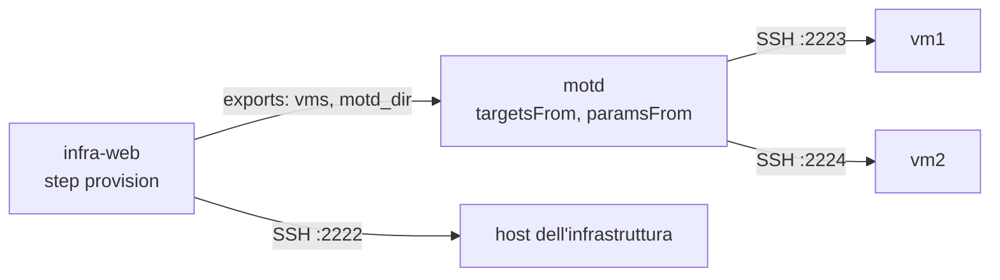

# 7. Infrastruttura e configurazione in catena

!!! abstract "In questo tutorial"
    Un deploy dell'infrastruttura "crea" due VM ed **esporta** i loro indirizzi; un deploy della configurazione li **importa** e rilascia su di esse, senza che nessuno copi gli host a mano. Concateni i due deploy, sposti l'import nella configurazione di ambiente e vedi cosa succede quando il codice dell'infrastruttura restituisce qualcosa di inatteso.

    **Tempo:** 25 minuti · **Serve:** il risultato del [tutorial 1](primo-deploy.md) (binari, `lab/deploy_key`, l'immagine `manent-tutorial-target`), Docker, `jq`



## Perché

Con l'infrastruttura come codice, le VM vengono create da un deploy (Terraform, l'API di un cloud, un hypervisor) e configurate da un altro (Ansible, pacchetti, file). Il secondo ha bisogno dell'output del primo: quali host, quali indirizzi, quali percorsi. Copiarli a mano in un descrittore spezza la catena a ogni modifica. Con [export e import](../guida/catene.md#export-import):

- il produttore dichiara quali suoi output gli altri possono leggere (`exports`), ognuno verificato con un pattern;
- il consumatore li legge all'avvio (`imports`) e li usa come target (`deploy.targetsFrom`) e parametri del plugin (`deploy.paramsFrom`).

## 1. Due "VM" e un host dell'infrastruttura

Il container del tutorial 1 (porta 2222) fa da host dell'infrastruttura, dove gira il provisioning. Avvia altri due container dalla stessa immagine: sono le VM che il provisioning "crea".

```sh
cd ~/manent-tutorial
docker run -d --name manent-tutorial-vm1 -p 2223:22 manent-tutorial-target
docker run -d --name manent-tutorial-vm2 -p 2224:22 manent-tutorial-target
ssh-keyscan -p 2223 127.0.0.1 >> lab/known_hosts
ssh-keyscan -p 2224 127.0.0.1 >> lab/known_hosts
```

## 2. Uno step di provisioning che riporta cosa ha creato

Un vero deploy dell'infrastruttura eseguirebbe `terraform apply` e leggerebbe `terraform output`. Qui lo simula uno script sull'host dell'infrastruttura: scrive le VM come lista JSON e la directory dove va la loro configurazione nel file degli output di uno [step personalizzato](../guida/step-personalizzati.md).

```sh
docker exec -i -u deploy manent-tutorial-target sh -c 'mkdir -p ~/bin && cat > ~/bin/provision && chmod 755 ~/bin/provision' <<'SH'
#!/bin/sh
# Simulated provisioning: a real one would run "terraform apply" here and read "terraform output".
echo "provisioning infra-web $1"
host=127.0.0.1
[ -e "$HOME/provision.wrong" ] && host=10.9.9.9    # a bug in the infrastructure code
cat >>"$MANENT_OUTPUT" <<EOF
vms=[{"host":"$host","port":2223,"user":"deploy"},{"host":"$host","port":2224,"user":"deploy"}]
motd_dir=/home/deploy/motd
EOF
SH
```

## 3. Configura manent

Lavora in una nuova directory, con un database proprio. Prima ferma il server del tutorial precedente.

```sh
mkdir -p ~/manent-tutorial/chain && cd ~/manent-tutorial/chain
```

```yaml title="manent.yml"
dbos:
  database_url: sqlite:manent.db
workdir: ./work
plugins:
  remote-copy:
    known_hosts: ../lab/known_hosts
envconfig:
  provider: file
  required: true
  file:
    path: "./envconfig/{application}/{artifact}/{environment}.yml"
pipeline:
  custom:
    known_hosts: ../lab/known_hosts
  steps:
    - {name: secrets, mode: mandatory}
    - {name: artifacts, mode: mandatory, max_retries: 3}
    - {name: qa, mode: optional, enabled: true}
    - name: provision                  # the infrastructure step, before the deploy
      mode: optional
      enabled: false                   # turned on by the descriptors that need it
      type: command
      timeout: 5m
      ssh: {key_secret: deploy-key}
      outputs:                         # only declared outputs, each with a pattern
        vms: {pattern: '\[[^\n]{1,1000}\]'}
        motd_dir: {pattern: '/[a-z0-9/_-]{1,100}'}
      run:
        run_once: true
        command: ["/home/deploy/bin/provision", "{{ .Version }}"]
    - {name: deploy, mode: mandatory, max_retries: 2}
    - {name: post-test, mode: optional, enabled: false, max_retries: 5}
    - {name: activation, mode: optional, enabled: true}
```

Le configurazioni di ambiente: `infra-web` gira sull'host dell'infrastruttura; `motd` **non ha target né `dest_dir`**, perché arriveranno dagli export. Sostituisci `/home/you/manent-tutorial` con il tuo percorso.

```yaml title="envconfig/infra-web/infra-web/test.yml"
plugin: remote-copy
targets:
  - {host: 127.0.0.1, port: 2222, user: deploy}
params:
  dest_dir: /home/deploy/infra
  layout: releases
  keep_releases: "3"
  ssh_key_secret: deploy-key
secrets:
  - name: deploy-key
    ref: file:/home/you/manent-tutorial/lab/deploy_key
```

```yaml title="envconfig/motd/motd/test.yml"
plugin: remote-copy
params:
  layout: releases
  keep_releases: "3"
  ssh_key_secret: deploy-key
  prepare_command: 'tar -xzf "$MANENT_ARTIFACT" -C "$MANENT_RELEASE_DIR"'
  post_command: 'cat "$MANENT_CURRENT/motd"'
secrets:
  - name: deploy-key
    ref: file:/home/you/manent-tutorial/lab/deploy_key
```

```sh
manent-server -c manent.yml serve
```

## 4. Gli artefatti

Il codice dell'infrastruttura e la configurazione sono entrambi archivi immutabili e versionati:

```sh
mkdir -p infra-src motd-src dist
echo 'resource "null_resource" "vm" { count = 2 }' > infra-src/main.tf
tar -czf dist/infra-web-1.0.0.tar.gz -C infra-src .
echo "Welcome, version 1.0.0" > motd-src/motd
tar -czf dist/motd-1.0.0.tar.gz -C motd-src .
```

## 5. Il produttore esporta

```yaml title="infra.yml"
apiVersion: manent/v1
application: infra-web
environment: test
artifact:
  type: application
  name: infra-web
  version: 1.0.0
  source: /home/you/manent-tutorial/chain/dist/infra-web-1.0.0.tar.gz
steps:
  provision: true
exports:
  vms: {from: provision.vms, format: targets, pattern: '127\.0\.0\.1'}
  motd_dir: {from: provision.motd_dir, pattern: '/home/deploy/[a-z]+'}
```

- `from` è `<step>.<chiave>`: qui gli output dello step `provision`. Con un plugin di provisioning sarebbe `deploy.<chiave>`, dai `Result.Outputs` del plugin.
- `format: targets` è una lista JSON di target; il `pattern` deve corrispondere a **ogni host** (al valore intero, è ancorato). Per un export di tipo stringa il pattern è obbligatorio. Diventano export solo gli output dichiarati, e solo se rispettano il pattern: è anche la barriera che tiene segreti e sorprese fuori dalla catena.

## 6. Il consumatore importa

```yaml title="motd.yml"
apiVersion: manent/v1
application: motd
environment: test
artifact:
  type: application
  name: motd
  version: 1.0.0
  source: /home/you/manent-tutorial/chain/dist/motd-1.0.0.tar.gz
deploy:
  targetsFrom:
    - {import: infra, export: vms}
  paramsFrom:
    dest_dir: {import: infra, export: motd_dir}
```

L'import `infra` qui non è dichiarato: la pipeline conosce l'ID del deploy dell'infrastruttura solo quando lo avvia, e lo passa con `--import`. Rilascia i due in catena:

```sh
INFRA=$(manent deploy -f infra.yml --no-wait | jq -r .id)
manent deploy -f motd.yml --import infra=$INFRA
```

```text
deploy waiting for its dependencies: 4d3857e0-7933-4bcc-9659-7d69d82f6cb4
deploy enqueued: 4d3857e0-7933-4bcc-9659-7d69d82f6cb4 (manent logs -f 4d3857e0-… to follow it)
```

`--import infra=<id>` dichiara l'import e aggiunge il deploy dell'infrastruttura ad `after`: `motd` attende (`WAITING_DEPENDENCY`, senza occupare slot) che `infra-web` sia riuscito, poi parte. Guarda cosa ha registrato ciascuno:

```sh
manent status $INFRA | jq '{state, exports}'
```

```json
{
  "state": "SUCCESS",
  "exports": {
    "motd_dir": "/home/deploy/motd",
    "vms": "[{\"host\":\"127.0.0.1\",\"port\":2223,\"user\":\"deploy\"},{\"host\":\"127.0.0.1\",\"port\":2224,\"user\":\"deploy\"}]"
  }
}
```

```sh
MOTD=$(manent list -a motd -n 1 | jq -r '.[0].id')
manent status $MOTD | jq -c '.result.steps[] | select(.name == "config") | .output'
```

```json
{"import.infra":"06091bae-7712-4dd5-bc51-b884d5417b86@1.0.0","policy_revision":"builtin:4f53cda18c2b","rollback":"disabled","source":"file:./envconfig/motd/motd/test.yml","targets":"2","tenant":"untenanted"}
```

Lo step `config` registra da dove arrivano i target: il deploy dell'infrastruttura e la sua versione. Sulle VM:

```sh
for vm in manent-tutorial-vm1 manent-tutorial-vm2; do docker exec $vm cat /home/deploy/motd/current/motd; done
# Welcome, version 1.0.0
# Welcome, version 1.0.0
```

Gli import sono stati risolti all'avvio di `motd` e salvati con lo step: un deploy ripreso dopo un crash usa gli stessi target. Target e parametri importati sono aggiunte del descrittore, quindi valgono le [regole di fusione](../guida/configurazione-ambiente.md#regole-di-fusione) e la [policy sui descrittori](../operazioni/sicurezza.md#cosa-puo-chiedere-un-descrittore).

## 7. Sposta l'import nell'ambiente

Un import di un deploy dato va bene per il primo deploy di una catena. Tutto ciò che viene dopo (una nuova versione di `motd`, un rollback, una promozione, la [riconciliazione](../guida/governance.md#inventario)) deve leggere l'infrastruttura **in esercizio**, qualunque deploy l'abbia creata. Questo spetta alla configurazione di ambiente, che è autorevole. Aggiungi a `envconfig/motd/motd/test.yml`:

```yaml title="envconfig/motd/motd/test.yml (aggiunta)"
imports:
  infra: {current: {application: infra-web}}     # the release in service of infra-web in test
targets_from:
  - {import: infra, export: vms}
params_from:
  dest_dir: {import: infra, export: motd_dir}
```

Il descrittore torna a contenere solo l'artefatto:

```yaml title="motd-min.yml"
apiVersion: manent/v1
application: motd
environment: test
artifact:
  type: application
  name: motd
  version: 1.1.0
  source: /home/you/manent-tutorial/chain/dist/motd-1.1.0.tar.gz
```

```sh
echo "Welcome, version 1.1.0" > motd-src/motd
tar -czf dist/motd-1.1.0.tar.gz -C motd-src .
manent validate -f motd-min.yml | jq -c '{config, targets: [.deploy.targets[] | "\(.host):\(.port)"], dest: .deploy.params.dest_dir}'
```

```json
{"config":{"import.infra":"06091bae-7712-4dd5-bc51-b884d5417b86@1.0.0","source":"file:./envconfig/motd/motd/test.yml","targets":"2"},"targets":["127.0.0.1:2223","127.0.0.1:2224"],"dest":"/home/deploy/motd"}
```

`validate` risolve già gli import e mostra i target effettivi. Rilascia:

```sh
manent deploy -f motd-min.yml
```

Con `targets_from` nell'ambiente, un descrittore non può più portare target propri: la richiesta verrebbe rifiutata.

## 8. Quando il codice dell'infrastruttura sbaglia

Simula un bug nel codice dell'infrastruttura, che ora riporta host fuori dalla rete attesa, e rilasciane una nuova versione:

```sh
docker exec -u deploy manent-tutorial-target touch /home/deploy/provision.wrong
tar -czf dist/infra-web-1.1.0.tar.gz -C infra-src .
manent deploy -f infra.yml --version 1.1.0 --source "$PWD/dist/infra-web-1.1.0.tar.gz"
```

```text
deploy 215f0b18-… failed: ERROR: exports of the deploy not valid: exports.vms (provision.vms): target 0: host "10.9.9.9" does not match the pattern "127\\.0\\.0\\.1"
```

Gli export vengono verificati quando il deploy riesce: un valore fuori dal suo pattern **fa fallire il produttore**, così nessuno lo legge. Un deploy che lo attendesse con `after` finirebbe in `DEPENDENCY_FAILED` invece di configurare gli host sbagliati. L'host dell'infrastruttura è stato comunque modificato (il suo step deploy è stato eseguito), come per ogni fallimento dopo lo step deploy; la release in esercizio resta la precedente:

```sh
manent inventory -a infra-web | jq -c '.[0] | {current: .current.version, failed: .last_failure.version}'
# {"current":"1.0.0","failed":"1.1.0"}
```

Quindi `motd` continua a leggere le VM della 1.0.0:

```sh
echo "Welcome, version 1.2.0" > motd-src/motd
tar -czf dist/motd-1.2.0.tar.gz -C motd-src .
manent deploy -f motd-min.yml --version 1.2.0 --source "$PWD/dist/motd-1.2.0.tar.gz"
M=$(manent list -a motd -n 1 | jq -r '.[0].id')
manent status $M | jq -r '.result.steps[] | select(.name == "config") | .output["import.infra"]'
# 06091bae-7712-4dd5-bc51-b884d5417b86@1.0.0
```

Correggi il bug prima di proseguire:

```sh
docker exec -u deploy manent-tutorial-target rm /home/deploy/provision.wrong
```

## Cosa hai imparato

- Un deploy **esporta** output dichiarati, verificati con un formato e un pattern; un export non valido fa fallire il produttore, mai i consumatori.
- Un deploy li **importa** come target e parametri del plugin, risolti all'avvio e registrati con lo step `config`.
- `--import <nome>=<id>` concatena un deploy a uno noto solo al momento dell'esecuzione; `current` nella configurazione di ambiente segue l'infrastruttura **in esercizio**, per ogni deploy successivo.
- Lo stesso meccanismo funziona con un [plugin di provisioning](../plugins/index.md) (`Result.Outputs`) e in una [release composta](../guida/catene.md#release-composte), dove un import nomina un altro deploy della release.

## Prossimo passo

Il [tutorial 8](produzione.md) esegue manent stesso come servizio di produzione.

??? note "Pulizia"
    `docker rm -f manent-tutorial-vm1 manent-tutorial-vm2` e `rm -rf ~/manent-tutorial/chain`. L'host dell'infrastruttura resta per gli altri tutorial.
