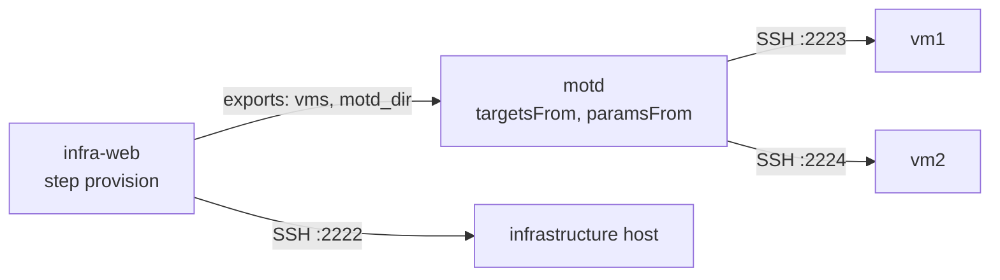

# 7. Infrastructure and configuration in a chain

!!! abstract "In this tutorial"
    An infrastructure deploy "creates" two VMs and **exports** their addresses; a configuration deploy **imports** them and releases onto them, without anyone copying hosts by hand. You chain the two deploys, move the import into the environment configuration, and see what happens when the infrastructure code returns something unexpected.

    **Time:** 25 minutes · **You need:** the result of [tutorial 1](primo-deploy.md) (binaries, `lab/deploy_key`, the `manent-tutorial-target` image), Docker, `jq`



## Why

With infrastructure as code, the VMs are created by one deploy (Terraform, a cloud API, a hypervisor) and configured by another (Ansible, packages, files). The second one needs the output of the first: which hosts, which addresses, which paths. Copying them into a descriptor by hand breaks the chain at every change. With [exports and imports](../guida/catene.md#export-import):

- the producer declares which of its outputs others may read (`exports`), each checked against a pattern;
- the consumer reads them when it starts (`imports`) and uses them as targets (`deploy.targetsFrom`) and plugin parameters (`deploy.paramsFrom`).

## 1. Two "VMs" and an infrastructure host

The container of tutorial 1 (port 2222) plays the infrastructure host, where provisioning runs. Start two more containers from the same image: they are the VMs that provisioning "creates".

```sh
cd ~/manent-tutorial
docker run -d --name manent-tutorial-vm1 -p 2223:22 manent-tutorial-target
docker run -d --name manent-tutorial-vm2 -p 2224:22 manent-tutorial-target
ssh-keyscan -p 2223 127.0.0.1 >> lab/known_hosts
ssh-keyscan -p 2224 127.0.0.1 >> lab/known_hosts
```

## 2. A provisioning step that reports what it created

A real infrastructure deploy would run `terraform apply` and read `terraform output`. Here a script on the infrastructure host simulates it: it prints the VMs as a JSON list and the directory where their configuration goes, in the outputs file of a [custom step](../guida/step-personalizzati.md).

```sh
docker exec -i -u deploy manent-tutorial-target sh -c 'mkdir -p ~/bin && cat > ~/bin/provision && chmod 755 ~/bin/provision' <<'SH'
#!/bin/sh
# Simulated provisioning: a real one would run "terraform apply" here and read "terraform output".
echo "provisioning infra-web $1"
host=127.0.0.1
[ -e "$HOME/provision.wrong" ] && host=10.9.9.9    # a bug in the infrastructure code
cat >>"$MANENT_OUTPUT" <<EOF
vms=[{"host":"$host","port":2223,"user":"deploy"},{"host":"$host","port":2224,"user":"deploy"}]
motd_dir=/home/deploy/motd
EOF
SH
```

## 3. Configure manent

Work in a new directory, with its own database. Stop the server of the previous tutorial first.

```sh
mkdir -p ~/manent-tutorial/chain && cd ~/manent-tutorial/chain
```

```yaml title="manent.yml"
dbos:
  database_url: sqlite:manent.db
workdir: ./work
plugins:
  remote-copy:
    known_hosts: ../lab/known_hosts
envconfig:
  provider: file
  required: true
  file:
    path: "./envconfig/{application}/{artifact}/{environment}.yml"
pipeline:
  custom:
    known_hosts: ../lab/known_hosts
  steps:
    - {name: secrets, mode: mandatory}
    - {name: artifacts, mode: mandatory, max_retries: 3}
    - {name: qa, mode: optional, enabled: true}
    - name: provision                  # the infrastructure step, before the deploy
      mode: optional
      enabled: false                   # turned on by the descriptors that need it
      type: command
      timeout: 5m
      ssh: {key_secret: deploy-key}
      outputs:                         # only declared outputs, each with a pattern
        vms: {pattern: '\[[^\n]{1,1000}\]'}
        motd_dir: {pattern: '/[a-z0-9/_-]{1,100}'}
      run:
        run_once: true
        command: ["/home/deploy/bin/provision", "{{ .Version }}"]
    - {name: deploy, mode: mandatory, max_retries: 2}
    - {name: post-test, mode: optional, enabled: false, max_retries: 5}
    - {name: activation, mode: optional, enabled: true}
```

The environment configurations: `infra-web` runs on the infrastructure host; `motd` has **no targets and no `dest_dir`**, because they will come from the exports. Replace `/home/you/manent-tutorial` with your path.

```yaml title="envconfig/infra-web/infra-web/test.yml"
plugin: remote-copy
targets:
  - {host: 127.0.0.1, port: 2222, user: deploy}
params:
  dest_dir: /home/deploy/infra
  layout: releases
  keep_releases: "3"
  ssh_key_secret: deploy-key
secrets:
  - name: deploy-key
    ref: file:/home/you/manent-tutorial/lab/deploy_key
```

```yaml title="envconfig/motd/motd/test.yml"
plugin: remote-copy
params:
  layout: releases
  keep_releases: "3"
  ssh_key_secret: deploy-key
  prepare_command: 'tar -xzf "$MANENT_ARTIFACT" -C "$MANENT_RELEASE_DIR"'
  post_command: 'cat "$MANENT_CURRENT/motd"'
secrets:
  - name: deploy-key
    ref: file:/home/you/manent-tutorial/lab/deploy_key
```

```sh
manent-server -c manent.yml serve
```

## 4. The artifacts

The infrastructure code and the configuration are both immutable, versioned archives:

```sh
mkdir -p infra-src motd-src dist
echo 'resource "null_resource" "vm" { count = 2 }' > infra-src/main.tf
tar -czf dist/infra-web-1.0.0.tar.gz -C infra-src .
echo "Welcome, version 1.0.0" > motd-src/motd
tar -czf dist/motd-1.0.0.tar.gz -C motd-src .
```

## 5. The producer exports

```yaml title="infra.yml"
apiVersion: manent/v1
application: infra-web
environment: test
artifact:
  type: application
  name: infra-web
  version: 1.0.0
  source: /home/you/manent-tutorial/chain/dist/infra-web-1.0.0.tar.gz
steps:
  provision: true
exports:
  vms: {from: provision.vms, format: targets, pattern: '127\.0\.0\.1'}
  motd_dir: {from: provision.motd_dir, pattern: '/home/deploy/[a-z]+'}
```

- `from` is `<step>.<key>`: here the outputs of the `provision` step. With a provisioning plugin it would be `deploy.<key>`, from the plugin's `Result.Outputs`.
- `format: targets` is a JSON list of targets; the `pattern` must match **every host** (the whole value, it is anchored). For a string export the pattern is required. Only declared outputs become exports, and only if they match: this is also the barrier that keeps secrets and surprises out of the chain.

## 6. The consumer imports

```yaml title="motd.yml"
apiVersion: manent/v1
application: motd
environment: test
artifact:
  type: application
  name: motd
  version: 1.0.0
  source: /home/you/manent-tutorial/chain/dist/motd-1.0.0.tar.gz
deploy:
  targetsFrom:
    - {import: infra, export: vms}
  paramsFrom:
    dest_dir: {import: infra, export: motd_dir}
```

The import `infra` is not declared here: the pipeline knows the ID of the infrastructure deploy only when it starts it, and passes it with `--import`. Release the two in a chain:

```sh
INFRA=$(manent deploy -f infra.yml --no-wait | jq -r .id)
manent deploy -f motd.yml --import infra=$INFRA
```

```text
deploy in attesa delle dipendenze: 4d3857e0-7933-4bcc-9659-7d69d82f6cb4
deploy accodato: 4d3857e0-7933-4bcc-9659-7d69d82f6cb4 (manent logs -f 4d3857e0-… per seguirlo)
```

`--import infra=<id>` declares the import and adds the infrastructure deploy to `after`: `motd` waits (`WAITING_DEPENDENCY`, without taking a slot) until `infra-web` has succeeded, then starts. Look at what each one recorded:

```sh
manent status $INFRA | jq '{state, exports}'
```

```json
{
  "state": "SUCCESS",
  "exports": {
    "motd_dir": "/home/deploy/motd",
    "vms": "[{\"host\":\"127.0.0.1\",\"port\":2223,\"user\":\"deploy\"},{\"host\":\"127.0.0.1\",\"port\":2224,\"user\":\"deploy\"}]"
  }
}
```

```sh
MOTD=$(manent list -a motd -n 1 | jq -r '.[0].id')
manent status $MOTD | jq -c '.result.steps[] | select(.name == "config") | .output'
```

```json
{"import.infra":"06091bae-7712-4dd5-bc51-b884d5417b86@1.0.0","policy_revision":"builtin:4f53cda18c2b","rollback":"disabled","source":"file:./envconfig/motd/motd/test.yml","targets":"2","tenant":"untenanted"}
```

The `config` step records where the targets came from: the infrastructure deploy and its version. On the VMs:

```sh
for vm in manent-tutorial-vm1 manent-tutorial-vm2; do docker exec $vm cat /home/deploy/motd/current/motd; done
# Welcome, version 1.0.0
# Welcome, version 1.0.0
```

The imports were resolved when `motd` started and saved with the step: a deploy resumed after a crash uses the same targets. Imported targets and parameters are additions of the descriptor, so the [merge rules](../guida/configurazione-ambiente.md#regole-di-fusione) and the [descriptor policy](../operazioni/sicurezza.md#cosa-puo-chiedere-un-descrittore) apply to them.

## 7. Move the import into the environment

An import of a given deploy is right for the first deploy of a chain. Everything that comes later (a new version of `motd`, a rollback, a promotion, the [reconciliation](../guida/governance.md#inventario)) should read the infrastructure **in service**, whatever deploy created it. That belongs to the environment configuration, which is authoritative. Add to `envconfig/motd/motd/test.yml`:

```yaml title="envconfig/motd/motd/test.yml (addition)"
imports:
  infra: {current: {application: infra-web}}     # the release in service of infra-web in test
targets_from:
  - {import: infra, export: vms}
params_from:
  dest_dir: {import: infra, export: motd_dir}
```

The descriptor is back to the artifact alone:

```yaml title="motd-min.yml"
apiVersion: manent/v1
application: motd
environment: test
artifact:
  type: application
  name: motd
  version: 1.1.0
  source: /home/you/manent-tutorial/chain/dist/motd-1.1.0.tar.gz
```

```sh
echo "Welcome, version 1.1.0" > motd-src/motd
tar -czf dist/motd-1.1.0.tar.gz -C motd-src .
manent validate -f motd-min.yml | jq -c '{config, targets: [.deploy.targets[] | "\(.host):\(.port)"], dest: .deploy.params.dest_dir}'
```

```json
{"config":{"import.infra":"06091bae-7712-4dd5-bc51-b884d5417b86@1.0.0","source":"file:./envconfig/motd/motd/test.yml","targets":"2"},"targets":["127.0.0.1:2223","127.0.0.1:2224"],"dest":"/home/deploy/motd"}
```

`validate` already resolves the imports and shows the effective targets. Release:

```sh
manent deploy -f motd-min.yml
```

With `targets_from` in the environment, a descriptor can no longer bring its own targets: the request would be refused.

## 8. When the infrastructure code is wrong

Simulate a bug in the infrastructure code, which now reports hosts outside the expected network, and release a new version of it:

```sh
docker exec -u deploy manent-tutorial-target touch /home/deploy/provision.wrong
tar -czf dist/infra-web-1.1.0.tar.gz -C infra-src .
manent deploy -f infra.yml --version 1.1.0 --source "$PWD/dist/infra-web-1.1.0.tar.gz"
```

```text
deploy 215f0b18-… failed: ERROR: exports of the deploy not valid: exports.vms (provision.vms): target 0: host "10.9.9.9" does not match the pattern "127\\.0\\.0\\.1"
```

The exports are checked when the deploy succeeds: a value outside its pattern **fails the producer**, so nothing reads it. A deploy waiting for it with `after` would end as `DEPENDENCY_FAILED` instead of configuring the wrong hosts. The infrastructure host itself was changed (its deploy step ran), as with any failure after the deploy step; the release in service is still the previous one:

```sh
manent inventory -a infra-web | jq -c '.[0] | {current: .current.version, failed: .last_failure.version}'
# {"current":"1.0.0","failed":"1.1.0"}
```

So `motd` keeps reading the VMs of 1.0.0:

```sh
echo "Welcome, version 1.2.0" > motd-src/motd
tar -czf dist/motd-1.2.0.tar.gz -C motd-src .
manent deploy -f motd-min.yml --version 1.2.0 --source "$PWD/dist/motd-1.2.0.tar.gz"
M=$(manent list -a motd -n 1 | jq -r '.[0].id')
manent status $M | jq -r '.result.steps[] | select(.name == "config") | .output["import.infra"]'
# 06091bae-7712-4dd5-bc51-b884d5417b86@1.0.0
```

Fix the bug before moving on:

```sh
docker exec -u deploy manent-tutorial-target rm /home/deploy/provision.wrong
```

## What you learned

- A deploy **exports** declared outputs, checked against a format and a pattern; an invalid export fails the producer, never the consumers.
- A deploy **imports** them as targets and plugin parameters, resolved when it starts and recorded with the `config` step.
- `--import <name>=<id>` chains a deploy to one known only at run time; `current` in the environment configuration follows the infrastructure **in service**, for every later deploy.
- The same mechanism works with a [provisioning plugin](../plugins/index.md) (`Result.Outputs`) and in a [composite release](../guida/catene.md#release-composte), where an import names another deploy of the release.

## Next

[Tutorial 8](produzione.md) runs manent itself as a production service.

??? note "Clean up"
    `docker rm -f manent-tutorial-vm1 manent-tutorial-vm2` and `rm -rf ~/manent-tutorial/chain`. The infrastructure host stays for the other tutorials.
