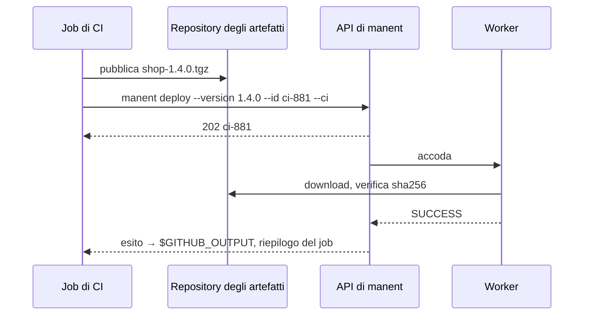

# 6. Deploy da una pipeline di CI

!!! abstract "In questo tutorial"
    Fai rilasciare una pipeline di CI: riceve un proprio token e un ruolo limitato agli ambienti che può toccare, invia la versione appena costruita, attende l'esito e lo pubblica nel riepilogo del job. Un job rieseguito non rilascia mai due volte, e le modifiche alla configurazione di ambiente vengono verificate nella merge request prima di arrivare in Consul.

    **Tempo:** 20 minuti · **Serve:** un server manent raggiungibile dalla CI (tutorial 1–3), un repository su GitHub o GitLab



## 1. Un token per la pipeline

La CI è un sistema automatico: usa un **token statico**, salvato come segreto della CI, di cui manent conserva solo lo sha256. Un file dei token permette di aggiungere, ruotare e revocare token senza riavviare il server.

```sh
TOKEN=$(openssl rand -hex 32)          # va nel segreto MANENT_TOKEN della CI
printf '%s' "$TOKEN" | sha256sum       # va nel file dei token
```

```yaml title="/etc/manent/tokens.yml"
tokens:
  - name: ci-hello
    sha256: "<sha256>"
    groups: [ci]
    expires_at: 2027-06-30T00:00:00Z   # la rotazione non è facoltativa
```

```yaml title="manent.yml"
auth:
  mode: enabled
  tokens_file: /etc/manent/tokens.yml   # riletto entro 5 secondi da una modifica
rbac:
  bindings:
    - subjects: ["token:ci-hello"]
      role: deployer
      applications: ["hello"]
      environments: [test, staging]      # la produzione passa da promozione e approvazione
```

Il token può rilasciare, annullare e fare rollback di `hello` in `test` e `staging`, e nient'altro. La produzione riceve gli artefatti per [promozione](promozione.md), approvata da una persona.

## 2. Tieni il descrittore nel repository

```yaml title="deploy/test.yml"
apiVersion: manent/v1
application: hello
environment: test
artifact:
  type: application
  name: hello
  version: 0.0.0                       # sostituita dalla pipeline
  source: https://nexus.example.com/repository/releases/hello/hello-0.0.0.tar.gz
```

La pipeline aggiunge solo ciò che conosce lei: versione, sorgente e, facoltativamente, lo sha256 atteso.

## 3. Provalo dal terminale

`--ci` scrive l'esito dove se lo aspetta il sistema di CI. Puoi vedere cosa produce simulando le variabili di GitHub:

```sh
export MANENT_SERVER=https://manent.example.com MANENT_TOKEN=…
: > out; : > summary
GITHUB_ACTIONS=true GITHUB_OUTPUT=out GITHUB_STEP_SUMMARY=summary \
  manent deploy -f deploy/test.yml --version 1.1.0 \
  --source https://nexus.example.com/repository/releases/hello/hello-1.1.0.tar.gz \
  --id ci-1001 --ci
cat out summary
```

```text
deployment_id=ci-1001
state=SUCCESS
application=hello
environment=test
version=1.1.0
dry_run=false
tenant=untenanted
### manent · Deploy of hello to test

| | |
|---|---|
| Version | `1.1.0` |
| Deploy | `ci-1001` |
| Outcome | **SUCCESS** |
```

Esegui di nuovo lo stesso comando: restituisce il deploy `ci-1001` con il suo esito invece di rilasciare ancora. L'`--id` è la **chiave di idempotenza** che rende sicuro un job ritentato. Il comando esce con un codice diverso da zero se il deploy non riesce, quindi il job fallisce con lui.

## 4. GitHub Actions

```yaml title=".github/workflows/release.yml"
name: release
on:
  push:
    tags: ["v*"]

jobs:
  build:
    runs-on: ubuntu-latest
    outputs:
      version: ${{ steps.v.outputs.version }}
    steps:
      - uses: actions/checkout@v4
      - id: v
        run: echo "version=${GITHUB_REF_NAME#v}" >> "$GITHUB_OUTPUT"
      - run: make dist VERSION=${{ steps.v.outputs.version }}     # costruisce dist/hello-<versione>.tar.gz
      - run: >
          curl -fsS -u "${{ secrets.NEXUS_USER }}:${{ secrets.NEXUS_PASSWORD }}"
          --upload-file dist/hello-${{ steps.v.outputs.version }}.tar.gz
          https://nexus.example.com/repository/releases/hello/

  deploy-test:
    needs: build
    runs-on: ubuntu-latest
    environment: test
    steps:
      - uses: actions/checkout@v4
      - id: manent
        uses: manent-deployer/manent/integrations/github@v0.1.0
        with:
          server: https://manent.example.com
          token: ${{ secrets.MANENT_TOKEN }}
          descriptor: deploy/test.yml
          version: ${{ needs.build.outputs.version }}
          source: https://nexus.example.com/repository/releases/hello/hello-${{ needs.build.outputs.version }}.tar.gz
          id: gh-${{ github.run_id }}
      - run: echo "rilasciata ${{ steps.manent.outputs.version }} come ${{ steps.manent.outputs.deployment-id }}"
```

- L'azione installa il client se non è nel `PATH`, esegue `manent deploy --ci` ed espone `deployment-id`, `state` e `version` come output dello step. Il riepilogo compare nella pagina del workflow.
- `id: gh-${{ github.run_id }}` fa sì che una riesecuzione dello stesso workflow restituisca il deploy esistente. Aggiungi `-${{ github.run_attempt }}` se *vuoi* che una riesecuzione rilasci di nuovo.
- Con `dry-run: true` l'azione chiede a un worker un [dry-run](../guida/dry-run.md), utile sulle pull request.

Vedi [GitHub Actions](../integrazioni/github-actions.md) per i job di promozione, le CA private e la validazione sulle pull request.

## 5. GitLab CI

```yaml title=".gitlab-ci.yml"
stages: [build, deploy]

include:
  - remote: https://raw.githubusercontent.com/manent-deployer/manent/v0.1.0/integrations/gitlab/manent.yml
    inputs:
      job: deploy-test
      stage: deploy
      descriptor: deploy/test.yml
      version: $CI_COMMIT_TAG
      source: https://nexus.example.com/repository/releases/hello/hello-$CI_COMMIT_TAG.tar.gz
      id: gl-$CI_PIPELINE_ID
      manent_ref: v0.1.0

build:
  stage: build
  script:
    - make dist VERSION=$CI_COMMIT_TAG
  rules:
    - if: $CI_COMMIT_TAG
```

`MANENT_SERVER` e `MANENT_TOKEN` sono variabili CI/CD del progetto (il token mascherato e protetto). Il template scrive il report dotenv `manent.env`, così `deployment_id`, `state` e `version` sono variabili dei job successivi. Vedi [GitLab CI](../integrazioni/gitlab-ci.md).

## 6. Verifica le modifiche alla configurazione nella merge request

Spesso la configurazione di ambiente sta in un repository a parte, sincronizzato con Consul. `manent env validate` verifica una configurazione candidata con tutti i controlli dell'invio (fusione, policy sui descrittori, piano del rollout, plugin), fusa con la richiesta del deploy in esercizio, e non scrive nulla:

```sh
manent env validate -a hello -e prod -f envconfig/hello/hello/prod.yml
```

Eseguilo nella pipeline delle merge request del repository della configurazione: un'ondata che non seleziona alcun target o un parametro non ammesso fa fallire la revisione, non il rilascio successivo. La GitHub Action fa lo stesso con `command: env-validate`.

## Cosa hai imparato

- La CI usa un **token statico** con un **ruolo** ristretto; la produzione si raggiunge per promozione.
- La pipeline passa **versione e sorgente**; il descrittore resta nel repository.
- `--id` rende i job **idempotenti**, `--ci` pubblica l'**esito**, il codice di uscita fa fallire il job.
- `env validate` verifica le **modifiche alla configurazione** prima che arrivino in Consul.

## Prossimo passo

- Mantieni la release in esercizio come codice con [Terraform](../integrazioni/terraform.md).
- [Tutorial 7](catene.md): concatena un deploy dell'infrastruttura e uno della configurazione con export e import.
- [Tutorial 8](produzione.md): esegui manent stesso come servizio di produzione.
