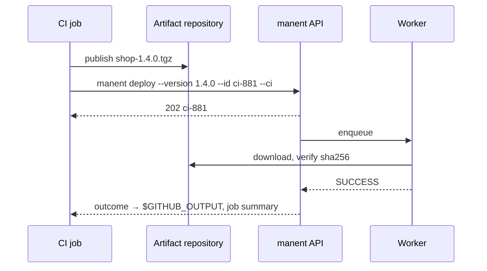

# 6. Deploy from a CI pipeline

!!! abstract "In this tutorial"
    You let a CI pipeline release: it gets its own token and a role limited to the environments it may touch, sends the version it just built, waits for the outcome and publishes it in the job summary. A re-run job never deploys twice, and changes to the environment configuration are checked in the merge request before they reach Consul.

    **Time:** 20 minutes · **You need:** a manent server reachable from CI (tutorials 1–3), a GitHub or GitLab repository



## 1. A token for the pipeline

CI is an automated system: it uses a **static token**, stored as a CI secret, with only its sha256 in manent. A token file lets you add, rotate and revoke tokens without restarting the server.

```sh
TOKEN=$(openssl rand -hex 32)          # goes into the CI secret MANENT_TOKEN
printf '%s' "$TOKEN" | sha256sum       # goes into the tokens file
```

```yaml title="/etc/manent/tokens.yml"
tokens:
  - name: ci-hello
    sha256: "<sha256>"
    groups: [ci]
    expires_at: 2027-06-30T00:00:00Z   # rotation is not optional
```

```yaml title="manent.yml"
auth:
  mode: enabled
  tokens_file: /etc/manent/tokens.yml   # reloaded within 5 seconds of a change
rbac:
  bindings:
    - subjects: ["token:ci-hello"]
      role: deployer
      applications: ["hello"]
      environments: [test, staging]      # production goes through promotion and approval
```

The token can deploy, cancel and roll back `hello` in `test` and `staging`, and nothing else. Production receives artifacts by [promotion](promozione.md), approved by a person.

## 2. Keep the descriptor in the repository

```yaml title="deploy/test.yml"
apiVersion: manent/v1
application: hello
environment: test
artifact:
  type: application
  name: hello
  version: 0.0.0                       # replaced by the pipeline
  source: https://nexus.example.com/repository/releases/hello/hello-0.0.0.tar.gz
```

The pipeline adds only what it alone knows: version, source and, optionally, the expected sha256.

## 3. Try it from your terminal

`--ci` writes the outcome where the CI system expects it. You can see what it produces by faking GitHub's variables:

```sh
export MANENT_SERVER=https://manent.example.com MANENT_TOKEN=…
: > out; : > summary
GITHUB_ACTIONS=true GITHUB_OUTPUT=out GITHUB_STEP_SUMMARY=summary \
  manent deploy -f deploy/test.yml --version 1.1.0 \
  --source https://nexus.example.com/repository/releases/hello/hello-1.1.0.tar.gz \
  --id ci-1001 --ci
cat out summary
```

```text
deployment_id=ci-1001
state=SUCCESS
application=hello
environment=test
version=1.1.0
dry_run=false
tenant=untenanted
### manent · Deploy of hello to test

| | |
|---|---|
| Version | `1.1.0` |
| Deploy | `ci-1001` |
| Outcome | **SUCCESS** |
```

Run the same command again: it returns deploy `ci-1001` with its outcome instead of releasing again. The `--id` is the **idempotency key** that makes a retried job safe. The command exits non-zero if the deploy does not succeed, so the job fails with it.

## 4. GitHub Actions

```yaml title=".github/workflows/release.yml"
name: release
on:
  push:
    tags: ["v*"]

jobs:
  build:
    runs-on: ubuntu-latest
    outputs:
      version: ${{ steps.v.outputs.version }}
    steps:
      - uses: actions/checkout@v4
      - id: v
        run: echo "version=${GITHUB_REF_NAME#v}" >> "$GITHUB_OUTPUT"
      - run: make dist VERSION=${{ steps.v.outputs.version }}     # builds dist/hello-<version>.tar.gz
      - run: >
          curl -fsS -u "${{ secrets.NEXUS_USER }}:${{ secrets.NEXUS_PASSWORD }}"
          --upload-file dist/hello-${{ steps.v.outputs.version }}.tar.gz
          https://nexus.example.com/repository/releases/hello/

  deploy-test:
    needs: build
    runs-on: ubuntu-latest
    environment: test
    steps:
      - uses: actions/checkout@v4
      - id: manent
        uses: joeg-ita/manent/integrations/github@v0.1.0
        with:
          server: https://manent.example.com
          token: ${{ secrets.MANENT_TOKEN }}
          descriptor: deploy/test.yml
          version: ${{ needs.build.outputs.version }}
          source: https://nexus.example.com/repository/releases/hello/hello-${{ needs.build.outputs.version }}.tar.gz
          id: gh-${{ github.run_id }}
      - run: echo "released ${{ steps.manent.outputs.version }} as ${{ steps.manent.outputs.deployment-id }}"
```

- The action installs the client if it is not on the `PATH`, runs `manent deploy --ci` and exposes `deployment-id`, `state` and `version` as step outputs. The summary appears on the workflow page.
- `id: gh-${{ github.run_id }}` makes a re-run of the same workflow return the existing deploy. Add `-${{ github.run_attempt }}` if you *want* a re-run to deploy again.
- With `dry-run: true` the action asks a worker for a [dry-run](../guida/dry-run.md), useful on pull requests.

See [GitHub Actions](../integrazioni/github-actions.md) for promotion jobs, private CAs and validation on pull requests.

## 5. GitLab CI

```yaml title=".gitlab-ci.yml"
stages: [build, deploy]

include:
  - remote: https://raw.githubusercontent.com/joeg-ita/manent/v0.1.0/integrations/gitlab/manent.yml
    inputs:
      job: deploy-test
      stage: deploy
      descriptor: deploy/test.yml
      version: $CI_COMMIT_TAG
      source: https://nexus.example.com/repository/releases/hello/hello-$CI_COMMIT_TAG.tar.gz
      id: gl-$CI_PIPELINE_ID
      manent_ref: v0.1.0

build:
  stage: build
  script:
    - make dist VERSION=$CI_COMMIT_TAG
  rules:
    - if: $CI_COMMIT_TAG
```

`MANENT_SERVER` and `MANENT_TOKEN` are CI/CD variables of the project (the token masked and protected). The template writes the dotenv report `manent.env`, so `deployment_id`, `state` and `version` are variables of the following jobs. See [GitLab CI](../integrazioni/gitlab-ci.md).

## 6. Check configuration changes in the merge request

The environment configuration often lives in its own repository, synchronized to Consul. `manent env validate` checks a candidate configuration with every submission-time check (merge, descriptor policy, rollout plan, plugins), merged with the request of the deploy currently in service, and writes nothing:

```sh
manent env validate -a hello -e prod -f envconfig/hello/hello/prod.yml
```

Run it in the merge request pipeline of the configuration repository: a wave that selects no target or a forbidden parameter fails the review, not the next release. The GitHub Action does the same with `command: env-validate`.

## What you learned

- CI uses a **static token** with a narrow **role**; production is reached by promotion.
- The pipeline passes **version and source**; the descriptor stays in the repository.
- `--id` makes jobs **idempotent**, `--ci` publishes the **outcome**, the exit code fails the job.
- `env validate` gates **configuration changes** before they reach Consul.

## Next

- Keep the release in service as code with [Terraform](../integrazioni/terraform.md).
- [Tutorial 7](catene.md): chain an infrastructure deploy and a configuration deploy with exports and imports.
- [Tutorial 8](produzione.md): run manent itself as a production service.
