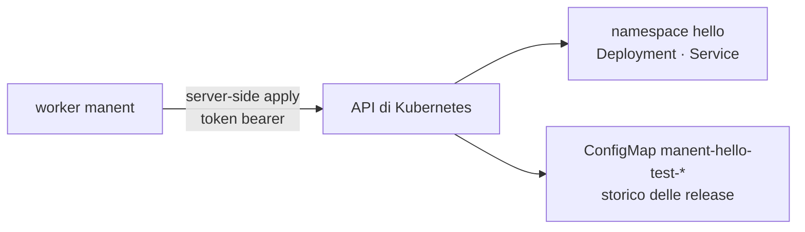

# 4. Deploy su Kubernetes

!!! abstract "In questo tutorial"
    Rilasci un manifest su un cluster Kubernetes con una service account limitata a un namespace. manent applica gli oggetti con server-side apply, attende il rollout, conserva lo storico delle release nel cluster e lo usa per riportare indietro un'immagine difettosa in pochi secondi, senza scaricare nulla.

    **Tempo:** 30 minuti · **Serve:** un cluster Kubernetes che puoi amministrare (kind, k3d, k3s, Docker Desktop o uno reale), `kubectl`, i binari del [tutorial 1](primo-deploy.md)



## 1. Una service account per manent

manent parla direttamente con l'API del cluster: al worker non servono `kubectl` né un kubeconfig. Serve un token, i cui permessi decidono esattamente cosa può cambiare. Un Role limitato al namespace dell'applicazione è la scelta abituale:

```yaml title="rbac.yaml"
apiVersion: v1
kind: Namespace
metadata:
  name: hello
---
apiVersion: v1
kind: ServiceAccount
metadata:
  name: manent
  namespace: hello
---
apiVersion: rbac.authorization.k8s.io/v1
kind: Role
metadata:
  name: manent-deployer
  namespace: hello
rules:
  - apiGroups: [""]
    resources: [configmaps, services]          # configmaps: anche lo storico delle release
    verbs: [get, list, watch, create, update, patch, delete]
  - apiGroups: [apps]
    resources: [deployments, replicasets]
    verbs: [get, list, watch, create, update, patch, delete]
  - apiGroups: [""]
    resources: [pods]
    verbs: [get, list, watch]
---
apiVersion: rbac.authorization.k8s.io/v1
kind: RoleBinding
metadata:
  name: manent-deployer
  namespace: hello
subjects:
  - {kind: ServiceAccount, name: manent, namespace: hello}
roleRef:
  apiGroup: rbac.authorization.k8s.io
  kind: Role
  name: manent-deployer
---
apiVersion: v1
kind: Secret
metadata:
  name: manent-token
  namespace: hello
  annotations:
    kubernetes.io/service-account.name: manent
type: kubernetes.io/service-account-token
```

```sh
mkdir -p ~/manent-tutorial/k8s && cd ~/manent-tutorial/k8s
kubectl apply -f rbac.yaml
kubectl -n hello get secret manent-token -o jsonpath='{.data.token}' | base64 -d > token
kubectl -n hello get secret manent-token -o jsonpath='{.data.ca\.crt}' | base64 -d > ca.crt
kubectl config view --minify -o jsonpath='{.clusters[0].cluster.server}'   # l'indirizzo dell'API
```

Aggiungi al Role le risorse che contengono i tuoi manifest (Ingress, HorizontalPodAutoscaler, …). Con manent dentro il cluster si legge invece il token del pod con `file:/var/run/secrets/kubernetes.io/serviceaccount/token`.

## 2. L'artefatto: un manifest

L'artefatto è il file dei manifest (o un `.tar.gz` di manifest, o un chart Helm). Viene verificato con lo sha256 e promosso senza modifiche tra gli ambienti: ciò che cambia tra un ambiente e l'altro arriva dalle variabili.

```yaml title="dist/hello-1.0.0.yaml"
apiVersion: apps/v1
kind: Deployment
metadata:
  name: hello
spec:
  replicas: ${REPLICAS}
  progressDeadlineSeconds: 120
  selector:
    matchLabels: {app: hello}
  template:
    metadata:
      labels: {app: hello}
    spec:
      containers:
        - name: hello
          image: hashicorp/http-echo:1.0
          args: ["-listen=:8080", "-text=hello from ${MANENT_VERSION} in ${MANENT_ENVIRONMENT}"]
          ports: [{containerPort: 8080}]
          readinessProbe:
            httpGet: {path: /, port: 8080}
---
apiVersion: v1
kind: Service
metadata:
  name: hello
spec:
  selector: {app: hello}
  ports: [{port: 80, targetPort: 8080}]
```

`${MANENT_VERSION}` e `${MANENT_ENVIRONMENT}` li imposta manent; `${REPLICAS}` viene dal parametro `var.REPLICAS` dell'ambiente. `progressDeadlineSeconds` fa fallire in fretta un rollout bloccato invece di attendere tutto il `wait_timeout`.

!!! tip "Immagini fissate per digest"
    In produzione riferisci le immagini come `image@sha256:…` e imposta il parametro `require_image_digest: "true"`: un manifest con un tag modificabile viene rifiutato, e l'artefatto è davvero immutabile.

## 3. Configurazione di ambiente

```yaml title="envconfig/hello/hello/test.yml"
plugin: kubernetes
targets:
  - {host: <host-api>, port: <porta-api>}     # dall'indirizzo del server, es. 127.0.0.1 e 6443
params:
  namespace: hello
  token_secret: kube-token
  ca_secret: kube-ca
  var.REPLICAS: "2"
  wait_timeout: 3m
secrets:
  - {name: kube-token, ref: "file:/home/you/manent-tutorial/k8s/token"}
  - {name: kube-ca, ref: "file:/home/you/manent-tutorial/k8s/ca.crt"}
rollback:
  enabled: true
```

Ogni target è un cluster. Con più cluster aggiungi un target per ciascuno con le etichette `region` e `az`, e un [rilascio a ondate](../guida/ondate.md) li aggiorna uno alla volta.

```yaml title="manent.yml"
dbos:
  database_url: sqlite:manent.db
workdir: ./work
plugins:
  kubernetes: {}
envconfig:
  provider: file
  required: true
  file:
    path: "./envconfig/{application}/{artifact}/{environment}.yml"
```

```yaml title="hello.yml"
apiVersion: manent/v1
application: hello
environment: test
artifact:
  type: kubernetes
  name: hello
  version: 1.0.0
  source: /home/you/manent-tutorial/k8s/dist/hello-1.0.0.yaml
```

Avvia il server (`manent-server -c manent.yml serve`) in un altro terminale.

## 4. Dry-run sul cluster

```sh
manent deploy -f hello.yml --dry-run | jq '.steps[] | select(.name=="deploy") | .output.result | fromjson'
```

```json
{"plugin": "kubernetes", "targets": [{"host": "127.0.0.1", "status": "ready",
  "details": {"cluster_version": "v1.31.4+k3s1", "namespace": "hello", "objects_checked": "2", "objects_skipped": "0"}}]}
```

In dry-run ogni oggetto viene applicato con `dryRun=All`: il cluster verifica schema, admission webhook e RBAC della service account, e non salva nulla. Un permesso mancante emerge qui, non durante il rilascio reale.

## 5. Rilascia

```sh
manent deploy -f hello.yml
kubectl -n hello get deploy,svc,configmap
```

```text
NAME                    READY   UP-TO-DATE   AVAILABLE
deployment.apps/hello   2/2     2            2

NAME                                         DATA
configmap/manent-hello-test                  3
configmap/manent-hello-test-1-0-0-8bf0f7f2   5

NAME            TYPE        CLUSTER-IP      PORT(S)
service/hello   ClusterIP   10.43.225.169   80/TCP
```

Lo step deploy è terminato solo a rollout del Deployment completato. Gli oggetti hanno le etichette `app.kubernetes.io/managed-by: manent`, `manent.io/application`, `manent.io/artifact`, `manent.io/tenant` e `manent.io/environment`, e l'annotazione `manent.io/version`. Le due ConfigMap sono lo **storico**: `manent-hello-test` punta alla release in esercizio, `manent-hello-test-1-0-0-…` contiene gli oggetti applicati dalla 1.0.0.

## 6. Un'immagine difettosa, riportata indietro

Rilascia una 1.1.0 la cui immagine non esiste:

```sh
sed -e 's#http-echo:1.0#http-echo:does-not-exist#' -e 's/progressDeadlineSeconds: 120/progressDeadlineSeconds: 30/' \
  dist/hello-1.0.0.yaml > dist/hello-1.1.0.yaml
manent deploy -f hello.yml --version 1.1.0 --source "$PWD/dist/hello-1.1.0.yaml"
```

```text
cluster 127.0.0.1: Deployment/hello/hello: rollout stuck: ReplicaSet "hello-8544968f49" has timed out progressing.; rollback completed
```

```sh
kubectl -n hello get deploy hello -o jsonpath='{.spec.template.spec.containers[0].image} {.metadata.annotations.manent\.io/version}{"\n"}'
# hashicorp/http-echo:1.0 1.0.0
```

Passata la scadenza, il plugin ha dichiarato il rollout bloccato e il rollback ha riapplicato gli oggetti salvati per la 1.0.0 nello storico: non è stato necessario scaricare nulla. Un rollout bloccato è un errore permanente, quindi manent non perde tempo a ritentarlo.

## 7. Chart Helm

Lo stesso plugin rilascia un chart impacchettato con `helm package` (un `.tgz` con `<nome>/Chart.yaml`, riconosciuto in automatico). manent lo **renderizza** soltanto, con `helm template` e le capability del cluster di destinazione, e ne applica il risultato come un manifest: Helm non tiene stato nel cluster, e storico e rollback funzionano come sopra.

```yaml title="envconfig/shop/shop/prod.yml"
plugin: kubernetes
targets:
  - {host: k8s-eu1.example.com, labels: {region: eu-1}}
params:
  namespace: shop-prod
  token_secret: kube-token
  helm_values_files: values-prod.yaml      # dentro il chart
  helm_value.replicaCount: "4"
  helm_values: |
    ingress:
      enabled: true
      host: shop.example.com
```

Il worker ha bisogno del binario `helm` (è nell'immagine `manent-server`). Gli hook sono saltati di default; vedi [Chart Helm](../plugins/kubernetes.md#chart-helm) per hook, CRD e il passaggio a manent di una release Helm esistente.

## Cosa hai imparato

- manent usa l'API del cluster con un **token limitato al namespace**; i permessi sono il confine.
- L'**artefatto** è il manifest o il chart; gli ambienti differiscono per **variabili e values**, non per file.
- Un deploy termina quando il **rollout** è completo, e un rollout bloccato fallisce in fretta.
- Lo **storico** nel cluster rende il rollback immediato.

## Prossimo passo

- Rilasci per percentuale su Kubernetes con la Gateway API o Istio: [Rilasci per percentuale](../guida/traffico.md) e il [plugin kubernetes](../plugins/kubernetes.md#rilasci-per-percentuale).
- [Tutorial 5](rilascio-progressivo.md): canary e ondate con health gate.
