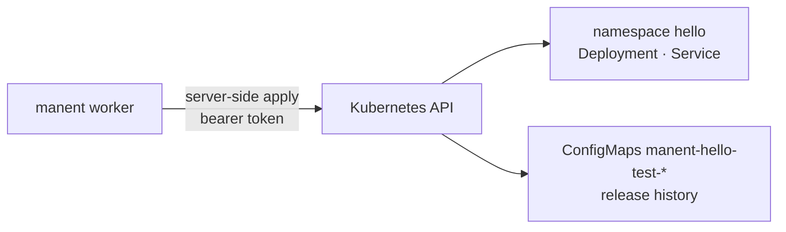

# 4. Deploy to Kubernetes

!!! abstract "In this tutorial"
    You release a manifest to a Kubernetes cluster with a service account limited to one namespace. manent applies the objects with server-side apply, waits for the rollout, keeps the release history in the cluster and uses it to roll back a broken image in seconds, without downloading anything.

    **Time:** 30 minutes · **You need:** a Kubernetes cluster you can administer (kind, k3d, k3s, Docker Desktop or a real one), `kubectl`, the binaries of [tutorial 1](primo-deploy.md)



## 1. A service account for manent

manent talks directly to the cluster API: the worker needs neither `kubectl` nor a kubeconfig. It needs a token whose permissions decide exactly what it can change. A Role limited to the application's namespace is the usual choice:

```yaml title="rbac.yaml"
apiVersion: v1
kind: Namespace
metadata:
  name: hello
---
apiVersion: v1
kind: ServiceAccount
metadata:
  name: manent
  namespace: hello
---
apiVersion: rbac.authorization.k8s.io/v1
kind: Role
metadata:
  name: manent-deployer
  namespace: hello
rules:
  - apiGroups: [""]
    resources: [configmaps, services]          # configmaps: the release history too
    verbs: [get, list, watch, create, update, patch, delete]
  - apiGroups: [apps]
    resources: [deployments, replicasets]
    verbs: [get, list, watch, create, update, patch, delete]
  - apiGroups: [""]
    resources: [pods]
    verbs: [get, list, watch]
---
apiVersion: rbac.authorization.k8s.io/v1
kind: RoleBinding
metadata:
  name: manent-deployer
  namespace: hello
subjects:
  - {kind: ServiceAccount, name: manent, namespace: hello}
roleRef:
  apiGroup: rbac.authorization.k8s.io
  kind: Role
  name: manent-deployer
---
apiVersion: v1
kind: Secret
metadata:
  name: manent-token
  namespace: hello
  annotations:
    kubernetes.io/service-account.name: manent
type: kubernetes.io/service-account-token
```

```sh
mkdir -p ~/manent-tutorial/k8s && cd ~/manent-tutorial/k8s
kubectl apply -f rbac.yaml
kubectl -n hello get secret manent-token -o jsonpath='{.data.token}' | base64 -d > token
kubectl -n hello get secret manent-token -o jsonpath='{.data.ca\.crt}' | base64 -d > ca.crt
kubectl config view --minify -o jsonpath='{.clusters[0].cluster.server}'   # the API address
```

Add to the Role the resources your manifests contain (Ingress, HorizontalPodAutoscaler, …). With manent running inside the cluster, the pod's own token is read with `file:/var/run/secrets/kubernetes.io/serviceaccount/token` instead.

## 2. The artifact: a manifest

The artifact is the manifest file (or a `.tar.gz` of manifests, or a Helm chart). It is verified by sha256 and promoted unchanged between environments: what differs between environments comes from variables.

```yaml title="dist/hello-1.0.0.yaml"
apiVersion: apps/v1
kind: Deployment
metadata:
  name: hello
spec:
  replicas: ${REPLICAS}
  progressDeadlineSeconds: 120
  selector:
    matchLabels: {app: hello}
  template:
    metadata:
      labels: {app: hello}
    spec:
      containers:
        - name: hello
          image: hashicorp/http-echo:1.0
          args: ["-listen=:8080", "-text=hello from ${MANENT_VERSION} in ${MANENT_ENVIRONMENT}"]
          ports: [{containerPort: 8080}]
          readinessProbe:
            httpGet: {path: /, port: 8080}
---
apiVersion: v1
kind: Service
metadata:
  name: hello
spec:
  selector: {app: hello}
  ports: [{port: 80, targetPort: 8080}]
```

`${MANENT_VERSION}` and `${MANENT_ENVIRONMENT}` are set by manent; `${REPLICAS}` comes from the `var.REPLICAS` parameter of the environment. `progressDeadlineSeconds` makes a stuck rollout fail quickly instead of waiting for the whole `wait_timeout`.

!!! tip "Pin images by digest"
    In production refer to images as `image@sha256:…` and set the `require_image_digest: "true"` parameter: a manifest with a mutable tag is then refused, and the artifact really is immutable.

## 3. Environment configuration

```yaml title="envconfig/hello/test.yml"
plugin: kubernetes
targets:
  - {host: <api-host>, port: <api-port>}      # from the server address, e.g. 127.0.0.1 and 6443
params:
  namespace: hello
  token_secret: kube-token
  ca_secret: kube-ca
  var.REPLICAS: "2"
  wait_timeout: 3m
secrets:
  - {name: kube-token, ref: "file:/home/you/manent-tutorial/k8s/token"}
  - {name: kube-ca, ref: "file:/home/you/manent-tutorial/k8s/ca.crt"}
rollback:
  enabled: true
```

Each target is a cluster. With several clusters, add a target for each one with `region` and `az` labels, and a [wave rollout](../guida/ondate.md) releases them one at a time.

```yaml title="manent.yml"
dbos:
  database_url: sqlite:manent.db
workdir: ./work
plugins:
  kubernetes: {}
envconfig:
  provider: file
  required: true
  file:
    path: "./envconfig/{application}/{environment}.yml"
```

```yaml title="hello.yml"
apiVersion: manent/v1
application: hello
environment: test
artifact:
  type: kubernetes
  name: hello
  version: 1.0.0
  source: /home/you/manent-tutorial/k8s/dist/hello-1.0.0.yaml
```

Start the server (`manent-server -c manent.yml serve`) in another terminal.

## 4. Dry-run on the cluster

```sh
manent deploy -f hello.yml --dry-run | jq '.steps[] | select(.name=="deploy") | .output.result | fromjson'
```

```json
{"plugin": "kubernetes", "targets": [{"host": "127.0.0.1", "status": "ready",
  "details": {"cluster_version": "v1.31.4+k3s1", "namespace": "hello", "objects_checked": "2", "objects_skipped": "0"}}]}
```

In a dry-run every object is applied with `dryRun=All`: the cluster validates schema, admission webhooks and the service account's RBAC, and saves nothing. A missing permission shows up here, not during the real release.

## 5. Release

```sh
manent deploy -f hello.yml
kubectl -n hello get deploy,svc,configmap
```

```text
NAME                    READY   UP-TO-DATE   AVAILABLE
deployment.apps/hello   2/2     2            2

NAME                                         DATA
configmap/manent-hello-test                  3
configmap/manent-hello-test-1-0-0-8bf0f7f2   5

NAME            TYPE        CLUSTER-IP      PORT(S)
service/hello   ClusterIP   10.43.225.169   80/TCP
```

The deploy step ended only when the Deployment had rolled out. The objects carry the labels `app.kubernetes.io/managed-by: manent`, `manent.io/application` and `manent.io/environment`, and the annotation `manent.io/version`. The two ConfigMaps are the **history**: `manent-hello-test` points to the live release, `manent-hello-test-1-0-0-…` holds the objects applied by 1.0.0.

## 6. A broken image, rolled back

Release a 1.1.0 whose image does not exist:

```sh
sed -e 's#http-echo:1.0#http-echo:does-not-exist#' -e 's/progressDeadlineSeconds: 120/progressDeadlineSeconds: 30/' \
  dist/hello-1.0.0.yaml > dist/hello-1.1.0.yaml
manent deploy -f hello.yml --version 1.1.0 --source "$PWD/dist/hello-1.1.0.yaml"
```

```text
cluster 127.0.0.1: Deployment/hello/hello: rollout stuck: ReplicaSet "hello-8544968f49" has timed out progressing.; rollback completed
```

```sh
kubectl -n hello get deploy hello -o jsonpath='{.spec.template.spec.containers[0].image} {.metadata.annotations.manent\.io/version}{"\n"}'
# hashicorp/http-echo:1.0 1.0.0
```

Once the deadline passed, the plugin declared the rollout stuck and the rollback re-applied the objects saved for 1.0.0 in the history: nothing had to be downloaded again. A stuck rollout is a permanent error, so manent does not waste time retrying it.

## 7. Helm charts

The same plugin releases a chart packaged with `helm package` (a `.tgz` with `<name>/Chart.yaml`, recognized automatically). manent only **renders** it with `helm template`, with the target cluster's capabilities, and applies the result like a manifest: Helm keeps no state in the cluster, and history and rollback work as above.

```yaml title="envconfig/shop/prod.yml"
plugin: kubernetes
targets:
  - {host: k8s-eu1.example.com, labels: {region: eu-1}}
params:
  namespace: shop-prod
  token_secret: kube-token
  helm_values_files: values-prod.yaml      # inside the chart
  helm_value.replicaCount: "4"
  helm_values: |
    ingress:
      enabled: true
      host: shop.example.com
```

The worker needs the `helm` binary (it is in the `manent-server` image). Hooks are skipped by default; see [Helm charts](../plugins/kubernetes.md#chart-helm) for hooks, CRDs and moving an existing Helm release to manent.

## What you learned

- manent uses the cluster API with a **namespaced token**; permissions are the boundary.
- The **artifact** is the manifest or the chart; environments differ by **variables and values**, not by files.
- A deploy ends when the **rollout** is complete, and a stuck rollout fails fast.
- The **history** in the cluster makes rollback immediate.

## Next

- Percentage rollouts on Kubernetes with the Gateway API or Istio: [Percentage rollouts](../guida/traffico.md) and the [kubernetes plugin](../plugins/kubernetes.md#rilasci-per-percentuale).
- [Tutorial 5](rilascio-progressivo.md): canary and waves with health gates.
