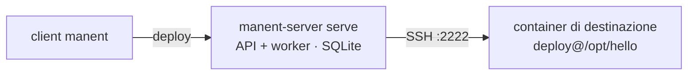

# 1. Primo deploy su un server Linux

!!! abstract "In questo tutorial"
    Rilasci una piccola applicazione su un server Linux via SSH, con una directory per versione e un symlink `current`. Lungo la strada simuli il deploy con un dry-run, vedi una release difettosa riportata indietro in automatico e torni a una versione precedente a mano.

    **Tempo:** 30 minuti · **Serve:** Docker, Go 1.27 (o i binari della release), `ssh-keygen`, `jq` (facoltativo)



## 1. Procurati i binari

Da un checkout del repository:

```sh
make build
export PATH="$PWD/bin:$PATH"
manent version
```

Oppure scarica `manent-server_<versione>_<os>_<arch>` dalle release su GitHub: l'archivio contiene sia `manent-server` sia il client `manent` (vedi [Installazione](../operazioni/installazione.md)).

Poi crea la directory del tutorial, che userai anche nei tutorial successivi:

```sh
mkdir -p ~/manent-tutorial/lab && cd ~/manent-tutorial
```

## 2. Prepara un server di destinazione

Va bene qualunque host Linux con SSH e GNU coreutils. Per tenere tutto sulla tua macchina, avvia un container Debian con un server SSH e un utente `deploy`.

```sh
ssh-keygen -q -t ed25519 -N '' -C manent-tutorial -f lab/deploy_key
```

```dockerfile title="lab/Dockerfile"
FROM debian:12-slim
RUN apt-get update && apt-get install -y --no-install-recommends openssh-server \
 && rm -rf /var/lib/apt/lists/* \
 && useradd -m -s /bin/bash deploy \
 && mkdir -p /run/sshd /home/deploy/.ssh /opt/hello \
 && chown deploy /opt/hello
COPY deploy_key.pub /home/deploy/.ssh/authorized_keys
RUN chown -R deploy /home/deploy/.ssh && chmod 600 /home/deploy/.ssh/authorized_keys
EXPOSE 22
CMD ["/usr/sbin/sshd", "-D", "-e"]
```

```sh
docker build -t manent-tutorial-target lab
docker run -d --name manent-tutorial-target -p 2222:22 manent-tutorial-target
ssh-keyscan -p 2222 127.0.0.1 > lab/known_hosts
```

manent verifica sempre la chiave host dei target: `lab/known_hosts` è l'elenco delle chiavi che accetterà.

## 3. Configura e avvia manent

Basta una configurazione minima: SQLite come database, una directory di lavoro per i download e il plugin `remote-copy` con il `known_hosts` del tutorial. Tutto il resto resta al default.

```yaml title="manent.yml"
dbos:
  database_url: sqlite:manent.db     # Postgres in produzione
workdir: ./work
plugins:
  remote-copy:
    known_hosts: ./lab/known_hosts
```

In un secondo terminale, dalla stessa directory:

```sh
manent-server -c manent.yml serve
```

`serve` avvia l'API HTTP su `:8080` e un worker nello stesso processo. Avvisa che la configurazione non è adatta alla produzione (nessuna autenticazione, qualunque sorgente di artefatti ammessa): per ora è normale.

!!! note "La porta 8080 è già occupata?"
    Aggiungi `http: {listen: "127.0.0.1:18080"}` a `manent.yml` ed esegui `export MANENT_SERVER=http://127.0.0.1:18080` nel terminale del client.

## 4. Costruisci l'artefatto

L'artefatto è un archivio immutabile. Qui contiene un solo script:

```sh
mkdir -p src/bin dist
printf '#!/bin/sh\necho "hello from version 1.0.0"\n' > src/bin/hello
chmod +x src/bin/hello
tar -czf dist/hello-1.0.0.tar.gz -C src .
```

## 5. Scrivi il descrittore

Il descrittore dice cosa rilasciare e dove. Sostituisci `/home/you/manent-tutorial` con l'output di `pwd`.

```yaml title="hello.yml"
apiVersion: manent/v1
application: hello
environment: test

artifact:
  type: application
  name: hello
  version: 1.0.0
  source: /home/you/manent-tutorial/dist/hello-1.0.0.tar.gz

secrets:
  - name: deploy-key
    ref: file:/home/you/manent-tutorial/lab/deploy_key   # un riferimento, mai la chiave

deploy:
  plugin: remote-copy
  targets:
    - {host: 127.0.0.1, port: 2222, user: deploy}
  params:
    dest_dir: /opt/hello
    layout: releases                  # /opt/hello/releases/<versione> + /opt/hello/current
    keep_releases: "3"
    ssh_key_secret: deploy-key        # il nome logico del segreto
    prepare_command: 'tar -xzf "$MANENT_ARTIFACT" -C "$MANENT_RELEASE_DIR"'
    post_command: '"$MANENT_CURRENT/bin/hello"'
```

- `secrets` dichiara un nome logico e un **riferimento**. Il worker legge il file solo quando apre la connessione SSH; la chiave non compare mai nella richiesta, nello storico o nei log.
- Con `layout: releases` ogni versione ha la sua directory e `current` viene spostato in modo atomico. È ciò che rende possibile il rollback.
- `prepare_command` gira nella nuova release prima dello spostamento, `post_command` dopo. In un servizio reale quest'ultimo sarebbe qualcosa come `sudo systemctl restart hello`.

## 6. Verifica prima di rilasciare

`validate` esegue sul server tutte le verifiche di un invio reale, poi stampa il piano e il deploy effettivo. Non accoda nulla e non tocca il target.

```sh
manent validate -f hello.yml | jq '{valid, plan, rollback, secrets, config}'
```

```json
{
  "valid": true,
  "plan": [
    {"name": "secrets", "max_retries": 0},
    {"name": "artifacts", "max_retries": 3},
    {"name": "qa", "max_retries": 0},
    {"name": "deploy", "max_retries": 2},
    {"name": "activation", "max_retries": 0}
  ],
  "rollback": {"enabled": false},
  "secrets": ["deploy-key"],
  "config": {"source": "descriptor", "targets": "1"}
}
```

Un **dry-run** va oltre: un worker esegue lo stesso workflow, risolve il segreto, scarica e verifica l'artefatto, si collega al target e controlla che `dest_dir` sia scrivibile, senza copiare nulla.

```sh
manent deploy -f hello.yml --dry-run
```

Nell'output lo step `deploy` riporta il target come `ready`, con `"post_command": "skipped"`.

## 7. Rilascia

```sh
manent deploy -f hello.yml
```

```text
deploy enqueued: 49bef919-2df2-47f3-bbec-3287a72de817 (manent logs -f 49bef919-… to follow it)
```

Il comando attende la fine e stampa il risultato di ogni step; esce con codice `0` se riesce. Guarda cosa è successo:

```sh
manent logs <id>
```

```text
19:26:30 INFO  [secrets] secrets verified count=1
19:26:30 INFO  [artifacts] artifact fetched sha256=45aae56d…
19:26:30 INFO  [qa] QA passed
19:26:31 INFO  [deploy] artifact copied remote_path=/opt/hello/releases/1.0.0/hello-1.0.0.tar.gz
19:26:31 INFO  [deploy] release activated previous= release=1.0.0
19:26:31 INFO  [deploy] post_command run output=hello from version 1.0.0
19:26:31 INFO  [activation] release activated in service version=1.0.0
```

E sul target:

```sh
docker exec manent-tutorial-target ls -l /opt/hello
# current -> releases/1.0.0
```

L'[inventario](../guida/governance.md#inventario) ora sa cosa è in esercizio:

```sh
manent inventory -a hello | jq -c '.[] | {application, artifact, environment, tenant, current: (.current | {version, sha256, kind, requested_by})}'
```

```json
{"application":"hello","artifact":"hello","environment":"test","tenant":"untenanted","current":{"version":"1.0.0","sha256":"45aae56d…","kind":"deploy","requested_by":"none:anonymous"}}
```

## 8. Rilascia una nuova versione

Il descrittore resta lo stesso: di solito è la CI a passare versione e sorgente da riga di comando.

```sh
sed -i.bak 's/1.0.0/1.1.0/' src/bin/hello
tar -czf dist/hello-1.1.0.tar.gz -C src .
manent deploy -f hello.yml --version 1.1.0 --source "$PWD/dist/hello-1.1.0.tar.gz"
```

Ora `current` punta a `releases/1.1.0`, e `releases/1.0.0` è ancora lì.

## 9. Osserva un rollback automatico

Attiva il rollback automatico aggiungendo questa sezione a `hello.yml`:

```yaml title="hello.yml"
rollback:
  enabled: true
```

Poi rilascia una 1.2.0 difettosa, un archivio senza `bin/hello`:

```sh
mkdir -p broken && echo "oops" > broken/README
tar -czf dist/hello-1.2.0.tar.gz -C broken .
manent deploy -f hello.yml --version 1.2.0 --source "$PWD/dist/hello-1.2.0.tar.gz"
```

```text
deploy … failed: ERROR: step "deploy": … post_command: Process exited with status 127:
bash: line 1: /opt/hello/current/bin/hello: No such file or directory; rollback completed
```

Cosa è successo, step per step (`manent steps <id>`):

```text
config secrets artifacts qa checkpoint:deploy deploy rollback:deploy cleanup …
```

1. `checkpoint:deploy` ha registrato la release in esercizio, la 1.1.0, prima di toccare qualunque cosa.
2. `deploy` ha spostato `current` sulla 1.2.0 ed eseguito `post_command`, che è fallito; DBOS ha ritentato due volte (`max_retries: 2`).
3. `rollback:deploy` ha riportato `current` sulla 1.1.0.

Il deploy resta `ERROR`, ma l'ambiente è tornato alla versione precedente, e l'inventario lo riporta:

```sh
manent inventory -a hello | jq '.[0] | {current: .current.version, failed: .last_failure.version, rollback: .last_failure.rollback}'
# {"current": "1.1.0", "failed": "1.2.0", "rollback": "completed"}
```

## 10. Torna indietro a mano

Il rollback automatico copre i deploy falliti. Quando un deploy è riuscito ma la versione si rivela difettosa, si torna indietro a mano:

```sh
manent rollback -a hello -e test
```

manent prende l'ultima versione riuscita diversa da quella in esercizio (qui la 1.0.0, `--to` ne sceglie un'altra), la scarica di nuovo, ne verifica lo sha256 e la rilascia come nuovo deploy di tipo `rollback`:

```sh
manent list -a hello -n 5 | jq -r '.[] | select(.dry_run | not) | "\(.state) \(.kind) \(.version)"'
```

```text
SUCCESS rollback 1.0.0
ERROR deploy 1.2.0
SUCCESS deploy 1.1.0
SUCCESS deploy 1.0.0
```

## Cosa hai imparato

- Un deploy è un **piano** di step eseguito da un worker; ogni step viene registrato, quindi `manent logs` e `manent steps` mostrano esattamente cosa è successo.
- I segreti sono **riferimenti**, risolti solo al momento dell'uso.
- `validate` e `--dry-run` verificano un deploy senza cambiare nulla.
- Con `layout: releases` il plugin `remote-copy` sa leggere la release in esercizio, e questo abilita il **rollback automatico** e l'**inventario**.
- Un rollback manuale è un nuovo deploy di un artefatto precedente, verificato con lo sha256.

## Prossimo passo

Il descrittore contiene ancora host, comandi e il percorso della chiave: nel [tutorial 2](ambienti.md) si spostano nella configurazione di ambiente, e la chiave in Vault.

??? note "Pulizia"
    Tieni il container e `~/manent-tutorial` per il tutorial successivo. Per rimuovere tutto: `docker rm -f manent-tutorial-target` e `rm -rf ~/manent-tutorial`.
