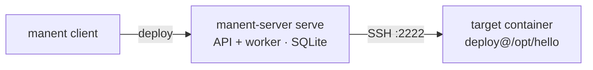

# 1. First deploy to a Linux server

!!! abstract "In this tutorial"
    You release a small application to a Linux server over SSH, with one directory per version and a `current` symlink. On the way you simulate the deploy with a dry-run, see a broken release rolled back automatically and go back to an older version by hand.

    **Time:** 30 minutes · **You need:** Docker, Go 1.27 (or the release binaries), `ssh-keygen`, `jq` (optional)



## 1. Get the binaries

From a checkout of the repository:

```sh
make build
export PATH="$PWD/bin:$PATH"
manent version
```

Or download `manent-server_<version>_<os>_<arch>` from the GitHub releases: the archive contains both `manent-server` and the `manent` client (see [Installation](../operazioni/installazione.md)).

Then create the tutorial directory, which you will use in the next tutorials too:

```sh
mkdir -p ~/manent-tutorial/lab && cd ~/manent-tutorial
```

## 2. Prepare a target server

Any Linux host with SSH and GNU coreutils works. To keep everything on your machine, run a Debian container with an SSH server and a `deploy` user.

```sh
ssh-keygen -q -t ed25519 -N '' -C manent-tutorial -f lab/deploy_key
```

```dockerfile title="lab/Dockerfile"
FROM debian:12-slim
RUN apt-get update && apt-get install -y --no-install-recommends openssh-server \
 && rm -rf /var/lib/apt/lists/* \
 && useradd -m -s /bin/bash deploy \
 && mkdir -p /run/sshd /home/deploy/.ssh /opt/hello \
 && chown deploy /opt/hello
COPY deploy_key.pub /home/deploy/.ssh/authorized_keys
RUN chown -R deploy /home/deploy/.ssh && chmod 600 /home/deploy/.ssh/authorized_keys
EXPOSE 22
CMD ["/usr/sbin/sshd", "-D", "-e"]
```

```sh
docker build -t manent-tutorial-target lab
docker run -d --name manent-tutorial-target -p 2222:22 manent-tutorial-target
ssh-keyscan -p 2222 127.0.0.1 > lab/known_hosts
```

manent always verifies the host key of the targets: `lab/known_hosts` is the list of keys it will accept.

## 3. Configure and start manent

A minimal configuration is enough: SQLite as the database, a working directory for downloads and the `remote-copy` plugin with the tutorial's `known_hosts`. Everything else keeps its default.

```yaml title="manent.yml"
dbos:
  database_url: sqlite:manent.db     # Postgres in production
workdir: ./work
plugins:
  remote-copy:
    known_hosts: ./lab/known_hosts
```

In a second terminal, from the same directory:

```sh
manent-server -c manent.yml serve
```

`serve` starts the HTTP API on `:8080` and a worker in the same process. It warns that the configuration is not fit for production (no authentication, any artifact source allowed): that is expected for now.

!!! note "Port 8080 already in use?"
    Add `http: {listen: "127.0.0.1:18080"}` to `manent.yml` and `export MANENT_SERVER=http://127.0.0.1:18080` in the client terminal.

## 4. Build the artifact

The artifact is an immutable archive. Here it holds a single script:

```sh
mkdir -p src/bin dist
printf '#!/bin/sh\necho "hello from version 1.0.0"\n' > src/bin/hello
chmod +x src/bin/hello
tar -czf dist/hello-1.0.0.tar.gz -C src .
```

## 5. Write the descriptor

The descriptor says what to release and where. Replace `/home/you/manent-tutorial` with the output of `pwd`.

```yaml title="hello.yml"
apiVersion: manent/v1
application: hello
environment: test

artifact:
  type: application
  name: hello
  version: 1.0.0
  source: /home/you/manent-tutorial/dist/hello-1.0.0.tar.gz

secrets:
  - name: deploy-key
    ref: file:/home/you/manent-tutorial/lab/deploy_key   # a reference, never the key

deploy:
  plugin: remote-copy
  targets:
    - {host: 127.0.0.1, port: 2222, user: deploy}
  params:
    dest_dir: /opt/hello
    layout: releases                  # /opt/hello/releases/<version> + /opt/hello/current
    keep_releases: "3"
    ssh_key_secret: deploy-key        # the secret's logical name
    prepare_command: 'tar -xzf "$MANENT_ARTIFACT" -C "$MANENT_RELEASE_DIR"'
    post_command: '"$MANENT_CURRENT/bin/hello"'
```

- `secrets` declares a logical name and a **reference**. The worker reads the file only when it opens the SSH connection; the key never appears in the request, the history or the logs.
- With `layout: releases` every version gets its own directory and `current` is switched atomically. This is what makes rollback possible.
- `prepare_command` runs in the new release before the switch; `post_command` after it. In a real service the latter would be something like `sudo systemctl restart hello`.

## 6. Check before releasing

`validate` runs on the server every check of a real submission, then prints the plan and the effective deploy. It enqueues nothing and does not touch the target.

```sh
manent validate -f hello.yml | jq '{valid, plan, rollback, secrets, config}'
```

```json
{
  "valid": true,
  "plan": [
    {"name": "secrets", "max_retries": 0},
    {"name": "artifacts", "max_retries": 3},
    {"name": "qa", "max_retries": 0},
    {"name": "deploy", "max_retries": 2},
    {"name": "activation", "max_retries": 0}
  ],
  "rollback": {"enabled": false},
  "secrets": ["deploy-key"],
  "config": {"source": "descriptor", "targets": "1"}
}
```

A **dry-run** goes further: a worker runs the same workflow, resolves the secret, downloads and verifies the artifact, connects to the target and checks that `dest_dir` is writable, without copying anything.

```sh
manent deploy -f hello.yml --dry-run
```

In the output, the `deploy` step reports the target as `ready`, with `"post_command": "skipped"`.

## 7. Release

```sh
manent deploy -f hello.yml
```

```text
deploy enqueued: 49bef919-2df2-47f3-bbec-3287a72de817 (manent logs -f 49bef919-… to follow it)
```

The command waits for the end and prints the result of every step; it exits with code `0` on success. Look at what happened, replacing `<id>` with the ID printed by `deploy`:

```sh
manent logs <id>
```

```text
19:26:30 INFO  [secrets] secrets verified count=1
19:26:30 INFO  [artifacts] artifact fetched sha256=45aae56d…
19:26:30 INFO  [qa] QA passed
19:26:31 INFO  [deploy] artifact copied remote_path=/opt/hello/releases/1.0.0/hello-1.0.0.tar.gz
19:26:31 INFO  [deploy] release activated previous= release=1.0.0
19:26:31 INFO  [deploy] post_command run output=hello from version 1.0.0
19:26:31 INFO  [activation] release activated in service version=1.0.0
```

And on the target:

```sh
docker exec manent-tutorial-target ls -l /opt/hello
# current -> releases/1.0.0
```

The [inventory](../guida/governance.md#inventario) now knows what is live:

```sh
manent inventory -a hello | jq -c '.[] | {application, artifact, environment, tenant, current: (.current | {version, sha256, kind, requested_by})}'
```

```json
{"application":"hello","artifact":"hello","environment":"test","tenant":"untenanted","current":{"version":"1.0.0","sha256":"45aae56d…","kind":"deploy","requested_by":"none:anonymous"}}
```

## 8. Release a new version

The descriptor stays the same: CI usually passes version and source on the command line.

```sh
sed -i.bak 's/1.0.0/1.1.0/' src/bin/hello
tar -czf dist/hello-1.1.0.tar.gz -C src .
manent deploy -f hello.yml --version 1.1.0 --source "$PWD/dist/hello-1.1.0.tar.gz"
```

`current` now points to `releases/1.1.0`, and `releases/1.0.0` is still there.

## 9. Watch an automatic rollback

Enable automatic rollback by adding this section to `hello.yml`:

```yaml title="hello.yml"
rollback:
  enabled: true
```

Then release a broken 1.2.0, an archive without `bin/hello`:

```sh
mkdir -p broken && echo "oops" > broken/README
tar -czf dist/hello-1.2.0.tar.gz -C broken .
manent deploy -f hello.yml --version 1.2.0 --source "$PWD/dist/hello-1.2.0.tar.gz"
```

```text
deploy … failed: ERROR: step "deploy": … post_command: Process exited with status 127:
bash: line 1: /opt/hello/current/bin/hello: No such file or directory; rollback completed
```

What happened, step by step (`manent steps <id>`):

```text
config secrets artifacts qa checkpoint:deploy deploy rollback:deploy cleanup …
```

1. `checkpoint:deploy` recorded the live release, 1.1.0, before touching anything.
2. `deploy` switched `current` to 1.2.0 and ran `post_command`, which failed; DBOS retried it twice (`max_retries: 2`).
3. `rollback:deploy` moved `current` back to 1.1.0.

The deploy stays `ERROR`, but production is back on the previous version, and the inventory says so:

```sh
manent inventory -a hello | jq '.[0] | {current: .current.version, failed: .last_failure.version, rollback: .last_failure.rollback}'
# {"current": "1.1.0", "failed": "1.2.0", "rollback": "completed"}
```

## 10. Go back by hand

Automatic rollback covers failed deploys. When a deploy succeeded but the version turns out to be faulty, you roll back manually:

```sh
manent rollback -a hello -e test
```

manent takes the last successful version different from the live one (1.0.0 here, `--to` picks another), downloads it again, verifies its sha256 and releases it as a new deploy of kind `rollback`:

```sh
manent list -a hello -n 5 | jq -r '.[] | select(.dry_run | not) | "\(.state) \(.kind) \(.version)"'
```

```text
SUCCESS rollback 1.0.0
ERROR deploy 1.2.0
SUCCESS deploy 1.1.0
SUCCESS deploy 1.0.0
```

## What you learned

- A deploy is a **plan** of steps run by a worker; each step is recorded, so `manent logs` and `manent steps` show exactly what happened.
- Secrets are **references**, resolved only at the moment of use.
- `validate` and `--dry-run` check a deploy without changing anything.
- With `layout: releases` the `remote-copy` plugin can read the live release, which enables **automatic rollback** and the **inventory**.
- A manual rollback is a new deploy of a previous artifact, verified by sha256.

## Next

The descriptor still contains hosts, commands and the path of the key: in [tutorial 2](ambienti.md) they move into the environment configuration, and the key into Vault.

??? note "Clean up"
    Keep the container and `~/manent-tutorial` for the next tutorial. To remove everything: `docker rm -f manent-tutorial-target` and `rm -rf ~/manent-tutorial`.
