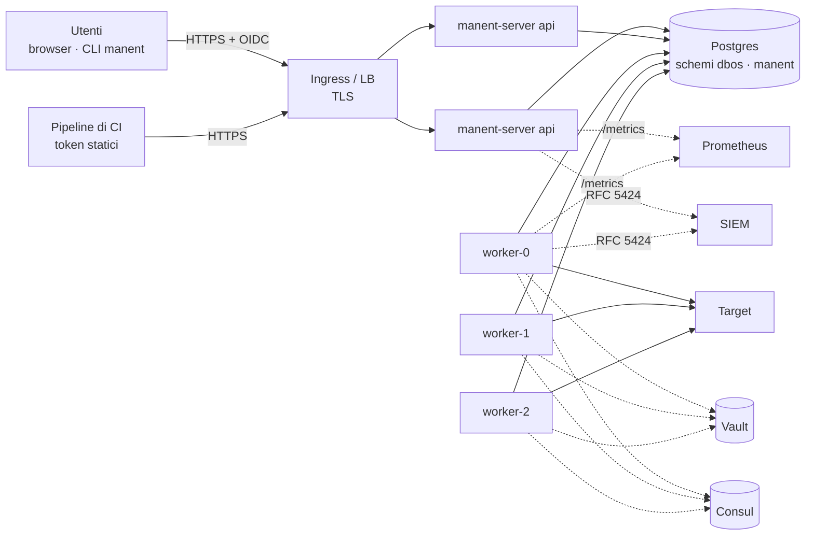

# 8. manent in produzione

!!! abstract "In questo tutorial"
    Porti manent da un singolo processo `serve` su SQLite a un servizio di piattaforma: Postgres, uno strato API e più worker su Kubernetes, accesso tramite il tuo identity provider, TLS, metriche e allarmi, log al SIEM, audit e backup. Ogni passo rimanda alla pagina di riferimento con tutte le opzioni.

    **Tempo:** 45 minuti · **Serve:** un cluster Kubernetes ed Helm (o VM con systemd), Postgres, il tuo identity provider, Vault e Consul del [tutorial 2](ambienti.md)

## Topologia di arrivo



- L'**API** (`manent-server api`) autentica, verifica e accoda. Non esegue mai deploy, quindi scala liberamente.
- I **worker** (`manent-server worker`) eseguono i deploy. Ognuno ha un `executor_id` stabile; dopo un riavvio riprende i propri deploy interrotti.
- **Postgres** contiene tutto: code, workflow, storico, schedule, approvazioni, log, il registro dei worker. È l'unico componente con stato.

## 1. Postgres

```sql
CREATE ROLE manent LOGIN PASSWORD '…';
CREATE DATABASE manent OWNER manent;
```

All'avvio manent crea gli schemi `dbos` e `manent`: i worker sempre, l'API solo se mancano. Più worker avviati insieme su un database vuoto vanno in race sulla migrazione, e manent ritenta finché uno vince.

```sh
kubectl create namespace manent
kubectl -n manent create secret generic manent-db \
  --from-literal=url='postgres://manent:…@postgres.internal:5432/manent?sslmode=verify-full'
```

L'URL arriva ai processi tramite `DBOS_SYSTEM_DATABASE_URL`, mai tramite la ConfigMap. Chi ha queste credenziali può agire direttamente su DBOS scavalcando manent: vanno solo ai processi server e agli operatori della piattaforma.

## 2. Installa con Helm

```yaml title="values-prod.yaml"
image:
  tag: "0.1.0"
config:
  dbos:
    concurrency: 4
    environment_concurrency: 1
    drain_timeout: 5m
  recovery:
    auto_recover_after: 10m          # i deploy di un pod rimosso li riprende un altro worker
  retention:
    max_age: 2160h                   # 90 giorni, tenendo sempre le ultime 10 release per ambiente
    keep_releases: 10
  # Qui va la configurazione dei tutorial precedenti: envconfig, secrets, artifacts,
  # descriptor_policy, plugins, governance, auth e rbac (vedi i passi successivi).
api:
  replicas: 2
worker:
  replicas: 3
  terminationGracePeriodSeconds: 360   # più lungo di dbos.drain_timeout
serviceMonitor:
  enabled: true
extraEnv:
  - name: CONSUL_HTTP_TOKEN
    valueFrom: {secretKeyRef: {name: manent-consul, key: token}}
```

```sh
helm install manent deploy/helm/manent -n manent -f values-prod.yaml
```

Il chart crea un Deployment per l'API, uno StatefulSet per i worker (il nome del pod `manent-worker-0`, `-1`… diventa l'`executor_id`), un PodDisruptionBudget e, a richiesta, un ServiceMonitor. I container girano come utente non root su un filesystem in sola lettura. Sulle VM le unit systemd in `deploy/systemd` fanno lo stesso: vedi [Installazione](../operazioni/installazione.md).

## 3. TLS e l'indirizzo dell'API

manent serve HTTP in chiaro: termina il TLS davanti, sull'Ingress, sul Gateway o sul load balancer, e pubblicalo come `https://manent.example.com`. Instrada tutti i percorsi al Service dell'API (l'interfaccia web è servita su `/`) e blocca `/metrics` dall'esterno: sonde e metriche non richiedono autenticazione.

Utenti e CI poi puntano il client lì:

```yaml title="~/.config/manent/client.yml"
server: https://manent.example.com
token_file: ~/.config/manent/token
ca_file: /etc/ssl/certs/corporate-ca.pem    # solo per una CA privata
```

## 4. Accesso con il tuo identity provider

```yaml title="values-prod.yaml (config)"
auth:
  mode: enabled
  oidc:
    issuer: https://sso.example.com/realms/corp
    audience: manent
    groups_claim: groups
    ui:
      client_id: manent-ui                 # client pubblico con PKCE, per l'interfaccia web
  tokens_file: /etc/manent/tokens/tokens.yml   # token della CI, montati da un Secret
rbac:
  bindings:
    - {groups: [team-*], role: deployer, applications: ["*"], environments: [dev, test, staging]}
    - {groups: [team-*], role: tester, applications: ["*"], environments: [prod]}
    - {groups: [release-managers], role: operator, applications: ["*"], environments: ["*"]}
    - {groups: [cab], role: approver, applications: ["*"], environments: [prod]}
```

[Identity provider OIDC](../integrazioni/oidc.md) riporta i passi per Keycloak, Microsoft Entra ID e Okta: il client dell'API, il client pubblico dell'interfaccia web, e i claim di audience e gruppi.

## 5. Impostazioni di produzione

All'avvio `serve` e `worker` registrano `configurazione non adatta alla produzione` per ogni impostazione ancora permissiva. Chiudile tutte:

```yaml title="values-prod.yaml (config)"
artifacts:
  allow_unlisted: false
  sources:
    - prefix: https://nexus.example.com/repository/releases/
      auth: {type: basic, username: manent, secret_ref: "vault:secret/data/manent/nexus#password"}
callbacks:
  allowed_hosts: ["*.example.com"]
descriptor_policy:
  params:
    remote-copy: [verify_checksum]
    kubernetes: [wait_timeout, "helm_value.*"]
  secret_refs: ["vault:secret/data/{application}/*"]
  targets: false
secrets:
  vault:
    enabled: true
    address: https://vault.example.com:8200
    auth: kubernetes
    kubernetes: {role: manent}
audit:
  file: /var/log/manent/audit.jsonl    # un volume scrivibile, un file per processo (extraVolumes)
  max_size_mb: 100
  hmac_key_ref: "vault:secret/data/manent/audit#key"
```

L'elenco completo è la checklist di produzione in [Sicurezza](../operazioni/sicurezza.md); [HashiCorp Vault](../integrazioni/vault.md) e [Repository degli artefatti](../integrazioni/repository-artefatti.md) spiegano le integrazioni.

## 6. Metriche, allarmi e tracce

Con `serviceMonitor.enabled` Prometheus legge `/metrics` di API e worker (porta `9090` per i worker, che non hanno API). Parti da questi allarmi:

```yaml title="PrometheusRule"
groups:
  - name: manent
    rules:
      - alert: ManentWorkerLost
        expr: max by (executor) (manent_executor_up) == 0
        for: 5m
      - alert: ManentQueueStuck
        expr: max(manent_workflows{workflow="manent.deploy",status="ENQUEUED"}) > 20
        for: 15m
      - alert: ManentProductionDeployFailed
        expr: sum by (application) (increase(manent_deployments_total{environment="prod",outcome="failed",dry_run="false"}[30m])) > 0
      - alert: ManentPolicyStale
        expr: max(manent_policy_age_seconds) > 600
```

Per le tracce, `observability.tracing` esporta span OpenTelemetry via OTLP: una traccia segue un deploy dalla richiesta della CI a ogni step sul worker. Vedi [Osservabilità](../operazioni/osservabilita.md) e [Prometheus e Alertmanager](../integrazioni/prometheus.md).

## 7. Log al SIEM

```yaml title="values-prod.yaml (config)"
logging:
  level: info
  format: json
siem:
  enabled: true
  network: tcp
  address: siem.example.com:6514
```

Ogni record, compresi DBOS e plugin, arriva al SIEM in RFC 5424 con gli attributi come structured data; le voci di audit hanno `audit=true`. Vedi [SIEM e syslog](../integrazioni/siem.md).

## 8. Operatività quotidiana

| Situazione | Cosa fare |
|---|---|
| Scalare in su o in giù | Cambia `worker.replicas`. I deploy in sospeso di un pod rimosso vengono ripresi dopo `recovery.auto_recover_after`. |
| Aggiornare manent | Una release senza cambio della versione dei workflow è un rolling update. Con una nuova versione dei workflow segui [Versioni e aggiornamenti](../operazioni/aggiornamenti.md). |
| Un worker è sparito per sempre | `manent-server admin executors`, poi `admin recover --executor <id>`. Vedi [Recovery](../operazioni/affidabilita.md#worker-perso). |
| Arresto ordinato | `SIGTERM`: il worker smette di prelevare deploy e attende quelli in corso fino a `dbos.drain_timeout`; nel frattempo `/readyz` risponde 503. |
| Cosa sta succedendo ora | `manent activity`, `manent workers`, o la pagina Attività dell'interfaccia web. |
| Integrità dell'audit | `manent-server audit verify`, pianificato, confrontato con il SIEM. |
| Backup | Backup continui di Postgres con point-in-time recovery. Prima di avviare i worker su un database ripristinato leggi [Backup e ripristino](../operazioni/affidabilita.md#backup-e-ripristino). |

## Cosa hai imparato

- manent in produzione è fatto di **processi senza stato su Postgres**: uno strato API e worker con ID stabili.
- **TLS, OIDC e RBAC** stanno davanti a ogni azione; la CI usa token da un file ricaricabile.
- I **default permissivi** vengono segnalati all'avvio e si chiudono con la configurazione.
- **Metriche, tracce, SIEM e audit** rendono la piattaforma osservabile e verificabile.

## Prossimo passo

Collega gli strumenti che i tuoi team usano già: [Integrazioni](../integrazioni/index.md).
