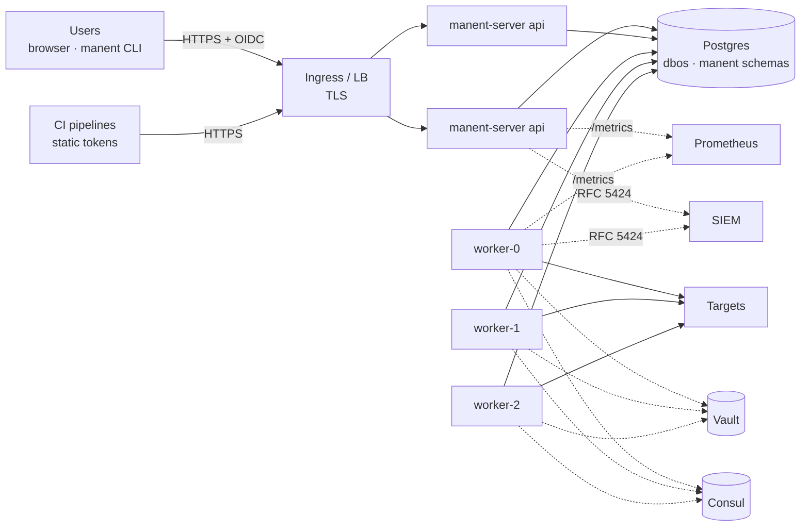

# 8. Run manent in production

!!! abstract "In this tutorial"
    You take manent from a single `serve` process on SQLite to a platform service: Postgres, an API tier and several workers on Kubernetes, sign-in through your identity provider, TLS, metrics and alerts, logs to the SIEM, audit and backups. Each step links to the reference page with every option.

    **Time:** 45 minutes · **You need:** a Kubernetes cluster and Helm (or VMs with systemd), Postgres, your identity provider, Vault and Consul from [tutorial 2](ambienti.md)

## Target topology



- The **API** (`manent-server api`) authenticates, checks and enqueues. It never runs deploys, so it scales freely.
- The **workers** (`manent-server worker`) run deploys. Each one has a stable `executor_id`; after a restart it resumes its own interrupted deploys.
- **Postgres** holds everything: queues, workflows, history, schedules, approvals, logs, the worker registry. It is the only stateful component.

### Why API and workers are separate

On a laptop `serve` runs both in one process, and that stays the right choice for development and small installations. In production the split pays off:

- **Independent scaling.** API replicas follow requests and the web interface; workers follow how many deploys run together (`dbos.concurrency`, `dbos.environment_concurrency`).
- **Restarts without impact.** An API pod can be replaced at any time. A worker stops taking deploys, waits for the running ones up to `dbos.drain_timeout` and resumes its own interrupted deploys when it comes back with the same `executor_id`: that is why workers are a StatefulSet.
- **Smaller exposed surface.** The API is what users and CI reach; only the workers reach the targets and read SSH keys, cluster tokens and cloud credentials. The API needs no network path to the targets, no `helm` and no external plugins.
- **Specialized workers.** Workers per region (`dbos.region`), per plugin (`dbos.plugins`, for example an image with Ansible) or per tenant queue are only possible as separate processes.

What each process must reach:

| | API | Workers |
|---|---|---|
| Postgres | yes | yes |
| Identity provider (OIDC discovery and keys) | yes | no |
| Consul or Git (environment configuration) | yes, to reject an invalid request at once | yes |
| Vault | only for the secrets the API itself uses: artifact credentials for `validate --check-artifact`, the Slack signing secret, the audit HMAC key | yes |
| Artifact repositories | only for `validate --check-artifact` | yes |
| Targets (SSH, WinRM, cluster and cloud APIs) | no | yes |
| Metrics systems, Alertmanager | no | yes, for the health gates |
| Chat, ITSM, callback receivers | no (it receives the Slack interactions) | yes |

If the API cannot reach Consul or Git, deploys are still accepted and the check moves to the worker: errors arrive later, not never. The split does not isolate the API from the database: its Postgres credentials can act on DBOS directly, so they are as sensitive as the workers'. With SQLite the processes can only share a file on one host: split them only on Postgres.

## 1. Postgres

```sql
CREATE ROLE manent LOGIN PASSWORD '…';
CREATE DATABASE manent OWNER manent;
```

At startup manent creates the `dbos` and `manent` schemas: the workers always, the API only if they are missing. Several workers started together on an empty database race on the migration, and manent retries until one wins.

```sh
kubectl create namespace manent
kubectl -n manent create secret generic manent-db \
  --from-literal=url='postgres://manent:…@postgres.internal:5432/manent?sslmode=verify-full'
```

The URL reaches the processes through `DBOS_SYSTEM_DATABASE_URL`, never through the ConfigMap. Whoever holds these credentials can act on DBOS directly, bypassing manent: give them only to server processes and platform operators.

## 2. Install with Helm

```yaml title="values-prod.yaml"
image:
  tag: "0.1.0"
config:
  dbos:
    concurrency: 4
    environment_concurrency: 1
    drain_timeout: 5m
  recovery:
    auto_recover_after: 10m          # a removed pod's deploys are resumed by another worker
  retention:
    max_age: 2160h                   # 90 days, always keeping the last 10 releases per environment
    keep_releases: 10
  # The configuration of the previous tutorials goes here: envconfig, secrets, artifacts,
  # descriptor_policy, plugins, governance, auth and rbac (see the next steps).
api:
  replicas: 2
worker:
  replicas: 3
  terminationGracePeriodSeconds: 360   # longer than dbos.drain_timeout
serviceMonitor:
  enabled: true
extraEnv:
  - name: CONSUL_HTTP_TOKEN
    valueFrom: {secretKeyRef: {name: manent-consul, key: token}}
```

```sh
helm install manent deploy/helm/manent -n manent -f values-prod.yaml
```

The chart creates a Deployment for the API, a StatefulSet for the workers (the pod name `manent-worker-0`, `-1`… becomes the `executor_id`), a PodDisruptionBudget and, on request, a ServiceMonitor. Containers run as non-root on a read-only filesystem. On VMs, the systemd units in `deploy/systemd` do the same: see [Installation](../operazioni/installazione.md).

## 3. TLS and the address of the API

manent serves plain HTTP: terminate TLS in front of it, on your Ingress, Gateway or load balancer, and publish it as `https://manent.example.com`. Route every path to the API Service (the web interface is served at `/`), and block `/metrics` from outside: probes and metrics require no authentication.

So that logs and audit show the users' addresses instead of the proxy's, list the proxy in `http.trusted_proxies` (for example the pod network, `10.42.0.0/16`): `X-Forwarded-For` is believed only from there.

Users and CI then point the client at it:

```yaml title="~/.config/manent/client.yml"
server: https://manent.example.com
token_file: ~/.config/manent/token
ca_file: /etc/ssl/certs/corporate-ca.pem    # only for a private CA
```

## 4. Sign-in with your identity provider

```yaml title="values-prod.yaml (config)"
auth:
  mode: enabled
  oidc:
    issuer: https://sso.example.com/realms/corp
    audience: manent
    username_claim: preferred_username
    groups_claim: groups
    ui:
      client_id: manent-ui                 # public client with PKCE, for the web interface
  tokens_file: /etc/manent/tokens/tokens.yml   # CI tokens, mounted from a Secret
rbac:
  bindings:
    - {groups: [team-*], role: deployer, applications: ["*"], environments: [dev, test, staging]}
    - {groups: [team-*], role: tester, applications: ["*"], environments: [prod]}
    - {groups: [release-managers], role: operator, applications: ["*"], environments: ["*"]}
    - {groups: [cab], role: approver, applications: ["*"], environments: [prod]}
```

[OIDC identity providers](../integrazioni/oidc.md) has the steps for Keycloak, Microsoft Entra ID and Okta: the API client, the public client of the web interface, and the audience and groups claims.

## 5. Production settings

At startup `serve` and `worker` log `configuration not fit for production` for every setting that is still permissive. Close them all:

```yaml title="values-prod.yaml (config)"
artifacts:
  allow_unlisted: false
  sources:
    - prefix: https://nexus.example.com/repository/releases/
      auth: {type: basic, username: manent, secret_ref: "vault:secret/data/manent/nexus#password"}
callbacks:
  allowed_hosts: ["*.example.com"]
descriptor_policy:
  params:
    remote-copy: [verify_checksum]
    kubernetes: [wait_timeout, "helm_value.*"]
  secret_refs: ["vault:secret/data/{application}/*"]
  targets: false
  post_test_hosts: ["*.example.com"]
secrets:
  vault:
    enabled: true
    address: https://vault.example.com:8200
    auth: kubernetes
    kubernetes: {role: manent}
audit:
  file: /var/log/manent/audit.jsonl    # a writable volume, one file per process (extraVolumes)
  max_size_mb: 100
  hmac_key_ref: "vault:secret/data/manent/audit#key"
```

The complete list is the [Production checklist](../operazioni/sicurezza.md); [HashiCorp Vault](../integrazioni/vault.md) and [Artifact repositories](../integrazioni/repository-artefatti.md) explain the integrations.

## 6. Metrics, alerts and traces

With `serviceMonitor.enabled` Prometheus scrapes `/metrics` of API and workers (port `9090` for the workers, which have no API). Start from these alerts:

```yaml title="PrometheusRule"
groups:
  - name: manent
    rules:
      - alert: ManentWorkerLost
        expr: max by (executor) (manent_executor_up) == 0
        for: 5m
      - alert: ManentQueueStuck
        expr: max(manent_workflows{workflow="manent.deploy",status="ENQUEUED"}) > 20
        for: 15m
      - alert: ManentProductionDeployFailed
        expr: sum by (application) (increase(manent_deployments_total{environment="prod",outcome="failed",dry_run="false"}[30m])) > 0
      - alert: ManentPolicyStale
        expr: max(manent_policy_age_seconds) > 600
```

For traces, `observability.tracing` exports OpenTelemetry spans over OTLP: one trace follows a deploy from the CI request to every step on the worker. See [Observability](../operazioni/osservabilita.md) and [Prometheus and Alertmanager](../integrazioni/prometheus.md).

## 7. Logs to the SIEM

```yaml title="values-prod.yaml (config)"
logging:
  level: info
  format: json
siem:
  enabled: true
  network: tcp
  address: siem.example.com:6514
```

Every record, DBOS and plugins included, goes to the SIEM as RFC 5424 with the attributes as structured data; audit entries carry `audit=true`. See [SIEM and syslog](../integrazioni/siem.md).

## 8. Day-2 operations

| Situation | What to do |
|---|---|
| Scale up or down | Change `worker.replicas`. A removed pod's pending deploys are resumed after `recovery.auto_recover_after`. |
| Upgrade manent | A release without a workflow version change is a rolling update. With a new workflow version, follow [Versions and upgrades](../operazioni/aggiornamenti.md). |
| A worker is gone for good | `manent-server admin executors`, then `admin recover --executor <id>`. See [Recovery](../operazioni/affidabilita.md#worker-perso). |
| Graceful stop | `SIGTERM`: the worker stops taking deploys and waits for the running ones up to `dbos.drain_timeout`; `/readyz` answers 503 meanwhile. |
| What is happening now | `manent activity`, `manent workers`, or the Activity page of the web interface. |
| Audit integrity | `manent-server audit verify`, scheduled, compared with the SIEM. |
| Backups | Continuous Postgres backups with point-in-time recovery. Before starting workers on a restored database, read [Backup and restore](../operazioni/affidabilita.md#backup-e-ripristino). |

## What you learned

- Production manent is **stateless processes on Postgres**: an API tier and workers with stable IDs.
- **TLS, OIDC and RBAC** sit in front of every action; CI uses tokens from a reloadable file.
- The **permissive defaults** are logged at startup and closed by configuration.
- **Metrics, traces, SIEM and audit** make the platform observable and accountable.

## Next

Connect the tools your teams already use: [Integrations](../integrazioni/index.md).
