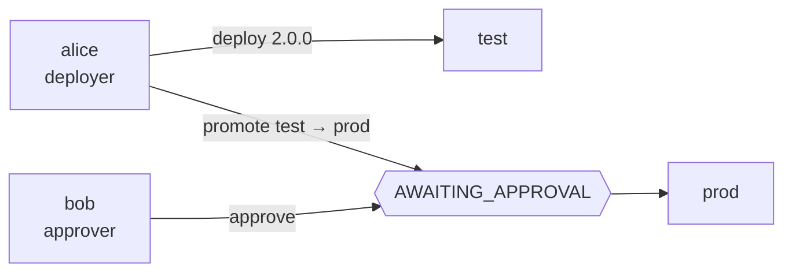

# 3. Promozione, approvazioni e freeze

!!! abstract "In questo tutorial"
    Aggiungi un ambiente `prod` e lo proteggi: ogni richiesta è autenticata, ogni identità ha un ruolo, la produzione riceve solo un artefatto già passato da `test`, una seconda persona approva e un freeze blocca i rilasci durante un incidente.

    **Tempo:** 25 minuti · **Serve:** il risultato del [tutorial 2](ambienti.md)



## 1. Due identità

Finora l'API accettava chiunque (`auth.mode: none`, identità `none:anonymous`). Crea due token statici, uno per Alice, che rilascia, e uno per Bob, che approva. manent ne conserva solo lo sha256:

```sh
openssl rand -hex 32 > lab/alice.token
openssl rand -hex 32 > lab/bob.token
printf '%s' "$(cat lab/alice.token)" | shasum -a 256   # sha256sum su Linux
printf '%s' "$(cat lab/bob.token)" | shasum -a 256
```

!!! note "Le persone accedono con OIDC"
    I token statici servono ai sistemi automatici come la CI. Le persone di solito accedono tramite un identity provider: vedi [Identity provider OIDC](../integrazioni/oidc.md). Le regole qui sotto valgono allo stesso modo per entrambi.

## 2. Ruoli e regole

Aggiungi autenticazione, permessi e una regola di governance a `manent.yml`:

```yaml title="manent.yml (aggiunta)"
auth:
  mode: enabled
  tokens:
    - {name: alice, sha256: "<sha256 di alice.token>", groups: [team-hello]}
    - {name: bob, sha256: "<sha256 di bob.token>", groups: [cab]}

rbac:
  bindings:
    - {groups: [team-hello], role: deployer, applications: ["hello"], environments: ["*"]}
    - {groups: [cab], role: approver, applications: ["*"], environments: [prod]}
    - {groups: [cab], role: release-manager, applications: ["*"], environments: [prod]}

governance:
  rules:
    - name: production
      applications: ["*"]
      environments: [prod]
      requires: [test]                     # lo stesso artefatto deve essere riuscito in test
      approvals: {required: 1, timeout: 24h}
```

- `deployer` può rilasciare, annullare e fare rollback, ma **non può approvare**: chi rilascia non deve potersi approvare da solo tramite un secondo ruolo.
- `approver` può solo leggere e approvare; `release-manager` può creare ed eliminare finestre di freeze.
- Per ogni deploy vale la **prima** regola che corrisponde. Senza regole corrispondenti non ci sono vincoli, ed è per questo che `test` resta libero.

## 3. L'ambiente di produzione

La produzione usa un'altra directory sullo stesso container e un proprio percorso in Vault:

```sh
sed -e 's#/opt/hello#/home/deploy/hello-prod#' -e 's#hello/test#hello/prod#' \
  envconfig/hello/test-consul.yml > envconfig/hello/prod-consul.yml
docker cp envconfig/hello/prod-consul.yml manent-tutorial-consul:/tmp/prod.yml
docker exec manent-tutorial-consul consul kv put manent/hello/hello/prod @/tmp/prod.yml

docker cp lab/deploy_key manent-tutorial-vault:/tmp/k
docker exec -e VAULT_ADDR=http://127.0.0.1:8200 -e VAULT_TOKEN=tutorial-root manent-tutorial-vault \
  vault kv put secret/hello/prod ssh_key=@/tmp/k
docker exec manent-tutorial-vault rm /tmp/k
```

Riavvia il server (`VAULT_TOKEN=tutorial-root manent-server -c manent.yml serve`) e verifica che le richieste anonime siano rifiutate:

```sh
manent list
```

```text
authentication required: provide a valid token (MANENT_TOKEN or --token-file)
```

D'ora in poi lavora come Alice, e guarda cosa può fare:

```sh
export MANENT_TOKEN_FILE=lab/alice.token
manent whoami
```

```json
{"subject": "token:alice", "method": "token", "groups": ["team-hello"], "auth_enabled": true,
 "grants": [{"role": "deployer", "actions": ["deployment.read", "schedule.read", "deployment.dry-run",
   "deployment.submit", "deployment.cancel", "deployment.rollback"], "applications": ["hello"], "environments": ["*"]}]}
```

## 4. La produzione riceve solo artefatti promossi

Costruisci una 2.0.0 e prova a mandarla direttamente in produzione:

```sh
sed -i.bak 's/1\.[01]\.0/2.0.0/' src/bin/hello
tar -czf dist/hello-2.0.0.tar.gz -C src .
sed 's/environment: test/environment: prod/' hello-min.yml > hello-prod.yml
manent deploy -f hello-prod.yml --version 2.0.0 --source "$PWD/dist/hello-2.0.0.tar.gz"
```

```text
invalid request: hello 2.0.0 was not released successfully in test: it must be promoted from there (governance)
```

Rilasciala prima in `test`, poi **promuovila**:

```sh
manent deploy -f hello-min.yml --version 2.0.0 --source "$PWD/dist/hello-2.0.0.tar.gz"
manent promote -a hello --from test --to prod --no-wait
```

```text
deploy awaiting approval: manent approve 7d817406-dae3-4a37-a382-5a078f2ea912
```

Nei comandi che seguono sostituisci `<id>` con l'ID stampato da `promote`.

Una promozione prende la richiesta dell'ultimo deploy riuscito in `test`, cambia l'ambiente e fissa `artifact.sha256` all'hash effettivamente rilasciato: lo step `qa` rifiuterà qualunque altro file. I target non vengono mai copiati: arrivano dalla configurazione di `prod`, insieme ai suoi parametri e segreti. Quello che il descrittore di origine impostava da sé viene invece copiato, quindi si possono promuovere solo le versioni rilasciate in `test` con il descrittore corto `hello-min.yml`: le versioni 1.x del [tutorial 1](primo-deploy.md), rilasciate con un descrittore che imposta `dest_dir` e la chiave, andrebbero in conflitto con la configurazione di `prod` (`environment configuration incompatible with the descriptor`). Se serve, `--deploy-file` sostituisce la sezione `deploy` del deploy di origine.

## 5. Quattro occhi

Alice non può approvare la propria promozione: il suo ruolo non lo consente, e anche con il permesso chi ha richiesto un deploy non può approvarlo.

```sh
manent approve <id> -m ok
```

```text
permission denied: token:alice cannot perform deployment.approve on hello/prod (artifact hello)
```

Bob vede la richiesta tra quelle su cui può decidere, e la approva citando il change:

```sh
MANENT_TOKEN_FILE=lab/bob.token manent approvals
MANENT_TOKEN_FILE=lab/bob.token manent approve <id> -m "CHG-1234"
```

Il deploy viene accodato con lo stesso ID e parte. Il suo stato conserva tutta la storia:

```sh
manent status <id> | jq -c '{state, kind, version, requested_by, approval: .approval.decisions}'
```

```json
{"state": "SUCCESS", "kind": "promotion", "version": "2.0.0", "requested_by": "token:alice",
 "approval": [{"approver": "token:bob", "approve": true, "comment": "CHG-1234", "time": "…"}]}
```

Entrambe le decisioni, quella negata e l'approvazione, sono anche nell'audit (`deployment.approve`), inviato al SIEM.

## 6. Congela la produzione durante un incidente

Una finestra di freeze blocca i deploy reali. Quelle configurate stanno in `governance.freezes` (per esempio ogni fine settimana); una di emergenza si crea a runtime, senza riavviare nulla, da un'identità con `freeze.write`:

```sh
MANENT_TOKEN_FILE=lab/bob.token manent freeze add --name incident-42 -e prod --for 2h --reason "incident 42 in progress"
manent promote -a hello --from test --to prod --version 2.0.0 --no-wait
```

```text
invalid request: deploy blocked by freeze "incident-42" until 2026-10-19T21:30:13+02:00 (incident 42 in progress); in an emergency set freezeOverride with the reason
```

Una correzione che deve uscire comunque usa `--freeze-override "<motivo>"`, che richiede il permesso `deployment.freeze-override` (di default solo `admin`), viene registrato nell'audit e non supera le finestre `--hard`. Finito l'incidente:

```sh
MANENT_TOKEN_FILE=lab/bob.token manent freeze delete incident-42
```

## Cosa hai imparato

- Con `auth.mode: enabled` ogni richiesta ha un'**identità**, e l'RBAC assegna **ruoli** per applicazione e ambiente.
- `requires` fa accettare alla produzione solo ciò che è già **riuscito altrove**, e `promote` rilascia esattamente quell'artefatto.
- Le **approvazioni** vengono da identità diverse dal richiedente, con commenti, scadenza e audit.
- Le **finestre di freeze** si configurano o si creano a runtime, e una deroga è esplicita, soggetta a permesso e registrata.

## Prossimo passo

- Ticket di change e approvazioni dalla chat: [ServiceNow](../integrazioni/servicenow.md), [Jira](../integrazioni/jira.md), [Slack](../integrazioni/slack.md).
- Regole scritte come codice, testate e approvate come codice: [Policy in Rego](../guida/policy.md).
- Il [tutorial 4](kubernetes.md) lascia SSH e rilascia su Kubernetes.
