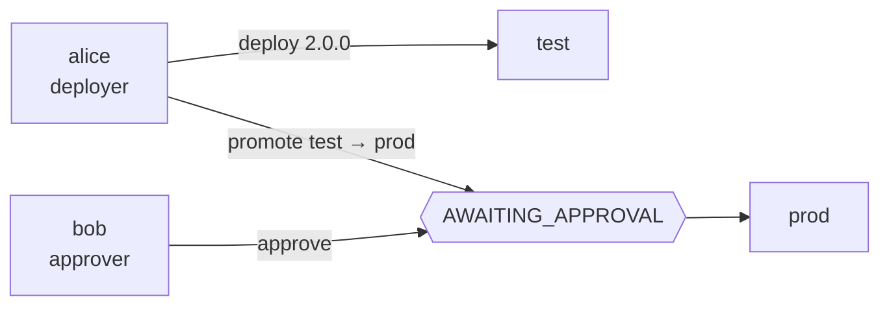

# 3. Promotion, approvals and freezes

!!! abstract "In this tutorial"
    You add a `prod` environment and protect it: every request is authenticated, each identity gets a role, production only receives an artifact that already passed through `test`, a second person approves, and a freeze blocks releases during an incident.

    **Time:** 25 minutes · **You need:** the result of [tutorial 2](ambienti.md)



## 1. Two identities

Until now the API accepted anyone (`auth.mode: none`, identity `none:anonymous`). Create two static tokens, one for Alice, who releases, and one for Bob, who approves. manent stores only their sha256:

```sh
openssl rand -hex 32 > lab/alice.token
openssl rand -hex 32 > lab/bob.token
printf '%s' "$(cat lab/alice.token)" | shasum -a 256   # sha256sum on Linux
printf '%s' "$(cat lab/bob.token)" | shasum -a 256
```

!!! note "Users sign in with OIDC"
    Static tokens are meant for automated systems such as CI. People normally sign in through an identity provider: see [OIDC identity providers](../integrazioni/oidc.md). The rules below apply in the same way to both.

## 2. Roles and rules

Add authentication, permissions and a governance rule to `manent.yml`:

```yaml title="manent.yml (addition)"
auth:
  mode: enabled
  tokens:
    - {name: alice, sha256: "<sha256 of alice.token>", groups: [team-hello]}
    - {name: bob, sha256: "<sha256 of bob.token>", groups: [cab]}

rbac:
  bindings:
    - {groups: [team-hello], role: deployer, applications: ["hello"], environments: ["*"]}
    - {groups: [cab], role: approver, applications: ["*"], environments: [prod]}
    - {groups: [cab], role: release-manager, applications: ["*"], environments: [prod]}

governance:
  rules:
    - name: production
      applications: ["*"]
      environments: [prod]
      requires: [test]                     # the same artifact must have succeeded in test
      approvals: {required: 1, timeout: 24h}
```

- `deployer` can deploy, cancel and roll back, but **cannot approve**: whoever releases must not be able to approve themselves through a second role.
- `approver` can only read and approve; `release-manager` can create and delete freeze windows.
- For each deploy the **first** matching rule applies. Without a matching rule there are no constraints, which is why `test` stays free.

## 3. The production environment

Production uses another directory on the same container and its own key path in Vault:

```sh
sed -e 's#/opt/hello#/home/deploy/hello-prod#' -e 's#hello/test#hello/prod#' \
  envconfig/hello/test-consul.yml > envconfig/hello/prod-consul.yml
docker cp envconfig/hello/prod-consul.yml manent-tutorial-consul:/tmp/prod.yml
docker exec manent-tutorial-consul consul kv put manent/hello/prod @/tmp/prod.yml

docker cp lab/deploy_key manent-tutorial-vault:/tmp/k
docker exec -e VAULT_ADDR=http://127.0.0.1:8200 -e VAULT_TOKEN=tutorial-root manent-tutorial-vault \
  vault kv put secret/hello/prod ssh_key=@/tmp/k
docker exec manent-tutorial-vault rm /tmp/k
```

Restart the server (`VAULT_TOKEN=tutorial-root manent-server -c manent.yml serve`) and check that anonymous requests are refused:

```sh
manent list
```

```text
authentication required: provide a valid token (MANENT_TOKEN or --token-file)
```

Work as Alice from now on, and look at what she can do:

```sh
export MANENT_TOKEN_FILE=lab/alice.token
manent whoami
```

```json
{"subject": "token:alice", "method": "token", "groups": ["team-hello"], "auth_enabled": true,
 "grants": [{"role": "deployer", "actions": ["deployment.read", "schedule.read", "deployment.dry-run",
   "deployment.submit", "deployment.cancel", "deployment.rollback"], "applications": ["hello"], "environments": ["*"]}]}
```

## 4. Production only receives promoted artifacts

Build a 2.0.0 and try to send it straight to production:

```sh
sed -i.bak 's/1\.[01]\.0/2.0.0/' src/bin/hello
tar -czf dist/hello-2.0.0.tar.gz -C src .
sed 's/environment: test/environment: prod/' hello-min.yml > hello-prod.yml
manent deploy -f hello-prod.yml --version 2.0.0 --source "$PWD/dist/hello-2.0.0.tar.gz"
```

```text
invalid request: hello 2.0.0 was not released successfully in test: it must be promoted from there (governance)
```

Release it to `test` first, then **promote** it:

```sh
manent deploy -f hello-min.yml --version 2.0.0 --source "$PWD/dist/hello-2.0.0.tar.gz"
manent promote -a hello --from test --to prod --no-wait
```

```text
deploy in attesa di approvazione: manent approve 7d817406-dae3-4a37-a382-5a078f2ea912
```

A promotion takes the request of the last successful deploy in `test`, changes the environment and pins `artifact.sha256` to the hash actually released: the `qa` step will refuse any other file. Targets and parameters come from the `prod` configuration, never from `test`.

## 5. Four eyes

Alice cannot approve her own promotion: her role does not allow it, and even with the permission the requester of a deploy cannot approve it.

```sh
manent approve 7d817406-dae3-4a37-a382-5a078f2ea912 -m ok
```

```text
permission denied: token:alice cannot perform deployment.approve on hello/prod
```

Bob sees the request among those he can decide, and approves it with a reference to the change:

```sh
MANENT_TOKEN_FILE=lab/bob.token manent approvals
MANENT_TOKEN_FILE=lab/bob.token manent approve 7d817406-dae3-4a37-a382-5a078f2ea912 -m "CHG-1234"
```

The deploy is enqueued with the same ID and runs. Its status keeps the whole story:

```sh
manent status 7d817406-dae3-4a37-a382-5a078f2ea912 | jq -c '{state, kind, version, requested_by, approval: .approval.decisions}'
```

```json
{"state": "SUCCESS", "kind": "promotion", "version": "2.0.0", "requested_by": "token:alice",
 "approval": [{"approver": "token:bob", "approve": true, "comment": "CHG-1234", "time": "…"}]}
```

Both decisions, the denied one and the approval, are also in the audit log (`deployment.approve`), sent to the SIEM.

## 6. Freeze production during an incident

A freeze window blocks real deploys. Configured ones live in `governance.freezes` (for example every weekend); an emergency one is created at runtime, without restarting anything, by an identity with `freeze.write`:

```sh
MANENT_TOKEN_FILE=lab/bob.token manent freeze add --name incident-42 -e prod --for 2h --reason "incident 42 in progress"
manent promote -a hello --from test --to prod --version 1.1.0 --no-wait
```

```text
invalid request: deploy blocked by freeze "incident-42" until 2026-10-19T21:30:13+02:00 (incident 42 in progress); in an emergency set freezeOverride with the reason
```

A fix that must go out anyway uses `--freeze-override "<reason>"`, which requires the `deployment.freeze-override` permission (only `admin` by default), is recorded in the audit log and does not bypass `--hard` windows. When the incident is over:

```sh
MANENT_TOKEN_FILE=lab/bob.token manent freeze delete incident-42
```

## What you learned

- With `auth.mode: enabled` every request has an **identity**, and RBAC grants **roles** per application and environment.
- `requires` makes production accept only what already **succeeded elsewhere**, and `promote` releases exactly that artifact.
- **Approvals** come from identities other than the requester, with comments, timeout and audit.
- **Freeze windows** can be configured or created at runtime, and an override is explicit, permissioned and recorded.

## Next

- Change tickets and approvals from chat: [ServiceNow](../integrazioni/servicenow.md), [Jira](../integrazioni/jira.md), [Slack](../integrazioni/slack.md).
- Rules written as code, tested and approved like code: [Policies in Rego](../guida/policy.md).
- [Tutorial 4](kubernetes.md) leaves SSH behind and releases to Kubernetes.
