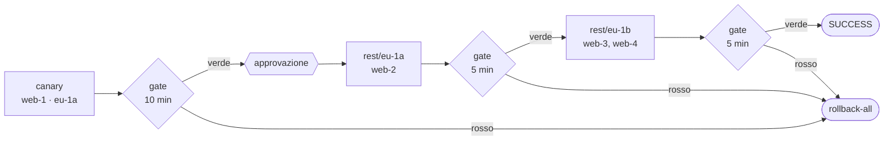

# 5. Rilascio progressivo con health gate

!!! abstract "In questo tutorial"
    Trasformi un deploy "tutto insieme" in uno progressivo: prima un nodo canary, poi una zona di disponibilità alla volta, con tempi di osservazione e un **health gate** su sonde HTTP e sul tasso di errori in Prometheus. Dopo il canary una persona approva; se il gate diventa rosso, tutti i nodi tornano alla release precedente.

    **Tempo:** 30 minuti · **Serve:** quattro server in due AZ raggiungibili via SSH (o il [laboratorio dei casi d'uso](../casi-uso.md)), Prometheus che legge le metriche dell'applicazione



!!! tip "Vederlo girare prima"
    Il laboratorio end-to-end esegue esattamente questo tipo di rollout su due region e cinque AZ, compresi un gate rosso e un rollback: `make test-usecases CASES="uc4 uc5"` (e `uc15` per l'analisi canary su Prometheus). Vedi [Casi d'uso](../casi-uso.md).

## 1. Descrivi la topologia con le etichette

Region e AZ non sono ambienti separati: sono **etichette** dei target di un solo ambiente, così governance, inventario e promozione continuano a ragionare su `prod`. `region` e `az` sono riservate; ogni altra etichetta (qui `canary`) è tua.

```yaml title="envconfig/hello/hello/prod.yml (target)"
plugin: remote-copy
targets:
  - {host: web-1.prod.internal, user: deploy, labels: {region: eu-1, az: eu-1a, canary: "true"}}
  - {host: web-2.prod.internal, user: deploy, labels: {region: eu-1, az: eu-1a}}
  - {host: web-3.prod.internal, user: deploy, labels: {region: eu-1, az: eu-1b}}
  - {host: web-4.prod.internal, user: deploy, labels: {region: eu-1, az: eu-1b}}
params:
  dest_dir: /opt/hello
  layout: releases
  ssh_key_secret: deploy-key
  prepare_command: 'tar -xzf "$MANENT_ARTIFACT" -C "$MANENT_RELEASE_DIR"'
  post_command: "sudo systemctl restart hello"
secrets:
  - {name: deploy-key, ref: "vault:secret/data/hello/prod#ssh_key"}
rollback:
  enabled: true
```

## 2. Definisci le ondate

La strategia sta nella stessa configurazione di ambiente, che è autorevole: i team applicativi non possono allentarla dal descrittore.

```yaml title="envconfig/hello/hello/prod.yml (rollout)"
rollout:
  waves:
    - {name: canary, select: "canary=true", bake: 10m}
    - {name: rest, select: "canary!=true", by: az, bake: 5m}
  maxUnavailable: 1               # un nodo alla volta dentro ogni AZ
  onFailure: rollback-all         # stop | rollback-wave | rollback-all
  approvalsBetween: [canary]      # dopo il canary decide una persona
  health:
    interval: 30s
    failuresToStop: 2             # due letture rosse di fila fermano il rollout
    probes:
      - {url: "http://{host}:8080/healthz"}
    metrics:
      - name: error-rate
        query: 'sum(rate(http_requests_total{app="{application}",code=~"5..",az="{az}"}[5m])) / sum(rate(http_requests_total{app="{application}",az="{az}"}[5m])) or vector(0)'
        max: 0.01
```

- `select` sceglie i target di un'ondata con condizioni sulle etichette; ogni target deve appartenere a una sola ondata.
- `by: az` divide l'ondata in uno **stadio** per AZ. Dentro uno stadio i target vengono aggiornati a lotti di `maxUnavailable`.
- Dopo ogni stadio il worker attende `bake`, leggendo il gate ogni `interval`. L'ultima lettura deve essere verde.
- `probes` chiamano ogni target dello stadio; l'URL deve iniziare con `http(s)://{host}`, quindi le sonde raggiungono solo i target.
- `metrics` esegue una query PromQL per stadio, con `{application}`, `{environment}`, `{region}` e `{az}` sostituiti. Una query **senza dati è rossa**: un gate che non vede traffico non può dire che la release è sana. `or vector(0)` accetta esplicitamente il silenzio.

`rollback-all` usa le stesse compensazioni del rollback automatico, quindi richiede `rollback.enabled` e, per `remote-copy`, `layout: releases`.

## 3. Collega Prometheus

```yaml title="manent.yml"
rollout:
  prometheus_url: http://prometheus.monitoring:9090
  alertmanager_url: http://alertmanager.monitoring:9093   # facoltativo, per health.alerts
  check_timeout: 30s
```

Senza `prometheus_url`, un rollout con metriche Prometheus viene rifiutato all'invio. Per usare invece Datadog, New Relic, Elastic, CloudWatch o Azure Monitor vedi [Sistemi di metriche](../integrazioni/metriche.md).

## 4. Verifica il piano

```sh
manent validate -f hello-prod.yml | jq '.rollout.stages[] | {name, hosts: [.passes[].hosts[]]}'
```

```json
{"name": "canary", "hosts": ["web-1.prod.internal"]}
{"name": "rest/eu-1a", "hosts": ["web-2.prod.internal"]}
{"name": "rest/eu-1b", "hosts": ["web-3.prod.internal", "web-4.prod.internal"]}
```

Il piano viene calcolato e verificato all'invio: un'ondata che non seleziona nulla, un target in due ondate o un `by: az` su target senza etichette danno `422`, prima di toccare qualunque cosa.

## 5. Rilascia e segui

```sh
manent deploy -f hello-prod.yml --no-wait
manent status <id> | jq '{state, rollout_progress, rollout: {status: .rollout.status, stage: .rollout.stage}}'
```

1. `secrets`, `artifacts` e `qa` girano **una volta**; gli step che toccano i target (da `deploy` ad `activation`) girano per ogni lotto, con il nome del passo e del lotto: `deploy@canary#0`.
2. Dopo il canary il gate legge sonde e metrica ogni 30 secondi per 10 minuti. Le attese sono durevoli: se il worker riparte, il tempo di osservazione già trascorso non si ripete.
3. Il rollout si mette in pausa: `rollout.status` è `paused-approval` e il deploy appare come `AWAITING_APPROVAL`. Una persona con `deployment.approve` (non il richiedente) lo fa proseguire:

    ```sh
    manent approve <id> -m "il canary è a posto"
    ```

4. L'ondata `rest` procede AZ per AZ, con i suoi gate. Alla fine il deploy è `SUCCESS` e `rollout_progress` è `3/3`.

L'interfaccia web mostra le stesse informazioni in tempo reale: stadi, passi, il gate di ogni stadio e il pulsante di approvazione.

## 6. Quando il gate diventa rosso

Supponi che la 1.3.0 aumenti il tasso di errori in `eu-1a`. Alla seconda lettura rossa consecutiva lo stadio fallisce, e lo stato dice perché:

```json
{
  "state": "ERROR",
  "rollout_progress": "1/3",
  "rollout": {
    "status": "failed",
    "stage": "rest/eu-1a",
    "on_failure": "rollback-all",
    "stages": [
      {"name": "canary", "state": "succeeded"},
      {"name": "rest/eu-1a", "state": "failed", "gate": "metric error-rate (eu-1/eu-1a): valore 0.034 fuori soglia"},
      {"name": "rest/eu-1b", "state": "pending"}
    ]
  }
}
```

Con `rollback-all` lo stadio fallito e il canary tornano alla release precedente, in ordine inverso; `eu-1b` non è mai stata toccata. Con `stop` i nodi già aggiornati resterebbero sulla 1.3.0, e l'[inventario](../guida/governance.md#inventario) segnalerebbe `drift`.

## Per andare oltre

| Esigenza | Usa |
|---|---|
| Verificare ogni lotto, non solo l'intera AZ | `waves[].batchBake` ([gate per lotto](../guida/ondate.md#gate-per-lotto)) |
| Lotti di dimensioni diverse per ondata | `waves[].maxUnavailable` |
| Togliere ogni lotto dal load balancer | `traffic.pool` ([Svuotamento dal load balancer](../guida/svuotamento.md)) |
| Region con reti separate | `dbos.region` e `dbos.region_routing` ([esecuzione nelle region](../guida/ondate.md#esecuzione-nelle-region)) |
| Un freeze su una sola region | `regions` nella finestra di freeze: il rollout si ferma prima di quella region |
| Spostare una percentuale di traffico invece dei nodi | `strategy: traffic` ([Rilasci per percentuale](../guida/traffico.md)), con analisi canary statistica |

## Cosa hai imparato

- La topologia si esprime con le **etichette**, e un rollout è **ondate → stadi → passi → lotti**.
- Un **health gate** combina sonde, metriche e allarmi, e considera rossa l'assenza di dati.
- **Approvazioni** e **freeze** possono fermare un rollout tra un'ondata e l'altra.
- `onFailure` decide cosa succede agli stadi già rilasciati.

## Prossimo passo

Il [tutorial 6](ci.md) rilascia da una pipeline di CI.
