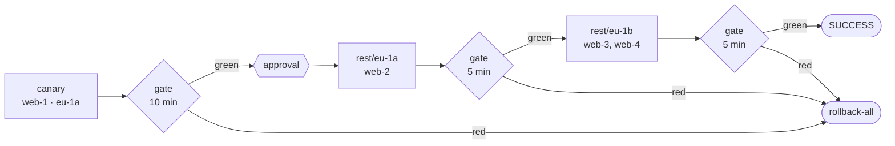

# 5. Progressive rollout with health gates

!!! abstract "In this tutorial"
    You turn an all-at-once deploy into a progressive one: a canary node first, then one availability zone at a time, with bake times and a **health gate** on HTTP probes and a Prometheus error rate. After the canary a person approves; if the gate turns red, every node goes back to the previous release.

    **Time:** 30 minutes · **You need:** four servers in two AZs reachable over SSH (or the [use case lab](../casi-uso.md)), Prometheus scraping your application



!!! tip "See it run first"
    The end-to-end lab runs exactly this kind of rollout across two regions and five AZs, including a red gate and a rollback: `make test-usecases CASES="uc4 uc5"` (and `uc15` for canary analysis on Prometheus). See [Use cases](../casi-uso.md).

## 1. Describe the topology with labels

Regions and AZs are not separate environments: they are **labels** of the targets of one environment, so governance, inventory and promotion keep reasoning about `prod`. `region` and `az` are reserved; any other label (here `canary`) is yours.

```yaml title="envconfig/hello/hello/prod.yml (targets)"
plugin: remote-copy
targets:
  - {host: web-1.prod.internal, user: deploy, labels: {region: eu-1, az: eu-1a, canary: "true"}}
  - {host: web-2.prod.internal, user: deploy, labels: {region: eu-1, az: eu-1a}}
  - {host: web-3.prod.internal, user: deploy, labels: {region: eu-1, az: eu-1b}}
  - {host: web-4.prod.internal, user: deploy, labels: {region: eu-1, az: eu-1b}}
params:
  dest_dir: /opt/hello
  layout: releases
  ssh_key_secret: deploy-key
  prepare_command: 'tar -xzf "$MANENT_ARTIFACT" -C "$MANENT_RELEASE_DIR"'
  post_command: "sudo systemctl restart hello"
secrets:
  - {name: deploy-key, ref: "vault:secret/data/hello/prod#ssh_key"}
rollback:
  enabled: true
```

## 2. Define the waves

The strategy lives in the same environment configuration, which is authoritative: application teams cannot loosen it from the descriptor.

```yaml title="envconfig/hello/hello/prod.yml (rollout)"
rollout:
  waves:
    - {name: canary, select: "canary=true", bake: 10m}
    - {name: rest, select: "canary!=true", by: az, bake: 5m}
  maxUnavailable: 1               # one node at a time within each AZ
  onFailure: rollback-all         # stop | rollback-wave | rollback-all
  approvalsBetween: [canary]      # a person decides after the canary
  health:
    interval: 30s
    failuresToStop: 2             # two red readings in a row stop the rollout
    probes:
      - {url: "http://{host}:8080/healthz"}
    metrics:
      - name: error-rate
        query: 'sum(rate(http_requests_total{app="{application}",code=~"5..",az="{az}"}[5m])) / sum(rate(http_requests_total{app="{application}",az="{az}"}[5m])) or vector(0)'
        max: 0.01
```

- `select` picks the targets of a wave with label conditions; every target must belong to exactly one wave.
- `by: az` splits the wave into one **stage** per AZ. Within a stage, targets are updated in batches of `maxUnavailable`.
- After every stage the worker waits `bake`, reading the gate every `interval`. The last reading must be green.
- `probes` call every target of the stage; the URL must start with `http(s)://{host}`, so probes can only reach the targets.
- `metrics` run a PromQL query per stage, with `{application}`, `{environment}`, `{region}` and `{az}` substituted. A query with **no data is red**: a gate that sees no traffic cannot say the release is healthy. `or vector(0)` accepts silence explicitly.

`rollback-all` uses the same compensations as automatic rollback, so it requires `rollback.enabled` and, for `remote-copy`, `layout: releases`.

## 3. Connect Prometheus

```yaml title="manent.yml"
rollout:
  prometheus_url: http://prometheus.monitoring:9090
  alertmanager_url: http://alertmanager.monitoring:9093   # optional, for health.alerts
  check_timeout: 30s
```

Without `prometheus_url`, a rollout with Prometheus metrics is rejected at submission. To use Datadog, New Relic, Elastic, CloudWatch or Azure Monitor instead, see [Metrics systems](../integrazioni/metriche.md).

## 4. Check the plan

```sh
manent validate -f hello-prod.yml | jq '.rollout.stages[] | {name, hosts: [.passes[].hosts[]]}'
```

```json
{"name": "canary", "hosts": ["web-1.prod.internal"]}
{"name": "rest/eu-1a", "hosts": ["web-2.prod.internal"]}
{"name": "rest/eu-1b", "hosts": ["web-3.prod.internal", "web-4.prod.internal"]}
```

The plan is computed and checked at submission: a wave that selects nothing, a target in two waves or a `by: az` on targets without labels is a `422`, before anything is touched.

## 5. Release and follow

```sh
manent deploy -f hello-prod.yml --no-wait
manent status <id> | jq '{state, rollout_progress, rollout: {status: .rollout.status, stage: .rollout.stage}}'
```

1. `secrets`, `artifacts` and `qa` run **once**; the steps that touch targets (`deploy` to `activation`) run for every batch, named after the pass and the batch: `deploy@canary#0`.
2. After the canary, the gate reads probes and the metric every 30 seconds for 10 minutes. Waits are durable: if the worker restarts, the elapsed bake time is not repeated.
3. The rollout pauses: `rollout.status` is `paused-approval` and the deploy shows as `AWAITING_APPROVAL`. Someone with `deployment.approve` (not the requester) continues it:

    ```sh
    manent approve <id> -m "canary looks good"
    ```

4. The `rest` wave proceeds AZ by AZ, with its gates. At the end the deploy is `SUCCESS` and `rollout_progress` is `3/3`.

The web interface shows the same thing live: stages, passes, the gate of each stage and the approval button.

## 6. When the gate turns red

Suppose 1.3.0 raises the error rate in `eu-1a`. At the second consecutive red reading the stage fails, and the status says why:

```json
{
  "state": "ERROR",
  "rollout_progress": "1/3",
  "rollout": {
    "status": "failed",
    "stage": "rest/eu-1a",
    "on_failure": "rollback-all",
    "stages": [
      {"name": "canary", "state": "succeeded"},
      {"name": "rest/eu-1a", "state": "failed", "gate": "metric error-rate (eu-1/eu-1a): valore 0.034 fuori soglia"},
      {"name": "rest/eu-1b", "state": "pending"}
    ]
  }
}
```

With `rollback-all` the failed stage and the canary go back to the previous release, in reverse order; `eu-1b` was never touched. With `stop` the nodes already updated would stay on 1.3.0, and the [inventory](../guida/governance.md#inventario) would report `drift`.

## Going further

| Need | Use |
|---|---|
| Check every batch, not only the whole AZ | `waves[].batchBake` ([batch gate](../guida/ondate.md#batch-gate)) |
| Different batch sizes per wave | `waves[].maxUnavailable` |
| Take each batch out of the load balancer | `traffic.pool` ([Load balancer draining](../guida/svuotamento.md)) |
| Regions with separate networks | `dbos.region` and `dbos.region_routing` ([running in the regions](../guida/ondate.md#esecuzione-nelle-region)) |
| A freeze on one region only | `regions` in the freeze window: the rollout pauses before that region |
| Shift a percentage of traffic instead of nodes | `strategy: traffic` ([Percentage rollouts](../guida/traffico.md)), with statistical canary analysis |

## What you learned

- Topology is expressed with **labels**, and a rollout is **waves → stages → passes → batches**.
- A **health gate** combines probes, metrics and alerts, and treats no data as red.
- **Approvals** and **freezes** can stop a rollout between waves.
- `onFailure` decides what happens to the stages already released.

## Next

[Tutorial 6](ci.md) releases from a CI pipeline.
