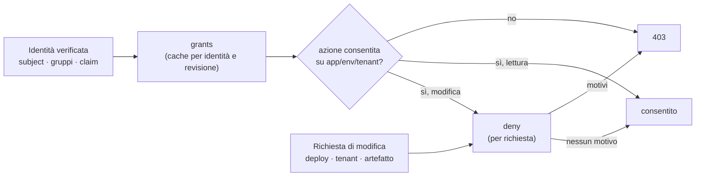

# Design: permessi (RBAC) e tenant come policy Rego

| | |
|---|---|
| Stato | Implementato (decisioni in §19, differenze in §20) |
| Data | 2026-10-19 |
| Ambito | `internal/authz`, `internal/policy`, `internal/auth`, `internal/app`, `internal/api`, CLI, interfaccia web |
| Prerequisiti | [Governance con OPA](governance-opa.md) (motore, revisioni, sorgenti, quattro occhi), [Tenant](tenant.md) (registro, tag, binding con `tenants`) |

## 1. Contesto

I permessi oggi sono dichiarati in `manent.yml` (`rbac.roles`, `rbac.bindings`) e applicati da `authz.Policy`:

- un **binding** assegna un **ruolo** (un insieme di azioni) a `subjects` o `groups`, su pattern di `applications` ed `environments` e, dal lavoro sui tenant, su un selettore `tenants` (tag e nome);
- un'azione è consentita se almeno un binding la concede; non esistono regole di divieto;
- le azioni di piattaforma (`platform.read`, `policy.*`) valgono se un binding qualunque le concede (`AllowedAnywhere`).

Il modello ha gli stessi limiti che la governance aveva prima di Rego:

1. **Ciclo di vita.** Aggiungere un team, dare accesso temporaneo a un consulente o togliere un permesso richiede di modificare `manent.yml` su tutti i nodi e riavviarli. Non c'è storico delle modifiche, né revisione da parte di una seconda persona, né un modo per vedere prima chi guadagna o perde accessi.
2. **Espressività.** Un binding dipende solo da identità, applicazione, ambiente e tag del tenant. Non si può dire, per esempio:
    - "i consulenti esterni (`employee_type=contractor`) non rilasciano mai in produzione, qualunque gruppo abbiano";
    - "il team che possiede un tenant (tag `owner`) rilascia quel tenant", senza un binding per team;
    - "le migrazioni (`artifact.type: migration`) in produzione le rilascia solo il gruppo DBA";
    - "il gruppo on-call può annullare e fare rollback in produzione solo durante il proprio turno";
    - "un rollback manuale è consentito anche a chi ha solo `deployer` in staging, se il deploy da annullare è suo".

Il design della governance (§10, §13) ha previsto l'RBAC in Rego come estensione, con due vincoli: le azioni `policy.*` restano statiche, e gli elenchi (`List`, che controlla molte righe) non devono diventare lenti. Questo documento li rispetta.

## 2. Obiettivi e non obiettivi

**Obiettivi**

- Un motore selezionabile: `rbac.engine: builtin` (oggi, default) oppure `opa`.
- Con `opa`, i permessi sono una policy Rego nella **stessa revisione** della governance: stesso store, stesse sorgenti (`store`, `file`, `bundle`, `consul`), stessi test, stessa approvazione a quattro occhi, stesso storico e stesso ritorno a una revisione precedente.
- Una **policy predefinita** che riproduce esattamente `rbac.roles` e `rbac.bindings`: passare a `opa` senza scrivere Rego non cambia nulla.
- I **tenant** nell'input: nome e tag dal registro, così i permessi possono dipendere dai tag senza un binding per tenant.
- **Prestazioni** degli elenchi uguali a oggi.
- `Me` e l'interfaccia web continuano a sapere cosa mostrare.

**Non obiettivi**

- Spostare in Rego le azioni `policy.read`, `policy.write`, `policy.approve` e il break-glass: restano decise da `rbac.bindings` di `manent.yml`, così una revisione non può concedersi permessi da sola (separazione dei poteri).
- Spostare in Rego l'autenticazione (verifica dei token, OIDC): la policy riceve un'identità già verificata.
- Spostare in Rego il registro dei tenant: resta nel provider della configurazione di ambiente (file, Consul).
- La `descriptor_policy` in Rego: possibile in seguito con lo stesso meccanismo (§17).

## 3. Dove si decide oggi

| Punto | Codice | Domanda | Frequenza |
|---|---|---|---|
| Ogni metodo del servizio | `Guard` → `Policy.AllowedFor` | l'identità può fare l'azione su app/env/tenant? | una o poche volte per richiesta |
| Elenchi (`List`, `Inventory`, `Activity`, `DORA`, `Approvals`, `Tenants`) | `ListFilter.Match` → `AllowedFor` | per ogni riga: `deployment.read` | fino a `maxListScan` righe per richiesta |
| Azioni di piattaforma | `AllowedAnywhere` | l'identità ha l'azione in qualche binding? | una per richiesta |
| Identità e permessi per l'interfaccia | `Guard.Me` | elenco dei binding dell'identità (`Grant`) | a ogni caricamento dell'interfaccia |
| Approvazioni da Slack | `chat.Interactions` → `Guard.Decide` | come la API | per clic |
| Freeze a runtime | `checkFreeze` | `freeze.write` su ogni coppia di pattern | per richiesta |

Due osservazioni guidano la proposta:

- la stragrande maggioranza delle verifiche sono **letture** dentro elenchi, e dipendono solo da identità, applicazione, ambiente e tenant;
- l'interfaccia web e la CLI hanno bisogno di un **elenco enumerabile** dei permessi (`Me.Grants`): una funzione `allow(identità, azione, risorsa)` non basta per sapere "dove posso fare cosa".

## 4. Proposta in sintesi

La policy dei permessi ha due parti, valutate in momenti diversi:

1. **`grants`**: a partire dall'**identità** (soggetto, metodo, gruppi, claim ammessi) e dall'istante, la policy produce l'elenco dei permessi, nella stessa forma dei binding di oggi: azioni, pattern di applicazioni e ambienti, selettore dei tenant. manent li valuta con lo stesso codice dei binding YAML. Si calcolano **una volta per identità e revisione** (con una cache breve), quindi gli elenchi costano come oggi e `Me` li restituisce così come sono.
2. **`deny`**: regole facoltative valutate **per richiesta**, solo sulle **azioni che modificano** (accodare, annullare, rollback, approvare, freeze, schedule), con l'input completo della richiesta: tenant con i tag, tipo di deploy, tipo e versione dell'artefatto, richiedente del deploy su cui si agisce. Un divieto vince su qualunque permesso.



## 5. Modello

### 5.1 Grants

```text
data.manent.authz.grants  →  array di grant
```

**Input**

```json
{
  "schema": 1,
  "now": "2026-10-19T09:00:00Z",
  "identity": {
    "subject": "oidc:alice",
    "method": "oidc",
    "name": "alice",
    "groups": ["team-shop", "oncall"],
    "claims": {"employee_type": "contractor", "department": "payments"}
  }
}
```

- `claims` contiene solo i claim del token elencati in `auth.oidc.policy_claims` (default `[email, name]`): i token possono contenere altri dati personali che la policy non deve vedere né registrare.
- I token statici hanno `method: token`, `name` e `groups` dalla configurazione, nessun claim.

**Output**

```json
[
  {"name": "team-shop", "actions": ["deployment.read", "deployment.submit"], "applications": ["shop-*"], "environments": ["dev", "test"]},
  {"name": "oncall", "role": "operator", "applications": ["*"], "environments": ["prod"], "until": "2026-10-19T18:00:00Z"},
  {"name": "owned-tenants", "role": "deployer", "applications": ["shop"], "environments": ["prod"], "tenants": "owner=team-shop"}
]
```

| Campo | Note |
|---|---|
| `name` | Etichetta mostrata in `Me` e nell'audit (al posto del nome del ruolo). |
| `role` o `actions` | Un ruolo (predefinito o di `data.manent.rbac.roles`) oppure un elenco di azioni. Le azioni `policy.*` sono **scartate** con un avviso: le decide solo la configurazione statica (§7). |
| `applications`, `environments` | Pattern con `*`, obbligatori come nei binding. |
| `tenants` | Selettore sui tag e sul nome del tenant, come nei binding. Assente: tutti i deploy. |
| `until` | Facoltativo: il grant scade a quell'istante, anche se è ancora in cache. Serve ai turni e agli accessi temporanei. |

La valutazione dei grant avviene come oggi in `Policy.AllowedFor`, `AllowedAnywhere` e `Me`: cambia solo la loro provenienza.

**Esempio: il team che possiede un tenant.** Con il tag `owner` nel registro dei tenant, un solo grant copre tutti i tenant di ogni team, senza un binding per cliente:

```rego
package manent.authz

import data.manent.lib

grants contains g if {
	some group in input.identity.groups
	startswith(group, "team-")
	g := {
		"name": sprintf("owner %s", [group]),
		"role": "deployer",
		"applications": ["*"],
		"environments": ["*"],
		"tenants": sprintf("owner=%s", [group]),
	}
}
```

### 5.2 Deny

```text
data.manent.authz.deny  →  insieme di motivi (stringhe o {code, message})
```

Valutato solo dopo che i grant consentono l'azione, e solo per le azioni che modificano: `deployment.submit`, `deployment.dry-run`, `deployment.cancel`, `deployment.rollback`, `deployment.approve`, `deployment.freeze-override`, `schedule.write`, `freeze.write`.

**Input**

```json
{
  "schema": 1,
  "now": "2026-10-19T09:00:00Z",
  "identity": {"subject": "oidc:alice", "method": "oidc", "groups": ["team-shop"], "claims": {"employee_type": "contractor"}},
  "action": "deployment.submit",
  "resource": {
    "application": "shop",
    "environment": "prod",
    "tenant": {"name": "acme", "tags": {"tier": "gold", "owner": "team-shop"}},
    "deployment": {
      "id": "shop-1.4.0-prod",
      "kind": "deploy",
      "dry_run": false,
      "artifact": {"type": "application", "name": "shop", "version": "1.4.0"},
      "requested_by": "oidc:alice"
    }
  }
}
```

- `resource.deployment` è presente quando l'azione riguarda un deploy: per `submit` è la richiesta, per `cancel`, `rollback` e `approve` è il deploy esistente (lo stato già letto dal Guard).
- Come nella governance, l'input non contiene segreti né parametri dei plugin.

**Esempi**

```rego
package manent.authz

# Contractors never change production.
deny contains "contractors cannot change production" if {
	input.identity.claims.employee_type == "contractor"
	startswith(input.resource.environment, "prod")
}

# Database migrations in production: DBA only.
deny contains "migrations in production are released by the DBA group" if {
	input.action == "deployment.submit"
	input.resource.deployment.artifact.type == "migration"
	startswith(input.resource.environment, "prod")
	not "dba" in input.identity.groups
}
```

Il motivo arriva nella risposta `403` e nell'audit, insieme alla revisione.

### 5.3 Perché due parti

| Alternativa | Problema |
|---|---|
| Solo `allow(identità, azione, risorsa)` per ogni verifica | Gli elenchi valutano la policy per ogni riga (centinaia di valutazioni a richiesta); `Me` non può enumerare "dove posso fare cosa", quindi l'interfaccia non sa quali pulsanti mostrare. |
| Partial evaluation di OPA per ricavare un filtro | Possibile, ma complessa da tradurre in un filtro sulle righe di DBOS e fragile rispetto a policy scritte liberamente. |
| Solo `grants` | Non esprime condizioni sulla richiesta (tipo di artefatto, autore del deploy, claim): sarebbero solo i binding YAML spostati. |

Con le due parti le letture restano veloci e enumerabili, mentre le condizioni ricche si applicano dove contano: alle modifiche, che sono poche.

## 6. La configurazione YAML come dati

Come le regole di governance diventano `data.manent.rules`, la configurazione RBAC diventa dati della revisione quando la revisione non li definisce:

```text
data.manent.rbac.roles     ← rbac.roles (più i ruoli predefiniti)
data.manent.rbac.bindings  ← rbac.bindings
```

Una revisione **senza** `package manent.authz` riceve il modulo predefinito `rego/authz_default.rego`, che trasforma in grant i binding che corrispondono all'identità:

```rego
package manent.authz

import data.manent.lib

grants contains g if {
	some i, b in data.manent.rbac.bindings
	lib.binding_matches(b, input.identity)
	g := object.union({"name": sprintf("binding %d", [i]), "role": b.role,
		"applications": b.applications, "environments": b.environments},
		lib.optional("tenants", b))
}

deny := set()
```

Quindi:

- con `rbac.engine: opa` e nessun Rego scritto, i permessi sono identici a quelli di `builtin` (un test di equivalenza su identità, azioni e risorse generate lo garantisce, come per le regole di governance);
- chi vuole partire dalla configurazione attuale può scrivere un `package manent.authz` che usa `data.manent.rbac` e aggiunge eccezioni, oppure portare i binding nei dati della revisione (`data.json`) e smettere di cambiarli in `manent.yml`.

## 7. Separazione dei poteri

| Azione | Chi decide con `rbac.engine: opa` |
|---|---|
| `policy.read`, `policy.write`, `policy.approve` | Solo `rbac.bindings` di `manent.yml` (motore `builtin`), sempre. |
| `manent-server admin …` (break-glass) | Chi ha accesso al database, come oggi (`cli:<utente>`), fuori dal Guard. |
| Tutte le altre | La revisione attiva. |

Conseguenze:

- una revisione che concede `policy.approve` non ha effetto: il grant viene scartato e la compilazione lo segnala come avviso;
- una revisione che toglie tutti i permessi non blocca chi deve correggerla: chi ha `policy.*` in `manent.yml` può ancora spingere, approvare e attivare una revisione nuova, o tornare a una precedente;
- la configurazione minima per adottare `opa` è quindi un binding statico per i release manager della piattaforma (`policy.*`), il resto può vivere in Rego.

## 8. Valutazione, cache e prestazioni

| Verifica | Valutazione |
|---|---|
| `Allowed`/`AllowedFor` di una lettura | grant in cache, nessuna valutazione Rego |
| `Allowed`/`AllowedFor` di una modifica | grant in cache + una valutazione di `deny` |
| `AllowedAnywhere`, `Me` | grant in cache |
| Elenchi | grant in cache, per ogni riga lo stesso confronto di pattern di oggi |

- **Cache dei grant:** chiave = revisione + hash dell'identità (soggetto, gruppi, claim ammessi); scadenza `rbac.opa.cache` (default 30s), e comunque al primo `until` raggiunto. Una nuova revisione invalida la cache. Dimensione massima configurabile (default 10.000 identità, LRU).
- **Costo di `deny`:** una valutazione preparata richiede decine di microsecondi; con il timeout della governance (200 ms) un errore non blocca il server.
- **Per processo:** la cache è in memoria in ogni processo API; i worker non valutano permessi (le decisioni si prendono al submit, come oggi).

## 9. Disponibilità e fail-closed

| Situazione | Effetto |
|---|---|
| Nessuna revisione caricata (avvio, sorgente irraggiungibile oltre `max_staleness`) | Tutte le azioni non statiche sono negate con `503` (`service.ErrUnavailable`); le azioni `policy.*` funzionano, così si può caricare o attivare una revisione. `/readyz` 503 come per la governance. |
| Errore di valutazione dei grant (timeout, tipo sbagliato) | Nessun grant per quell'identità: tutto negato, con l'errore nel log e nella metrica. |
| Errore di valutazione di `deny` | Azione negata (`403` con `policy evaluation failed`). |
| Grant non validi (ruolo sconosciuto, pattern mancanti) | Scartati uno per uno, con avviso nel log e nella metrica; gli altri valgono. Alla compilazione, sugli input di esempio, sono errori. |

## 10. Compilazione, test e strumenti

- **Compilazione:** una revisione deve produrre grant validi e un `deny` valutabile sugli input di esempio (identità con e senza gruppi, ogni azione, risorse con e senza tenant). I test `*_test.rego` coprono anche `manent.authz`.
- **Libreria:** `lib.binding_matches`, `lib.glob_any`, `lib.tenant_matches` (già presente per la governance), stesse restrizioni (Rego v1 strict, nessun built-in non deterministico, nessun `http.send`).
- **Simulazione:** `manent policy access <revisione> --subject oidc:alice --group team-shop [--claim k=v]` mostra i grant e, con `--action … -a … -e … [-t tenant] [-f deploy.yml]`, l'esito e i motivi. API `POST /api/v1/policies/{revision}/access` (permesso `policy.write`). Nell'interfaccia, una scheda **Accessi** nella pagina Policy.
- **Impatto:** `manent policy access <revisione> --compare` (e la scheda Accessi) mostra, per le identità indicate, i grant guadagnati e persi rispetto alla revisione attiva (§11).
- **Esportazione:** `manent-server policy export-rbac -c manent.yml -d dir` scrive `data.json` con `manent.rbac` e un `authz.rego` di partenza, per chi vuole spostare i binding nella revisione.

## 11. Identità per l'impatto

manent **non conserva** identità, gruppi o claim per calcolare l'impatto sugli accessi (decisione §19, la scelta più sicura): l'impatto di una revisione sui permessi si calcola solo sulle identità inserite a mano nella simulazione (`policy access`, scheda Accessi), con soggetto, gruppi e claim indicati da chi la esegue. Nessuna tabella nuova, nessun dato personale in più nel database.

## 12. Audit e osservabilità

- Le voci di audit `denied` riportano la revisione (`authz_revision`) e i motivi di `deny`; le modifiche consentite riportano la revisione e il nome del grant che le ha concesse.
- Metriche: `manent_authz_grants_evaluations_total{outcome}`, `manent_authz_deny_evaluations_total{action, outcome}`, `manent_authz_cache_entries`, `manent_authz_eval_duration_seconds{part}`, `manent_authz_invalid_grants_total`.
- `Me` riporta `authz_engine` e `authz_revision`, e i grant con il loro `name`.

## 13. Interfaccia, CLI e API

- **`Me`/`whoami`:** stessa forma di oggi (`grants` con azioni e pattern), più `name` e `until`; l'interfaccia web continua a usare `can`/`canSomewhere` senza modifiche.
- **Pagina Policy:** scheda Accessi (simulazione per identità) e, nell'impatto di una revisione, grant guadagnati e persi.
- **Errori:** un `403` per `deny` riporta il motivo: `permission denied: oidc:alice cannot perform deployment.submit on shop/prod: contractors cannot change production (policy 14:3f2a9c1e5b7d)`.

## 14. Configurazione

```yaml title="manent.yml"
auth:
  oidc:
    policy_claims: [email, name, employee_type]   # claim esposti alla policy (default [email, name])
rbac:
  engine: opa                 # builtin (default) | opa (richiede governance.engine: opa)
  opa:
    cache: 30s
    cache_size: 10000
  roles: {}                   # data.manent.rbac.roles se la revisione non li definisce
  bindings:                   # policy.* sempre da qui; il resto solo se la revisione non definisce manent.authz
    - {groups: [platform-release], role: admin, applications: ["*"], environments: ["*"]}
```

`rbac.engine: opa` richiede `governance.engine: opa`: le due policy condividono revisioni, sorgente e ciclo di vita, e una revisione si approva una volta sola.

## 15. Compatibilità e migrazione

- **Default invariato:** senza `rbac.engine` tutto resta come oggi.
- **Passaggio a `opa`:** con la policy predefinita i permessi non cambiano (test di equivalenza). Poi si scrive `package manent.authz` in una nuova revisione, la si prova con `policy access` e `impact`, e la si attiva con l'approvazione di una seconda persona.
- **Ritorno a `builtin`:** basta cambiare `rbac.engine` e riavviare: i binding YAML sono sempre lì.
- **Client:** nessun cambiamento per CLI, API, interfaccia web, GitHub Action e provider Terraform: cambiano solo le decisioni del server.
- **Versione dei workflow:** invariata; i permessi si decidono nell'API, fuori dai workflow.

## 16. Fasi

1. **Astrazione, senza cambio di comportamento:** `authz.Authorizer` (grant per identità, deny per richiesta) con l'implementazione `builtin` sui binding di oggi; `Guard` usa solo l'interfaccia; `Me` dai grant.
2. **Grant in Rego:** query `data.manent.authz.grants` nelle revisioni, dati `manent.rbac`, modulo predefinito con test di equivalenza, cache, separazione dei poteri, fail-closed, metriche, `rbac.engine: opa`.
3. **Deny e claim:** `data.manent.authz.deny` sulle azioni di modifica, `resource.deployment`, `auth.oidc.policy_claims`, audit con motivi e revisione.
4. **Strumenti:** `policy access` (CLI, API, scheda Accessi) con l'impatto sugli accessi delle identità indicate, `export-rbac`, documentazione utente in inglese e italiano, caso d'uso UC25 (contractor bloccato in produzione, team proprietario dei tenant via tag `owner`, accesso on-call con `until`, revisione che toglie tutto e viene corretta da chi ha `policy.*` statico).

## 17. Estensioni successive

- **`descriptor_policy` in Rego** (`data.manent.descriptor.deny`), con lo stesso meccanismo e gli stessi dati.
- **Deny sulle letture**, per casi come "i dati di un cliente li vede solo il suo team": richiederebbe una valutazione per riga negli elenchi, con una cache per (identità, risorsa).
- **Grant da dati esterni** (un elenco di turni on-call aggiornato da un "data provider", come previsto per la governance), senza `http.send` nella valutazione.

## 18. Alternative scartate

| Alternativa | Motivo |
|---|---|
| OPA esterno come sidecar o servizio | Latenza di rete su ogni verifica (e su ogni riga degli elenchi), un componente in più da gestire, nessun accesso allo store delle revisioni di manent. |
| Cedar o un altro linguaggio | Un secondo motore e un secondo ciclo di vita accanto a Rego, già usato per la governance. |
| Permessi in Consul come dati, senza Rego | Risolve il ciclo di vita ma non l'espressività, e non ha revisione a quattro occhi. |
| Spostare anche `policy.*` in Rego | Una revisione potrebbe concedersi l'approvazione delle revisioni successive (vedi §7). |

## 19. Decisioni (domande aperte risolte il 2026-10-19)

1. **Claim esposti:** `auth.oidc.policy_claims` ha default `[email, name]`.
2. **Identità viste:** nessuna tabella delle identità; l'impatto sugli accessi usa solo identità inserite a mano nella simulazione (§11).
3. **`platform.read` e `freeze.write`:** restano in Rego; solo `policy.*` è statica.
4. **Ritardo della revoca:** la cache di 30 secondi basta; nessun comando `flush` (una nuova revisione invalida comunque la cache).
5. **`until` e orologi:** l'orologio dell'API è sufficiente.

## 20. Note di implementazione

Differenze rispetto al progetto, decise durante l'implementazione:

- **Pacchetto:** il modello dei permessi è in `internal/rbac` (foglia, senza dipendenze dall'engine), con alias in `internal/authz`: `policy.Runtime` implementa `rbac.Authorizer` senza cicli di import.
- **Libreria Rego:** `data.manent.lib.authz` espone `bindings` (i grant dei binding per l'identità dell'input) e `binding_matches(binding, identity)`; il modulo predefinito è `grants := authz.bindings` e `deny := set()`. I pattern e i selettori dei tenant si confrontano in Go, non in Rego.
- **Cache:** quando è piena toglie prima le voci scadute, poi la svuota (si ricostruisce alle richieste successive), invece di un LRU.
- **Simulazione:** `PolicyAccess` è un metodo di `service.PolicyService` (`POST /api/v1/policies/{revision}/access`); valuta la revisione senza cache, e `compare` confronta per contenuto i grant con quelli della revisione attiva. Le azioni `policy.*` risultano sempre negate con il motivo "decise solo da `rbac.bindings`". Il confronto è nella sezione Accessi della pagina Policy, non nel dialogo dell'impatto di una revisione.
- **Esportazione:** `export-rbac` scrive `manent/rbac/data.json` (montato come `data.manent.rbac`) anziché un `data.json` alla radice, per non sovrascrivere i dati della revisione; i file esistenti si sovrascrivono solo con `--force`.
- **Laboratorio:** tutti i casi d'uso girano con `rbac.engine: opa` (come per la governance con UC23). Il provider OIDC di prova ha gli utenti `dave` e `carol` con il claim `employee_type` e l'endpoint `/lab/token` per ottenere un token da shell.
